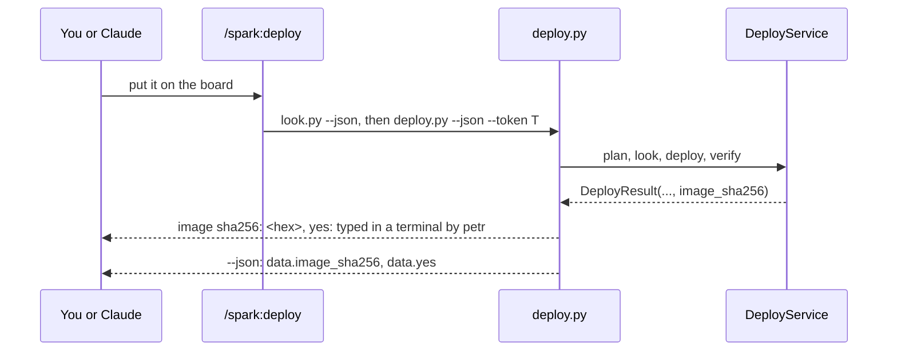

# P213 (#192) part b1: `/spark:deploy`, and a deploy that names its image and its yes

## Council

One round, 2026-10-19: the tech lead with the architecture lens, the PO's assistant with the UX and AI-UX lenses,
and naming, in one Sonnet agent. What it changed:

- A command page is found by itself (no manifest edit), but `check_docs.unlisted` (tests/test_docs.py:39) needs
  `/spark:deploy` named in the README and `docs/guide/commands.md`. The plugin description in
  `.claude-plugin/plugin.json` names it too.
- build.md's two lines keep the order in one sentence (look, token, the person's yes, relay a refusal word for word)
  and the warning that the board restarts, because Claude inside `/spark:build` does not load the deploy page.
- Before the move, find the tests and mutation tables that read build.md's deploy text
  (`tests/test_json_contracts.py:74`, `test_routes`, `test_docs`, `tests/mutations/*.json`), and move their anchors.
- `image.sha256` is read once in `verify` and passed to both `BoardLog` and `DeployResult`.
- The line sits after the facts line and before the ready verdict, so a person reads "ready" last. `yes:` is its own
  part, because a grant's `who` is long ("standing yes typed by X at T, until T2").
- Tests compare with the sha256 of the fake image's bytes, computed in the test. They cover both consent strategies,
  the refused and dry-run cases (no line, `image_sha256` null) and the unknown-ready case. A test reads
  `commands/deploy.md`: a description, look.py and deploy.py allowed, grant.py not. A mutation table goes with them.
- b1 claims nothing about a board: `/spark:deploy` is not "ran on a board" until b2.

## Context

P213's PR a merged in #378: `look.py --json` and `deploy.py --json` print the envelope. Left on the card is PR b. Part
of it needs the PO at the bench (the redeploy walk, and card C: the place of the BOOT and RESET buttons, whose source
is the PO's photo, AT158). The PO, 2026-10-19: "I'm not at the Bench now, wait with that and go on meanwhile with the
other items." So this PR, b1, takes the parts that need no bench, and b2 stays with the bench reminder, beside P100.

Today the deploy steps are one section of `commands/build.md` ("Put it on the board", lines 287 to 366). After a
deploy, deploy.py prints the facts file's sha256 and the store record's path, but not the image's sha256 and not whose
yes it was (card A, folded into P213 on 2026-10-17). The JSON has `yes` but no image sha256.

Done when (b1):

- `/spark:deploy` is a command of its own, `commands/deploy.md`, with the steps that are now in build.md's section.
  build.md's section becomes two lines that point to it. The other pages that link the section point to the command.
- After a deploy, the text says one line `image sha256: <hex>, yes: <who>`, and `--json` has `data.image_sha256`
  beside `data.yes`.

## The change

1. `scripts/deploy_service.py`: `DeployResult` gets the field `image_sha256` (default None), filled in `verify` from
   `image.sha256`, the value the board log already writes (line 176). No new hashing.
2. `scripts/deploy.py`, `_deploy`: after the facts line, one line `  image sha256: %s, yes: %s` with
   `result.image_sha256` and `consent.who`. The words come from one constant `DEPLOYED_LINE`.
3. `scripts/board_envelope.py`, `deploy_envelope`: `"image_sha256": result.image_sha256 if result else None`.
4. `commands/deploy.md`: frontmatter `description` and `allowed-tools` for `look.py` and `deploy.py` (the two that
   build.md allows today; `grant.py` stays out, because the person runs it in their own terminal). The body is
   build.md's section, moved, with the new line named. The untrusted-text sentence that every command page starts
   with is kept.
5. `commands/build.md`: the section keeps its heading, and says in two lines that `/spark:deploy` does it. Its
   `allowed-tools` keeps `look.py` and `deploy.py`, so an old flow still runs.
6. Links: `docs/guide/journey.md:1126` and `skills/spark-design/SKILL.md:104` point to `commands/deploy.md`.
   `docs/guide/agents.md` names `data.image_sha256`. The README's Bench row names `/spark:deploy`.
7. Card #192: b1 and b2 written down. b2 holds the walk and card C.

## Files

- `scripts/deploy_service.py`, `scripts/deploy.py`, `scripts/board_envelope.py`.
- New `commands/deploy.md`, and `commands/build.md`.
- Tests, in the deploy tests that use fakes (`tests/test_deploy*.py`): a deploy with a typed yes prints
  `image sha256: <the fake image's sha256>, yes: typed in a terminal by <user>`, and `--json` has the same sha256 in
  `data.image_sha256`. A test that `commands/deploy.md` allows `look.py` and `deploy.py`, if the command tests
  have such a check (`tests/test_inventory.py` reads the pages that name a script).
- Docs as in step 6. Rows: `docs/observations/rows/p213-deploy-command.md`.

## Verification

1. The deploy and inventory tests, then the push hook.
2. `deploy.py --dry-run --json` on the XIAO fixture runs with no board and shows `image_sha256: null` (no deploy).
3. Review: logic under 50 lines, so one reviewer (Sonnet) and the refuter (Opus), and the mutation-tester.
