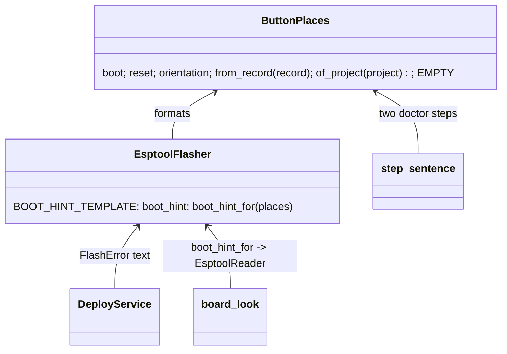

# P213 b2: every hint that names BOOT or RESET says where the button is (card C), and the bench walk's PR

## Council

Round 1 ran (Sonnet lenses: design, names, UX and AI-UX; Opus refuter). It changed: one value class for the places
instead of a dict read in two modules; the record read once with the DeployError kept; the doctor's two button
steps and grant.py's reader in scope; a broken fixture test found; a shorter hint; the source as a committed note
with the comment's permalink; a shape check. Rejected with evidence: the chip-before-tool order (already tested),
the mutation tables (history, not checked). Round 2 ran (Opus, tech lead and PO's assistant). It changed: the doctor's steps go through one `step_sentence` that its two readers call (the service never read them); the shape check in `validate` and the PortFinder plumbing are cut (only esptool's read and the doctor name buttons); one hint builder, not two; `orientation` and `BOOT_HINT_TEMPLATE` for clearer names; the period kept out of the template so today's sentence stays byte for byte; four more tests listed.

## Context

P213 (#192) PR b2 is the card's last PR. The bench walk passed on 2026-10-19 (two deploys with a standing yes, the
scenario passed, the PO saw the faster blink). Card C is open: a hint that tells a person to press BOOT or RESET
does not say where the button is. The PO's photo gives the places on the XIAO ESP32-C6. This PR puts them in the
board record, makes every such hint read them, records the walk, and closes #192.

## The change

1. Source. `docs/observations/2026-10-19-p213b2-xiao-buttons.md`, a short note: what the photo shows, its sha256
   (87b43e78...f5a8), why the photo is not committed, and the permalink
   https://github.com/xmejkal/spark/issues/192#issuecomment-6262027325. The PO's photo is of the board in hand, so
   the fact is not marked UNVERIFIED.

2. Record. `boards/xiao-esp32-c6.json`, under `physical`, with `//buttons` citing the note:

   ```json
   "buttons": {
     "seen_from": "the metal shield facing you, USB-C at the top",
     "boot":  {"silkscreen": "B", "place": "top right, beside the USB-C"},
     "reset": {"silkscreen": "R", "place": "top left, beside the USB-C"}
   }
   ```

   The same field goes into `tests/data/breadboard/button-light-xiao/boards/xiao-esp32-c6-fresh.json`
   (test_xiao_record.py:89 compares the two). The FireBeetle record gets nothing: no source was read.

3. `scripts/boards.py`: a small Value class `ButtonPlaces` with one job, naming a button for a sentence.
   - `ButtonPlaces.from_record(record)`: reads `physical.buttons`. Not a dict at every level, or a part missing,
     gives the empty value. No half hint.
   - `ButtonPlaces.of_project(project)`: the record requirements.json names, or the empty value when it cannot be
     read. The stop for a bad record stays where it is today.
   - `boot`, `reset`: `"BOOT button (B, top right, beside the USB-C)"` and `"RESET (R, top left, beside the USB-C)"`,
     or `"BOOT button"` and `"RESET"` when empty. `orientation`: `". Left and right as seen with the metal shield
     facing you, USB-C at the top"`, or `""` when empty.

4. `scripts/flasher.py`. `Flasher.boot_hint = ""`. `EsptoolFlasher.BOOT_HINT` goes; `BOOT_HINT_TEMPLATE` is
   `"if esptool could not connect, hold the board's %(boot)s, press and release %(reset)s, release BOOT, and run it
   again%(orientation)s"`. The one builder is `EsptoolFlasher.boot_hint_for(places)`.
   `EsptoolFlasher(tool, chip, places=ButtonPlaces.EMPTY)` sets `self.boot_hint`. With the empty value the sentence
   is today's, byte for byte, so the FireBeetle text does not change.

5. `scripts/firmware_platform.py`: `record_of(project)` reads the record once inside `chip_of`'s try (DeployError
   as today). `chip_of` returns its `chip`. `_esptool_flasher` passes `ButtonPlaces.from_record(record)`.
   New test: an unknown board gives a DeployError before a missing tool.

6. `scripts/deploy_service.py:126`: `planned.flasher.boot_hint`.

7. `scripts/board_look.py`: the module constant `BOOT_HINT` goes. `EsptoolReader(tool, run, boot_hint=...)` takes
   the hint (default: the empty-value sentence). `looker` and `grant.py:91` pass
   `EsptoolFlasher.boot_hint_for(ButtonPlaces.of_project(project))`. `PortFinder`'s timeout line (:81) names no
   button place and keeps the plain sentence.

8. `scripts/board_doctor.py`: `MESSAGE_FOR`'s two button steps (:39, :43) become templates with `%(boot)s` and
   `%(reset)s`. One function, `step_sentence(code, places=ButtonPlaces.EMPTY)`, formats any step. Its two readers,
   `describe` (:185, :187) and `board_envelope.look_stop_envelope` (:73), call it with the project's places where
   they have the project, else the empty value. The step codes do not change, so `--json` readers keep working.

9. Tests: the new cases above; the XIAO record gives the placed hint; a record without `buttons` and a partial one
   give today's sentence; a look's LookStop and a deploy's FlashError for a XIAO project name the places, in text
   and in `--json`; the doctor's two steps name them. Reads renamed to `boot_hint` (test_flasher.py:54-107,
   test_deploy.py:206, test_deploy_gate.py:240, test_deploy_service.py:77). Exact step text: test_deploy_json.py:108 (its default board is the XIAO), test_board_doctor.py:144, test_deploy_gate.py:429,448,459.

10. Docs, same PR: `boards/README.md` (the field), `commands/deploy.md:67`, `docs/guide/agents.md` if it quotes the
    hint, `docs/guide/developing.md:248-250` (`boot_hint`, `ButtonPlaces`), the README Bench row (one sentence on
    the 10-19 walk and the button places). The Bench status stays "partly", so `tools/journey.py` does not change.

11. Rows: `docs/observations/rows/p213-b2-bench-and-buttons.md`: the two walk rows from #192 (a new image needs a
    new look; AT313 not exercised), the council's rows, then the review's.

## Names

`ButtonPlaces` (the role: where the buttons are), `from_record`, `of_project`, `EMPTY`; `boot`, `reset`,
`orientation` (each the words for a sentence); `boot_hint` (the sentence), `BOOT_HINT_TEMPLATE`, `boot_hint_for`
(its one builder); `step_sentence` (a doctor step's sentence). In the record: `buttons`, `silkscreen`, `place`, `seen_from`.

## Diagram



## Verification

- The push hook runs the suite; quote its line.
- By hand: print `FirmwarePlatform.micropython(<blink-c6>).make_flasher().boot_hint` and the doctor's two steps
  for blink-c6, and see the places.
- Review: lenses on Sonnet, the refuter on Opus, the mutation tester. The PR closes #192. After merge: Done, Miro,
  branch removed, memory.
