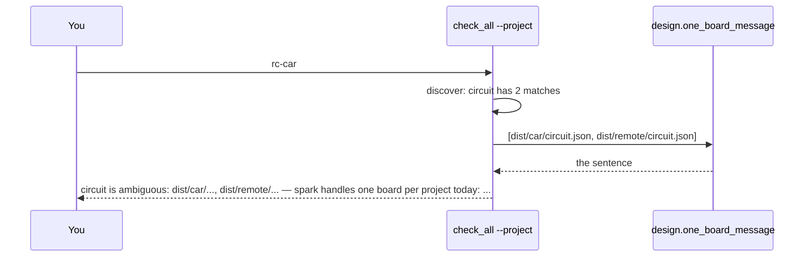

# P223 (#205): two circuits in one project say "one board per project today"

## Council

One round, 2026-10-19: a tech lead with the architecture lens, the PO's assistant and naming, in one Sonnet agent.
What it changed:

- `Check.run` picks the sentence by the need's key, from a map `{"circuit": design.one_board_message}`. No English
  text is compared, and `package` and `rules` keep "name one with --<need>".
- The example path is absolute. `--circuit` is read from the current folder, so `dist/car/circuit.json` was wrong
  when `--project` names another folder. The list of matches stays relative.
- "check one with --circuit" became "use one with --circuit", because init seeds rails and does not check.
- The name is `one_board_message`, after `SAME_NAME_RULE`'s precedent for a message in `design.py`.
- A test feeds the path from the message back as `--circuit` and finds no ambiguity left.
- Rejected: comparing the tests with the function's own output. The guard `test_self_confirmation` asks for literals.

## Context

Spike P318 (#402, finding in PR #404) ended with the PO's "yes": one board per project folder now, many boards in
v0.13 (#94). Today `check_all.py --project ~/Development/rc-car` answers `circuit is ambiguous: dist/car/circuit.json,
dist/remote/circuit.json — name one with --circuit`. That is true, but it does not say why or how to get the whole
journey. `init_project.py` says "Name one with --circuit, or run this in each design's own project".

Done when (from the card): `check_all.py --project` on a folder with two or more `dist/*/circuit.json` says that spark
handles one board per project today. It names `--circuit dist/<name>/circuit.json` for one check, and one folder per
board, with init in each, for the whole journey. `init_project.py` says the same.

## The change

One sentence, written once, in `scripts/design.py` beside `CIRCUIT_PATHS` (both tools already import it):

```python
def one_board_message(circuits):
    """The sentence that two built designs in one project get from every tool (P223, P318): spark handles one
    board per project today. `circuits` are absolute paths, the first one the example."""
    return ("spark handles one board per project today: use one with --circuit %s, or give each board its own "
            "folder and run init_project.py in it" % circuits[0])
```



- `check_all.py`, `Check.run`: the reason for an ambiguous `circuit` keeps its list and ends with the sentence instead
  of "name one with --circuit". Other inputs (`package`, `rules`) keep "name one with --<need>".
- `check_all.py`, `discover`: the note for an ambiguous circuit ends with the sentence instead of "name one
  explicitly".
- `init_project.py`: "Name one with --circuit, or run this in each design's own project." becomes the sentence.
- No change to the status or the exit code: it stays could-not-run, because the input is there twice.

## Files

- `scripts/design.py`, `scripts/check_all.py`, `scripts/init_project.py`.
- `tests/test_check_all.py`: two circuits in `dist/car/` and `dist/remote/` give a could-not-run whose reason holds
  the literal words "one board per project today" and the absolute path of `dist/car/circuit.json`. The path from the
  message, given back as `--circuit`, leaves nothing ambiguous. Two fab packages still say "name one with --package".
- `tests/test_init_project.py` (or where its ambiguous case is tested): the same words.
- Docs: `docs/guide/agents.md` row `results[].reason` names the one-board sentence; `skills/spark-review/SKILL.md:27`
  one clause; `docs/guide/developing.md` one paragraph "One board per project" with a link to the P318 finding; the
  README's "What works today" Checks row a short note. `tools/journey.py` changes only if a status changes (it does
  not).
- Rows: `docs/observations/rows/p223-one-board.md`.

## Verification

1. `python3 -m unittest tests.test_check_all tests.test_init_project tests.test_self_confirmation`, then the push hook.
2. `python3 scripts/check_all.py --project ~/Development/rc-car --json` (read only) shows the sentence in the three
   reasons.
3. Review: under 50 lines of logic, so one reviewer (Sonnet) and the refuter (Opus), and the mutation-tester.
