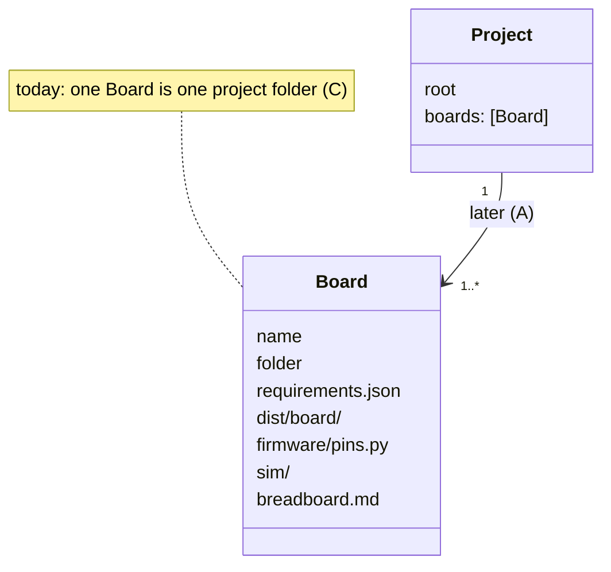

# P318: many boards in one project. Finding

> Keep one board per project until after the MVP. A board that needs its own firmware gets its own project folder
> today. Fix only the message that stops `check_all --project` on rc-car, so that it says this. The many-board
> project comes later as a list of such folders. The one-board code built now needs no rework for it, if each board
> folder stays the store's project.

Spike [P318 (#402)](https://github.com/xmejkal/spark/issues/402), 2026-10-19. It informs
[P223 (#205)](https://github.com/xmejkal/spark/issues/205). North star: [P203 (#163)](https://github.com/xmejkal/spark/issues/163).
Council: a code map (Explore, Sonnet), an architect (Sonnet), then a refuter (Opus). Its result is in the section
"Refuter" at the end.

## The PO's question

"The two circuits problem is a real one, question is whether we should address it now or leave it after the mvp. It
should be able to handle multiple boards [...] We want to do it if it's easy. If it's way too much change, we might
want to leave it for later."

## What spark assumes today

Every stage after the requirements file assumes one board in one project folder. The code map found these fixed paths,
grouped by stage. The rows with "yes" already take a path or a flag.

| Stage | Where | What it assumes | Takes a path? |
| --- | --- | --- | --- |
| Idea | `parts.py:2232`, `needs.py:396` | writes `<project>/requirements.json` | a project folder, so the file name is fixed |
| Build | `design.py:53` `CIRCUIT_PATHS` | `dist/board/` or one `dist/*/` | partly: the source of the ambiguity |
| Build | `check_spine.py:392,436` | the build always gives `dist/board/` | no |
| Build | `check_spine.py:709` `kept_into` | `--keep DIR` writes `board.tsx`, `dist/`, `sim/` into DIR | yes |
| Build | `check_spine.py:759` | a board-only build removes `DIR/dist` whole | no |
| Checks | `check_all.py:311` `discover` | one circuit, and two give "ambiguous" | `--circuit` |
| Checks | `check_all.py:470` | one `.spark/rules.json` for the project | `--rules` |
| Breadboard | `breadboard.py:66,69` | `dist/board/circuit.json`, `breadboard.md` | `--out` only |
| Firmware | `check_spine.py:88` | `firmware/pins.py` under the keep folder | no |
| Deploy | `deploy.py:133`, `firmware_platform.py:21`, `flash_image.py:79` | `project/requirements.json`, `project/sim/` | `--project` is a folder |
| Board | `boards.py:187` `active_id` | one active board, and its docstring says two boards "means two projects" | no, by an earlier decision |
| Store | `store.py:255` `add_project` | one entry, one folder | no |

rc-car today has `car.requirements.json` and `remote.requirements.json` in one folder, and its `dist/car/` and
`dist/remote/` came from `tsci build`, not from spark's `--keep`. Of spark's commands, only the checks with `--circuit` and
the builds with an explicit requirements path work on it. The breadboard sheet, the pin map, the simulation and deploy
do not.

## The options

| | Concept | Size | Risk | Cost later |
| --- | --- | --- | --- | --- |
| A | A board is a folder, and a thin `project.json` lists the folders | about 10 files, 300 to 500 lines, 5 stories | medium: every stage, and the stores keyed by project | low: a refactor into `Board` |
| B | One requirements file names many boards | about 15 files, a schema change | high: a schema change before a second project needs it, against "records grow by need" | the same as A, but harder to undo |
| C | One board per project folder, and rc-car becomes two folders | the message below, and in each folder an init and its own `parts/` | low | no rework of spark code, if A keeps each board folder as the store's project (`projects.json`, history events) |

## Recommendation: C now, A after the MVP

1. The MVP bar holds with one board per project. The refuter tried it on a copy of rc-car. `remote/` walked the build
   to the end. `car/` built, but its simulation stops because 3 parts have no `simulation` record, which is a gap
   in rc-car's part records, not in spark.
2. A is the kind of refactor that v0.13, one core ([#94](https://github.com/xmejkal/spark/issues/94)), does anyway. Done
   now, every stage changes twice.
3. v0.11 and v0.12 still add state per project (built-from, kept moves, board records). The `Project` with many
   boards is easier to design after that state settles.
4. No one-board code built now needs rework for A, because A's `Board` is today's project folder in one class. This
   holds if A keeps each board folder as the store's project.

What C costs: each folder needs `init_project.py` and its own copy of `parts/`, and the rules are answered again in
each folder. What C loses: no stage sees that the car and the remote talk to each other (one radio link, one protocol). That is
outside the MVP bar, and it is A's job later.

## What to do now

1. P223 (#205), reworded: when `check_all --project` finds two or more `dist/*/circuit.json`, it says that spark
   handles one board per project today. It names `--circuit dist/car/circuit.json` for one check, and one folder per
   board for the whole journey. The same message goes in `init_project.py`. About 10 lines and a test.
2. One paragraph in `docs/guide/developing.md` and the README's status: one board per project, so several boards
   means several project folders.
3. A defect the refuter found, now [P319 (#403)](https://github.com/xmejkal/spark/issues/403): a folder with no `.spark/` builds with its parent's project, because
   `design.project_for` walks up (`boards.py:138`), but `check_all --project .` does not walk up. So one build and its
   checks read two different projects. The P223 message says to run init in each board folder until that card is done.
4. One line on v0.13 (#94): "many boards: a board is a folder, and the project lists them (P318, option A)".

Not in spark: moving rc-car into two folders is a change in a demo project. The PO decides it after an epic, by the
rule "spark is the product".

## Refuter

The refuter (Opus) copied rc-car into a scratch folder, made `car/` and `remote/`, and ran init, `check_spine --keep .`
and `check_all --project .` in each, with an empty store. It deleted the copy after. What it changed in this finding:
the cost of C (init and `parts/` in each folder), the walk-up defect, the condition on "cost later: none" (the store
keys by folder name), the result per board, and four line numbers. The sizes of A and B are estimates that nobody
measured.
