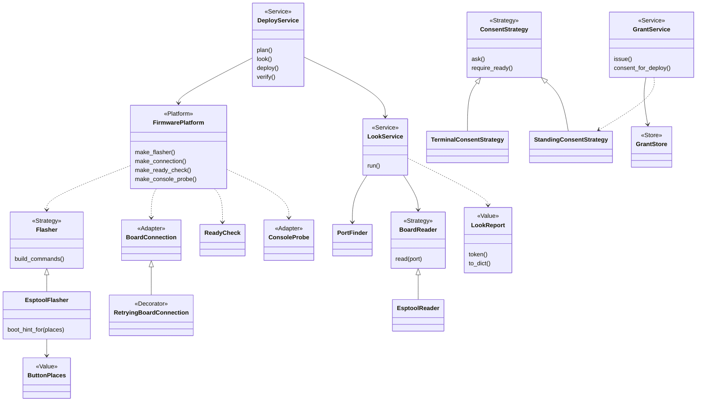
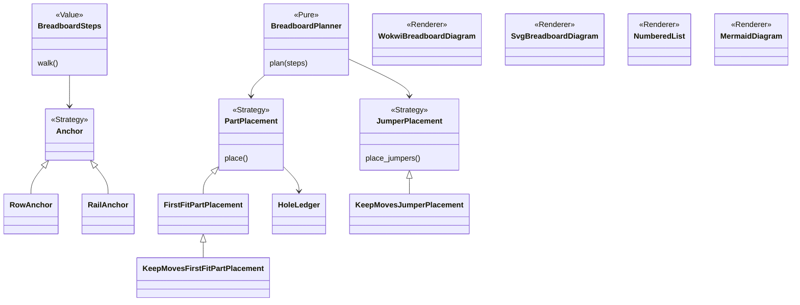
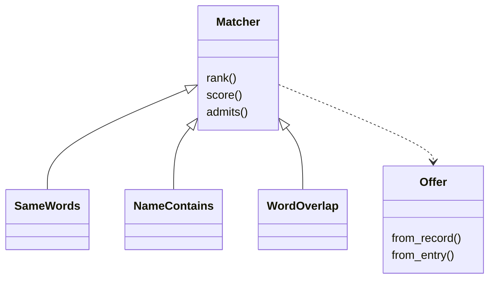
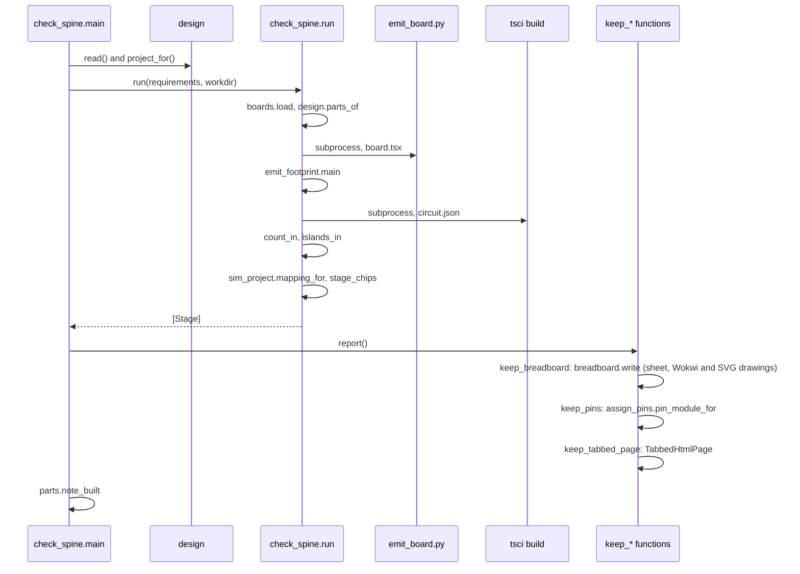
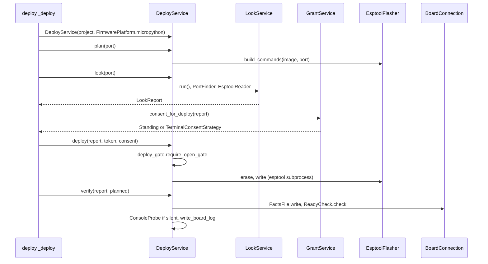

# P322: spark's code architecture on 2026-10-19

The score today:

```
SCORE classes 16% | fat CLIs 3 | thin CLIs 4 | private imports 3 | outcome literals 10 | roles stated 56/103
```

The input for the Miro diagrams. The numbers come from `measure.py` in this folder. Rerun it from the repository root.

## a. Layers and module map

- **Interfaces.** 8 commands (`commands/*.md`), 4 agents (`agents/*.md`), the skills, and 24 scripts with a `main()`.
- **Library cores.** 35 modules in `scripts/` with no `main()`, plus the logic inside the CLI scripts.
- **Records.** `boards/*.json`, `parts/*.json`, `chips/`, `data/` in the repository. The person's store (`store.py`) holds the drawer, the history and the grants.

| Stage | Interface (CLI) | Core |
|---|---|---|
| drawer | parts.py | drawer, store |
| idea | parts.py --requirements | needs, matching, cost |
| parts | parts.py, boards.py, tools.py | design, restricted_pins |
| build | check_spine.py, emit_board.py, breadboard.py, init_project.py | breadboard_steps, breadboard_drawing, breadboard_keep, tabbed_page, netlist, ai_files |
| checks | check_all.py and five check_*.py | copper, fab, compare_design |
| firmware | assign_pins.py (pins.py), import_firmware.py, flash_image.py | |
| simulate | run_scenario.py | sim_project, project_image |
| bench/deploy | look.py, deploy.py, grant.py | deploy_service, board_look, deploy_gate, board_grant, flasher, firmware_platform, ready_check, board_facts, board_doctor |
| live | live.py, reach.py | board_live, board_reach, board_connection, board_console |

Shared by all: `outcomes`, `store`, `tools`, `boards`, `parts`, `design`.

Main edges: commands call CLI scripts. idea calls parts, then needs and matching. build calls design, boards and parts, runs `emit_board.py` as a subprocess, then breadboard. checks reads emit_board and netlist. simulate reads sim_project. deploy reads project_image (simulate) and boards. live reuses board_doctor, board_grant and board_connection from deploy.

## b. Class diagrams

The deploy core:



The breadboard drawing:



The matching (no role words yet):



## c. Sequences

Build, `check_spine.py requirements.json --keep DIR`:



Deploy, `deploy.py`:



## d. The code style today, measured

59 modules, 14,313 code lines, 103 classes, 647 top-level functions. 16% of the code is in classes, 67% in top-level functions, 0% in `__main__` blocks; the rest (2,162 lines) is module-level code. Kinds: 35 library, 4 thin CLI, 17 CLI with library, 3 fat CLI. One threshold for fat: a `main()` over 80 lines holds logic. Thin is a `main()` of 40 lines or fewer with at most 3 other functions. The rest of the CLIs are "CLI with library". `measure.py` prints every figure here except those marked (counted by hand).

Good:

- `deploy.py` `main()` is 28 lines and only parses and prints (counted by hand, deploy.py:126). The flow is in `DeployService` (deploy_service.py:69).
- `FirmwarePlatform` (firmware_platform.py:41) makes the language swappable.
- Swappable placement strategies (breadboard_drawing.py:149, breadboard_keep.py:158) and renderers listed in `DRAWING_RENDERERS` (breadboard.py:94).
- `look.py`, `live.py`, `reach.py`, `import_firmware.py` are thin CLIs.

Gaps:

1. `parts.py` is 1,899 lines with 121 functions behind one CLI. `validate` alone is 240 lines (parts.py:621).
2. `check_spine.run` is one 192-line procedure (check_spine.py:347). It runs `emit_board.py` as a subprocess, not as a call.
3. Fat CLIs, a `main()` over 80 lines: emit_board 115 lines (emit_board.py:1054), init_project 112 (init_project.py:407), tools 83 (tools.py:568). Other long functions: `assign_pins.assign` 118, `check_physics.check_resistor_power` 98.
4. Private names across modules: 3 modules (drawer, init_project, needs) use 32 private names of other scripts. The most used are `parts._problem` (22) and `parts._parse` (5). `needs.py` uses `parts._problem` 14 times and `parts._parse` 4 times, and `drawer.py` uses `parts._problem` 8 times (counted by hand; needs.py:81).
5. Magic strings: 10 bare outcome words, compared or assigned as a status, where `outcomes.OK` exists: check_vendor_pins 8 (check_vendor_pins.py:207 is one) and check_all 2. Only 2 of 16 `--json` scripts (deploy, look) print an envelope.
6. Two validators of the same kind: `parts.validate` and `boards.validate` (boards.py:340, 161 lines).
7. 47 of 103 classes state no role (103 less 56), for example `Check` and its five checks in check_all.py:63 (counted by hand).

Progress score, printed as the last line of `measure.py`: share of code in classes, fat CLIs, thin CLIs, modules using a private name, outcome literals (a bare outcome word compared, assigned to status/verdict/outcome, or stored under a status key), classes with a stated role.

## e. Target shape and the five refactors

v0.13 (P158, #94) makes spark a package that the CLI, MCP and Claude call, so no code is written twice. Each job is a small class with one role from developing.md's table. A script's `main()` only parses arguments and prints, and every `--json` script prints `outcomes.envelope`. Strategies and adapters make a board, a tool or a firmware language swappable.

Smallest first:

1. Replace the 10 outcome literals with `outcomes` constants (2 modules).
2. Make `parts._problem` and `parts._parse` public, so private imports go to 0.
3. Give the 47 classes a role word in their docstrings.
4. Move the long mains of emit_board, init_project and tools into Services, so the fat CLIs go from 3 to 0.
5. Turn `check_spine.run` into a `BuildService` with one step per stage, and call emit_board in-process.
