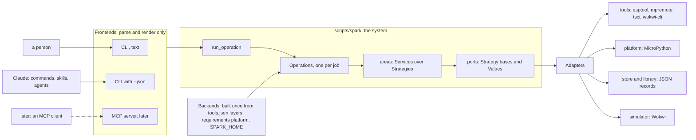
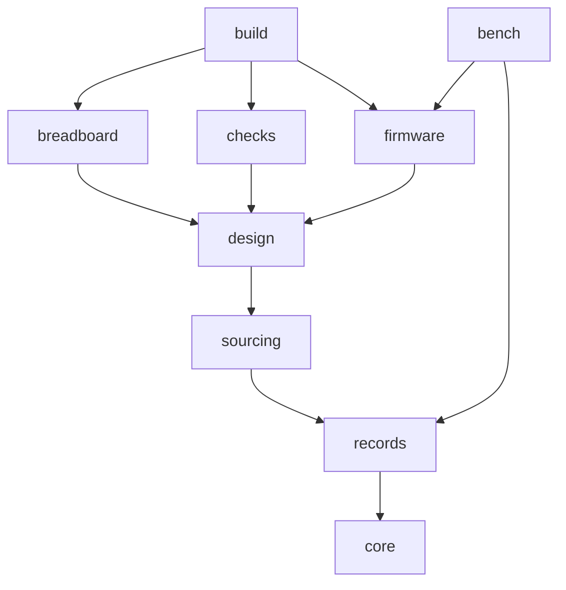
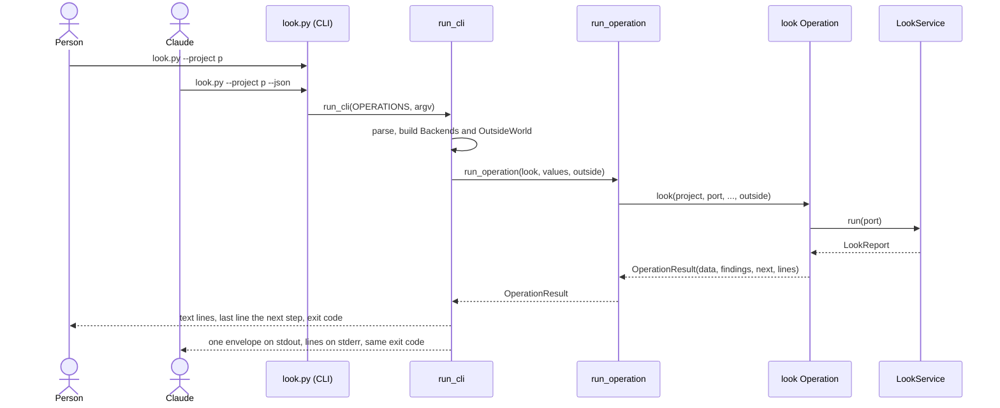

# spark's architecture, level 1: the whole system

Card [P323 #413](https://github.com/xmejkal/spark/issues/413), epic P158 [#94](https://github.com/xmejkal/spark/issues/94).
Round 4 synthesis, 2026-10-21. It replaces [design.md](../design.md), which keeps rounds 1 to 3 as a record.

> TL;DR. spark becomes one small system that every script only calls. A person and Claude get the same answer,
> as text or as JSON. Each outside tool sits behind one swappable part, chosen in one place. We first record today's
> outputs as tests that never change, then move the code area by area, the bench first for walk 2.

Summary. Each script in `scripts/` becomes a thin CLI that parses, calls one Operation in a package under
`scripts/spark/`, and prints. Every Operation returns one result shape, so the text, the `--json` envelope and a
later MCP server all show the same facts. One automatic test checks the code rules, and its list of known breaches
only shrinks.

## Your call

Four decisions, one at a time, in this order. Everything else the council decided ([notes](notes.md)).

1. Readability first. The five goals rank readable, testable, exchangeable, reusable, consistent. Example: when a
   short function and a reusable one conflict, the short one wins. Yes, or another order?
2. The shape. Scripts become thin CLIs over one package, one Operation per job, one rules test. Example:
   `look.py` shrinks from 72 lines to about 15, and its flags, output and exit codes stay. Yes or no?
3. Slice 0a before walk 2, or after it. Walk 2 is due 2026-10-27. (a) Slice 0a, about 300 lines of tests with no
   output change, merges by 2026-10-23, and its goldens catch a change in what walk 2 runs. (b) Walk 2 first, and 0a
   follows. The council proposes (a) only if it merges by 2026-10-23, otherwise (b).
4. When the area moves start. Until v0.13 only a story pulls its area (D13). Example: walk 2 finds a `deploy` gap,
   so that story moves the bench area. Confirm, or name a date.

## The system and its context

Frontends sit on the left, backends on the right. The core in the middle knows neither: it sees only ports, which
are Python base classes and Values. This shape is called ports and adapters.

A frontend never decides. A backend is never named outside its area's `operations.py`. Swapping either one touches
no Operation.

## The area map

Nine areas. An arrow points to an area that the area at its tail imports. Nothing imports upward, and every area imports `core`.

| Area | Its job in one line | Page |
|---|---|---|
| core | the contract: Operation, result, Finding, errors, the CLI runner | [core](areas/core.md) |
| records | reads and writes records, the store and tool rows, builds Backends | [records](areas/records.md) |
| sourcing | the drawer, matching needs to parts, cost, datasheets | [sourcing](areas/sourcing.md) |
| design | the pin map, the netlist and the board file from the requirements | [design](areas/design.md) |
| firmware | the flash image and the simulation | [firmware](areas/firmware.md) |
| breadboard | the breadboard sheet and drawing | [breadboard](areas/breadboard.md) |
| checks | grades a design | [checks](areas/checks.md) |
| bench | the board on USB: look, grant, deploy, live, reach | [bench](areas/bench.md) |
| build | runs the build chain stage by stage, sets up a project | [build](areas/build.md) |

Four upward edges exist today, and the move of the lower area removes each ([plan](refactor-plan.md)).

## The one interface contract

Every Operation returns an `OperationResult` (proposed). Every frontend renders that one value.

| Part | Shape |
|---|---|
| result | `data`, `findings`, `next`, `lines`. `status` comes from `status_of` (`outcomes.py:35`), never declared. |
| envelope | v1 keys stay: `envelope`, `tool`, `op`, `status`, `data`, `problems`, `unchecked`, `next`, `truncated` (`outcomes.py:68`). It only gains keys. |
| Finding | `severity`, `subject`, `code`, `sentence`, `fix`. Severity picks the list: `problems`, `unchecked` or `unmeasured`. |
| status words | `ok`, `problems`, `could-not-run`. A check or stage also has `skipped` (`outcomes.py:21-26`). Nothing else under `status`. |
| exit codes | 0 ok, 1 problems, 2 could-not-run, only from `EXIT_FOR`. A crash is `could-not-run`, code `crash`, exit 2. |
| codes | snake_case constants in the area's `codes.py`, or `core/codes.py` when two areas use one. Starters: `tool_missing`, `no_project`, `no_board`, `no_port`, `port_busy`, `image_stale`, `sim_failed`, `crash`. |
| next steps | `op`, `argv`, `why`, `effects`, `needs_yes` (consent), `needs_person` (a hand on the bench, proposed) |
| text | the person reads findings, then the status word, then the first next step as the last line |
| help | generated from the Operation, with three fixed lines: effects, exit codes, the `--json` pointer |

## The five goals, in the PO's order

Each rule has an id. The full table is in [notes](notes.md#rule-reference). `ArchitectureRules` (proposed) is one
test that reads the code with Python's `ast` module. A breach that exists today goes in a baseline that only shrinks.

| Goal | Its rules | How a test enforces it |
|---|---|---|
| 1. Readable | R1 short functions (40 lines in `spark/`), R2 nesting at most 3, R3 at most 5 parameters, R4 public code first, R5 short comments, R6 role word first in a docstring, R7 sentences as constants | `ArchitectureRules` counts R1 to R6. `test_no_magic_strings.py` and review cover R7. |
| 2. Testable | T1 only Adapters touch the outside, T2 no new `mock.patch`, T3 a contract test per Strategy, T4 no hidden test mode, T5 goldens per Operation | AST for T1 to T4. The golden test for T5. |
| 3. Exchangeable | X1 a backend is picked only from Backends in `operations.py`, X2 a frontend only parses and renders, X3 one registry form | AST, plus a parity test: text and `--json` carry the same codes. |
| 4. Reusable | U1 imports follow the area map, U2 import modules, never private names, U3 one home per shared flag, code and shape | AST, plus the contract test of allowed keys. |
| 5. Consistent | C1 the glossary's words, C2 one envelope from every Operation, C3 exit codes only from `EXIT_FOR`, C4 effects declared and gated | AST and the contract test. |

The glossary is [glossary.md](glossary.md): one word per thing, and the public names that keep their spelling.

## How a person or an agent finds code

1. Start at the CLI, such as `scripts/look.py`. Its docstring names its Operation and its Service.
2. Open the area's `operations.py`. Its docstring lists the area's Operations, and each `Operation(...)` sits right
   under its function, so one screen holds the flags and the code they reach.
3. Follow the Service. Its `__init__` lists every collaborator, so its whole outside world is one signature.
4. For one backend, open the Strategy base. Its contract test shows what every Adapter must do.

A generated page, `docs/guide/map.md` (proposed), lists each CLI with its Operations, each area's modules with their
first docstring line and test file, and each registry with its keys. A test fails when it is stale.

## One Operation, two frontends

A person and Claude run `look` the same way. Only the last render differs.

## Pages

- Level 2 and 3, one page per area: [core](areas/core.md), [records](areas/records.md),
  [sourcing](areas/sourcing.md), [design](areas/design.md), [firmware](areas/firmware.md),
  [breadboard](areas/breadboard.md), [checks](areas/checks.md), [bench](areas/bench.md), [build](areas/build.md).
- [refactor-plan.md](refactor-plan.md): the slices in order, slice 0 first.
- [notes.md](notes.md): decisions, conflicts between the papers, the rule reference, what was cut.
- [glossary.md](glossary.md): the words.
