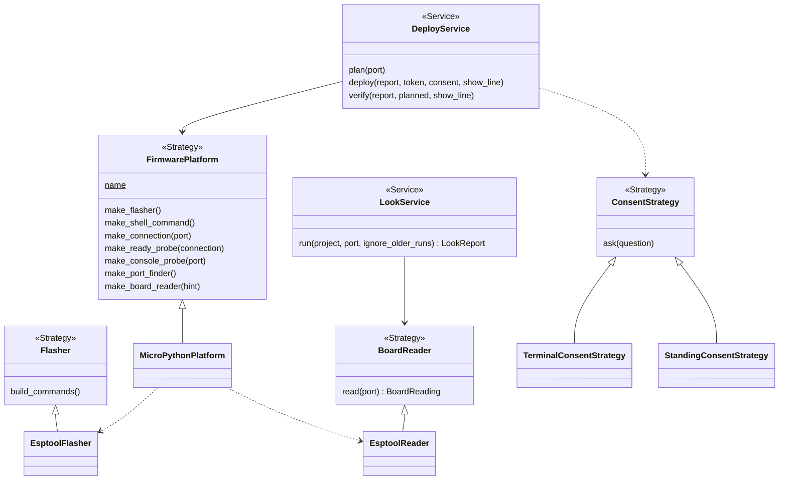
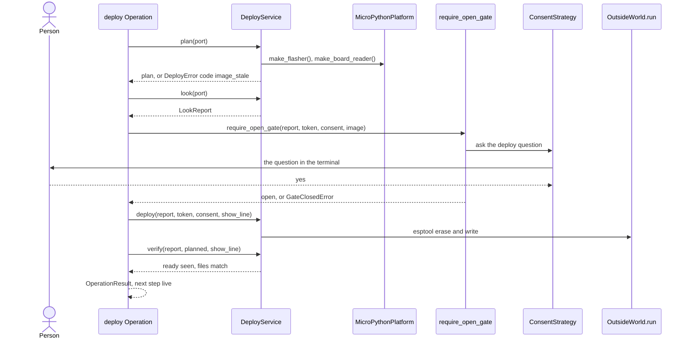

# Area: bench

Back to [level 1](../README.md). Words are in the [glossary](../glossary.md). The files that move here are in the
[refactor plan](../refactor-plan.md#into-bench). This area moves first, because walk 2 of P100 runs on the bench.

New names (proposed): `MicroPythonPlatform`, `PLATFORMS`, `DEFAULT_PLATFORM`, `make_port_finder`,
`make_board_reader`, `make_ready_probe`, `ReadyProbe`, `DoctorProbe`, `DoctorProbeResult`, `LookStopError`,
`bench/operations.py`, `FakeFirmwarePlatform`, `FakeBoardReader`, `FakePortFinder`, `FirmwarePlatformContract`,
`FlasherContract`.

## Level 2: what bench does

Bench works with the real board on USB: it reads the board, asks the person's yes, writes the image and runs code on
it. It never writes or erases without a gate that the person opened, and it says the next step for a hand on the bench.

### Its operations

| Operation | CLI | Effects |
|---|---|---|
| `look` | `look.py` | reads, runs, board (the board restarts while esptool reads it) |
| `deploy` | `deploy.py` with `--token`, `--dry-run` (`deploy.py:136-145`) | reads, runs, board, erases, writes the board log |
| `grant`, `grant-check` | `grant.py --minutes`, `--check` (`grant.py:72-73`) | reads, runs, board, writes a grant |
| `live` | `live.py --code` (`live.py:76`) | reads, runs, board |
| `reach` | `reach.py`, `--cure-first` (`reach.py:75`) | reads, runs, board |

### Its components

`bench/operations.py` holds the five Operations and the area's index. The Services stay in `board_look`,
`board_doctor`, `board_grant`, `deploy_gate` and `deploy_service`, the platform in `firmware_platform`, and the
Adapters in `flasher`, `board_connection`, `board_console` and `ready_probe`. The modules keep today's `board_` and
`deploy_` prefixes, so no name repeats a CLI's name (rule C1).

### Its ports and adapters

| Port | Real adapter | Fake |
|---|---|---|
| `FirmwarePlatform`: makes every board tool below | `MicroPythonPlatform` | `FakeFirmwarePlatform` built from the Fakes below |
| `Flasher`: `build_commands` | `EsptoolFlasher` (`flasher.py:35`) | the contract test with a recording `run` |
| `BoardReader`: `read(port)` | `EsptoolReader` (`board_look.py:117`) | `FakeBoardReader` |
| port finder: `ports()`, `require_one_port` | `PortFinder` over `mpremote devs` (`board_look.py:67`) | `FakePortFinder`, from `test_board_doctor.py:28` |
| board connection | `BoardConnection`, `RetryingBoardConnection` (`board_connection.py:50`, `:106`) | `FakeBoardConnection` (`tests/fakes.py:8`) |
| console probe | `ConsoleProbe` (`board_console.py:86`) | `FakeConsoleProbe` (`tests/fakes.py:102`) |
| `ConsentStrategy`: `ask` | `TerminalConsentStrategy`, `StandingConsentStrategy` | `FakeConsent` (`tests/fakes.py:41`) |
| clock: `now`, `monotonic`, `sleep` | `SystemClock` (`board_console.py:80`) | one `FakeClock`, merged from `tests/fakes.py:59` and `:88` |

`bench/operations.py` picks the platform from `PLATFORMS` by `backends.platform.name`, or `DEFAULT_PLATFORM`
(`micropython`) when the requirements name none. It is the only place that names an Adapter (rule X1). Bench
imports firmware (`ProjectImage`), design (`restricted_pins`, at `board_live.py:24` and `live.py:19`), records and
core. Each is reachable along the area map's arrows (rule U1).

## Level 3: how bench is built

Today `FirmwarePlatform` (`firmware_platform.py:41`) is one class that a classmethod fills with three lambdas and
two classes (`firmware_platform.py:55-60`). In the target it is a base class, and `MicroPythonPlatform` (proposed) fills it. The
Platform role word folds into Strategy. `make_port_finder` and `make_board_reader` are proposed: today 8 lookups
of `board-shell` or `flasher` sit outside the platform (`live.py:84`, `reach.py:79`, `grant.py:88`, `grant.py:95`,
`board_look.py:296-297`, `board_doctor.py:160`, `:162`). `make_ready_check` becomes `make_ready_probe`. Pin map
text and image building stay out of the platform until a second one exists.

### The main flow: deploy

### How bench is tested alone

- `FakeFirmwarePlatform`, `FakeConsent` and one `FakeClock`. No USB, no esptool, no patch.
- A seam test: `FakeFirmwarePlatform` drives `look`, `grant`, `live`, `reach` and `deploy` with no caller edit.
- A `FirmwarePlatformContract` test loops over every board record, and `FlasherContract` covers each flasher.
- Safety tests: an erasing Operation with no gate fails, a corrupt or zoneless grant fails closed, and no secret or
  home path reaches the output.
- The goldens of slice 0a run each bench CLI as a process with fake `esptool` and `mpremote` processes first on
  `PATH`. A golden changes only in a bench envelope-additions slice, never in a move.

### How a new implementation is added

- A new platform, such as Arduino, is one `FirmwarePlatform` subclass with its Adapters and one entry in `PLATFORMS`.
  The project picks it with `"platform": "arduino"` in `requirements.json`. No bench caller changes. The limit:
  the image builder (firmware) and the `pins.py` text (design) stay MicroPython's, so that swap also adds an
  image builder in firmware and a pin map Renderer in design.
- A new flasher is one `Flasher` subclass that the platform makes.
- A new way to say yes, such as an MCP prompt, is one `ConsentStrategy` subclass. It fails closed.

