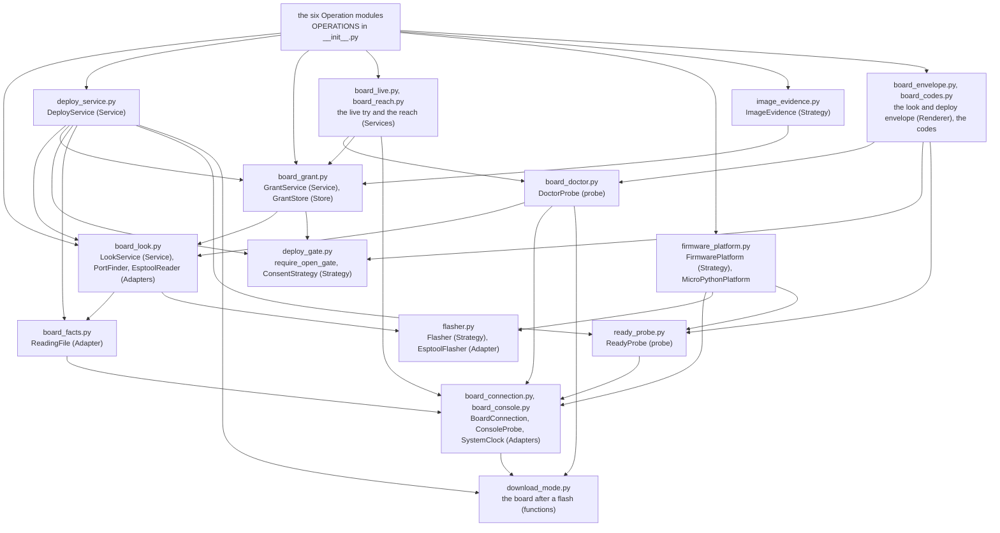
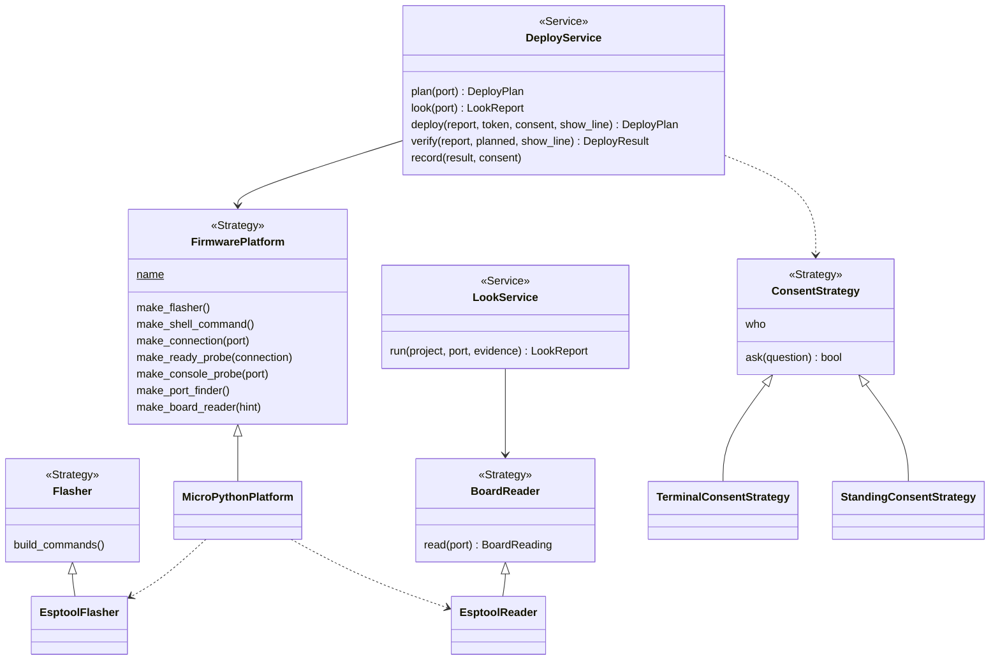
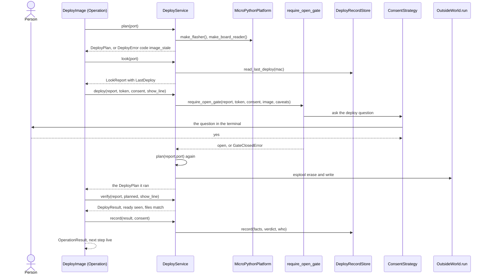

# Area: bench

Back to [level 1](../README.md). Words are in the [glossary](../glossary.md). The files that move here are in the
[refactor plan](../refactor-plan.md#appendix-what-moves-where-by-name). Its net landed first (S1, P380).

New names (proposed): `MicroPythonPlatform`, `PLATFORMS`, `DEFAULT_PLATFORM`, `make_port_finder`,
`make_board_reader`, `make_ready_probe`, `ReadyProbe`, `DoctorProbe`, `DoctorProbeResult`, `LookStopError`,
`ReadingFile`, `DeferringConsentStrategy`, the six Operation classes, `FakeFirmwarePlatform`, `FakeBoardReader`, `FakePortFinder`, `FirmwarePlatformContract`,
`FlasherContract`. Three names are renamed in S11: `ready_probe` is `ready_check.py` today, `ReadyProbe` is
`ReadyCheck`, and `make_ready_probe` is `make_ready_check`.

## Level 2: what bench does

Bench works with the real board on USB: it reads the board, asks the person's yes, writes the image and runs code on
it. It never writes or erases without a gate that the person opened, and it says the next step for a hand on the bench.

### Its operations

| Operation | CLI | Effects |
|---|---|---|
| `look` | `look.py` | reads, runs, board (the board restarts while esptool reads it) |
| `deploy` | `deploy.py` with `--token`, `--dry-run` (`deploy.main`) | reads, runs, board, deletes, writes the board log |
| `grant`, `grant-check` | `grant.py --minutes`, `--check` (`grant.py:72-73`) | reads, runs, board, writes a grant |
| `live` | `live.py --code` (`live.py:76`) | reads, runs, board |
| `reach` | `reach.py`, `--cure-first` (`reach.py:75`) | reads, runs, board |

### Its components

One module per Operation, named after it: `look_at_board.py` (`LookAtBoard`, op `look`), `deploy_image.py`,
`issue_grant.py`, `check_grant.py`, `run_live_code.py`, `reach_board.py`. `bench/__init__.py` holds `OPERATIONS` and the
area's index. The modules keep today's `board_` and `deploy_` prefixes, so no name repeats a CLI's name (rule C1). An
arrow in the diagram is an import at `d064a65`, read with `ast`.

### Its seams and adapters

| Seam | Real adapter | Fake |
|---|---|---|
| `FirmwarePlatform`: makes every board tool below | `MicroPythonPlatform` | `FakeFirmwarePlatform` built from the Fakes below |
| `Flasher`: `build_commands` | `EsptoolFlasher` (`flasher.py:35`) | the contract test with a recording `run` |
| `BoardReader`: `read(port)` | `EsptoolReader` (`board_look.py:117`) | `FakeBoardReader` |
| port finder: `ports()`, `require_one_port` | `PortFinder` over `mpremote devs` (`board_look.py:67`) | `FakePortFinder`, from `test_board_doctor.py:28` |
| board connection | `BoardConnection`, `RetryingBoardConnection` (`board_connection.py:50`, `:106`) | `FakeBoardConnection` (`tests/fakes.py:8`) |
| console probe | `ConsoleProbe` (`board_console.py`) | `FakeConsoleProbe` (`tests/fakes.py:102`) |
| `ConsentStrategy`: `ask`, `who` | `TerminalConsentStrategy`, `StandingConsentStrategy`, `DeferringConsentStrategy` (proposed, for a graph: its `require_ready` raises `GateClosedError` with the next step, so `ask` is never reached) | `FakeConsent` (`tests/fakes.py:41`) |
| clock: `now`, `monotonic`, `sleep` | `SystemClock` (`board_console.py`), the one clock. `board_grant.read_local_time` becomes `clock.now()` | one `FakeClock`, merged from `tests/fakes.py:59` and `:88` |

The Operation modules pick the platform from `PLATFORMS` by `backends.platform.name`, or `DEFAULT_PLATFORM`
(`micropython`) when the requirements name none. They are the only place that names an Adapter (rule X1). Bench
imports firmware (`ProjectImage`, and `scenario_steps` for `image_evidence`: the edge `image_evidence ->
scenario_steps`), design (`restricted_pins`, at `board_live.py:24` and `live.py:19`), records and core. Each is
reachable along the area map's arrows (rule U1). The look's line of a `LastDeploy` (`board_look.say_last_deploy`) and the deploy question's words
(`deploy_gate.say_last_deploy_in_question`) sit on the bench side, and the `DeployRecordStore` that reads and records it
sits in records.

## Level 3: how bench is built

Today `FirmwarePlatform` (`firmware_platform.py:41`) is one class that a classmethod fills with three lambdas and
two classes (`firmware_platform.py:55-60`). In the target it is a base class, and `MicroPythonPlatform` (proposed) fills it. The
Platform role word folds into Strategy. `make_port_finder` and `make_board_reader` are proposed: today 8 lookups
of `board-shell` or `flasher` sit outside the platform (`live.py:84`, `reach.py:79`, `grant.py:88`, `grant.py:95`,
two in `looker`, two in `board_doctor`). `make_ready_check` becomes `make_ready_probe`. Pin map
text and image building stay out of the platform until a second one exists.

### The main flow: deploy

The gate stays inside `DeployService.deploy`, as today: that method is the only path to the erase (D8), so a node
that composes the service cannot skip it. `record` needs `verify`'s result, so it comes last. A graph pauses between
Operations: with `DeferringConsentStrategy`, `require_ready` raises before the question, so nothing records "answered
no", and the step `needs_yes` names the command for the person's own terminal.

### How bench is tested alone

- `FakeFirmwarePlatform`, `FakeConsent` and one `FakeClock`. No USB, no esptool, no patch.
- A seam test: `FakeFirmwarePlatform` drives `look`, `grant`, `live`, `reach` and `deploy` with no caller edit.
- A `FirmwarePlatformContract` test loops over every board record, and `FlasherContract` covers each flasher.
- Safety tests: a deploy with no open gate raises `GateClosedError` before any erase, a corrupt or zoneless grant
  fails closed, and no secret or home path reaches the output.
- The goldens of S1 run each bench CLI as a process with fake `esptool`, `mpremote` and `serial` modules first on
  the child's `PYTHONPATH`, because both tools are `kind: python` rows. A golden changes only in an output slice,
  never in a move.

### How a new implementation is added

- A new platform, such as Arduino, is one `FirmwarePlatform` subclass with its Adapters and one entry in `PLATFORMS`.
  The project picks it with `"platform": "arduino"` in `requirements.json`. No bench caller changes. The limit:
  the image builder (firmware) and the `pins.py` text (design) stay MicroPython's, so that swap also adds an
  image builder in firmware and a pin map Renderer in design.
- A new flasher is one `Flasher` subclass that the platform makes.
- A new way to say yes is one `ConsentStrategy` subclass. It fails closed. A graph or an MCP client gets
  `DeferringConsentStrategy`, which never asks: its `require_ready` raises with the next step, as the terminal one does
  with no tty, and the person gives the yes in their own terminal.

