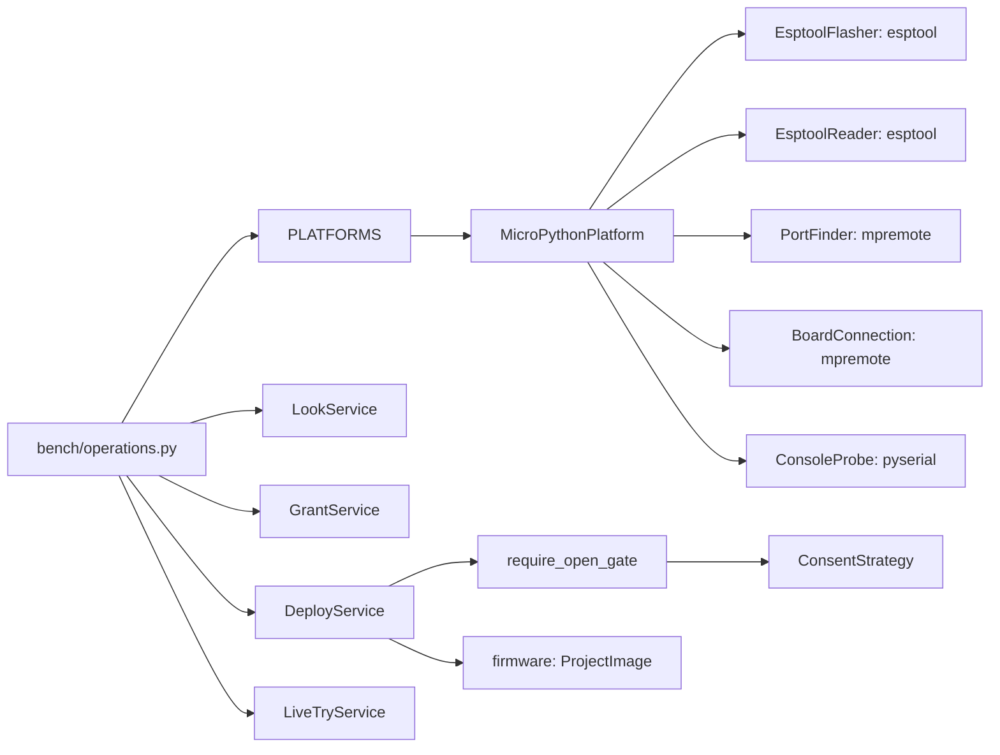
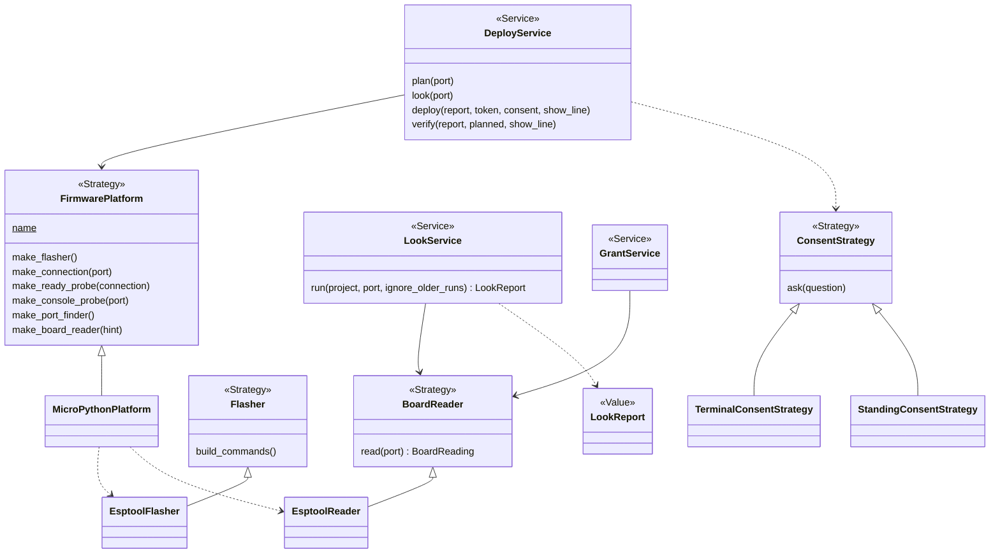
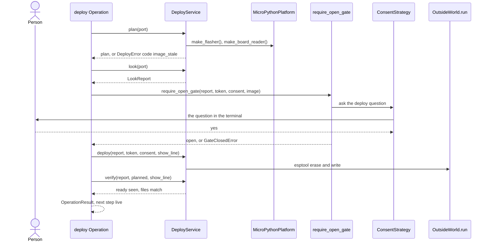

# Area: bench

Back to [level 1](../README.md). Words are in the [glossary](../glossary.md). Names marked "proposed" do not exist
in the code yet. This area moves first, because walk 2 of P100 runs on the bench.

## Level 2: what bench does

Bench works with the real board on USB: it reads the board, asks the person's yes, writes the image and runs code on
it. It never writes or erases without a gate that the person opened, and it says the next step for a hand on the bench.

### Its operations

| Operation | CLI | Effects |
|---|---|---|
| `look` | `look.py` | reads, board (the board restarts while esptool reads it) |
| `deploy` | `deploy.py` with `--token`, `--dry-run` (`deploy.py:136-145`) | reads, board, erases, writes the board log |
| `grant`, `grant-check` | `grant.py --minutes`, `--check` (`grant.py:72-73`) | reads, board, writes a grant |
| `live` | `live.py --code` (`live.py:76`) | reads, board |
| `reach` | `reach.py`, `--cure-first` (`reach.py:75`) | reads, board |

### Its components

| Module | Holds |
|---|---|
| `bench/board_look.py` | `PortFinder`, `BoardReader`, `EsptoolReader`, `LookReport`, `LookService` |
| `bench/board_doctor.py` | `DoctorStep` and its two steps, `BoardDoctorService` |
| `bench/board_grant.py` | `Grant`, `GrantStore`, `StandingConsentStrategy`, `GrantService` |
| `bench/deploy_gate.py` | `ConsentStrategy`, `TerminalConsentStrategy`, `require_open_gate` |
| `bench/deploy_service.py` | `DeployService`, `BoardLog` |
| `bench/firmware_platform.py` | `FirmwarePlatform`, `MicroPythonPlatform`, `PLATFORMS` |
| `bench/board_live.py`, `board_reach.py`, `flasher.py`, `board_connection.py`, `board_console.py`, `ready_probe.py` | the live and reach tries, and the Adapters |
| `bench/operations.py` | the five Operations, their codes and next steps, and the area's index docstring |

The modules keep today's `board_` and `deploy_` prefixes, so no name repeats a CLI's name (rule C1).

### Its ports and adapters

| Port | Real adapter | Fake |
|---|---|---|
| `FirmwarePlatform`: makes every board tool below | `MicroPythonPlatform` (proposed) | `FakePlatform` (proposed) built from the Fakes below |
| `Flasher`: `build_commands` | `EsptoolFlasher` (`flasher.py:35`) | the contract test with a recording `run` |
| `BoardReader`: `read(port)` | `EsptoolReader` (`board_look.py:117`) | `FakeBoardReader` (proposed) |
| port finder: `ports()`, `require_one_port` | `PortFinder` over `mpremote devs` (`board_look.py:67`) | `FakePortFinder`, from `test_board_doctor.py:28` |
| board connection | `BoardConnection`, `RetryingBoardConnection` (`board_connection.py:50`, `:106`) | `FakeBoardConnection` (`tests/fakes.py:8`) |
| console probe | `ConsoleProbe` (`board_console.py:86`) | `FakeConsoleProbe` (`tests/fakes.py:102`) |
| `ConsentStrategy`: `ask` | `TerminalConsentStrategy`, `StandingConsentStrategy` | `FakeConsent` (`tests/fakes.py:41`) |
| clock: `now`, `monotonic`, `sleep` | `SystemClock` (`board_console.py:80`) | one `FakeClock`, merged from `tests/fakes.py:59` and `:88` |

`PLATFORMS[backends.platform.name]` picks the platform in `bench/operations.py`, the only place that names an
Adapter (rule X1). Bench depends on firmware (`ProjectImage`), records and core.

## Level 3: how bench is built

Today `FirmwarePlatform` (`firmware_platform.py:41`) is one class that a classmethod fills with five lambdas
(`firmware_platform.py:53-60`). In the target it is a base class, and `MicroPythonPlatform` (proposed) fills it. The
Platform role word folds into Strategy. `make_port_finder` and `make_board_reader` are proposed: today 8 lookups
of `board-shell` or `flasher` sit outside the platform (`live.py:84`, `reach.py:79`, `grant.py:88`, `grant.py:95`,
`board_look.py:296-297`, `board_doctor.py:160`, `:162`). `make_ready_check` becomes `make_ready_probe`. Pin map
text and image building stay out of the platform until a second one exists.

### The main flow: deploy

### How bench is tested alone

- `FakePlatform`, `FakeConsent` and one `FakeClock`. No USB, no esptool, no patch.
- A seam test: `FakePlatform` drives `look`, `grant`, `live`, `reach` and `deploy` with no caller edit.
- A `FirmwarePlatformContract` test loops over every board record, and `FlasherContract` covers each flasher.
- Safety tests: an erasing Operation with no gate fails, a corrupt or zoneless grant fails closed, and no secret or
  home path reaches the output.
- The goldens of slice 0a run each bench CLI as a process with fake `esptool` and `mpremote` processes first on
  `PATH`. They stay unchanged through every later slice.

### How a new implementation is added

- A new platform, such as Arduino, is one `FirmwarePlatform` subclass with its Adapters and one entry in `PLATFORMS`.
  The project picks it with `"platform": "arduino"` in `requirements.json`. No caller changes.
- A new flasher is one `Flasher` subclass that the platform makes.
- A new way to say yes, such as an MCP prompt, is one `ConsentStrategy` subclass. It fails closed.

### What moves into bench

| Today | Becomes |
|---|---|
| `look.py`, `deploy.py`, `grant.py`, `live.py`, `reach.py` bodies | Operations in `bench/operations.py`. The CLIs shrink to about 15 lines each. |
| `deploy._deploy` (`deploy.py:165`), which prints and picks exit codes | the `deploy` Operation, returning an `OperationResult` |
| `FirmwarePlatform.micropython` (`firmware_platform.py:53`) | `MicroPythonPlatform` |
| the 8 tool lookups listed above | `make_port_finder`, `make_board_reader` |
| `GrantService` built in `grant.py:90`, `:99`, `live.py:89`, `deploy.py:192` | built once in `bench/operations.py` |
| `BoardCheckStrategy`, `CheckResult` (`board_doctor.py:74`, `:54`), `ReadyCheck` (`ready_check.py:43`), `FactsFile` (`board_facts.py:35`), `LookStop` (`board_look.py:53`) | `DoctorStep`, `DoctorStepResult`, `ReadyProbe`, `ReadingFile`, `LookStopError` |
| `STAGE_*` (`board_envelope.py:23`) | `DeployPhase`. The JSON key `stage` stays. |
| `DeployService.sleep` as a class attribute (`deploy_service.py:76`) | the clock, passed in `__init__` |
| `board_envelope.py`'s item dicts (`board_envelope.py:54-80`) | core's `Finding` and `NextStep`, with codes |
| `FakeFinder`, `FakeProbe`, `FakeGrants`, `FakeDoctor` (`test_board_doctor.py:28`, `:38`, `test_board_live.py:27`, `:140`) | `tests/fakes.py` |
