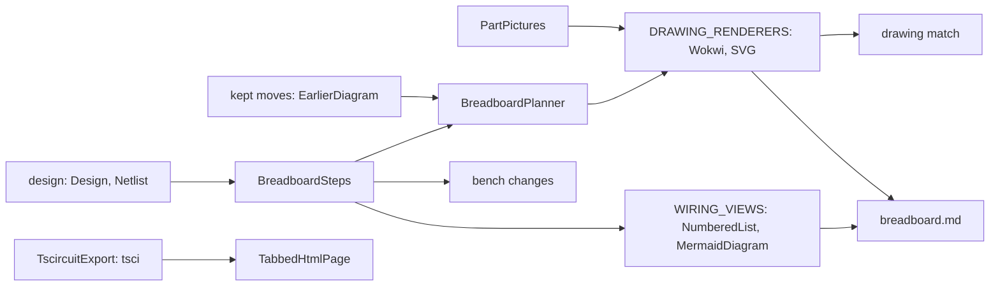
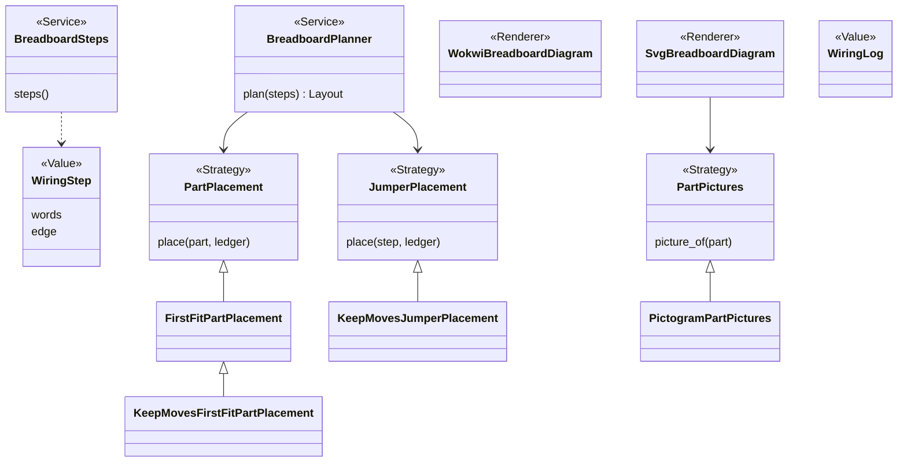
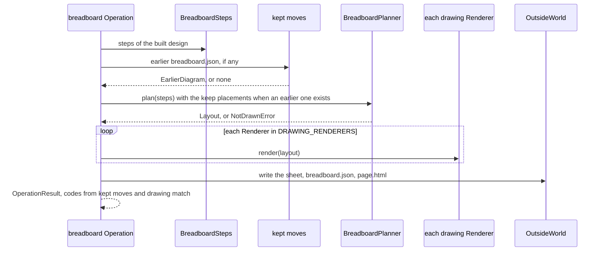

# Area: breadboard

Back to [level 1](../README.md). Words are in the [glossary](../glossary.md). Names marked "proposed" do not exist
in the code yet.

## Level 2: what breadboard does

Breadboard turns a built design into the sheet a person wires from: numbered steps, a drawn breadboard and a page
with three tabs. It keeps the person's own moves across a rebuild and says what changed on the bench.

### Its operations

| Operation | CLI | Effects |
|---|---|---|
| `breadboard` (proposed name) | `breadboard.py` with `--out` (`breadboard.py:577`) | reads, writes the sheet, `breadboard.json` and `page.html` |

The build runs the same Service as its breadboard stage.

### Its components

| Module | Holds |
|---|---|
| `breadboard/wiring_steps.py` | `BreadboardSteps`, the anchors, `NumberedList`, `MermaidDiagram`, from `breadboard_steps.py` |
| `breadboard/drawing.py` | `BreadboardPlanner`, the placements, the two drawing Renderers, from `breadboard_drawing.py` |
| `breadboard/kept_moves.py` | the person's moves kept across a rebuild, from `breadboard_keep.py` |
| `breadboard/bench_changes.py` | what a rebuild asks the person to change, from `breadboard_changes.py` |
| `breadboard/drawing_match.py` | the drawing check against `circuit.json`, from `breadboard_match.py` |
| `breadboard/part_pictures.py` | `PartPictures`, moved as is |
| `breadboard/tabbed_page.py` | `TabbedHtmlPage`, `TscircuitExport`, moved as is |
| `breadboard/sheet.py` | the sheet flow, moved from `breadboard.py` (proposed) |
| `breadboard/operations.py` | the area's `OPERATIONS` and its index docstring |

The module names are proposed, and none repeats the area's name (rule C1).

### Its ports and adapters

| Port | Real adapter | Fake | Registry |
|---|---|---|---|
| `PartPlacement` Strategy | `FirstFitPartPlacement`, `KeepMovesFirstFitPartPlacement` | none needed, both are pure | none, the Service picks by "is there an earlier drawing" |
| `JumperPlacement` Strategy | `JumperPlacement`, `KeepMovesJumperPlacement` | none needed | as above |
| drawing Renderer | `WokwiBreadboardDiagram`, `SvgBreadboardDiagram` | none needed | `DRAWING_RENDERERS` (`breadboard.py:94`) |
| wiring view Renderer | `NumberedList`, `MermaidDiagram` | none needed | `WIRING_VIEWS` (`breadboard.py:82`) |
| `PartPictures` Strategy | `PictogramPartPictures` | `FakePartPictures` (`tests/fakes.py:137`) | none yet |
| the circuit export | `TscircuitExport` over `tsci` | `FakeTscircuitExport` (`tests/fakes.py:147`) | none |

Breadboard depends on design (the `Design` Value and `Netlist`), records and core.

## Level 3: how breadboard is built

Most classes exist: `BreadboardPlanner` (`breadboard_drawing.py:230`), `PartPlacement` (`:149`), `JumperPlacement`
(`:160`), `FirstFitPartPlacement` (`:169`), the keep variants (`breadboard_keep.py:158`, `:262`), the Renderers
(`breadboard_drawing.py:338`, `:380`) and `PartPictures` (`part_pictures.py:27`). Two renames are proposed:
`WiringStep` for `Step` (`breadboard_steps.py:34`) and `WiringLog` for `WiringRecord` (`breadboard_changes.py:103`).
The method names in the diagram and `Layout` are a sketch, proposed. Each class keeps its real methods.

### The main flow: a sheet from a build

### How breadboard is tested alone

- A built design from `tests/data/breadboard/`, no `tsci` run: `FakeTscircuitExport` gives the page its tabs.
- `FakePartPictures` gives the SVG its pictures, with no download.
- A contract test per Strategy base: every `PartPlacement` and every `JumperPlacement` passes the same cases.
- The golden of `breadboard.py` on the fixture project stays unchanged through the move.

### How a new implementation is added

- A new drawing is one Renderer class with its `name` and one entry in `DRAWING_RENDERERS`. `operations.py` builds
  it with its arguments, since the registry holds classes, not instances (rule X3).
- A new picture source, such as pictures from online, is one `PartPictures` subclass.
- A new placement rule is one `PartPlacement` subclass, picked by the Service.

### What moves into breadboard

| Today | Becomes |
|---|---|
| `breadboard.py` logic (603 lines), `NotBuilt` (`breadboard.py:108`) | `breadboard/sheet.py`, `NotBuiltError` |
| `breadboard_steps.py` (211 lines) | `breadboard/wiring_steps.py`, `Step` becomes `WiringStep` |
| `breadboard_drawing.py` (477 lines), `NotDrawn` (`:37`) | `breadboard/drawing.py`, `NotDrawnError` |
| `breadboard_keep.py` (338 lines), `NotKeptResult` (`:63`) | `breadboard/kept_moves.py`. `NotKeptResult` folds into core's `Finding`, it already holds a `code`. |
| `breadboard_changes.py` (235 lines), `WiringRecord` (`:103`) | `breadboard/bench_changes.py`, `WiringLog` |
| `breadboard_match.py` (93 lines), `DrawingDiffersResult` (`:29`) | `breadboard/drawing_match.py`, the result folds into `Finding` |
| `part_pictures.py`, `tabbed_page.py` | moved as is. `TscircuitExport` takes `run` (`tabbed_page.py:48`). |
| `DRAWING_RENDERERS`, a tuple of instances (`breadboard.py:94`) | a dict from name to class (rule X3) |
