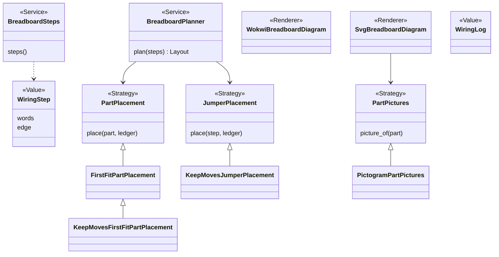
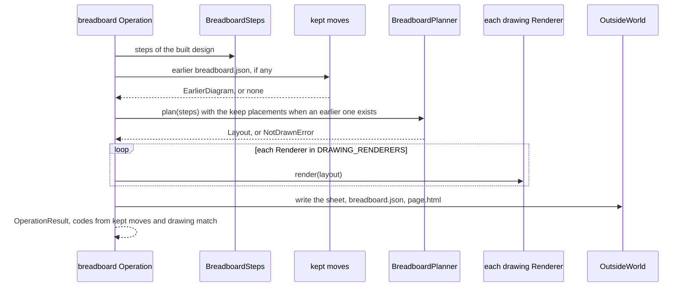

# Area: breadboard

Back to [level 1](../README.md). Words are in the [glossary](../glossary.md). The files that move here are in the
[refactor plan](../refactor-plan.md#appendix-what-moves-where-by-name).

New names (proposed): `WiringStep`, `WiringLog`, `NotBuiltError`, `NotDrawnError`, `Layout`, the modules `wiring_steps`, `drawing`, `kept_moves`, `bench_changes`, `drawing_match`, `sheet`, `operations`, and the Operation name `breadboard`.

## Level 2: what breadboard does

Breadboard turns a built design into the sheet a person wires from: numbered steps, a drawn breadboard and a page
with three tabs. It keeps the person's own moves across a rebuild and says what changed on the bench.

### Its operations

| Operation | CLI | Effects |
|---|---|---|
| `breadboard` | `breadboard.py` with `--out` (`breadboard.py:54`, its `main`) | reads the built circuit, writes the sheet, `breadboard.json`, `breadboard.svg` and `wiring-record.json`. It runs no tool. `page.html` is the build's (`check_spine.keep_tabbed_page`) |

The build runs the same Service as its breadboard stage.

### Its components

| Module | Holds |
|---|---|
| `breadboard/wiring_steps.py` | `BreadboardSteps`, the anchors, `NumberedList`, `MermaidDiagram`, and since P692 the circuit's `points`, `wiring` and `printed_label`, from `breadboard_steps.py` (P694) |
| `breadboard/drawing.py` | `BreadboardPlanner`, the placements, the two drawing Renderers, from `breadboard_drawing.py` (P694) |
| `breadboard/kept_moves.py` | the person's moves kept across a rebuild, from `breadboard_keep.py` (P694) |
| `breadboard/bench_changes.py` | what a rebuild asks the person to change, from `breadboard_changes.py` (P694) |
| `breadboard/drawing_match.py` | the drawing check against `circuit.json`, from `breadboard_match.py` (P694) |
| `breadboard/drawing_catalog.py` | what the drawn breadboard draws each component as, the catalog of a build, from `breadboard_catalog.py` (P694) |
| `breadboard/part_pictures.py` | `PartPictures`, moved as is |
| `breadboard/part_shape.py` | `PartShape`, `ShapeSource`, `find_part_px`, a part's pixel shape in the Wokwi drawing, moved as is in W6-D3b (P703, planned in P698). It raises `NotDrawnError` and imports design's `footprint_emitter`, a downward arrow |
| `breadboard/tabbed_page.py` | `TabbedHtmlPage`, `TscircuitExport`, moved as is |
| `breadboard/sheet.py` | the sheet flow, from `breadboard.py`, whose `main` stays in `scripts/` as the CLI (P694) |
| `breadboard/breadboard_codes.py` | the codes of the refusals of the run, with one sentence each (a leaf, P692); a drawing not written has its codes in `drawing.py`'s `CODES`. Moved as it is (P694) |
| `breadboard/__init__.py` | the index docstring alone, and it imports nothing. `OPERATIONS` and one module per Operation, named after it, come with the Operation card |

No module name repeats the area's name (rule C1), but for `breadboard_codes`: C1 counts basenames, and `codes` is the
core's, as `firmware_codes` is named.

### Its seams and adapters

| Seam | Real adapter | Fake | Registry |
|---|---|---|---|
| `PartPlacement` Strategy | `FirstFitPartPlacement`, `KeepMovesFirstFitPartPlacement` | none needed, both are pure | none, the Service picks by "is there an earlier drawing" |
| `JumperPlacement` Strategy | `JumperPlacement`, `KeepMovesJumperPlacement` | none needed | as above |
| drawing Renderer | `WokwiBreadboardDiagram`, `SvgBreadboardDiagram` | none needed | `DRAWING_RENDERERS` (`sheet.py:51`) |
| wiring view Renderer | `NumberedList`, `MermaidDiagram` | none needed | `WIRING_VIEWS` (`sheet.py:41`) |
| `PartPictures` Strategy | `PictogramPartPictures` | `FakePartPictures` (`tests/fakes.py:257`) | none yet |
| the circuit export | `TscircuitExport` over `tsci` | `FakeTscircuitExport` (`tests/fakes.py:267`) | none |

Breadboard imports design (the `Design` Value and `Netlist`), records and core.
No edge goes back up from design since P703: `part_shape`, which imports `drawing`, is breadboard's
([P698 #943](https://github.com/xmejkal/spark/issues/943)).

## Level 3: how breadboard is built

Most classes exist: `BreadboardPlanner` (`drawing.py:288`), `PartPlacement` (`:198`), `JumperPlacement`
(`:209`), `FirstFitPartPlacement` (`:218`), the keep variants (`kept_moves.py:158`, `:262`), the Renderers
(`drawing.py:396`, `:449`), `PartPictures` (`part_pictures.py:27`), `WiringStep` (`wiring_steps.py:39`) and `WiringLog`
(`bench_changes.py:103`), which P709 renamed from `Step` and `WiringRecord`.
The method names in the diagram are a sketch. Each class keeps its real methods.

### The main flow: a sheet from a build

### How breadboard is tested alone

- A built design from `tests/data/breadboard/`. `breadboard.py` runs no tool. `FakeTscircuitExport` gives the build's page its tabs.
- `FakePartPictures` gives the SVG its pictures, with no download.
- A contract test per Strategy base: every `PartPlacement` and every `JumperPlacement` passes the same cases.
- The golden of `breadboard.py` on the fixture project stays unchanged through the move.

### How a new implementation is added

- A new drawing is one Renderer class with its `name` and one entry in `DRAWING_RENDERERS`. The Operation module builds
  it with its arguments, since the registry holds classes, not instances (rule X3).
- A new picture source, such as pictures from online, is one `PartPictures` subclass.
- A new placement rule is one `PartPlacement` subclass, picked by the Service.

