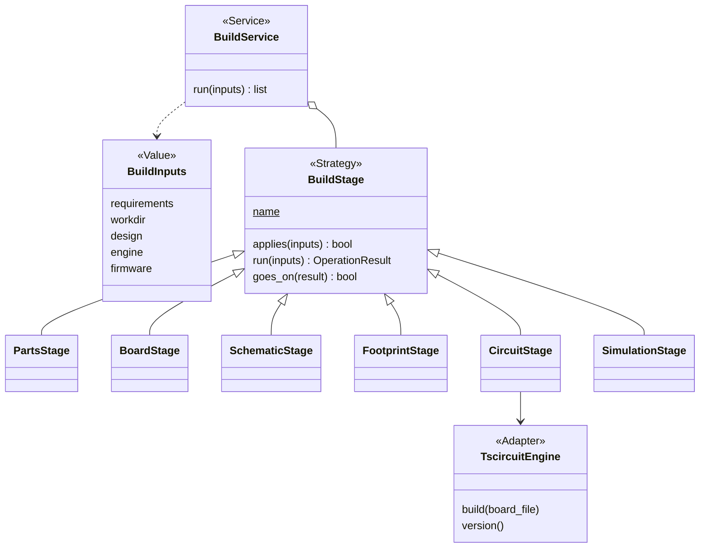
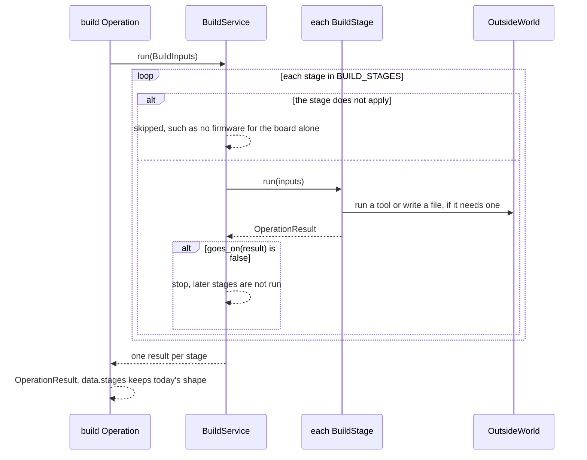

# Area: build

Back to [level 1](../README.md). Words are in the [glossary](../glossary.md). The files that move here are in the
[refactor plan](../refactor-plan.md#appendix-what-moves-where-by-name).

New names (proposed): `BuildService`, `BuildInputs`, `BuildStage` and its six subclasses, `BUILD_STAGES`,
`goes_on`, `TscircuitEngine`, `DiagramConverter`, `ProjectSetupService`, `build/operations.py`, and the
Operation names `build` and `init`.

## Level 2: what build does

Build runs the chain from a requirements file to a board that builds, in today's order: parts, board, schematic,
footprint, build (the circuit) and simulation. It stops at the first stage that cannot feed the next, and it sets up
a new project with the files every check and reviewer needs.

### Its operations

| Operation | CLI | Effects |
|---|---|---|
| `build` | `check_spine.py requirements.json`, `--keep DIR`, `--sim-dir`, `--firmware` (`check_spine.main`) | reads, runs `tsci` and the diagram converter, writes the kept build and, with `--keep`, the breadboard sheet |
| `init` | `init_project.py --project --board --circuit --force` (`init_project.py:411-414`) | reads, writes the project's files |

### Its components

| Module | Holds |
|---|---|
| `build/build_service.py` | `BuildService`, `BuildInputs` |
| `build/stages.py` | one `BuildStage` subclass per stage, under 600 lines, and `NO_FOOTPRINT_HINT` |
| `build/board_engine.py` | the Adapters `TscircuitEngine` and `DiagramConverter` |
| `build/project_setup.py` | `ProjectSetupService`, from `init_project.py` |
| `build/ai_files.py` | `AiFiles`, moved as is (`ai_files.py:31`) |
| `build/operations.py` | the area's `OPERATIONS` and its index docstring |

### Its ports and adapters

| Port | Real adapter | Fake | Chosen by |
|---|---|---|---|
| `BuildStage` Strategy: `applies(inputs)`, `run(inputs) -> OperationResult`, `goes_on(result)` | six stages | a fake stage per area below | `BUILD_STAGES`, an ordered tuple, because order is the point |
| board engine: `build(board_file) -> Circuit`, `version()` | `TscircuitEngine` over `tsci build` (the build stage of `check_spine.run`, `toolchain_can_build`, `tsci_version`) | a recording `run` with a canned `circuit.json` | the `board-engine` role (`data/tools.json:6`) |
| diagram converter | `DiagramConverter` (`converter_command` and its run in `check_spine.run`) | the same | the `diagram-converter` role (`data/tools.json:7`) |

Build imports breadboard, firmware, design, records and core, each reachable along the area map's arrows (rule U1).
It calls each area's Service in process, so the board emitter no longer runs as a child process
(the `emit_board.py` call in `check_spine.run`). The breadboard sheet stays a side output of `--keep`
(`keep_breadboard`), not a stage.

## Level 3: how build is built

Today one function, `check_spine.run` (204 lines, 6 parameters), runs every stage inline
and returns `stages + [Stage(...)]` from 23 places. `Stage(name, status, detail)` holds each
result. `BUILD_STAGES` keeps today's order and JSON names: `parts`, `board`, `schematic`, `schematic-notes`,
`footprint`, `build`, `simulation`. `SchematicStage` runs the board emitter and adds `schematic-notes`. `FootprintStage` calls
`emit_footprint.render`, not `emit_footprint.main` (OC2).
`CircuitStage` prints as `build`. The stop rule stays: `goes_on(result)` is true only for `ok`, except that
`SchematicStage` goes on over its notes, which report `problems` (the `schematic-notes` stage in `run`). The board engine's trivial-board probe (`toolchain_can_build`) moves into `TscircuitEngine`, so a
broken tool reads as `could-not-run` with code `tool_cannot_build`, never as a design problem.

### The main flow: one build

### How build is tested alone

- A fake stage per lower area: the test gives `BuildService` three stages and checks the stop rule and `skipped`.
- Each real stage gets a `BuildInputs` from `tests/data/` and a recording `run` with a canned `circuit.json`.
- The 6 patches of `check_spine.run` and the 7 of `find_toolchain` go when the engine Adapter takes `run`.
- The golden of `check_spine.py --json` on the fixture project stays unchanged through the move. It is the net.
- One real `tsci build` test moves to the slow lane (`slow_test_*.py`), with `test_a_catalog_pick_whose_name_would_end_the_board_s_comment_is_built_with_it_inert` in `test_needs.py`.

### How a new implementation is added

- A new stage is one `BuildStage` subclass and one place in `BUILD_STAGES`. It changes the `check_spine` golden, so it lands in an envelope-additions slice.
- A new board engine, such as KiCad, is one Adapter for the `board-engine` role. KiCad stays optional.
- A new AI tool's files are one entry in `AiFiles`.

