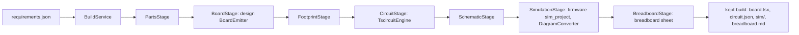
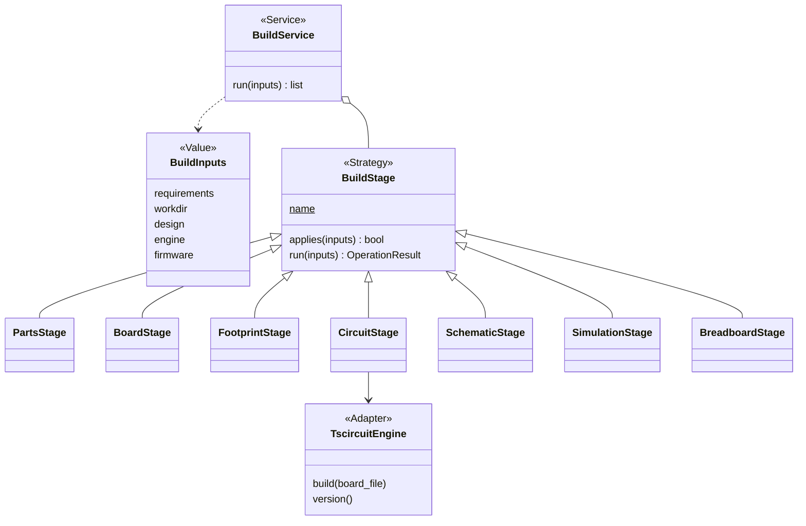
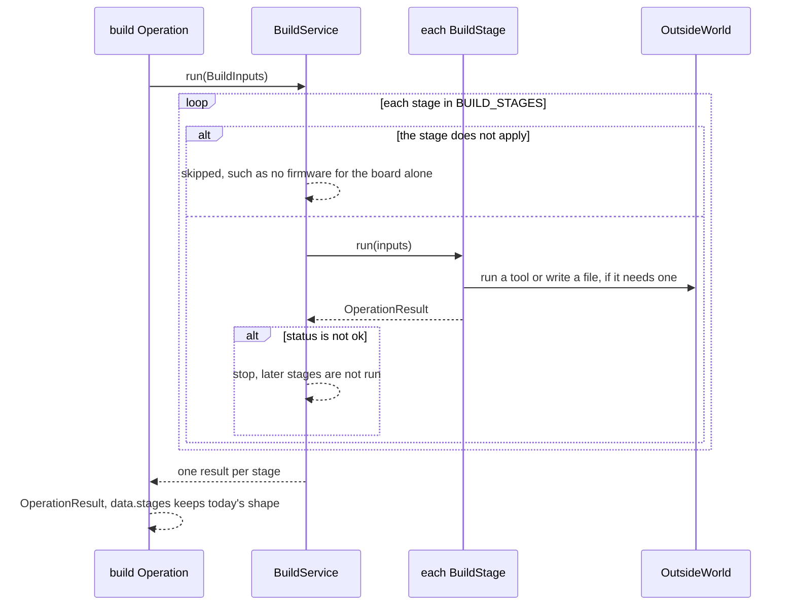

# Area: build

Back to [level 1](../README.md). Words are in the [glossary](../glossary.md). Names marked "proposed" do not exist
in the code yet.

## Level 2: what build does

Build runs the chain from a requirements file to a board that builds: the parts, the board file, the footprint, the
circuit, the schematic and the simulation project, then the breadboard sheet. It stops at the first stage that
cannot feed the next, and it sets up a new project with the files every check and reviewer needs.

### Its operations

| Operation | CLI | Effects |
|---|---|---|
| `build` (proposed name) | `check_spine.py requirements.json`, `--keep DIR`, `--sim-dir`, `--firmware` (`check_spine.py:635-653`) | reads, writes the kept build, runs `tsci` and the diagram converter |
| `init` (proposed name) | `init_project.py --project --board --circuit --force` (`init_project.py:411-414`) | reads, writes the project's files |

### Its components

| Module | Holds |
|---|---|
| `build/build_service.py` | `BuildService`, `BuildInputs` (proposed) |
| `build/stages.py` | one `BuildStage` subclass per stage (proposed), under 600 lines |
| `build/board_engine.py` | `TscircuitEngine` and `DiagramConverter` (proposed Adapters) |
| `build/project_setup.py` | `ProjectSetupService` (proposed), from `init_project.py` |
| `build/ai_files.py` | `AiFiles`, moved as is (`ai_files.py:31`) |
| `build/operations.py` | the area's `OPERATIONS` and its index docstring |

### Its ports and adapters

| Port | Real adapter | Fake | Chosen by |
|---|---|---|---|
| `BuildStage` Strategy: `applies(inputs)`, `run(inputs) -> OperationResult` | seven stages | a fake stage per area below | `BUILD_STAGES`, an ordered tuple, because order is the point |
| board engine: `build(board_file) -> Circuit`, `version()` | `TscircuitEngine` over `tsci build` (`check_spine.py:432`, `:162`, `:170`) | a recording `run` with a canned `circuit.json` | the `board-engine` role (`data/tools.json:6`) |
| diagram converter | `DiagramConverter` (`check_spine.py:509`) | the same | the `diagram-converter` role (`data/tools.json:7`) |

Build depends on breadboard, firmware, design, records and core. It calls each area's Service in process, so the
board emitter no longer runs as a child process (`check_spine.py:391`).

## Level 3: how build is built

Every name in this diagram is proposed. Today one function, `check_spine.run` (`check_spine.py:347`, 192 lines, 6
parameters), runs every stage inline and returns `stages + [Stage(...)]` from 21 places. `Stage(name, status,
detail)` (`check_spine.py:100`) holds each result. The stage names in the JSON stay: `parts`, `board`, `footprint`,
`build`, `schematic`, `schematic-notes`, `simulation`. `CircuitStage` prints as `build`, and `SchematicStage` adds
`schematic-notes`. The board engine's trivial-board probe (`check_spine.py:162`) moves into `TscircuitEngine`, so a
broken tool reads as `could-not-run` with code `tool_cannot_build`, never as a design problem.

### The main flow: one build

### How build is tested alone

- A fake stage per lower area: the test gives `BuildService` three stages and checks the stop rule and `skipped`.
- Each real stage gets a `BuildInputs` from `tests/data/` and a recording `run` with a canned `circuit.json`.
- The 6 patches of `check_spine.run` and the 7 of `find_toolchain` go when the engine Adapter takes `run`.
- The golden of `check_spine.py --json` on the fixture project stays unchanged. It is the net for this move.
- One real `tsci build` test moves to the slow lane (`slow_test_*.py`), with `test_needs.py:1416`.

### How a new implementation is added

- A new stage is one `BuildStage` subclass and one place in `BUILD_STAGES`.
- A new board engine, such as KiCad, is one Adapter for the `board-engine` role. KiCad stays optional.
- A new AI tool's files are one entry in `AiFiles`.

### What moves into build

| Today | Becomes |
|---|---|
| `check_spine.run` (`check_spine.py:347`) | `BuildService` and seven `BuildStage`s, each under 40 lines of logic |
| `check_spine.Stage` (`check_spine.py:100`) | each stage's `OperationResult`. `detail` stays the JSON key, filled from the sentence. |
| `subprocess.run` of `emit_board.py` (`check_spine.py:391`) | `BoardStage` calls design's `BoardEmitter` in process |
| `toolchain_can_build`, `tsci build`, `--version` (`check_spine.py:162`, `:170`, `:432`) | `TscircuitEngine` |
| `converter_command` and its run (`check_spine.py:509`) | `DiagramConverter` |
| the history comments at `check_spine.py:371` and `:453` | their cards. Comments keep 4 lines at most (rule R5). |
| `init_project.py` logic (522 lines) | `build/project_setup.py` |
| `ai_files.py` | `build/ai_files.py` |
