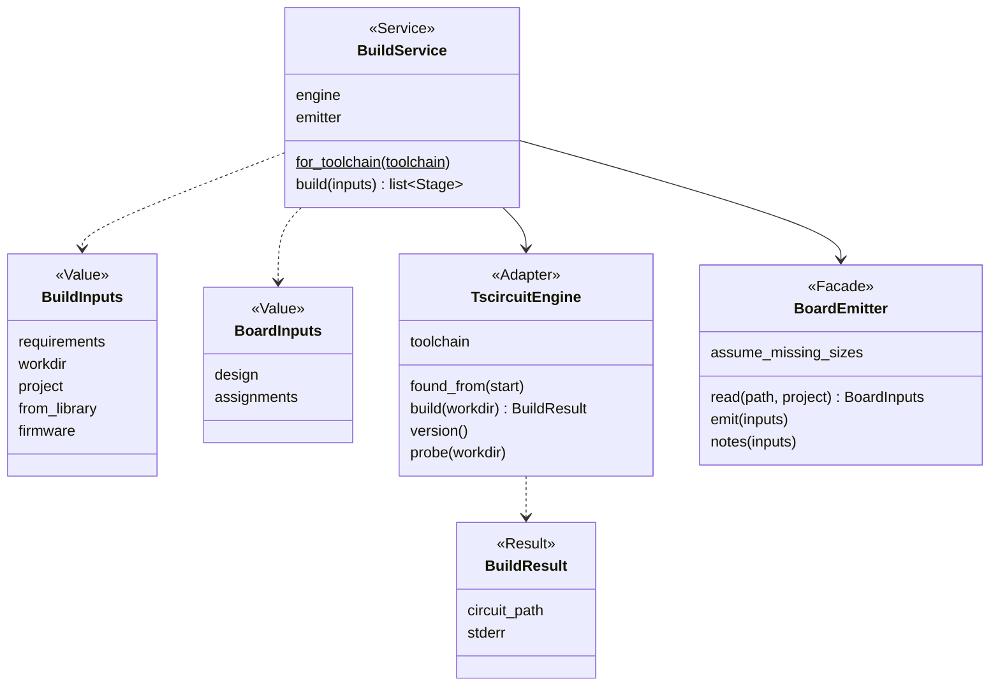

# Area: build

Back to [level 1](../README.md). Words are in the [glossary](../glossary.md). The files that move here are in the
[refactor plan](../refactor-plan.md#appendix-what-moves-where-by-name).

Names real since P706: `BuildService`, `BuildInputs`, `TscircuitEngine`, `BuildResult` (and design's `BoardEmitter`, which
the build calls in process); since P783 PR 3, `RequirementsBuildService` and `RequirementsBuildResult`. Still proposed: `DiagramConverter` (the renames card), `ProjectSetupService`,
`build/__init__.py` with `OPERATIONS`, and the Operation names `build` and `init`. The `BuildStage` family (six subclasses,
`BUILD_STAGES`, `goes_on`) was dropped as YAGNI at P706: six methods on one Service are the small version, and a base class
with one implementation per stage waits for a second implementation of a stage.

## Level 2: what build does

Build runs the chain from a requirements file to a board that builds, in today's order: parts, board, schematic,
footprint, build (the circuit) and simulation. It stops at the first stage that cannot feed the next, and it sets up
a new project with the files every check and reviewer needs.

### Its operations

| Operation | CLI | Effects |
|---|---|---|
| `build` | `check_spine.py requirements.json`, `--keep DIR`, `--sim-dir`, `--firmware` (`check_spine.main` over `RequirementsBuildService`) | reads, runs `tsci` and the diagram converter, writes the kept build and, with `--keep`, the breadboard sheet |
| `init` | `init_project.py --project --board --circuit --force` (`init_project.main`) | reads, writes the project's files |

### Its components

| Module | Holds |
|---|---|
| `build/build_service.py` | `BuildService(engine, emitter, find_tool=None)` (P706, P725): `build(inputs)` runs the six stage methods over the engine and the emitter it is given, with `BuildInputs`, `board_alone`, `islands_in`, `verdict` and the stage sentences |
| `build/requirements_build.py` | `RequirementsBuildService(build_service=None)` (P783 PR 3; `build_service` is an object with `for_toolchain`, BuildService or a fake): `build(requirements_path, firmware, simulation)` is `check_spine.py`'s whole run of the chain: the requirements read (a refusal is one `requirements` stage), the work folder, a `BuildService`'s stages (a `TimeoutExpired` is one `stage_timed_out` stage and any other exception one `stage_crashed` stage), and the history note; a `RequirementsBuildResult` of `stages`, `workdir`, `requirements`, `toolchain` and `diagnostics`. `REFERENCE` and `timed_out_sentence` are here. `check_spine.main` prints the diagnostics and its `report` renders the stages |
| `build/stages.py` | `Stage` (one link's result) and `NO_FOOTPRINT_HINT`, imported by name (P705) |
| `build/board_engine.py` | the Adapter `TscircuitEngine` with `BuildResult` (P706: `found_from`, `build`, `version`, `probe`, the runner resolved at each call), `find_toolchain`, and the converter functions to `convert`, of which `converter_command` and `converter_stage_problem` take a `find_tool` keyword (P725: a test gives `FakeToolFinder(...).find`; `BuildService`, the converter functions and `stage_chips` take the module `find`'s shape, a name and a project, so the build Operations bind the project when they hand them `outside.find_tool`, a later step); later the Adapter `DiagramConverter` |
| `build/kept_files.py` | the files `--keep` writes into DIR and what an earlier build left there (P705). `kept_` means what a run keeps between runs, as breadboard's `kept_moves.py` |
| `build/project_setup.py` | `init_project.py`'s library (P705); later `ProjectSetupService` |
| `build/build_codes.py` | the leaf of codes (P701): one per stage that stops the build and per refusal of init. A `Stage` carries a `code` (a design error's own when one stopped it), and `project_setup`'s `why_project_refused`, `why_board_refused` and `find_circuit` return a `Refusal`. Only the sheet's `not written` entry in `kept` writes its code |
| `build/ai_files.py` | `AiFiles`, moved as is (P705) |
| `build/board_alone_input.py` | `read_board_alone`, `make_converter_input`, `BoardAloneResult` and `NETLIST`: the converter's input for a board-only build, moved out of `records/onboard_parts.py` in P708 |
| `build/__init__.py` | its index docstring, no import; later the area's `OPERATIONS`. One module per Operation, named after it |

### Its seams and adapters

| Seam | Real adapter | Fake | Chosen by |
|---|---|---|---|
| board emitter: `read(path, project)`, `emit(inputs)`, `notes(inputs)` | design's `BoardEmitter`, a Facade of `read_inputs`, `board_file` and `design_notes` | a subclass whose `read` or `emit` raises (`tests/test_build_service.py`) | `BuildService(engine, emitter)`; `for_toolchain` builds the real pair |
| board engine: `found_from(start)`, `build(workdir) -> BuildResult`, `version()`, `probe(workdir)` | `TscircuitEngine` over `tsci` (`run=` is the runner, `subprocess.run` when None, resolved at each call) | `FakeTscircuitEngine` (`tests/fakes.py`) with a canned `circuit.json` | the `board-engine` role (`data/tools.json:6`) |
| diagram converter | `DiagramConverter` (`converter_command` and `convert` in `board_engine`) | the same | the `diagram-converter` role (`data/tools.json:7`) |

Build imports breadboard, firmware, design, records and core, each reachable along the area map's arrows (rule U1).
It calls each area's Service in process: since P706 the board emitter is `BoardEmitter`, called by `_schematic`, and no
child Python runs (the requirements file is read twice, not three times). The breadboard sheet stays a side output of
`--keep` (`keep_breadboard`), not a stage.

## Level 3: how build is built



`BuildService.build(inputs)` resolves the project once (`inputs.project`, or the plugin's library) and runs six private
stage methods in the code's order, each under 40 lines, each appending its `Stage` and returning its product or None when
the build ends: `_board`, `_parts` (a board-only project ends through `board_alone`), `_schematic` (the emitter's `read`,
`emit` and `notes`: `board.tsx` and the `schematic-notes` stage), `_footprint` (`footprint_emitter.render`, not the CLI,
OC2), `_build_circuit` (`found_from`, `build`, `version`, and `probe` when nothing came out, so a broken tool reads as
`could-not-run` with code `tool_cannot_build`, never as a design problem; `_circuit_verdict` reads the circuit) and
`_simulation`. The stage names and order stay: `board`, `parts`, `schematic`, `schematic-notes`, `footprint`, `build`,
`simulation`. A `TimeoutExpired` from the engine propagates to `RequirementsBuildService`, which keeps `timed_out_sentence`.
`BuildInputs` holds no design and no engine: the design is read by a stage, and the engine is a collaborator.

### The main flow: one build

```mermaid
sequenceDiagram
  participant M as check_spine.main
  participant R as RequirementsBuildService
  participant S as BuildService
  participant E as BoardEmitter
  participant T as TscircuitEngine
  M->>R: build(requirements, firmware, simulation)
  R->>R: read the requirements (a refusal: one stage, no work folder); the work folder; the kept diagram and firmware
  R->>S: for_toolchain(toolchain).build(BuildInputs)
  S->>S: _board, _parts (board_alone ends a board-only build)
  S->>E: read(requirements.json, project)
  E-->>S: BoardInputs, or RefusedInputError (a stage), or a crash (F5: could-not-run)
  S->>E: emit(board_inputs); notes(board_inputs)
  S->>S: board.tsx written; schematic ok; schematic-notes when notes
  S->>S: _footprint (footprint_emitter, pure)
  S->>T: found_from(project).build(workdir); version(); probe(workdir)
  T-->>S: BuildResult (TimeoutExpired propagates to R)
  S->>S: _simulation (converter functions, loader.load as today)
  S-->>R: stages (R turns a TimeoutExpired or a crash into one stage)
  R->>R: the P429 line; the history note, or its line
  R-->>M: RequirementsBuildResult; main prints the diagnostics and reports
```

### How build is tested alone

- `tests/test_build_service.py` (P706): `BuildService` with `FakeTscircuitEngine` and the real `BoardEmitter`, or a
  subclass whose `read` or `emit` raises: the stop rule, `tool_missing`, the probe, the crash sentences, the notes stage.
- `TscircuitEngine(toolchain, run=a_recorder)` is asked what it ran and with which `timeout=`.
- The 15 goldens of `tests/golden_design.py` ran the CLIs as children through the move, byte for byte. They are the net.
- One real `tsci build` test is marked `@slow` (`tests/suite_runs.py`, P425), so the full run alone runs it, with `test_a_catalog_pick_whose_name_would_end_the_board_s_comment_is_built_with_it_inert` in `test_needs.py`.

### How a new implementation is added

- A new stage is one private method of `BuildService` and one call in `build`. It changes the `check_spine` golden, so it lands in an envelope-additions slice.
- A new board engine, such as KiCad, is one Adapter for the `board-engine` role. KiCad stays optional.
- A new AI tool's files are one entry in `AiFiles`.

