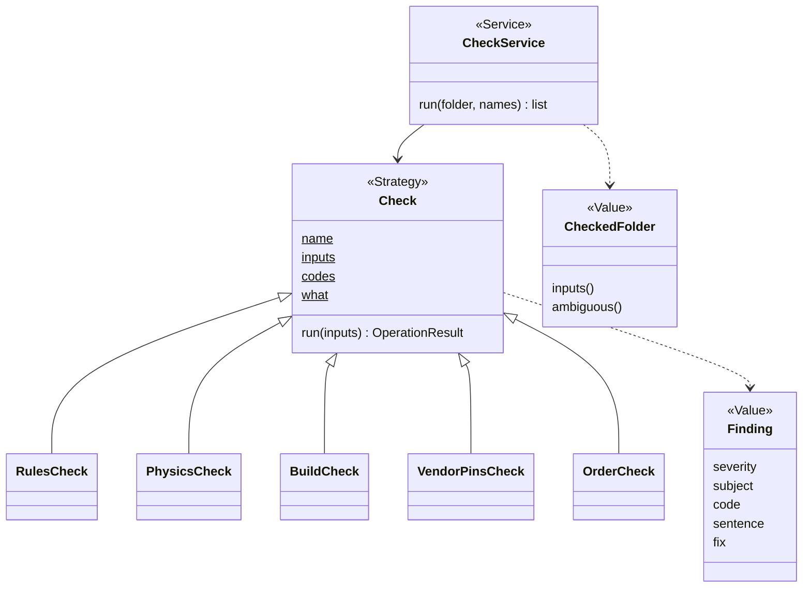
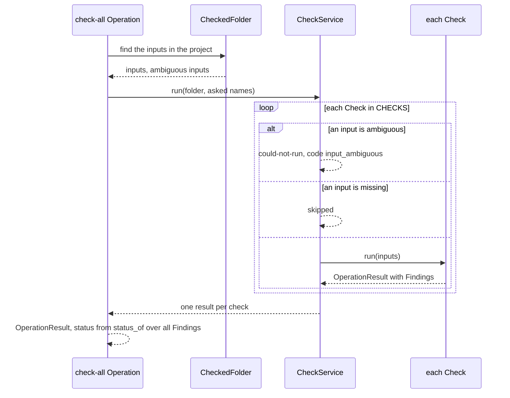

# Area: checks

Back to [level 1](../README.md). Words are in the [glossary](../glossary.md). The files that move here are in the
[refactor plan](../refactor-plan.md#appendix-what-moves-where-by-name).

New names (proposed): `RulesCheck`, `PhysicsCheck`, `BuildCheck`, `VendorPinsCheck`, `OrderCheck`, `CheckService`, `CheckContract`, `GhVendorHeaders`, `CircuitBoard`, `CouldNotKeepError`, the `checks/` modules, and the Operation names below.

## Level 2: what checks does

Checks grades a built design against facts in records: the rules, the physics, the footprints, the vendor's pin
header and the order list. Each check says what it found and what it did not look at, and `check_all` runs them all.

### Its operations

| Operation | CLI | Effects |
|---|---|---|
| `check-all` | `check_all.py` | reads |
| `check-physics` | `check_physics.py` | reads |
| `check-footprints` | `check_footprints.py` | reads |
| `check-bom` | `check_bom.py` | reads |
| `check-vendor-pins` | `check_vendor_pins.py` | reads, runs `gh`, network |
| `compare-design` | `compare_design.py` | reads |

Each CLI keeps its flags and positionals.

### Its components

| Module | Holds |
|---|---|
| `checks/check.py` | `Check`, `CHECKS`, `CheckedFolder`, from `check_all.py` |
| `checks/rules_check.py` | `RulesCheck` and `compare_design`'s logic |
| `checks/physics_check.py` | `PhysicsCheck` and `check_physics`'s logic, `CircuitBoard` |
| `checks/build_check.py` | `BuildCheck` and `check_footprints`'s logic |
| `checks/vendor_pins_check.py` | `VendorPinsCheck`, `check_vendor_pins`'s logic, the Adapter `GhVendorHeaders` |
| `checks/order_check.py` | `OrderCheck` and `check_bom`'s logic |
| `checks/codes.py` | every code a check emits, with a one-line meaning |
| `checks/__init__.py` | the area's `OPERATIONS` and its index docstring. One module per Operation, named after it |

### Its seams and adapters

| Seam | Real adapter | Fake | Registry |
|---|---|---|---|
| `Check` Strategy: `run(inputs) -> OperationResult` | the five checks | a toy `Check` in the test | `CHECKS` |
| vendor headers: `header(variant) -> str` | `GhVendorHeaders` over `gh api` (`check_vendor_pins.py:67`) | a dict from variant to header text | none |

Checks imports design (the `Design` Value and `Netlist`), records and core.

Three checks are later, not MVP: `OrderCheck`, `BuildCheck` and `PhysicsCheck` (today `TheOrder`, `Buildability` and
`Physics` in `check_all.py`, with `check_bom`, `check_footprints` and `check_physics`). They ask PCB and fab questions, which
the breadboard journey does not. They sit behind the `CHECKS` registry, and the [pruning list](../../../2026-10-25-p385-prune-and-refactor/pruning-list.md#the-verdicts)
holds the verdict.

## Level 3: how checks is built

`Check` (`check_all.py:63`) and `CheckedFolder` (`check_all.py:316`) exist. Today a check is an instance with
`name`, `needs` and `what` given in `__init__` (`check_all.py:71`), and `run` returns a dict with a `reason` key. In
the target, `name`, `inputs` and `codes` are class attributes, and `run` returns an `OperationResult` with Findings.
`CheckService` runs the asked checks, marks a missing input `skipped` and an ambiguous one
`could-not-run`, as `check_all.py:76-89` does now. `check_all`'s `codes` are the union of each check's `codes`.

### The main flow: check-all

### How checks is tested alone

- Each check runs on a built design under `tests/data/`. No tool, no network.
- `VendorPinsCheck` takes a vendor header source. Its test passes a dict, so no `gh` call and no patch.
- A `CheckContract` test: every Check in `CHECKS` declares `name`, `inputs` and `codes`, and every Finding
  it emits holds a listed code.
- The goldens of `check_all.py` and each `check_*.py` stay unchanged through the move.

### How a new implementation is added

- A new check is one `Check` subclass with `name`, `inputs`, `codes` and `run`, and one entry in `CHECKS`. Its codes
  go in `checks/codes.py`. `check_all` runs it with no other change.
- A SPICE rung (P136) is one such Check that calls a simulator Adapter. It waits for its card.

