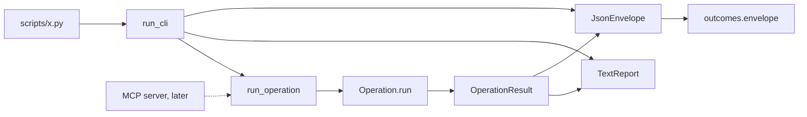
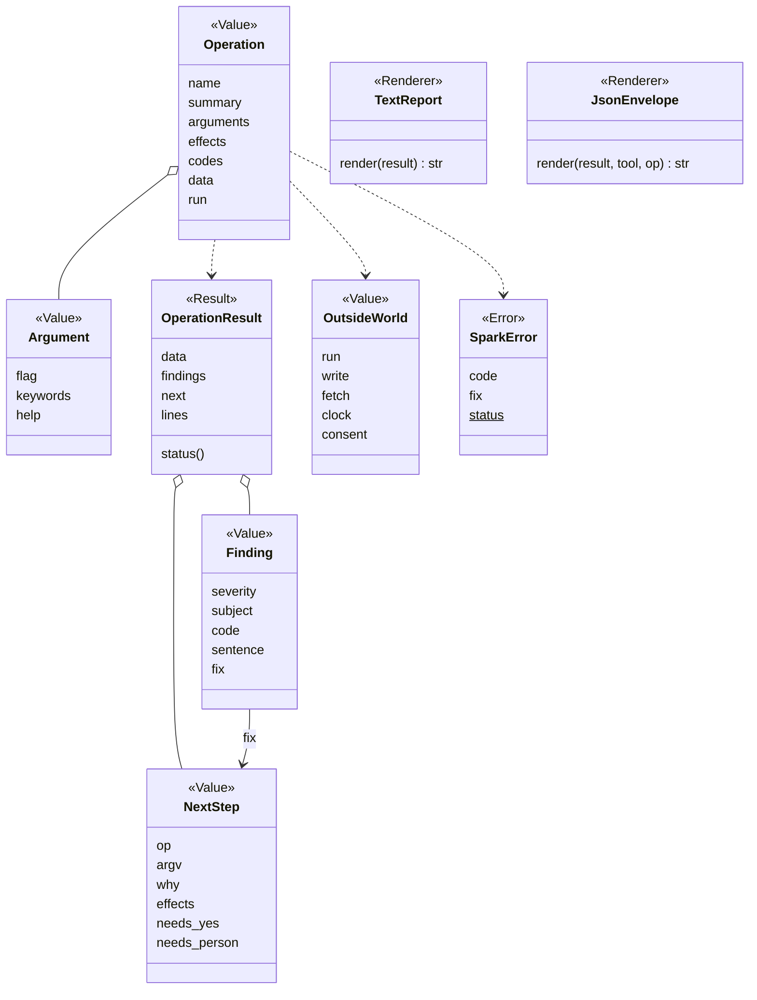
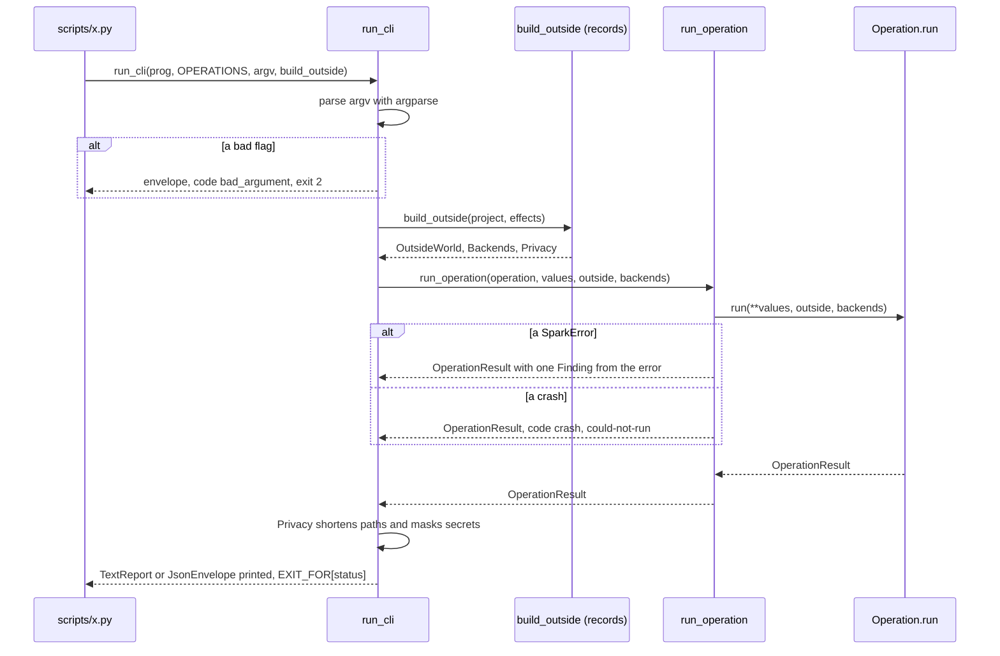

# Area: core

Back to [level 1](../README.md). Words are in the [glossary](../glossary.md). Every name here except `outcomes`
and its functions is proposed.

## Level 2: what core does

Core holds the contract that every area and every frontend shares: the Operation, its result, the Finding, the
error and the CLI runner. It imports only Python's standard library, so any area and any frontend can use it.

### Its operations

Core runs no Operation of its own. It runs everyone else's: `run_operation` for any frontend, `run_cli` for a CLI.

### Its components

| Module | Holds |
|---|---|
| `core/outcomes.py` | the status words, `EXIT_FOR`, `status_of`, `envelope`, `step`, `page`, moved from `scripts/outcomes.py` |
| `core/result.py` | `OperationResult`, `Finding`, `NextStep` |
| `core/operation.py` | `Operation`, `Argument`, `COMMON_ARGUMENTS` (`--project`, `--json`, `--port`, `--dry-run`, `--out`, `--timeout`, `--describe`, `--debug`) |
| `core/errors.py` | `SparkError` and the core codes |
| `core/outside.py` | `OutsideWorld`, `Privacy`, `pick` |
| `core/cli.py` | `run_operation`, `run_cli`, `TextReport`, `JsonEnvelope` |

### Its ports

| Port | Kind | Who fills it |
|---|---|---|
| `OutsideWorld` | Value of callables: `run`, `write`, `fetch`, `clock`, `consent` | `records.build_outside` (proposed) in production, `FakeOutside` in tests |
| `Privacy` | Value: path replacements and secret values to mask | `records`, from the record folders and `account_env` rows (`tools.py:339`) |
| the frontend | a function that calls `run_operation` and renders the result | `run_cli` today, an MCP server later |

It depends on nothing in spark.

## Level 3: how core is built

`Operation.run` is a plain function whose keyword parameters are its arguments' `dest` names, plus `outside` and
`backends`. Example: `def look(project, port, ignore_older_runs, *, outside, backends)`. One test checks that every
`Argument.dest` names a parameter. `SparkError.status` is a class attribute, `could-not-run` by default. Only a
subclass for "the design cannot be done", such as `assign_pins.Impossible` (`assign_pins.py:113`), sets `problems`.

`OutsideWorld` holds only what the Operation's `effects` declare. `build_outside` puts a refusing stub in every other
field, and a call to it raises `SparkError` with code `undeclared_effect`. `run` is there for every Operation that
runs a tool. `write` needs `writes`. `fetch` needs `network`. `consent` needs `board` or `erases`. With `--dry-run`,
`run` and `write` record instead of act, and the result lists `data.would_write`.

### The main flow

A bad flag with `--json` prints an envelope, as `parts.py` does today with `_Parser` (`parts.py:1672`). The
traceback of a crash goes to stderr only with `--debug`.

### How core is tested alone

- A toy Operation in the test file, a `FakeOutside`, no spark area imported.
- One test per path in the flow above: ok, problems, could-not-run, bad flag, SparkError, crash, undeclared effect.
- The parity test: for each golden, the text and the `--json` render carry the same codes and the same first step.
- `envelope` keeps its v1 keys. `tests/test_json_contracts.py` lists the allowed keys and fails on a new one that
  is not added there.

### How a new implementation is added

- A new frontend, such as an MCP server, is one module. It turns a tool call into `(operation, values)`, calls
  `run_operation` and renders the `OperationResult`. `isError` is true exactly for `could-not-run`. At that point,
  with two frontends, a `Frontend` base class enters (rule T3: a base needs two subclasses or a Fake).
- A new shared flag is one `Argument` in `COMMON_ARGUMENTS`. An old spelling stays as a hidden alias.
- A new code is one constant with a one-line meaning in `core/errors.py` when two areas emit it.

### What moves into core

| Today | Becomes |
|---|---|
| `scripts/outcomes.py`, whole (106 lines) | `core/outcomes.py`. 39 importers change their import. |
| `parts.Answer` (`parts.py:230`) and `outcomes.answer` (`outcomes.py:49`) | `OperationResult` |
| `parts._problem` (`parts.py:238`), the item dicts in `board_envelope.py:54-80` | `Finding` |
| `outcomes.step` (`outcomes.py:84`), `board_envelope.look_step` and `deploy_step` (`board_envelope.py:43,48`) | `NextStep` |
| `parts.OPERATIONS` tuples and `OPTIONS` (`parts.py:1581`, `:1655`) | `Operation` and `Argument` |
| `parts._Parser` (`parts.py:1672`) and `look.main`'s body (`look.py:41-64`) | `run_cli` |
| `board_envelope.dumps` (`board_envelope.py:38`) | `JsonEnvelope` |
| `board_look.report_lines` (`board_look.py:234`) as the text form | `lines` of the result, rendered by `TextReport` |
