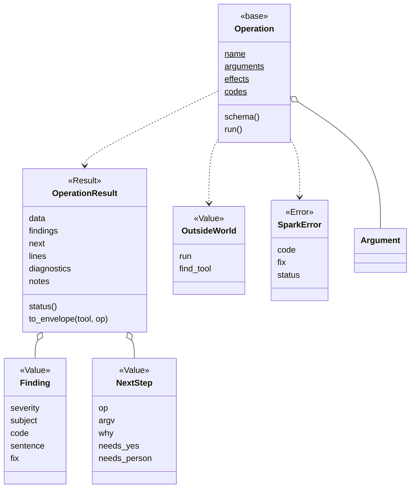
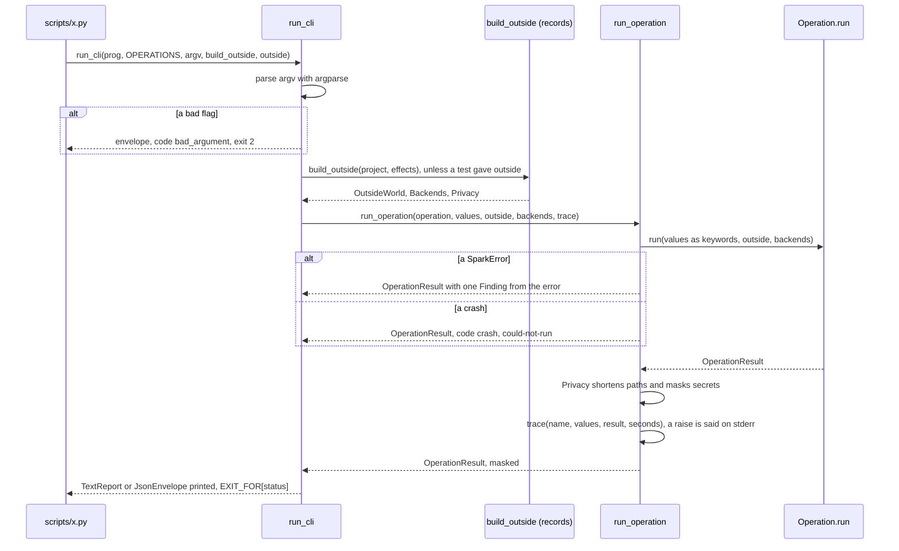

# Area: core

Back to [level 1](../README.md). Words are in the [glossary](../glossary.md). The files that move here are in the
[refactor plan](../refactor-plan.md#appendix-what-moves-where-by-name).

New names (proposed): every class and function on this page except `outcomes` and its functions, and the Fakes
`FakeOutsideWorld`.

## Level 2: what core does

Core holds the contract that every area and every frontend shares: the Operation, its result, the Finding, the
error and the CLI runner. It imports only Python's standard library, so any area and any frontend can use it.

Core runs no Operation of its own. It runs everyone else's: `run_operation` for any frontend, `run_cli` for a CLI.

| Module | Holds |
|---|---|
| `core/outcomes.py` | the status words, `EXIT_FOR`, `status_of`, `envelope`, `step`, `page`, moved from `scripts/outcomes.py` |
| `core/result.py` | `OperationResult`, `Finding`, `NextStep` |
| `core/operation.py` | the `Operation` base class, `Argument`, `COMMON_ARGUMENTS` (`--project`, `--json`, `--port`; `--dry-run`, `--out`, `--timeout` and `schema()` wait for their first user), the effects `READS`, `RUNS`, `BOARD` |
| `core/errors.py` | `SparkError` |
| `core/codes.py` | the codes the core writes for every Operation: `bad_argument`, `crash`, `undeclared_effect` (`tool_missing` stays the bench's) |
| `core/outside.py` | `OutsideWorld` (`run`, `find_tool`, `report`), `build_outside_world(effects, reporter, find_tool)`; `Privacy` and `pick` wait |
| `core/events.py` | `Event` (`kind`, `code`, `text`; kinds `LINE` and `BEGIN`), the `Reporter` base, `TerminalReporter` (P507) |
| `core/cli.py` | `run_operation(operation, values, outside)`, `run_cli(text, operation, argv, *, outside_builder, outside=None)`, `HelpText`, `TextReport`, `JsonEnvelope`; `trace` and `Privacy` wait |
| `core/zone_time.py` | the leaf `zone_time`: times with their zone |
| `core/text_guards.py` | the leaf `text_guards` (once `screen_text`, renamed in P418): the guards where text leaves spark |

| Seam | Kind | Who fills it |
|---|---|---|
| `OutsideWorld` | Value of callables: `run`, `find_tool` and `report` today; `write`, `fetch`, `clock`, `consent`, `environ` with their first user | `spark.bench.build_project_outside_world` in production, `FakeOutsideWorld` in tests |
| `Privacy` | Value: path replacements and secret values to mask | records, from the record folders and `account_env` rows (`tools.py:339`) |
| the frontend | a function that calls `run_operation` and renders the result | `run_cli` today, an MCP server later |

Core depends on nothing in spark.

## Level 3: how core is built

An Operation is a class with one public method, `run`. Its keyword parameters are its arguments' `dest` names, plus
`outside`: `LookAtBoard.run(self, project, port, ignore_older_runs, no_simulation, *, outside)` (P442; `backends` folded
into `outside.find_tool`). Its module is named after it, and the area's `OPERATIONS` in `__init__.py` maps each printed `op` to its
class. One test checks that every `Argument.dest` names a parameter. `SparkError.status` is an instance field with
the class default `could-not-run`: `ImpossibleError` (today `assign_pins.Impossible`) defaults to `problems`, and
`GateClosedError` sets it per instance, as its `code` is today.

`fix` stays a string, as today (`board_envelope.look_envelope`), so the envelope only gains keys. `fix_step` was dropped on 2026-10-27, because it would be
null at every look site. `TextReport` and `JsonEnvelope` are the two Renderers of a result.

The effects are `reads`, `writes`, `runs`, `network`, `board` and `deletes`. `build_outside` fills only the fields
the declared effects need and puts a refusing stub in the others. A call to a stub raises `SparkError` with code
`undeclared_effect`. `run` needs `runs`, `write` needs `writes`, `fetch` needs `network`, `consent` needs `board` or
`deletes`. `environ` is a read-only copy of the variables the Operation names, such as `CLAUDE_CODE_SESSION_ID`
(`cost.py:69`) or the Wokwi token (read in `run_scenario.main`). With `--dry-run`, `run` and `write` record instead of act.

### The main flow

The signature is `run_cli(text, operation, argv=None, *, outside_builder, outside=None)`, `text` a `HelpText(prog,
description, epilog)` (P442; a mapping of Operations comes with S9). A CLI's `main(argv=None, outside=None)` passes its `outside` on. A test passes a `FakeOutsideWorld` there, and production passes nothing.

A bad flag with `--json` prints an envelope, as `parts.py` does today with `_Parser`. The traceback of a crash always
goes to stderr, and the envelope with code `crash` is an output change per CLI (plan, S6). Privacy runs inside
`run_operation`, so a frontend that calls it directly, and the tracer, see only masked values.

### How core is tested alone

- A toy Operation in the test file, a `FakeOutsideWorld`, no spark area imported.
- One test per path in the flow: ok, problems, could-not-run, bad flag, SparkError, crash, undeclared effect. An
  unchecked Finding never gives ok. A result with a store path reaches `trace` shortened.
- Rule X2's test finds no `print`, `input`, `sys.stdin`, `sys.stdout` or `readline` in `spark/` outside the Renderers
  and `TerminalConsentStrategy`. An Operation asks only through `outside.consent`.
- The parity test: for each golden, the text and the `--json` render carry the same codes and the same first step.
- `tests/test_json_contracts.py` lists the allowed envelope keys and fails on a new one that is not added there.

### How a new implementation is added

- A new frontend, such as an MCP server, is one module. It turns a tool call into `(operation, values)`, calls
  `run_operation` and renders the result. `isError` is true exactly for `could-not-run`. With two frontends, a
  `Frontend` base class enters (rule T3: a base needs two subclasses or a Fake).
- A new shared flag is one `Argument` in `COMMON_ARGUMENTS`. An old spelling stays as a hidden alias.
- A new code is one constant with a one-line meaning in `core/codes.py` when two areas emit it.
