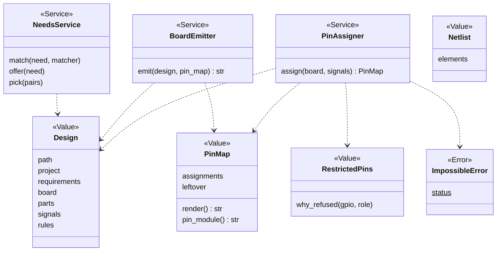
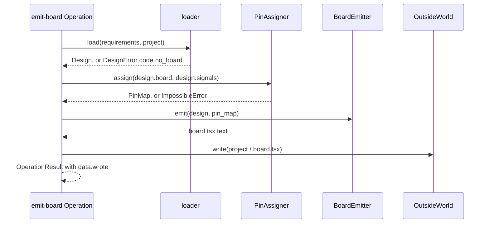

# Area: design

Back to [level 1](../README.md). Words are in the [glossary](../glossary.md). The files that move here are in the
[refactor plan](../refactor-plan.md#into-design).

New names (proposed): `PinAssigner`, `PinMap`, `BoardEmitter`, `NeedsService`, `ImpossibleError`, the modules
`loader`, `pin_assigner`, `board_emitter`, `footprint_emitter`, `operations`, and the Operation names below.

## Level 2: what design does

Design turns a goal's needs and the requirements file into a design: the parts picked, a pin for each signal and
the board file that wires them. It writes facts only, the pin map and the board file, never firmware behaviour.

### Its operations

| Operation | CLI | Effects |
|---|---|---|
| `need`, `needs`, `needs-set`, `match`, `offer`, `pick`, `requirements` | `parts.py` with that flag | reads, writes for `needs-set`, `pick`, `requirements` |
| `audit` | `parts.py --audit` | reads |
| `board-list` | `boards.py --list` | reads |
| `assign-pins` | `assign_pins.py requirements.json` | reads, writes `pins.py` with `--out` |
| `emit-board` | `emit_board.py` | reads, writes `board.tsx` |
| `emit-footprint` | `emit_footprint.py` | reads, writes a footprint file |

`audit` and `board-list` live here because both ask whether a board stops the chain at the footprint
(`footprint_gaps`, `footprint_stop`). That is a design fact, so the Operations move up to it. A callback passed down
into records and sourcing would be a parameter with one value.

### Its components

| Module | Holds |
|---|---|
| `design/loader.py` | `load` and the `Design` Value, moved from `design.py` (the name avoids `design/design.py`) |
| `design/needs.py` | a goal's needs, matched against the store, the pick, moved from `scripts/needs.py` |
| `design/restricted_pins.py` | `RestrictedPins`, moved as is |
| `design/pin_assigner.py` | the pin assignment, moved from `assign_pins.py` |
| `design/netlist.py` | `Netlist`, moved as is |
| `design/board_emitter.py` | the board file writer, moved from `emit_board.py` (1172 lines) |
| `design/footprint_emitter.py` | the footprint writer and `footprint_stop`, moved from `emit_footprint.py` and `boards.py:236` |
| `design/fab.py`, `design/copper.py` | the fab house's numbers and the copper rules, moved as is |
| `design/operations.py` | the area's `OPERATIONS` and its index docstring |

### Its ports

Design runs no outside program, so it has no Adapter. Its only effect is `OutsideWorld.write`. It reads part and
board records through records, and offers through sourcing's `Matcher`.

Design imports sourcing, records and core.

## Level 3: how design is built

`Design` exists as a namedtuple (`design.py:45`). `ImpossibleError` is today's `Impossible` (`assign_pins.py:113`), and its class
attribute `status` is `problems`, because the design asks for something the board cannot do.

The pin map is written as MicroPython's `pins.py` today (`assign_pins.py:392`). It stays in design until a second
platform exists. Then the text form moves behind a Renderer per platform, chosen by `Backends.platform`.

### The main flow: requirements to board file

### How design is tested alone

- Records from `tests/data/`, read through `RecordFolders(tmp)`. No tool and no network.
- `PinAssigner` and `BoardEmitter` are pure: a `Design` in, a value or a text out. They need no Fake.
- The goldens of `assign_pins.py --json` and `emit_board.py` on fixture projects stay unchanged through the move.
- `no_board` (D16): only when neither the requirements nor `boards/active.json` names a board. Its callers are
  `live.py:91`, `check_all.py:406`, `emit_footprint.py:208` and `design.py:377`.

### How a new implementation is added

- A new board is one JSON record in `boards/`. `RecordSchema("board")` checks it.
- A new part is one record in `parts/`. The design reads its facts and needs no code.
- A pin map for a second platform is a Renderer of `PinMap`, added with that platform.

