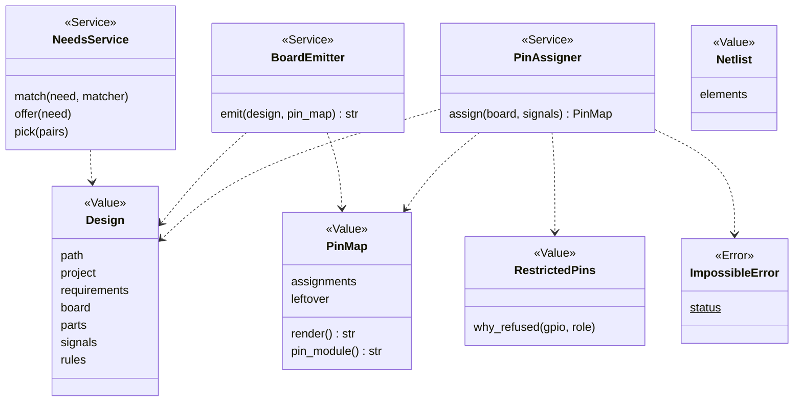
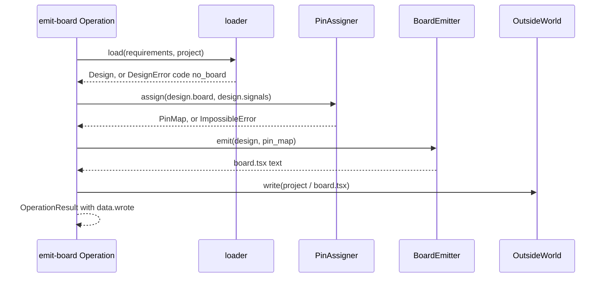

# Area: design

Back to [level 1](../README.md). Words are in the [glossary](../glossary.md). The files that move here are in the
[refactor plan](../refactor-plan.md#appendix-what-moves-where-by-name).

New names (proposed): `PinAssigner`, `PinMap`, `BoardEmitter`, `NeedsService`, `ImpossibleError`, the modules
`loader`, `pin_assigner`, `board_emitter`, `footprint_emitter`, `goal_handlers` (the goal handlers of `parts.py` as
functions, a stopgap until the "one module per Operation" card: C1 refuses a second `operations.py`, P710), and the
Operation names below.

## Level 2: what design does

Design turns a goal's needs and the requirements file into a design: the parts picked, a pin for each signal and
the board file that wires them. It writes facts only, the pin map and the board file, never firmware behaviour.

### Its operations

| Operation | CLI | Effects |
|---|---|---|
| `need`, `needs`, `needs-set`, `match`, `offer`, `pick`, `requirements` | `parts.py` with that flag | reads, writes for `needs-set`, `pick`, `requirements` |
| `audit` | `parts.py --audit` | reads |
| `board-list` | `boards.py --list` | reads |
| `assign-pins` | `assign_pins.py requirements.json` | reads, writes `pins.py` with `--out` |
| `emit-board` | `emit_board.py` | reads, writes `board.tsx` |
| `emit-footprint` | `emit_footprint.py` | reads, writes a footprint file |

`audit` and `board-list` live here because both ask whether a board stops the chain at the footprint
(`footprint_gaps`, `footprint_stop`). That is a design fact, so the Operations move up to it. A callback passed down
into records and sourcing would be a parameter with one value.

### Its components

| Module | Holds |
|---|---|
| `design/loader.py` | `load` and the `Design` Value, moved from `design.py` in P702 (the name avoids `design/design.py`) |
| `design/needs.py` | a goal's needs, matched against the store, the pick, moved from `scripts/needs.py` |
| `design/restricted_pins.py` | `RestrictedPins`, moved as is in P702 |
| `design/pin_assigner.py` | the pin assignment, moved from `assign_pins.py` in P702. The CLI `assign_pins.py` stays in `scripts/` and defines `main` only |
| `design/netlist.py` | `Netlist`, moved as is in P702 |
| `design/board_emitter.py` | the board file writer, moved from `emit_board.py` in P703 (1145 lines), with `read_inputs`, `BoardInputs`, `RefusedInput`, `REFUSED_INPUT_MESSAGE` and the stage names `SCHEMATIC_STAGE` and `FOOTPRINT_STAGE`. The CLI `emit_board.py` stays in `scripts/` and defines `main` only |
| `design/footprint_emitter.py` | the footprint writer, with `why_no_footprint`, moved from `emit_footprint.py` in P703. The CLI `emit_footprint.py` stays in `scripts/` with `main` and `_report`, which prints. `footprint_stop` comes from `boards.py` in W6-R3a |
| `design/fab.py`, `design/copper.py` | the fab house's numbers and the copper rules, moved as is in P702 |
| `design/design_codes.py` | the leaf of codes (P700): one per refusal of `load`, `assign_pins`, `emit_board` and `emit_footprint`, moved as it is in P703. A `DesignError`, an `Impossible` and a `RefusedInput` carry a `code`, and `why_no_footprint`, `why_wrong_kind`, `why_header_disagrees`, `board_file` and `board_to_draw` return a `Refusal`. No CLI writes a code yet |
| not here: `part_shape.py` | it went to `breadboard/part_shape.py` in P703 (P698, the U1 edge) |
| `design/__init__.py` | the index docstring alone since P702: it imports nothing. The area's `OPERATIONS` come with the N19 card, one module per Operation, named after it |

### Its seams

Design runs no outside program, so it has no Adapter. Its only effect is `OutsideWorld.write`. It reads part and
board records through records, and offers through sourcing's `Matcher`.

Design imports sourcing, records and core.
No edge goes up since P703: `part_shape`, which imported `spark.breadboard.drawing`, moved to breadboard
([P698 #943](https://github.com/xmejkal/spark/issues/943) planned it).

## Level 3: how design is built

`Design` exists as a namedtuple (`loader.Design`). `ImpossibleError` is today's `Impossible` (in `pin_assigner.py`), and its class
attribute `status` is `problems`, because the design asks for something the board cannot do.

The pin map is written as MicroPython's `pins.py` today (`pin_assigner.pin_module`). It stays in design until a second
platform exists. Then the text form moves behind a Renderer per platform, chosen by `Backends.platform`.

### The main flow: requirements to board file

### How design is tested alone

- Records from `tests/data/`, read through `RecordFolders(tmp)`. No tool and no network.
- `PinAssigner` and `BoardEmitter` are pure: a `Design` in, a value or a text out. They need no Fake.
- The goldens of `assign_pins.py --json` and `emit_board.py` on fixture projects stay unchanged through the move.
- `no_board` (D16): only when neither the requirements nor `boards/active.json` names a board. Its callers are
  `live.py:91`, `emit_footprint.main` and `design.load`.

### How a new implementation is added

- A new board is one JSON record in `boards/`. `RecordKind` for boards checks it.
- A new part is one record in `parts/`. The design reads its facts and needs no code.
- A pin map for a second platform is a Renderer of `PinMap`, added with that platform.

`pin_assigner.ROLE_PENALTY` stays a named constant in `pin_assigner.py` (the PO, epic #94, 2026-10-26: *"leta go with a then"*). The onboard roles live once in `boards.ONBOARD_ROLES`.
