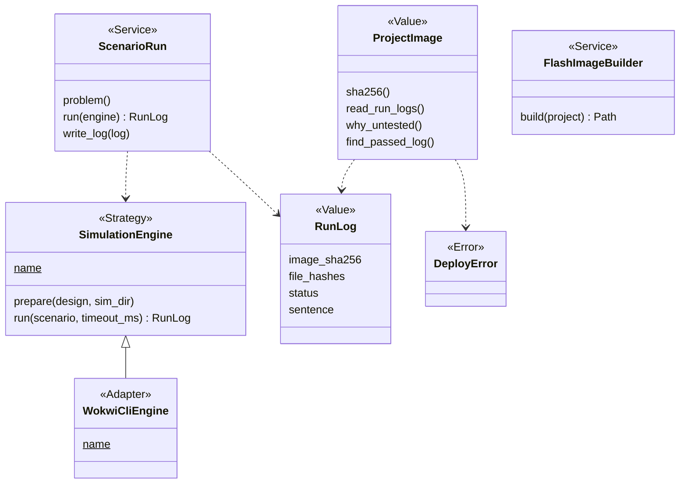
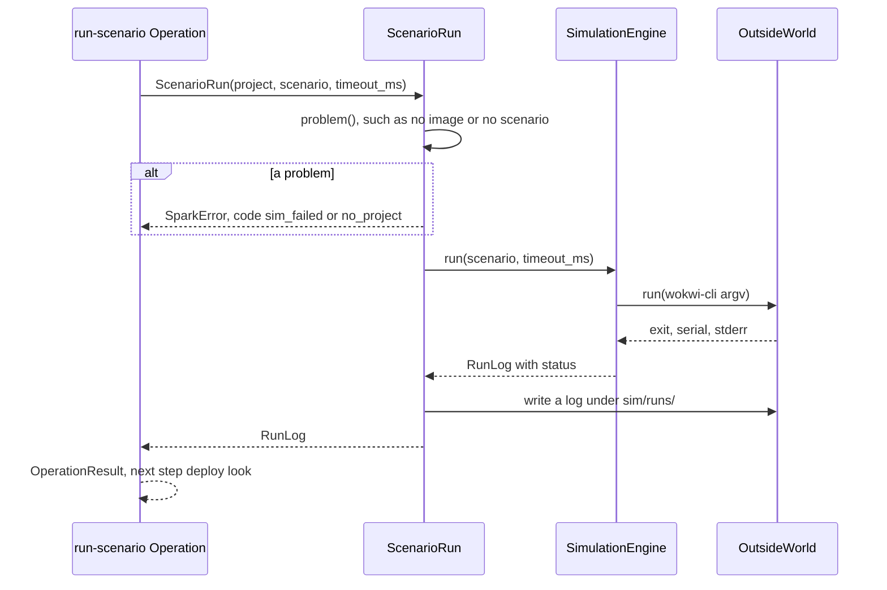

# Area: firmware

Back to [level 1](../README.md). Words are in the [glossary](../glossary.md). The files that move here are in the
[refactor plan](../refactor-plan.md#appendix-what-moves-where-by-name).

New names (proposed): `SimulationEngine`, `WokwiCliEngine`, `ENGINES`, `RunLog`, `FlashImageBuilder`, `status_of_run`, `SimulationEngineContract`, the modules `image_builder`, `import_probe`, `scenario_run`, `scenario_steps`, `simulation_engine`, `operations`, and the Operation names below.

P345 added `ScenarioSteps` (the counts of a scenario's step kinds, in `run_scenario`) and `ImageEvidence.caveats(image)`, a list of sentences. `RunLog` will own the counts line.

## Level 2: what firmware does

Firmware turns a project's code into a flash image and runs that image in a simulator against a scenario. It keeps
a log of each run, so the bench knows which image a passed simulation tested.

### Its operations

| Operation | CLI | Effects |
|---|---|---|
| `flash-image` | `flash_image.py` | reads, writes the image file |
| `import-firmware` | `import_firmware.py PROJECT` | reads, runs the host Python |
| `run-scenario` | `run_scenario.py` | reads, runs the simulator, reads the Wokwi token from `OutsideWorld.environ`, writes a run log under `sim/runs/` |

The build calls the simulation project step (`sim_project.py`) as one of its stages.

### Its components

| Module | Holds |
|---|---|
| `firmware/image_builder.py` | the image of MicroPython plus the project's files, moved from `flash_image.py` |
| `firmware/import_probe.py` | imports each firmware module on the computer without `main.py`, moved from `import_firmware.py` |
| `firmware/project_image.py` | `ProjectImage` and the run logs that tested it, moved as is |
| `firmware/sim_project.py` | the Wokwi project a design implies: the part mapping, the limits (`onboard_limits`, `write_limits`), the chips, `wokwi.toml` |
| `firmware/scenario_run.py` | `ScenarioRun` and `RunLog`, moved from `run_scenario.py` |
| `firmware/scenario_steps.py` | `ScenarioSteps`, the step constants, and `component_ids` after P399, moved from `run_scenario.py` |
| `firmware/simulation_engine.py` | `SimulationEngine`, `WokwiCliEngine`, `ENGINES` |
| `firmware/operations.py` | the area's `OPERATIONS` and its index docstring |

### Its ports and adapters

| Port | Real adapter | Fake | Chosen by |
|---|---|---|---|
| `SimulationEngine`: `prepare(design)`, `run(scenario) -> RunLog` | `WokwiCliEngine` over `wokwi-cli` | `tests/fake_wokwi_cli.py`, a fake process that exists today | `Backends.simulator`, the `simulator` role in the tools layers (`data/tools.json:5`) |
| command runner | `OutsideWorld.run` | a recording `run` | the CLI |
| file writes | `OutsideWorld.write` | a recording writer | the CLI |

Firmware imports design (the `Design` Value), records and core.

## Level 3: how firmware is built

`ScenarioRun`, `ProjectImage` (`project_image.py:19`) and `DeployError`
(`project_image.py:15`) exist.
`RunLog` replaces the dict that `run_record` builds, and its fields are proposed. The name avoids "record", which means a
fact file. `DeployError` subclasses `SparkError`.

### The main flow: run one scenario

### How firmware is tested alone

- `fake_wokwi_cli.py` stays the fake simulator. It is a process, so the same fake serves the goldens and the unit tests.
- A `SimulationEngineContract` test runs every engine on one tiny scenario with a recording `run`.
- `ProjectImage` reads run logs from `tests/data/`. No board, no USB.
- The patches of `find_toolchain` and `subprocess` go when each Adapter takes `run` (the `wokwi-cli` run in
  `ScenarioRun`, `sim_project.stage_chips`, `import_firmware.py:58`).

### How a new implementation is added

- A new simulator is one `SimulationEngine` subclass, one entry in `ENGINES` and one tool row for the `simulator`
  role. Its engine facts then move under `simulation.<engine>` in the part records.
- A new firmware platform builds its image with its own builder. That waits for the second platform: today the image
  is MicroPython plus LittleFS (`flash_image.py:33`), and the board's `micropython_port` picks the build
  (`flash_image.py:89`).

