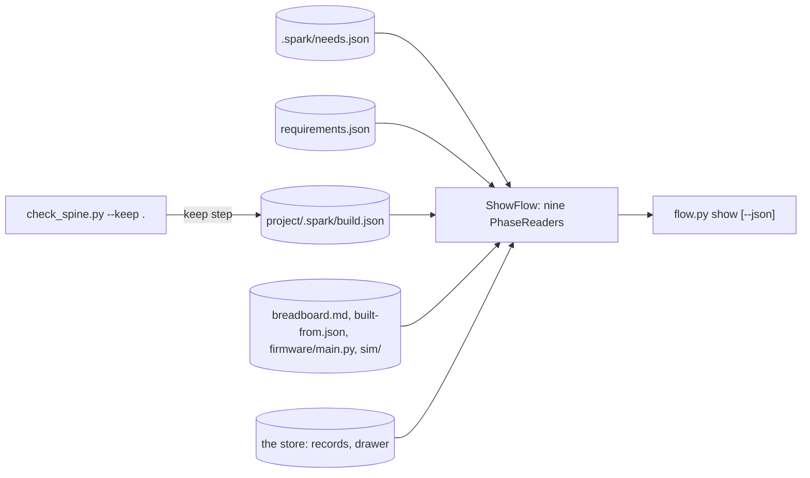

# Area: flow

Back to [level 1](../README.md). Words are in the [glossary](../glossary.md). Added by P825 (#1183), the first card of
the Artifact interface (P820): one reader says where a project stands, so the page (P827) and the requests (P829) read
one core.

## Level 2: what flow does

The flow area says where a project stands, phase by phase from the idea to the deploy. It reads the files each stage
wrote: `.spark/needs.json`, `requirements.json`, the build record `.spark/build.json`, `breadboard.md` with
`dist/board/built-from.json`, `firmware/main.py`, and the image and the runs under `sim/`. It writes nothing, and it runs
no offer.

### Its operations

| Operation | CLI | Effects |
|---|---|---|
| `show-flow` | `flow.py show --project DIR` (`flow.py` with no verb shows too) | reads |

### Its components

| Module | Holds |
|---|---|
| `flow/show_flow.py` | `ShowFlow` asks each reader in order and answers `data.phases` and `data.stands_at`. Each phase with problems or `could-not-run` adds one Finding |
| `flow/phase_readers.py` | `Phase` and `Offer` (Values), the mark table `MARKS`, the base `PhaseReader` (a Strategy) and one reader per phase in `READERS` |
| `flow/flow_codes.py` | the words of the area (a leaf): the nine phase names, the phase words `not-started`, `partial` and `stale`, and who does each phase. It also holds the offer keys and the fixed sentences |
| `flow/flow_operations.py` | `OPERATIONS`, which maps each printed `op` to its class, for the frontends |
| `flow/__init__.py` | the index docstring, no import |

Flow imports build (`build_record`), breadboard (`sheet`), design (`needs`, `need_requirements`), firmware
(`project_image`), records and core. Nothing imports flow but its CLI, `flow.py`.

### How flow is tested alone

`tests/test_flow.py` runs `flow.main` on five projects: no needs, picked, built by hand with no needs, a build that ended in
`could-not-run`, and requirements changed after the build. Each test pins the phases' status and offers. The build record's own tests are in
`tests/test_check_spine.py`. Flow has no golden net of its own: `GOLDEN_NET_ELSEWHERE` in `tools/story_tests.py` maps it
to the design net, `tests/test_golden_design.py`, which pins the record's line in `check_spine.py --keep`.
