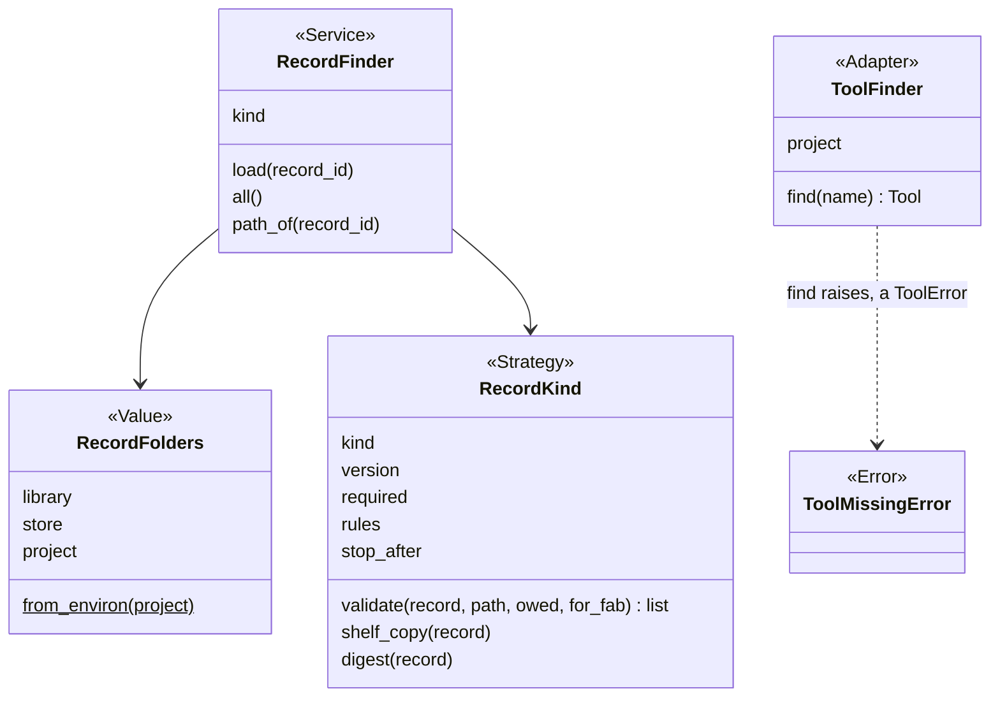
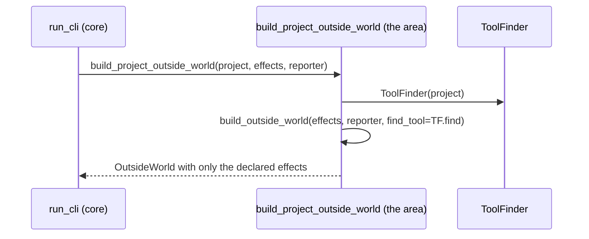

# Area: records

Back to [level 1](../README.md). Words are in the [glossary](../glossary.md). The files that move here are in the
[refactor plan](../refactor-plan.md#appendix-what-moves-where-by-name).

New names (proposed): `RecordFolders`, `RecordFinder`, `RecordKind`, `Record`, `ShelveRecord`, `Brief`, `DeployRecordStore`,
`ToolFinder`, `ToolMissingError` and `FakeToolFinder` (real since P725), and the Operation names below. `Backends`, `Choice` and
`build_outside` were dropped in P725: the choice of tools comes from `outside.find_tool`, built once per run by the area's builder.
`Records` and `RecordSchema` are the names of plan version 1. They are now `RecordFinder` and `RecordKind`, and the
role word Records is gone.

## Level 2: what records does

Records reads and writes every JSON record, the person's store and the tool rows, from one walk over the library,
the store and the project. An area's builder hands each run `ToolFinder(project).find` as `outside.find_tool`, so every
tool comes from one place (P725).

### Its operations

| Operation | CLI | Effects |
|---|---|---|
| `board-get`, `board-validate`, `board-resolve`, and `--path`, `--id`, `--paths` | `boards.py` (`main`) | reads |
| `tool-status`, `tool-install`, `tool-on`, `tool-off`, `tool-use`, `tool-pin`, `tool-new` | `tools.py --status` and the rest (`main`) | reads, writes, network and runs for install |

The flags stay as they are. `boards.py --list` is design's `list-boards` Operation on `run_cli` (P707), because it says
which board stops at the footprint (`footprint_emitter`, a design fact). `main` imports `ListBoards` inside the `--list`
branch alone, so the other flags load no design module.

### Its components

| Module | Holds |
|---|---|
| `records/store.py` | the store's folder, `write_file`, `fetch`, events, `keep`, moved from `scripts/store.py` in W6-R3a (P718) |
| `records/record_folders.py` | `RecordFolders`: the library, store and project folders, built once |
| `records/record_finder.py` | `RecordFinder`: one record kind read across the three folders, the nearest wins |
| `records/record_kind.py` | the record contract, moved from `parts.py` in W6-S3a (P720): `LIBRARY`, the keys and verbs, `RECORD_TYPES`, `document_problems`, the one reader and writer of a record file (`_parse`, `_write_record`) and `Answer`. `RecordKind` is built (P724): a kind's `version`, `required` keys, `rules` and `stop_after`, and `validate`. `BOARD` is in `board_records`, `PART` in sourcing's `part_records`. `shelf_copy`, `digest`, `RecordFinder`, `RecordFolders`, `Record` and `ShelveRecord` fold into P342 #437 |
| `records/answer_operation.py` | `AnswerOperation` (P726): the base of a parts.py handler on the core, a Template Method whose `run` holds the lock for a write, refuses a negative `start` (`--from`) before the body, turns an unreadable file into a could-not-run item and a coded refusal into `answer_refusal`'s Answer (a could-not-run item, unless a subclass answers it otherwise), and returns `build_answer(**values).to_result()`. `ANSWER_ARGUMENTS` holds the `--project`, `--from` and `--dry-run` Arguments and their help, which parts.py's `OPTIONS` reads. Design's six goal Operations are on it; sourcing's fifteen on its subclass `PartOperation` (PR 2) |
| `records/board_records.py` | the board loader, `ButtonPlaces`, `BoardError`, `OnboardRole`, `ONBOARD_ROLES`, `SimulatedPart`, `read_simulated_part`, `WOKWI_DEFINITION`, `onboard_limits`, `gpio_limits` and the readers of the role table, moved from `boards.py` in W6-R3a (P718), and `BOARD`, its contract (P724). The CLI `boards.py` keeps `main` and `_validate_all`, which prints |
| `records/board_rules.py` | the board's rules, one named rule per function, and the names they read: `PIN_ROLES`, `POWER_FUNCTIONS`, `GPIO_MIN`, `GPIO_MAX`, `is_gpio`, `is_pin_map_constant`, which `board_records` imports (P724) |
| `records/brief.py` | `Brief`: the project's `prefer` and `sellers`, from `.spark/project.json` |
| `records/deploy_record_store.py` | `DeployRecordStore` and `LastDeploy`: what the store says of the board on USB (built in `scripts/` in P431) |
| `records/provenance.py` | the leaf `provenance`: what a fact must carry |
| `records/board_pads.py` | the footprint pad each pin label of a board sits on: the one reader of `physical.pad_aliases` (P512) |
| `records/onboard_parts.py` | the onboard parts a scenario wires (`ONBOARD_PARTS`, P484). It imports only records and core since P708, and the converter's input is `build/board_alone_input.py` |
| `records/missing_facts.py` | the facts a board record owes a stage, as Findings, and what refuses a write of them (P464) |
| `records/records_codes.py` | the leaf `records_codes` (P716, moved in W6-R3a): a code and its sentence for each refusal of `BoardError`, `ToolError` and `StoreError`, `errors.CodedMessageError`s |
| `records/tool_finder.py` | the three `tools.json` layers merged, `find`, `status`, `plan`, `install` and the install lines, moved from `tools.py` in W6-R3b (P719). The CLI `tools.py` keeps `main` and `print_status`, which prints. Since P725 `ToolFinder(project).find` is the Adapter an area's builder hands an Operation as `outside.find_tool`, and `ToolMissingError` the `ToolError` of a tool not installed |
| `records/versions.py` | version numbers compared: a pin against the release installed, and a release against the oldest one spark runs, moved from `scripts/versions.py` in W6-R3b (P719) |

### Its seams and adapters

| Seam | Real adapter | Fake | Configured in |
|---|---|---|---|
| record folders | `RecordFolders.from_environ()` | `RecordFolders(tmp)` | `SPARK_HOME`, then `XDG_DATA_HOME`, then `~/.local/share/spark` (`store.home`) |
| tool finder: `find_tool(name) -> Tool` | `ToolFinder(project).find` over `data/tools.json`, the store's and the project's `tools.json` (P725) | `FakeToolFinder(answers)`: a name -> Tool or the exception to raise, with `asked` | the three layers, the project wins (`tool_finder.merged`) |
| network: `fetch(url) -> bytes` | `store.fetch`, the only `urlopen` | a dict from URL to bytes | none |
| file writes | `store.write_file` | a recording writer | none |

Records imports only core. It is the only area that reads `os.environ`. Another area gets the variables it needs
from `OutsideWorld.environ`, such as `CLAUDE_CODE_SESSION_ID` (`cost.py:69`, `:77`) and the Wokwi token
(read in `run_scenario.main`).

## Level 3: how records is built

`Backends` was dropped in P725. `ToolFinder(project).find` goes in as `outside.find_tool`, built by the area's builder
(`bench.build_project_outside_world`); the build and firmware functions take the same callable as a `find_tool` keyword
until their Operations come. Each area keeps its own platform default, such as bench's `DEFAULT_PLATFORM`, so records
never imports bench or firmware.

A record reader refuses a newer schema with code `schema_too_new`. A schema bump ships one tested `migrate(record)`.

### The main flow: one run starts

### How records is tested alone

- `RecordFolders(tmp)` over records copied from `tests/data/`. No test sets `os.environ` for the store.
- `FakeToolFinder` replaced the 31 `mock.patch.object(tool_finder, "find")` lines in P725 (about 39 on 2026-10-21); the
  29 patches of `shutil.which` stay. The suite's T2 baseline fell by 31.
- A `RecordKind` contract test runs every record in `boards/` and `parts/` through `validate` and expects none.
- When every test passes a `RecordFolders`, the test branches in `store` (the `unittest` guard at import, and `store._must_be_web`) go (rule T4).

### How a new implementation is added

- A new record kind, such as chips, is one `RecordKind` and one `RecordFinder("chips")`. No new class.
- A new tool is one row in `data/tools.json` for its role. A person switches it with `tools.py --use ROLE=TOOL`.
- A tool's MCP version is a `kind: mcp` row (`tool_finder.py:155`). Claude runs that tool and passes its result to the
  Operation as an input file. spark has no MCP client, so no core Adapter exists for it.
- An online store is a fourth folder in `RecordFolders`, only when a second user needs it.

