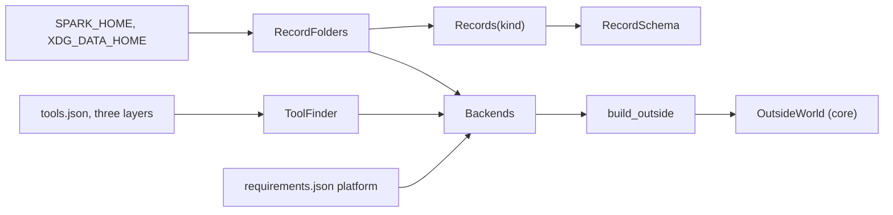
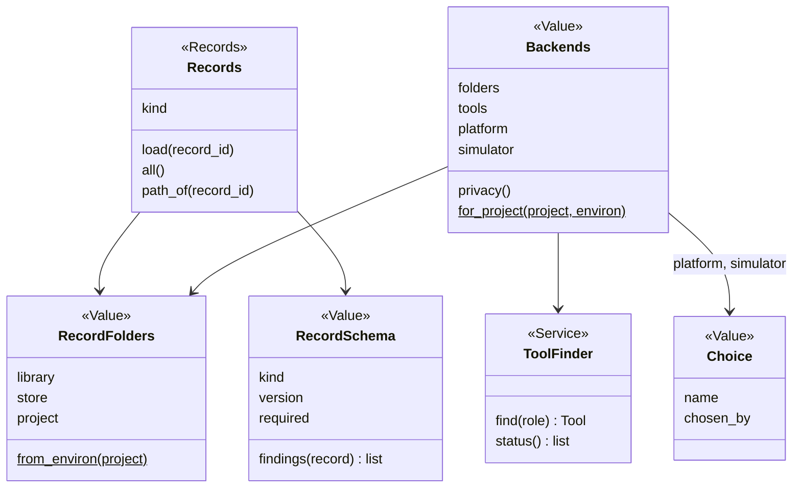
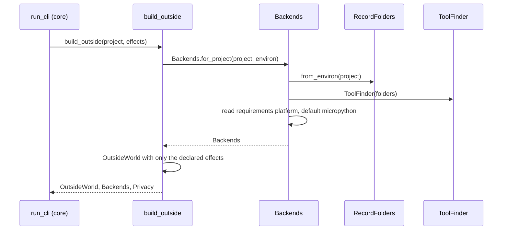

# Area: records

Back to [level 1](../README.md). Words are in the [glossary](../glossary.md). Names marked "proposed" do not exist
in the code yet.

## Level 2: what records does

Records reads and writes every JSON record, the person's store and the tool rows, from one walk over the library,
the store and the project. It also builds `Backends` once per run, so every backend choice comes from one place.

### Its operations

| Operation | CLI | Effects |
|---|---|---|
| `board-list`, `board-get`, `board-validate`, `board-resolve` | `boards.py --list`, `--get`, `--validate`, `--resolve` (`boards.py:553-561`) | reads |
| `tool-status`, `tool-install`, `tool-on`, `tool-off`, `tool-use`, `tool-pin`, `tool-new` | `tools.py --status` and the rest (`tools.py:572-578`) | reads, writes, network for install |

The Operation names are proposed. The flags stay as they are.

### Its components

| Module | Holds |
|---|---|
| `records/store.py` | the store's folder, `write_file`, `fetch`, events, `keep`, moved from `scripts/store.py` |
| `records/record_folders.py` | `RecordFolders` (proposed): the library, store and project folders, built once |
| `records/reader.py` | `Records` (proposed): one record kind read across the three folders, the nearest wins |
| `records/schema.py` | `RecordSchema` (proposed): a record kind's version, required keys and rules, `findings(record)` |
| `records/board_records.py` | the board loader, `ButtonPlaces`, `BoardError`, moved from `boards.py` |
| `records/tool_finder.py` | `ToolFinder` (proposed) over the three `tools.json` layers, install lines |
| `records/backends.py` | `Backends` and `build_outside` (both proposed) |

### Its ports and adapters

| Port | Real adapter | Fake | Configured in |
|---|---|---|---|
| record folders | `RecordFolders.from_environ()` | `RecordFolders(tmp)` | `SPARK_HOME`, then `XDG_DATA_HOME`, then `~/.local/share/spark` (`store.py:46-52`) |
| tool finder: `find(role) -> Tool` | `ToolFinder` over `data/tools.json`, the store's and the project's `tools.json` | `FakeToolFinder({role: argv})` | the three layers, the project wins (`tools.py:79-85`) |
| network: `fetch(url) -> bytes` | `store.fetch`, the only `urlopen` (`store.py:357`) | a dict from URL to bytes | none |
| file writes | `store.write_file` (`store.py:140`) | a recording writer | none |

Records depends only on core. It is the only area that reads `SPARK_HOME` or the environment.

## Level 3: how records is built

`Backends` holds choices, not built objects. `platform` is a `Choice` such as `micropython` chosen by
`requirements.json`. Each area's `operations.py` turns a choice into a Strategy with its own registry, so records
never imports bench or firmware. `Choice` is proposed. The envelope gains a `backends` key with each choice and its
`chosen_by` (proposed), so a person and Claude see which backend ran and why.

A record reader refuses a newer schema with code `schema_too_new`. A schema bump ships one tested `migrate(record)`.

### The main flow: one run starts

### How records is tested alone

- `RecordFolders(tmp)` over records copied from `tests/data/`. No test sets `os.environ` for the store.
- `FakeToolFinder` replaces about 39 `mock.patch.object(tools, "find")` lines and 29 patches of `shutil.which`
  (grep, 2026-10-21). The suite's patch count then falls.
- A `RecordSchema` contract test runs every record in `boards/` and `parts/` through `findings` and expects none.
- When every test passes a `RecordFolders`, the test branches at `store.py:40` and `store.py:339` go (rule T4).

### How a new implementation is added

- A new record kind, such as chips, is one `RecordSchema` and one `Records("chips")`. No new class.
- A new tool is one row in `data/tools.json` for its role. A person switches it with `tools.py --use ROLE=TOOL`.
- A tool's MCP version is a `kind: mcp` row (`tools.py:162`). Claude runs that tool and passes its result to the
  Operation as an input file. spark has no MCP client, so no core Adapter exists for it.
- An online store is a fourth folder in `RecordFolders`, only when a second user needs it.

### What moves into records

| Today | Becomes |
|---|---|
| `scripts/store.py` (407 lines) | `records/store.py`. `home()` (`store.py:46`) feeds `RecordFolders`. |
| `store.layers`, `store.records` (`store.py:73`, `:86`) | `Records(kind)` over `RecordFolders` |
| `boards.validate`, `REQUIRED_KEYS` (`boards.py:340`, `:62`) | `RecordSchema("board")` |
| `parts.validate`, `REQUIRED_KEYS`, `RECORD_TYPES` (`parts.py:621`, `:51`, `:311`) | `RecordSchema("part")`, one named rule per function |
| `compare_design.PULLUP_MIN_OHM` and `MAX` (read at `parts.py:495`) | `records/schema.py`, which removes the sourcing to checks edge |
| `boards.load`, `ButtonPlaces`, `BoardError` (`boards.py:253`, `:269`, `:122`) | `records/board_records.py`. `BoardError` subclasses `SparkError`. |
| `boards.footprint_stop` (`boards.py:236`), which imports `emit_footprint` and `parts` | design, which removes the records to design edge |
| `tools.find`, `merged`, `ToolProblem` (`tools.py:277`, `:79`, `:63`) | `ToolFinder`, `ToolMissingError` (proposed), code `tool_missing` |
| `tools.main` (`tools.py:568`, 83 lines, nesting 5) | seven Operations, one function each |
| the platform hard-coded at `deploy.py:171` and `micropython_port` at `flash_image.py:89` | `Backends.platform`. `micropython_port` stays a board fact the platform reads. |
