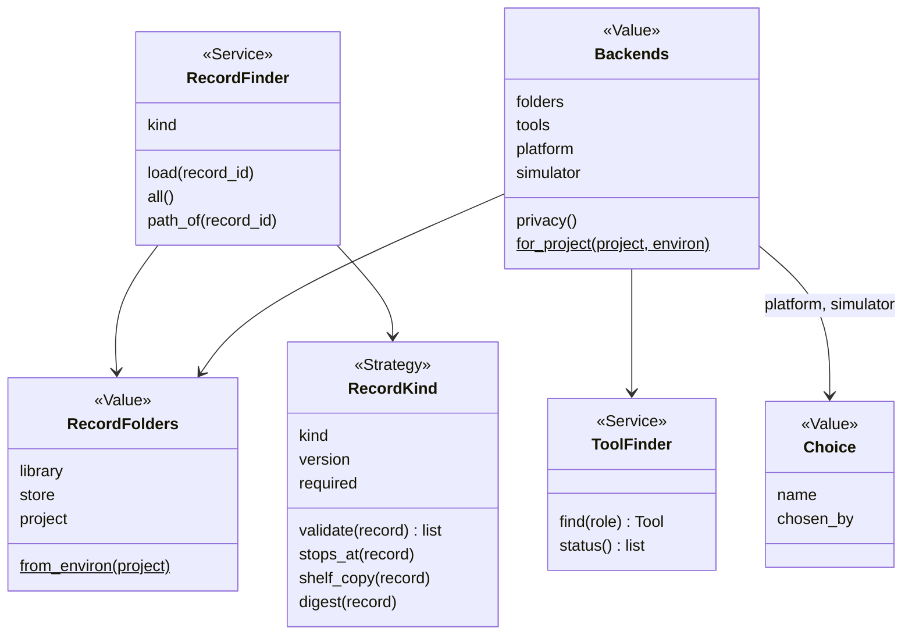
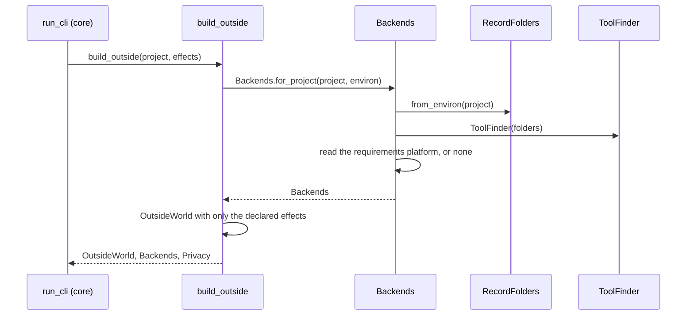

# Area: records

Back to [level 1](../README.md). Words are in the [glossary](../glossary.md). The files that move here are in the
[refactor plan](../refactor-plan.md#appendix-what-moves-where-by-name).

New names (proposed): `RecordFolders`, `RecordFinder`, `RecordKind`, `Record`, `ShelveRecord`, `Brief`, `DeployedStore`,
`ToolFinder`, `ToolMissingError`, `Backends`, `Choice`, `build_outside`, `FakeToolFinder` and the Operation names below.
`Records` and `RecordSchema` are the names of plan version 1. They are now `RecordFinder` and `RecordKind`, and the
role word Records is gone.

## Level 2: what records does

Records reads and writes every JSON record, the person's store and the tool rows, from one walk over the library,
the store and the project. It also builds `Backends` once per run, so every backend choice comes from one place.

### Its operations

| Operation | CLI | Effects |
|---|---|---|
| `board-get`, `board-validate`, `board-resolve`, and `--path`, `--id`, `--paths` | `boards.py` (`main`) | reads |
| `tool-status`, `tool-install`, `tool-on`, `tool-off`, `tool-use`, `tool-pin`, `tool-new` | `tools.py --status` and the rest (`main`) | reads, writes, network and runs for install |

The flags stay as they are. `boards.py --list` is design's `board-list` Operation, because it says which board
stops at the footprint (`footprint_stop`, called in `main`), a design fact. `boards.py` imports both
areas' `OPERATIONS`, as `parts.py` does.

### Its components

| Module | Holds |
|---|---|
| `records/store.py` | the store's folder, `write_file`, `fetch`, events, `keep`, moved from `scripts/store.py` |
| `records/record_folders.py` | `RecordFolders`: the library, store and project folders, built once |
| `records/record_finder.py` | `RecordFinder`: one record kind read across the three folders, the nearest wins |
| `records/record_kind.py` | `RecordKind`: a record kind's `version`, `required` keys and rules, `validate`, `stops_at`, `shelf_copy`, `digest` |
| `records/board_records.py` | the board loader, `ButtonPlaces`, `BoardError`, `OnboardRole`, `ONBOARD_ROLES`, `POWER_FACT_FUNCTIONS`, `SimulatedPart`, `read_simulated_part`, `WOKWI_DEFINITION` and the readers of the role table, moved from `boards.py` |
| `records/brief.py` | `Brief`: the project's `prefer` and `sellers`, from `.spark/project.json` |
| `records/deployed_store.py` | `DeployedStore` and `LastDeploy`: what the store says of the board on USB |
| `records/provenance.py` | the leaf `provenance`: what a fact must carry |
| `records/tool_finder.py` | `ToolFinder` over the three `tools.json` layers, install lines |
| `records/backends.py` | `Backends` and `build_outside` |

### Its ports and adapters

| Port | Real adapter | Fake | Configured in |
|---|---|---|---|
| record folders | `RecordFolders.from_environ()` | `RecordFolders(tmp)` | `SPARK_HOME`, then `XDG_DATA_HOME`, then `~/.local/share/spark` (`store.py:46-52`) |
| tool finder: `find(role) -> Tool` | `ToolFinder` over `data/tools.json`, the store's and the project's `tools.json` | `FakeToolFinder({role: argv})` | the three layers, the project wins (`tools.py:79-85`) |
| network: `fetch(url) -> bytes` | `store.fetch`, the only `urlopen` (`store.py:357`) | a dict from URL to bytes | none |
| file writes | `store.write_file` (`store.py:140`) | a recording writer | none |

Records imports only core. It is the only area that reads `os.environ`. Another area gets the variables it needs
from `OutsideWorld.environ`, such as `CLAUDE_CODE_SESSION_ID` (`cost.py:69`, `:77`) and the Wokwi token
(read in `run_scenario.main`).

## Level 3: how records is built

`Backends` holds choices, not built objects, and it names no backend of its own. `platform` is a `Choice` with the
name that `requirements.json` gives, or none and `chosen_by: default`. Each area's `operations.py` turns a choice into
a Strategy with its own registry and its own default, such as bench's `DEFAULT_PLATFORM`. So records never imports
bench or firmware. The envelope gains a `backends` key with each choice and its `chosen_by`, so a person and Claude
see which backend ran and why.

A record reader refuses a newer schema with code `schema_too_new`. A schema bump ships one tested `migrate(record)`.

### The main flow: one run starts

### How records is tested alone

- `RecordFolders(tmp)` over records copied from `tests/data/`. No test sets `os.environ` for the store.
- `FakeToolFinder` replaces about 39 `mock.patch.object(tools, "find")` lines and 29 patches of `shutil.which`
  (grep, 2026-10-21). The suite's patch count then falls.
- A `RecordKind` contract test runs every record in `boards/` and `parts/` through `validate` and expects none.
- When every test passes a `RecordFolders`, the test branches at `store.py:40` and `store.py:339` go (rule T4).

### How a new implementation is added

- A new record kind, such as chips, is one `RecordKind` and one `RecordFinder("chips")`. No new class.
- A new tool is one row in `data/tools.json` for its role. A person switches it with `tools.py --use ROLE=TOOL`.
- A tool's MCP version is a `kind: mcp` row (`tools.py:162`). Claude runs that tool and passes its result to the
  Operation as an input file. spark has no MCP client, so no core Adapter exists for it.
- An online store is a fourth folder in `RecordFolders`, only when a second user needs it.

