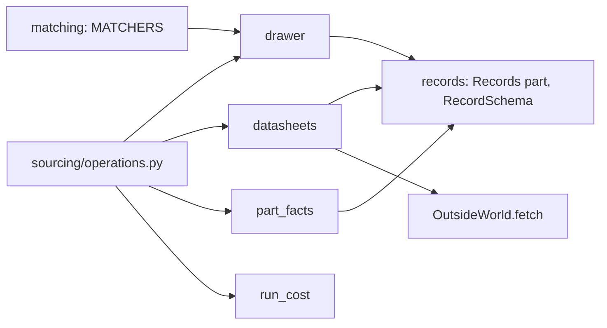
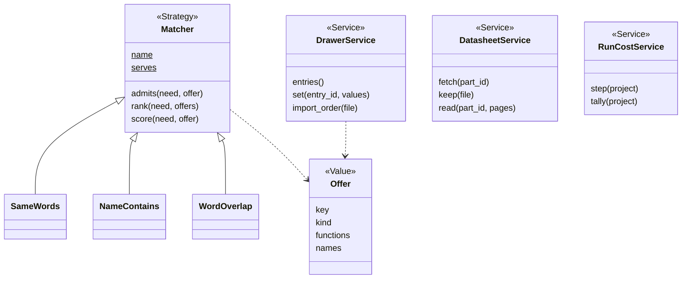
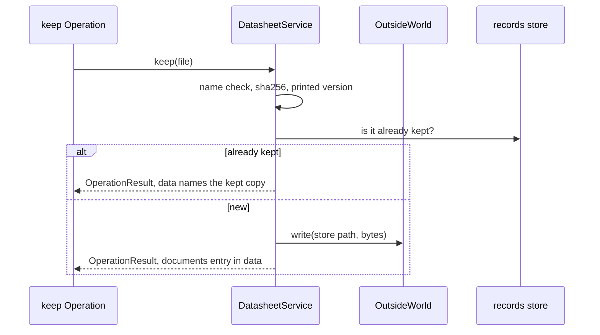

# Area: sourcing

Back to [level 1](../README.md). Words are in the [glossary](../glossary.md). Names marked "proposed" do not exist
in the code yet. The area name is proposed: `parts` already names the record folder and the CLI `parts.py`.

## Level 2: what sourcing does

Sourcing knows what the person owns and what spark knows about each part: the drawer, part facts, datasheets and
the offers that match a need. It also tallies what a project's run cost, read from the session transcripts.

### Its operations

`parts.py` runs 29 Operations today (`parts.py:1581`, counted with `ast`). Sourcing owns these:

| Group | Operations | Effects |
|---|---|---|
| records | `list`, `show`, `validate`, `signals`, `unverified`, `audit`, `describe`, `skeleton` | reads |
| facts | `fact-set`, `function-set`, `promote` | writes |
| datasheets | `sources`, `fetch`, `keep`, `read`, `kept`, `catalog` | reads, writes, network |
| drawer | `drawer`, `drawer-set`, `drawer-import` | reads, writes |
| cost | `step`, `tally`, and `cost.py` | reads, writes |

The goal Operations of `parts.py` (`need`, `needs`, `needs-set`, `match`, `offer`, `pick`, `requirements`) live in
design, because `needs.py` imports `design`, `emit_board` and `emit_footprint`. `parts.py` imports both areas'
`OPERATIONS`, so its flags stay as they are.

### Its components

| Module | Holds |
|---|---|
| `sourcing/drawer.py` | the drawer entries, their fields and checks, moved from `scripts/drawer.py` |
| `sourcing/matching.py` | `Matcher` and its subclasses, `Offer`, `MATCHERS`, moved from `scripts/matching.py` |
| `sourcing/datasheets.py` | fetching, keeping and reading a datasheet, moved out of `parts.py` (proposed) |
| `sourcing/part_facts.py` | setting and auditing facts on a part record, moved out of `parts.py` (proposed) |
| `sourcing/run_cost.py` | the transcript tally, moved from `cost.py` (proposed name: `cost.py` stays the CLI) |
| `sourcing/operations.py` | the area's `OPERATIONS` and its index docstring |

### Its ports and adapters

| Port | Real adapter | Fake |
|---|---|---|
| `Matcher` Strategy, chosen by `--matcher` | `SameWords`, `NameContains`, `WordOverlap` (`matching.py:166-195`) | a Matcher subclass in the test |
| part records | `Records("part")` from records | `RecordFolders(tmp)` over `tests/data/` |
| network | `OutsideWorld.fetch` | a dict from URL to bytes |
| transcripts | a reader of the harness's files under the store | transcript files in `tests/data/` |

Sourcing depends on records and core.

## Level 3: how sourcing is built

`DrawerService`, `DatasheetService` and `RunCostService` are proposed. `Matcher` already has the target form: a
`name` class attribute and a registry built from the classes (`matching.py:140`, `:222`). Every other registry copies it.

### The main flow: keep a datasheet

### How sourcing is tested alone

- `RecordFolders(tmp)` over the part records in `tests/data/`, no `SPARK_HOME`.
- A `MatcherContract` test (proposed) that every Matcher passes, the same way `FlasherContract` works for flashers.
- `fetch` is a dict, so no test opens the network.
- The goldens of slice 0c run every `parts.py` Operation once on a fixture project and stay unchanged.

### How a new implementation is added

- A new matcher is one `Matcher` subclass with its `name` and one entry in `MATCHERS`. A person picks it with
  `--matcher NAME`.
- A new shop for the drawer import is one Adapter that reads its order file into drawer entries.
- A new record kind goes to records, not here.

### What moves into sourcing

| Today | Becomes |
|---|---|
| `scripts/drawer.py` (421 lines) | `sourcing/drawer.py`. Its reads of `parts._parse` and `parts._problem` (`drawer.py:187`, `:226`) use records' public `Records` and core's `Finding`. |
| `scripts/matching.py` (230 lines) | `sourcing/matching.py`. `UnknownMatcher` (`matching.py:31`) becomes `UnknownMatcherError`. |
| `parts.py` datasheet code: `keep_in_store`, `keep_local`, `EXIF_TYPE_BYTES`, `DATASHEET_SAYS` (`parts.py:1102`, `:1214`, `:1061`, `:1122`) | `sourcing/datasheets.py` |
| `parts.validate` (`parts.py:621`, 240 lines) | records' `RecordSchema("part")` |
| `parts.py`'s use of `emit_footprint.footprint_gaps` (`parts.py:165`) | design, with `boards.footprint_stop` |
| `cost.py`'s logic (302 lines) | `sourcing/run_cost.py`. `NoTranscript` (`cost.py:46`) becomes `NoTranscriptError`. |
| `parts.py`'s operation table and parser (`parts.py:1581`, `:1655`, `:1672`) | `sourcing/operations.py` and core's `run_cli` |
