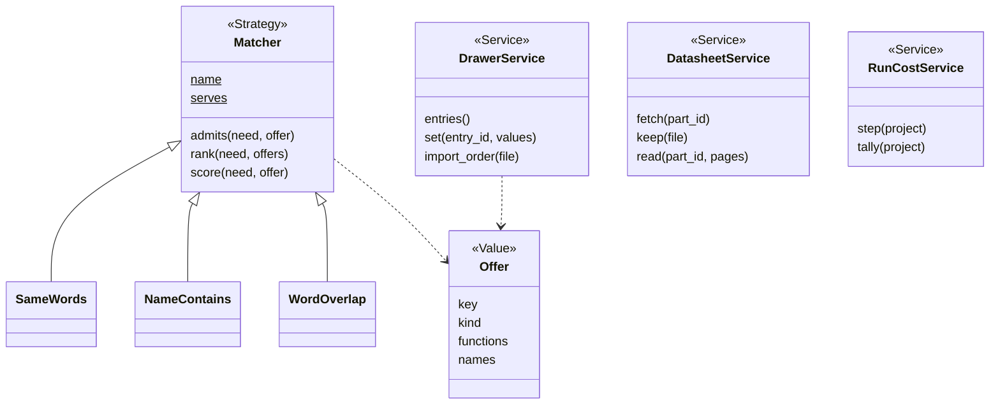
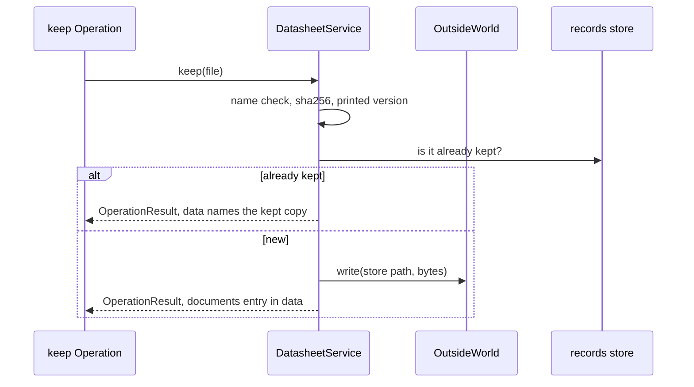

# Area: sourcing

Back to [level 1](../README.md). Words are in the [glossary](../glossary.md). The files that move here are in the
[refactor plan](../refactor-plan.md#appendix-what-moves-where-by-name).

New names (proposed): the area name `sourcing` (`parts` already names the record folder and the CLI `parts.py`),
`DrawerService`, `DatasheetService`, `RunCostService`, `UnknownMatcherError`, `NoTranscriptError`,
`MatcherContract`, and the modules `datasheets`, `part_facts`, `run_cost`, `operations`.

## Level 2: what sourcing does

Sourcing knows what the person owns and what spark knows about each part: the drawer, part facts, datasheets and
the offers that match a need. It also tallies what a project's run cost, read from the session transcripts.

### Its operations

`parts.py` runs 29 Operations today (`parts.OPERATIONS`, counted with `ast`). Sourcing owns these:

| Group | Operations | Effects |
|---|---|---|
| records | `list`, `show`, `validate`, `signals`, `unverified`, `describe`, `skeleton` | reads |
| facts | `fact-set`, `function-set`, `promote` | writes |
| datasheets | `sources`, `fetch`, `keep`, `read`, `kept`, `catalog` | reads, writes, network, runs the `pdf-text` tool for `read` (`parts.py:1192`) |
| drawer | `drawer`, `drawer-set`, `drawer-import` | reads, writes |
| cost | `step`, `tally`, and `cost.py` | reads, writes |

The goal Operations of `parts.py` (`need`, `needs`, `needs-set`, `match`, `offer`, `pick`, `requirements`) live in
design, because `needs.py` imports `design`, `emit_board` and `emit_footprint`. `audit` lives in design too: it asks
`emit_footprint.footprint_gaps` whether a board stops the chain (`parts.audit`). `parts.py` imports both areas'
`OPERATIONS`, so its flags stay as they are.

### Its components

| Module | Holds |
|---|---|
| `sourcing/drawer.py` | the drawer entries, their fields and checks, moved from `scripts/drawer.py` |
| `sourcing/matching.py` | `Matcher` and its subclasses, `Offer`, `MATCHERS`, moved from `scripts/matching.py` |
| `sourcing/datasheets.py` | fetching, keeping and reading a datasheet, moved out of `parts.py` |
| `sourcing/part_facts.py` | setting facts on a part record, moved out of `parts.py` |
| `sourcing/run_cost.py` | the transcript tally, moved from `cost.py`, which stays the CLI |
| `sourcing/__init__.py` | the area's `OPERATIONS` and its index docstring. One module per Operation, named after it |

### Its seams and adapters

| Seam | Real adapter | Fake |
|---|---|---|
| `Matcher` Strategy, chosen by `--matcher` | `SameWords`, `NameContains`, `WordOverlap` (`matching.py:166-195`) | a Matcher subclass in the test |
| part records | `RecordFinder("part")` from records | `RecordFolders(tmp)` over `tests/data/` |
| `Retriever` Strategy: `search(words, project)`, proposed with the sourcing move | today's `parts.need` with the `Matcher` registry. The datasheet reader and a vector store come with the learning spike, where a second real adapter exists | a Retriever subclass in the test |
| the project's brief | `Brief` from records (`prefer`, `sellers`), which replaces `parts.vendor_order` and `parts.sellers` | a `Brief` built in the test |
| network | `OutsideWorld.fetch` | a dict from URL to bytes |
| transcripts | a reader of the harness's files, the session from `OutsideWorld.environ` | transcript files in `tests/data/` |

Sourcing imports records and core. `matching` imports `text_guards` (core) and no longer `drawer`, because `clean` and
its caps leave `drawer` (OC8).

## Level 3: how sourcing is built

`Matcher` already has the target form: a
`name` class attribute and a registry built from the classes (`matching.py:140`, `:222`). Every other registry copies it.

### The main flow: keep a datasheet

### How sourcing is tested alone

- `RecordFolders(tmp)` over the part records in `tests/data/`, no `SPARK_HOME`.
- A `MatcherContract` test that every Matcher passes, as `FlasherContract` does for flashers (both proposed).
- `fetch` is a dict, so no test opens the network.
- The goldens of stage 6 run every `parts.py` Operation once on a fixture project. The `fetch` goldens run
  through `main(argv)`, so `store.fetch` takes `file:` URLs (`store.py:339`) and no golden needs the network.

### How a new implementation is added

- A new matcher is one `Matcher` subclass with its `name` and one entry in `MATCHERS`. A person picks it with
  `--matcher NAME`.
- A new shop for the drawer import is one Adapter that reads its order file into drawer entries.
- A new record kind goes to records, not here.

