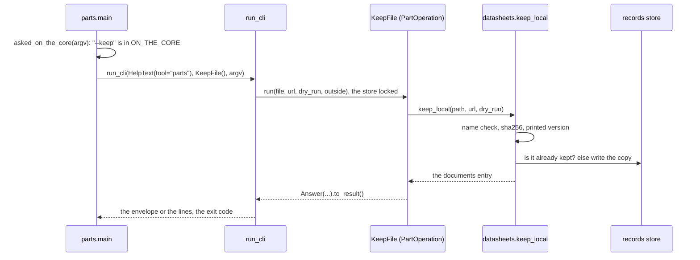

# Area: sourcing

Back to [level 1](../README.md). Words are in the [glossary](../glossary.md). The files that move here are in the
[refactor plan](../refactor-plan.md#appendix-what-moves-where-by-name).

New names: the area name `sourcing` (`parts` already names the record folder and the CLI `parts.py`),
`UnknownMatcherError`, `NoTranscriptError`, the modules `datasheets`, `part_facts`, `part_rules`, `part_records`, `run_cost`
and `part_handlers` (the write helpers), and since P726 PR 2 one module per Operation on `part_operation.PartOperation`
(`show_part.ShowPart`, `keep_file.KeepFile`, `mark_step.MarkStep`, twelve more), listed in `sourcing_operations.OPERATIONS`.
Still proposed: `MatcherContract`; the `DrawerService`, `DatasheetService` and `RunCostService` wraps of the three function
modules, which no card builds yet (the Operations call the modules' functions).

## Level 2: what sourcing does

Sourcing knows what the person owns and what spark knows about each part: the drawer, part facts, datasheets and
the offers that match a need. It also tallies what a project's run cost, read from the session transcripts.

### Its operations

`parts.py` runs 29 Operations today (`parts.OPERATIONS`, counted with `ast`). Sourcing owns these:

| Group | Operations | Effects |
|---|---|---|
| records | `list`, `show`, `validate`, `signals`, `unverified`, `describe`, `skeleton` | reads |
| facts | `fact-set`, `function-set`, `promote` | writes |
| datasheets | `sources`, `fetch`, `keep`, `read`, `kept`, `catalog` | reads, writes, network, runs the `pdf-text` tool for `read` (`datasheets.read_datasheet`) |
| drawer | `drawer`, `drawer-set`, `drawer-import` | reads, writes |
| cost | `step`, `tally`, and `cost.py` | reads, writes. `tally` is design's `tally_cost.TallyCost` (P726), because it reads `needs` (design), and sourcing imports no design module (P721) |

The goal Operations of `parts.py` (`need`, `needs`, `needs-set`, `match`, `offer`, `pick`, `requirements`) live in
design, because `needs` and `need_requirements` import `loader`, `power_rails` and `footprint_emitter`; six of them run on `run_cli` since P726,
each on records' `AnswerOperation`. `audit` lives in design too: it asks
`footprint_emitter.footprint_gaps` whether a board stops the chain (`audit_records.walk`). `parts.py` routes a flag to the core by
design's `OPERATIONS` and keeps its own table for `--describe`, so its flags stay as they are.

### Its components

| Module | Holds |
|---|---|
| `sourcing/drawer.py` | the drawer entries, their fields and checks, moved from `scripts/drawer.py` (W6-S3b, P721) |
| `sourcing/matching.py` | `Matcher` and its subclasses, `Offer`, `MATCHERS`, moved from `scripts/matching.py` |
| `sourcing/datasheets.py` | the catalog and `need`, fetching, keeping and reading a datasheet, and asking the cited URLs, moved out of `parts.py` (W6-S3b, P721) |
| `sourcing/part_facts.py` | what is known about a part: its signals, what nobody checked, the shelf copy and its digest, `promote`, `skeleton` and `describe`, moved out of `parts.py` (W6-S3b, P721) |
| `sourcing/part_handlers.py` | the write helpers (`_set_in_home`, `_drawer_answer`, `_write_lines`, the shelf-copy finders) with `vendor_order` and `sellers`, moved out of `parts.py` (W6-S3b, P721). The fifteen handlers it held are the Operations below since P726 PR 2; the handlers that read a JSON payload stay in the CLI until PR 3, because reading stdin is the interface's job |
| `sourcing/part_operation.py` | `PartOperation` (P726 PR 2): records' `AnswerOperation` with the one rule `parts.main` kept for the part handlers, a `PartError` is a problem on the part the flag names (`answer_refusal`) |
| `sourcing/list_parts.py`, `show_part.py`, `validate_parts.py`, `list_signals.py`, `list_unverified.py` | `ListParts` (`list`), `ShowPart` (`show`), `ValidateParts` (`validate`), `ListSignals` (`signals`), `ListUnverified` (`unverified`): the records group on the core (P726 PR 2) |
| `sourcing/write_skeleton.py`, `promote_record.py` | `WriteSkeleton` (`skeleton`), `PromoteRecord` (`promote`): the writes of the records and facts groups (P726 PR 2) |
| `sourcing/resolve_sources.py`, `fetch_documents.py`, `keep_file.py`, `read_datasheet.py`, `find_kept.py`, `list_catalog.py` | `ResolveSources` (`sources`), `FetchDocuments` (`fetch`), `KeepFile` (`keep`), `ReadDatasheet` (`read`), `FindKept` (`kept`), `ListCatalog` (`catalog`): the datasheets group on the core (P726 PR 2); `sources` and `fetch` declare `fetches` and reach the network through `datasheets` themselves |
| `sourcing/list_drawer.py`, `mark_step.py` | `ListDrawer` (`drawer`), `MarkStep` (`step`): the drawer listing and the cost group's write (P726 PR 2) |
| `sourcing/sourcing_operations.py` | `OPERATIONS`, the fifteen Operations by their printed `op` (P726 PR 2). A module, because the area's `__init__` imports nothing |
| `sourcing/run_cost.py` | the transcript tally, moved from `cost.py`, which stays the CLI |
| `sourcing/part_rules.py` | the rules that judge a part record's facts: the pull-up band since P717 (W6-S2), `i2c_pullup_problems` and the others since W6-S3a (P720) |
| `sourcing/part_records.py` | the part record read and checked (`load`, `validate`, `PartError`, `function_of`), moved out of `parts.py` (W6-S3a, P720) |
| `sourcing/sourcing_codes.py` | the leaf `sourcing_codes` (P717, moved into `sourcing/` by W6-S3a, P720): a code and its sentence for each refusal of `PartError`, `NoTranscriptError` and `UnknownMatcherError`, `errors.CodedMessageError`s |
| `sourcing/__init__.py` | the index docstring alone: it imports nothing (the wave 5 cycles), so the table is `sourcing_operations.py` |

### Its seams and adapters

| Seam | Real adapter | Fake |
|---|---|---|
| `Matcher` Strategy, chosen by `--matcher` | `SameWords`, `NameContains`, `WordOverlap` (`matching.py:166-195`) | a Matcher subclass in the test |
| part records | `RecordFinder("part")` from records | `RecordFolders(tmp)` over `tests/data/` |
| `Retriever` Strategy: `search(words, project)`, proposed with the sourcing move | today's `datasheets.need` with the `Matcher` registry. The datasheet reader and a vector store come with the learning spike, where a second real adapter exists | a Retriever subclass in the test |
| the project's brief | `Brief` from records (`prefer`, `sellers`), which replaces `part_handlers.vendor_order` and `part_handlers.sellers` | a `Brief` built in the test |
| network | `OutsideWorld.fetch` | a dict from URL to bytes |
| transcripts | a reader of the harness's files, the session from `OutsideWorld.environ` | transcript files in `tests/data/` |

Sourcing imports records and core. `matching` imports `text_guards` (core) and no longer `drawer`, because `clean` and
its caps leave `drawer` (OC8).

## Level 3: how sourcing is built

```mermaid
classDiagram
  class Matcher {
    <<Strategy>>
    name$
    serves$
    admits(need, offer)
    rank(need, offers)
    score(need, offer)
  }
  class Offer {
    <<Value>>
    key
    kind
    functions
    names
  }
  class AnswerOperation {
    <<Operation, records>>
    run(outside, **values)
    build_answer(**values)*
    answer_refusal(broken, values)
  }
  class PartOperation {
    answer_refusal(broken, values): a PartError is a problem on the part
  }
  class ShowPart {
    name = "show"
    build_answer(part_id, project)
  }
  class KeepFile {
    name = "keep"
    effects = reads, writes
    build_answer(file, url, dry_run)
  }
  class MarkStep {
    name = "step"
    build_answer(project_and_step, dry_run)
  }
  Matcher <|-- SameWords
  Matcher <|-- NameContains
  Matcher <|-- WordOverlap
  Matcher ..> Offer
  AnswerOperation <|-- PartOperation
  PartOperation <|-- ShowPart
  PartOperation <|-- KeepFile
  PartOperation <|-- MarkStep
  PartOperation <|-- "twelve more"
```

`Matcher` already has the target form: a
`name` class attribute and a registry built from the classes (`matching.py:140`, `:222`). Every other registry copies it.

### The main flow: keep a datasheet



The sequence of the other fourteen is the same but the library function called; `ResolveSources` and `FetchDocuments` reach
the network through `datasheets` and declare `fetches`.

### How sourcing is tested alone

- `RecordFolders(tmp)` over the part records in `tests/data/`, no `SPARK_HOME`.
- A `MatcherContract` test that every Matcher passes, as `FlasherContract` does for flashers (both proposed).
- `fetch` is a dict, so no test opens the network.
- The goldens of stage 6 run every `parts.py` Operation once on a fixture project. The `fetch` goldens run
  through `main(argv)`, so `store.fetch` takes `file:` URLs (`store._must_be_web`) and no golden needs the network.

### How a new implementation is added

- A new matcher is one `Matcher` subclass with its `name` and one entry in `MATCHERS`. A person picks it with
  `--matcher NAME`.
- A new shop for the drawer import is one Adapter that reads its order file into drawer entries.
- A new record kind goes to records, not here.

