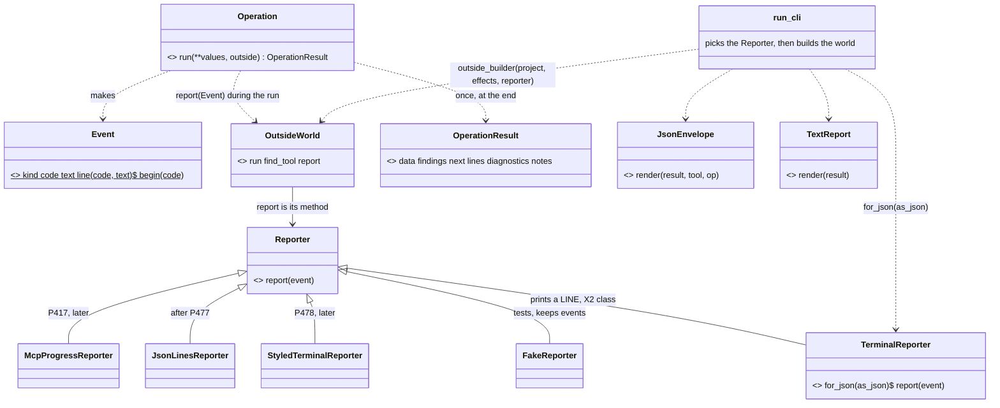
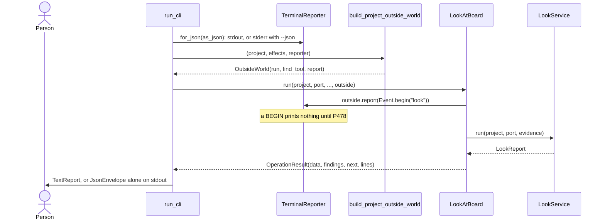
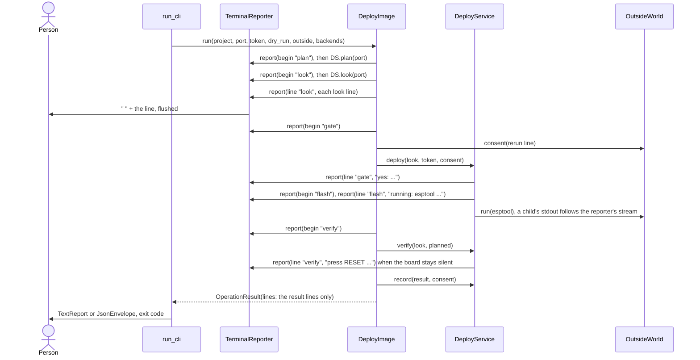

# The event seam: how an Operation tells a reader what happens now (P479, #657)

Card [P479 #657](https://github.com/xmejkal/spark/issues/657), epic P158 [#94](https://github.com/xmejkal/spark/issues/94).
Written on 2026-11-01 by Fable 5.1 for the PO's approval, with no code. It refines the PO's decision on #94
(2026-11-01). Measured on the branch after it merged `origin/main` at d375c017 (P482 and P468 are in). Line numbers are
that commit's.

> **The short version.** An Operation gets one more callable in its `OutsideWorld`: `report(event)`. An Event is a
> small Value of three facts: its kind (`LINE` or `BEGIN`), the code of the phase it is about, and for a `LINE` the
> sentence. The CLI's `TerminalReporter` prints a `LINE` at once and prints nothing for a `BEGIN`. So every golden stays
> byte-equal, and a person sees no change until the colored terminal (P478 #656) draws the `BEGIN`s. `--json` keeps one
> envelope on stdout and plain text on stderr. First a probe on the look (E1), then deploy inside W4-2 (E2), then each
> other output place with its wave.

> **You decide.** Each line is a question, the council's recommendation, and your yes or no.
>
> 1. Is `report` the one word for the seam: `outside.report(event)`? **Recommend: yes.**
> 2. Does E1, the probe on the look, run as its own PR right after P480 (the walk 3 notes), and E2a (two new deploy
>    goldens) as its own small PR before W4-2? **Recommend: yes.**
> 3. Under `--json`, does stderr stay plain text for a person, with JSON lines on stderr waiting until the spike P477
>    #653 shows an agent that reads them? **Recommend: yes.**
> 4. Do E1, E2a and E2 change nothing a person sees, so that the first visible gain is P478's colored terminal?
>    **Recommend: yes, the seam comes first.**
>
> **Approve this** = E1 starts as its own PR after P480. E2a follows it. E2 rides in W4-2's PR. Each edit of section 3 lands in the PR
> of the slice that makes it true. The council decided the other open questions, in
> `docs/observations/rows/p479-event-seam.md`.

Summary. Today only deploy prints while a step runs, through a `show_line` callable that two Service methods and one
helper take. The seam replaces that callable with one Event Value and one `report` method in `OutsideWorld`. So the
Operation and its Services never see a stream. The result at the end stays one `OperationResult` for the two Renderers.
The events during the run go through the Reporter that the frontend picks. The map of every output place is the appendix.

Council. Round 1 (architecture, UX and AI-UX, tech lead, PO assistant, refuter) ran on 2026-11-01. It renamed the
Event's fields and cut `PROGRESS` and the counts. It moved the child output change to E2 and added the rules of the seam. It fixed the
builder path that E1's test takes. It added two deploy goldens before E2 and corrected three counts. Round 2 (PO
assistant and tech lead, senior architecture, refuter) ran on the same day. It split E2a from E2, dropped the Reporter
role row, added rule 5 and the one-event-per-line rule, and cut risk 3's claim to what the goldens reach. Records:
`docs/observations/2026-11-01-p479-event-seam-council/round1.md` and `round2.md`.

## 1. The design

The smallest design that works end to end: one Value, one method, one real Reporter, one Fake.

### The Event Value

`Event`, a namedtuple in `spark/core/events.py` with three fields. Its docstring says Value.

| Field | What it holds |
|---|---|
| `kind` | `LINE` (a sentence the person reads now) or `BEGIN` (a phase begins now). The constants: `LINE, BEGIN = "line", "begin"` |
| `code` | the snake_case code of the phase the event is about. Deploy's phases are `board_envelope.STAGE_*` (`board_envelope.py:26`). They are public already, as the envelope's `stage`. S11 renames them `DeployPhase`. A build's codes are its stage names. Never a sentence |
| `text` | for a `LINE`, one line of the words printed today, with no newline and no indent. None for a `BEGIN` |

A caller that has a joined block (`deploy.py:243`, `:259`) sends one event per line. Two constructors keep call sites short: `Event.line(code, text)` and `Event.begin(code)`. A `BEGIN` has no end event: the
next `BEGIN` or the result ends it. No count, colour, stream, time stamp or severity. When a Reporter needs one of them,
that field enters (records grow by need). A unit test builds one event of each kind and reads every field.

Why `code` and `begin`. The draft had a field `step` and a constructor `Event.step`: one word for two things, and "step"
already names wiring steps and scenario steps. `code` means what it means in a `Finding`: a snake_case constant that a
reader decides on.

### The Reporter

- `Reporter`, a Strategy base in `events.py` with one method, `report(event)`. It returns nothing and never raises on a
  kind it does not know. A Reporter decides on `kind` and `code`, never on `text`.
- `TerminalReporter(stream)`, in `events.py`, a Strategy case like `TerminalConsentStrategy`. It prints `"  " + text`
  for a `LINE` through `guard_lines`, with a flush, and nothing for a `BEGIN`. The indent is presentation, so the terminal
  adds it, and every line keeps today's bytes. `TerminalReporter.for_json(as_json)` picks the stream: stdout, or stderr
  with `--json`. The class joins X2's `TERMINAL_CLASSES` (`tools/measure.py:251`), so the stream choice sits in an X2
  class and outside `run_cli`'s R1 budget.
- `FakeReporter` in `tests/fakes.py` keeps every event in `events`. `FakeOutsideWorld` (`fakes.py:272`) makes one by
  default as `outside.reporter`, and its `report` is the Fake's.
- `ReporterContract` in `tests/test_core.py`: each Reporter takes one event of each kind, and one of an unknown kind,
  with no exception.

Names. `Reporter` is a Strategy and `Event` is a Value. Neither gets a new row in `docs/guide/developing.md`'s table: its
Strategy row (`:302`) already lets a plain noun stand when the docstring says Strategy, as `BoardReader` does. The
docstring of `Reporter` says Strategy, and `tools/measure.py:35` `ROLES` stays as it is.

### Where it sits, and the builder change

`OutsideWorld` (`outside.py:18`) gains the field `report`, as `run` holds `ProgramRunner.run` today.
`build_outside_world(effects, reporter, find_tool=None)` fills it with `reporter.report`. Reporting is not an effect:
every Operation has it, and nothing gates it.

`run_cli` picks the Reporter before it builds the world. At `cli.py:108` it pops `as_json`. One new line follows:
`reporter = TerminalReporter.for_json(as_json)`. The builder call at `:109` gains `reporter`. So every builder takes three parameters: `build_project_outside_world` (`bench/__init__.py:14-17`, which
`look.py:55` passes on unchanged), and the test builders at `test_core.py:187` and `:265`. A test that gives `outside`
keeps its own reporter, so E1's stream test goes through a builder, as `test_core.py:185-193` does.
`FakeOutsideWorld` makes its own `FakeReporter`, so it takes a `reporter=` parameter (`fakes.py:277`) beside `run` and
`find_tool`. The two calls of `build_outside_world` at `test_core.py:276` and `:286` gain the reporter. The mutation row at
`tests/mutations/p442-core-look.json:4` finds `build_outside_world`'s return line, so E1 updates its find and replace.

### The five rules of the seam

1. **One line, one place.** An event line is a line that the person reads before the run ends: before the gate asks,
   or while a slow phase runs. Every other line is a result line in `OperationResult.lines`, which `TextReport` prints
   once at the end. No line is both, and E2's test checks that no event text is in the result's lines. Deploy has seven
   event lines, listed in the appendix. The dry run's lines and the closing lines are result lines.
2. **The order on the streams.** Without `--json`: the event lines on stdout as they happen, then `TextReport`'s result lines
   on stdout, then the diagnostics on stderr. With `--json`: the event lines on stderr as they happen, then the envelope
   alone on stdout, then the diagnostics on stderr. E1's toy test pins both orders.
3. **Diagnostics stay out of the Reporter.** A line that goes to stderr in both modes is a diagnostic in
   `OperationResult.diagnostics`, never a `LINE`: the build's kept lines (`check_spine.py:1023`), its notes at `:737` and
   `:745`, a refusal such as `deploy.py: <why>`, a crash's traceback. So no Event needs a stream field, and no later move
   puts a stderr line on stdout.
4. **The stderr contract.** Under `--json`, stderr holds text for a person: the event lines, a tool's own output, the
   diagnostics and a crash's traceback. An agent reads the envelope on stdout and never parses stderr. E1 adds this
   sentence to `docs/guide/agents.md` beside `:555-558`. JSON lines on stderr are a later Reporter (decision 3).
5. **The world's report is the only path.** An Operation prints nothing, and `run_cli` never prints an event itself.
   Test builders take the reporter. A caller-supplied `outside` carries its own report, so a test that gives one reads
   that Fake's events.

Facts only. An Operation reports codes and the sentences spark prints today. No threshold, timing or colour enters an
Event. P481 #660 later describes each phase once, as data, and a `LINE` then names fewer words.

### A child's output, in E2

`deploy.py:225` gives esptool fd 2 under `--json`, through `DeployService.echo_to` (`deploy_service.py:68-72`, `:120`).
Only deploy uses it, so it moves in E2, not E1. When the caller does not capture a child's stdout, the `ProgramRunner`
that `build_outside_world` builds sends it to the reporter's stream. `subprocess.run` refuses `stdout` beside
`capture_output`. So when the caller gives either, the runner sets no `stdout`. The mutation row "the echo goes to stdout
under `--json`" stays and targets `ProgramRunner`.

### The later Reporters

Each plugs in without touching an Operation, and each enters with its frontend. A severity and a phase order enter with
P478 and the MCP Reporter, not before. `McpProgressReporter` needs a progress and a total, and P481's phases as data can
give the total. MCP stdio never gets a stdout `TerminalReporter`: the MCP frontend builds its own world.

| Reporter | Frontend | What it does | Card |
|---|---|---|---|
| `StyledTerminalReporter` | the CLI, on a tty with `NO_COLOR` unset | colours a `LINE` by its `code`, says a `BEGIN` in grey | P478 #656 |
| `JsonLinesReporter` | the CLI under `--json`, on stderr | one JSON object per event, such as `{"event": "begin", "code": "flash"}` | after P477 #653 |
| `McpProgressReporter` | the MCP server in `scripts/spark/frontends/` | a `BEGIN` as a progress notification, a `LINE` as a log message | P417 #545 |
| `SseReporter` | a web frontend, none exists | `event: <kind>` and `data: <json>` per event | none yet |

The look, E1. One `BEGIN` before the esptool read. The terminal prints nothing for it, so no golden changes, and the Fake
sees it.

Deploy, E2 inside W4-2. Each phase reports a `BEGIN` where `reached["stage"]` is set today. The event lines of rule 1
become `LINE`s with their phase code. The person sees the same bytes.

## 2. The order

E1 sits in wave 4, before W4-2, and W4-2 builds on it. Each slice is one PR, tested, with no golden changed.

| Slice | What it builds | Done when | Size |
|---|---|---|---|
| E1, the probe on the look | `events.py` with the Event, its two kinds, the Reporter base and `TerminalReporter`. `OutsideWorld.report` and `build_outside_world`'s new parameter. `run_cli`'s reporter line and the three builders. `LookAtBoard.run` reports `Event.begin(STAGE_LOOK)` before `looker(...).run` (`look_at_board.py:50`). `FakeReporter` and `FakeOutsideWorld`'s default. X2's list. The agents.md sentence of rule 4. The p442 mutation row retargeted. `Reporter` stays a plain noun whose docstring says Strategy | the 16 golden files are byte-equal. `test_look` sees `[Event("begin", "look", None)]`. The toy, run through a builder: its `LINE` is on stdout before the report without `--json`, and on stderr with it while stdout holds the envelope alone. A `BEGIN` prints nothing. The Event test reads every field. `ReporterContract` passes. The X2 baseline gains no entry, and `ROLES` is unchanged. Mutation: a `BEGIN` that prints, a `LINE` on stdout under `--json`, a `LINE` without its indent, the event not sent, each caught | estimate: 50 product lines, 60 test lines, 10 doc lines |
| E2a, two goldens before W4-2 | Measured on main, with no product code changed: `deploy-could-not-run-no-terminal.txt` (no `--json`, reaches the gate, the look's lines on stdout) and the stderr bytes of the `--json` case. The golden runner returns stderr for a case that names a stderr file (`golden_bench.py:134` returns stdout only today) | both goldens pass on main. The 16 older goldens are byte-equal. The PR text says where the two leading spaces of the look's lines come from at each site (risk 3) | 60 test lines |
| E2, deploy inside W4-2 | W4-2's code with the edits of section 3: the event lines of rule 1 become `LINE`s, each phase a `BEGIN`, `echo_to` moves into `ProgramRunner`, `show_line` goes | every deploy golden, the two of E2a too, is byte-equal. `test_deploy_gate` holds the exact event texts of one deploy that reaches ready, prints them once through `TerminalReporter`, and compares them with today's strings. No event text is in the result's lines. `test_core.py:287-288` (`assertIs` of `run` and `ProgramRunner.run` to `subprocess.run`) and the `echo_to` test at `test_deploy_json.py:455` change with `ProgramRunner`. In `tests/architecture_baseline.json`, `R1:scripts/deploy.py:_deploy` (72), `R3:...:_deploy` (9) and `R3:...:DeployService.__init__` (7) drop or go. W4-2's other checks hold | the seam edits, about 60 lines |
| E3, the colored terminal (P478 #656) | `StyledTerminalReporter`. On a tty with `NO_COLOR` unset, `run_cli` picks it | the PO sees colour on his bench. `deploy.py --json` and a piped `deploy.py` print the bytes of before | P478's card |
| E4, the other output places | each with its area's move in wave 6, as the appendix lists | each move's goldens are byte-equal, and the person sees a stage as it begins | inside each move |
| E5, the other readers | one Reporter each, with its frontend (the table above) | no Operation touched | later |

Review size. E1 holds logic: one reviewer, the refuter on the strongest model, one mutation run. E2a is tests only: one
reviewer. E2 keeps W4-2's review. This plan takes two council rounds before the PO reads it, as #657 says.

## 3. What changes in the plans

No file is edited by this card. Each edit lands in the PR of the slice that makes it true. After E2's PR,
`/usr/bin/grep -rn show_line docs/discovery/2026-10-19-p323-target-architecture scripts` finds nothing outside this file.

| File | Section | The change | Slice |
|---|---|---|---|
| `README.md` (level 1) | "The one interface contract" | a row `events`: `Event(kind, code, text)` through `OutsideWorld.report`, the five rules | E1 |
| `README.md` | "One Operation, two frontends" | an arrow `O->>RC: outside.report(Event)` and `RC-->>P: the line, now` | E1 |
| `refactor-plan.md` | "Level 3" class diagram (`:127-128`) | `deploy(look, token, consent)`, `verify(look, planned)`, `DeployService` holds `outside` | E2 |
| `refactor-plan.md` | "Level 4" sequence (`:188`, `:194`) and the paragraph at `:201-202` | `DS->>OW: report(Event)`, and `OutsideWorld.report`, not `show_line` | E2 |
| `refactor-plan.md` | "4. The core contract", rule 2 | "No Operation asks or prints. It asks only through `outside.consent` and tells only through `outside.report`." X2's list gains `TerminalReporter` | E1 |
| `refactor-plan.md` | "Wave 4", S7b | the lines a person sees while esptool runs are `LINE` events, each phase a `BEGIN` | E2 |
| `refactor-plan.md` | "Wave 6" | the build move reports a `BEGIN` per stage, and the kept lines stay diagnostics. The firmware move reports a `BEGIN` before wokwi-cli | E4 |
| `refactor-plan.md` | "What we will not do" | no Reporter beyond `TerminalReporter` and the Fake until its frontend exists | E1 |
| `refactor-plan.md` | "Appendix: what moves where" (`:627`) | `deploy.show_line` becomes `OutsideWorld.report` with `TerminalReporter` | E2 |
| `wave4-plan.md` | "Council", round 1 (`:25`) | `show_line` becomes `report`, built in E1 | E2 |
| `wave4-plan.md` | "W4-2", Classes (`:95-97`) | `OutsideWorld` gains `clock` and `consent(line)` (`report` exists). `LineWriter` goes: `TerminalReporter` and `ProgramRunner` take its two jobs | E2 |
| `wave4-plan.md` | "W4-2", Files (`:103`) | `outside_builder(project, effects, reporter)`. `deploy_service.py`: `show_line` and `echo_to` go. New mutation rows: a `BEGIN` prints, a `LINE` under `--json` reaches stdout, an event line is also a result line | E2 |
| `wave4-plan.md` | "W4-2", the rename | its own row: deploy's `LookReport` variable `report` becomes `look` where it meets `outside.report` | E2 |
| `wave4-plan.md` | "W4-3" | one sentence: grant, live and reach report nothing new | E2 |
| `wave4-plan.md` | "The bench after wave 4" (`:154`, `:191-195`) | `OutsideWorld { run find_tool clock consent report }`, and the sequence gains `DS->>R: report(begin "flash")` | E2 |
| `wave4-plan.md` | "The four checks" | a fifth: every line deploy shows while a phase runs is an Event in a test | E2 |
| `areas/core.md` | the `core/outside.py` and `OutsideWorld` rows | name `report`, and a row for `core/events.py` | E1 |
| `areas/bench.md` | `:127-128`, `:173`, `:182` | the `show_line` parameters go | E2 |
| `glossary.md` | rows | Event, Reporter, and "report" with its three meanings: the method `outside.report`, the `LookReport` value, the `TextReport` output. Also "event line" and "result line" | E1 |
| `notes.md` | a decision row | "N33 `OutsideWorld.report(event)` over a line callable: one seam for every reader" | E1 |
| `docs/guide/developing.md` | "The core contract" and its class diagram, the Strategy row's examples | `report` in the contract, `Reporter` among the examples. No new role row | E1 |
| `docs/guide/agents.md` | beside `:555-558` | the stderr contract of rule 4 | E1 |

## 4. Risks

1. **A child's output and a capture (E2).** `subprocess.run` refuses `stdout` beside `capture_output`. When the caller
   gives either, the runner sets no `stdout`. E2's test runs both.
2. **A base class with one real case.** Rule T3 takes the Fake as the second case, and P478 brings the second real one.
   The base comes now, because the contract test names what every later Reporter owes.
3. **The indent.** `deploy.py:243` prints `report_lines` with no indent, and `board_look.py:390` builds `"port   %s"`
   with none, yet `test_deploy_json.py:196` expects `"  port   ..."`. So the source of the two spaces is not clear at each
   site, and E2a writes it down per site. The Event holds the text without them, and the terminal adds them. E2's goldens
   stop at the gate, so they reach only the look's lines. The `yes:`, `running:`, retry, press RESET and not-counted lines
   and `deploy.py:152` are in no golden. E2's exact-text event test is what guards them.
4. **The build's timing (E4).** A `BEGIN` per stage shows text earlier. The bytes stay, the timing changes, and the build
   golden (S3) compares bytes.
5. **The probe's size.** E1 touches ten files, listed in its row. The child output change moved to E2 to keep it small.

## Appendix: the map, where spark prints, asks and streams today

| What | Count | Main anchors |
|---|---|---|
| scripts in `scripts/*.py` | 69, 25 with a `main()` | `ls scripts/*.py` |
| scripts that print or write stderr | 29 (28 with `print(`, 155 calls) | `tools.py` 19, `emit_board.py` 16, `init_project.py` 11, `boards.py` 11, `assign_pins.py` 9, `grant.py` 8, `deploy.py` 3 (it prints through its helper `shown`, `deploy.py:117`) |
| scripts on `run_cli` | 1 | `scripts/look.py:54` |
| prints inside `scripts/spark/` | 3, all in `run_cli` | `scripts/spark/core/cli.py:106`, `:112`, `:114` |
| places that ask a person | 1 | `deploy_gate.py:78-82` (`TerminalConsentStrategy.ask`), the tty test at `:75` |
| lines shown while a step runs | deploy only, 7 sites | `deploy.py:243` the look's lines. `deploy.py:152` the standing yes not used. `deploy_service.py:102` the yes. `:108` running. `:126` the retry. `:182` press RESET. `board_start.py:106` the restart not counted |
| waits a person sits through | 4 | `deploy_service.py:108-121` the erase and the write. `:120` esptool's output through `echo_to`. The retry sleep. `board_start.py:95-108` the start wait poll loop. The look's esptool read |
| a tool's own output passed through | 1 | `deploy.py:225` gives esptool fd 2 under `--json` |
| prints all at the end, though steps are slow | 4 | `check_spine.py:375` collects stages, `:638` renders, `:1019-1023` prints. `run_scenario.py:488` runs one child, `:581-585` prints. `flash_image.py:308-309`. `tools/mutate.py` |
| tools in `tools/*.py` that print | 10 of 12 | the team's tools, not spark's product |

The other output places and the wave that moves them (E4):

| Place | Today | After its move | Wave |
|---|---|---|---|
| the build, `check_spine.py` | stages at the end, the kept lines on stderr | a `BEGIN` per stage, the kept lines as diagnostics (rule 3) | wave 6, the build move |
| the simulation run, `run_scenario.py` | one line at the end | a `BEGIN` before wokwi-cli starts | wave 6, the firmware move |
| the image, `flash_image.py` | per-file lines at the end | result lines, as today | wave 6, the firmware move |
| `tools/mutate.py` | lines at the end | no Reporter, a team tool | none |
