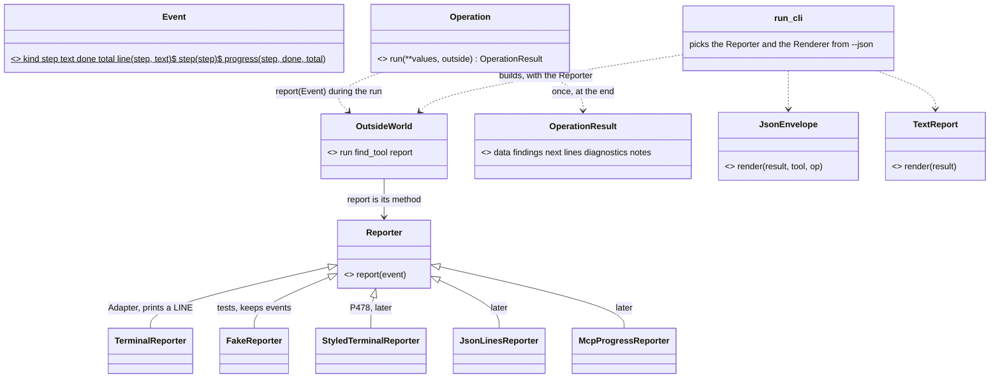
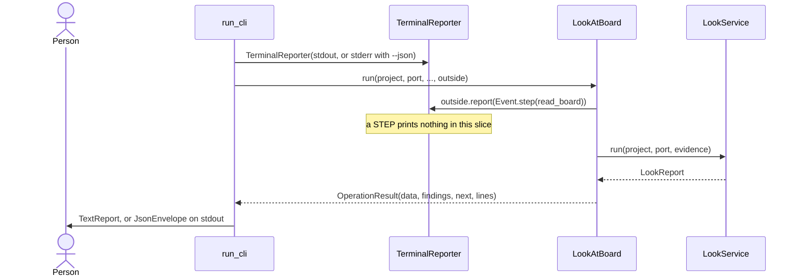
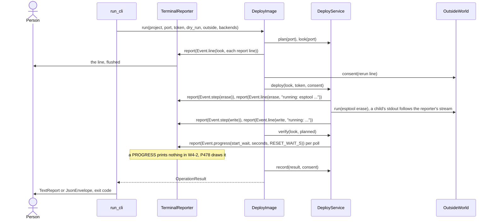

# The event seam: how an Operation tells a reader what happens now (P479, #657)

Card [P479 #657](https://github.com/xmejkal/spark/issues/657), epic P158 [#94](https://github.com/xmejkal/spark/issues/94).
Written on 2026-11-01 by Fable 5.1 for the PO's approval, with no code. Measured on `origin/main` 5ecdf48a. Line numbers
are that commit's. It refines the PO's decision on #94 (2026-11-01). W4-2 builds `OutsideWorld.report(event)`, the seam
only. The council rounds run on this file before the PO reads it.

> The short version. An Operation gets one more callable in its `OutsideWorld`: `report(event)`. An Event is a small Value of facts:
> what kind of thing happened, which step, a sentence, and a count. The CLI's `TerminalReporter` prints a line event as
> deploy prints its lines today, so every golden stays byte-equal. `--json` keeps one envelope on stdout. A colored
> terminal (P478), JSON lines, MCP progress and SSE each come later as one more Reporter, and no Operation changes.
> First a probe on the look, the one Operation on the core. Then deploy in W4-2. Then each output place as it moves.

Summary. Today 29 of 69 scripts print, and only deploy prints while a step runs, through a `show_line` callable that the
Service gets. The seam replaces that callable with one Event Value and one Reporter method in `OutsideWorld`. So the
Operation and its Services never see a stream. The result at the end stays an `OperationResult` for the two Renderers.
The events during the run go through the Reporter that the frontend picks.

## 1. The map: where spark prints, asks and streams today

| What | Count | Main anchors |
|---|---|---|
| scripts in `scripts/*.py` | 69, 25 with a `main()` | `ls scripts/*.py` |
| scripts that print or write stderr | 29 (28 with `print(`, 155 calls) | `emit_board.py` 25 calls, `tools.py` 19, `init_project.py` 11, `boards.py` 11, `grant.py` 10, `deploy.py` 7 |
| scripts on `run_cli` | 1 | `scripts/look.py:54` |
| prints inside `scripts/spark/` | 3 in `run_cli`, 1 in the baseline | `scripts/spark/core/cli.py:106`, `:112`, `:114`. `outcomes.py:138` (`X2` baseline) |
| places that ask a person | 1 | `deploy_gate.py:79-82` (`TerminalConsentStrategy.ask`: `stdout.write`, `stdin.readline`), the tty test at `:75`. `parts.py`'s `input(` hits are `_read_json_input`, a file reader |
| lines shown while a step runs | deploy only, 7 sites | `deploy.py:156-158` is `show_line`. `deploy.py:243` flushes the look's lines before the gate. `deploy_service.py:102` the yes. `:108` running. `:126` the retry. `:182` press RESET. `board_start.py:106` a restart not counted |
| waits a person sits through | 4 | the erase and the write, `deploy_service.py:108-121`, with esptool's own output through `echo_to` at `:120`. The retry sleep at `:128`. The start wait poll loop, `board_start.py:95-108`, every `POLL_S`. The look's esptool read, `board_look.py:46` and `:431` |
| a tool's own output passed through | 1 | `deploy.py:225` gives esptool fd 2 under `--json`, so the envelope stays alone on stdout |
| prints all at the end, though steps are slow | 4 | `check_spine.py:361` collects stages, `:638-650` renders them, `:1021` prints. `run_scenario.py:488` one child with `capture_output`, `:581-585` prints. `flash_image.py:308-309`. `tools/mutate.py:411` loops, `:537-543` prints |
| tools in `tools/*.py` that print | 10 of 12 | `tools/mutate.py`, `tools/measure.py` and the rest. They are the team's, not spark's product |

The counts come from `ls` and `/usr/bin/grep -c` on 5ecdf48a. The sizes in section 4 are estimates.

What the map says. One seam exists today, `show_line`. It is a bare callable that two Service methods take
(`deploy_service.py:93`, `:136`) and one helper (`board_start.py:90`). Everything else prints at the end. So the seam is
new for 68 scripts and replaces one for deploy. The build chain and the simulation run are the places where a person
waits longest with nothing on the screen.

## 2. The design

The smallest design that works end to end: one Value, one method, one real Adapter, one Fake.

### The Event Value

`Event`, a namedtuple in `spark/core/events.py`: `kind`, `step`, `text`, `done`, `total`. Every field is a fact.

| Field | What it holds | Facts only |
|---|---|---|
| `kind` | one of three constants: `LINE` (a sentence the person reads now), `STEP` (a named step begins now), `PROGRESS` (a step's count moved) | the constants live in `events.py` as `LINE, STEP, PROGRESS = "line", "step", "progress"` |
| `step` | the snake_case word of the step this event is about, from the area's `codes.py`, such as `read_board`, `erase`, `write`, `start_wait` | a code, never a sentence. A Reporter decides on it (rule R7) |
| `text` | the sentence, for `LINE` only. It is today's line, without its two-space indent | the words spark prints today. P481 later gives each step one description as data, and `LINE` shrinks |
| `done`, `total` | the count of a `PROGRESS`, such as seconds waited of `RESET_WAIT_S` | numbers. None for the other kinds |

No colour, no stream, no time stamp. If a reader wants a time stamp (SSE), its Reporter adds one from the frontend's
clock. Three constructors keep call sites short: `Event.line(step, text)`, `Event.step(step)`, `Event.progress(step,
done, total)`. A `STEP` has no end event. The next `STEP` or the result ends it.

### The Reporter

`Reporter` is a Strategy base in `spark/core/events.py` with one method, `report(event)`. It returns nothing and never
raises on a kind it does not know. Two cases fill rule T3. `TerminalReporter(stream)` is an Adapter in
`spark/core/outside.py`. It prints `event.text` for a `LINE` through `guard_lines`, with a flush. It prints nothing for
`STEP` and `PROGRESS`. `FakeReporter` in `tests/fakes.py` keeps every event in `events`. A `ReporterContract` test in
`tests/test_core.py` sends one event of each kind and expects no exception. `TerminalReporter` joins rule X2's list of the
places that print in `scripts/spark/`, beside the Renderers and the terminal consent.

### Where it sits

`OutsideWorld` gains the field `report`, the bound `report` method of the Reporter, as `run` holds `ProgramRunner.run`
today (`outside.py:18`). `build_outside_world(effects, find_tool, reporter)` fills it. Reporting is not an effect: every
Operation has it, and nothing gates it. The Operation, or a Service the Operation hands `outside` to, calls
`outside.report(Event.step(codes.READ_BOARD))`.

The two Renderers stay as they are. `JsonEnvelope` and `TextReport` render the one `OperationResult` once, at the end.
The Reporter takes the events during the run. Both belong to the frontend, and `run_cli` picks both from `--json`:

- without `--json`: `TerminalReporter(sys.stdout)` and `TextReport`. A line event prints at once, as deploy's does today.
- with `--json`: `TerminalReporter(sys.stderr)` and `JsonEnvelope`. The lines go to stderr, as deploy's do today
  (`deploy.py:197`), and stdout holds the one envelope. The goldens compare stdout only (`golden_bench.py:134`).

A child program's output follows the same rule. Today `deploy.py:225` gives esptool fd 2 under `--json`. The plan moves
that choice into the frontend: `build_outside_world` builds `ProgramRunner(echo_to)`, and its `run` sends a child's stdout
to the reporter's stream unless the caller captures it. `DeployService.echo_to` goes. The mutation row "the echo goes
to stdout under `--json`" stays and targets `ProgramRunner`.

`--json` stays one envelope now. Later, `JsonLinesReporter` writes one JSON object per event on stderr under `--json`,
such as `{"event": "step", "step": "erase"}`. An agent then reads progress line by line, and stdout still holds the one
envelope. The Reporter enters after the spike P477 #653 shows an agent that reads it. The envelope and `envelope: 1`
never change for it.

The later Reporters plug in without touching an Operation:

| Reporter | Frontend | What it does with the three kinds | Card |
|---|---|---|---|
| `StyledTerminalReporter` | the CLI, on a tty with `NO_COLOR` unset | colours a `LINE` by its `step`, draws a live line for a `PROGRESS`, says a `STEP` in grey | P478 #656 |
| `JsonLinesReporter` | the CLI under `--json`, on stderr | one JSON object per event | after P477 |
| `McpProgressReporter` | the MCP server in `scripts/spark/frontends/` | `PROGRESS` as a `notifications/progress`, `LINE` as a log message, `STEP` as both | P417 #545 |
| `SseReporter` | a web frontend, none exists | `event: <kind>` and `data: <json>` per event | none yet |

The look, the probe. One `STEP` before the esptool read. The terminal prints nothing for it, so no golden changes, and
the Fake sees it.

Deploy, in W4-2. The lines of `deploy_service.py:102-128` and `board_start.py:106` become `LINE` events with a step
code. Each phase becomes a `STEP`. The start wait reports a `PROGRESS` per poll. The person sees the same bytes.

## 3. What changes in the target architecture and the wave plans

No file is edited by this card. Each edit lands in the PR of the slice that makes it true.

`README.md` (level 1):

- "The one interface contract": one row, `events`: `Event(kind, step, text, done, total)` through `OutsideWorld.report`.
  The terminal prints a line event. `--json` keeps one envelope on stdout.
- "One Operation, two frontends": one arrow, `O->>RC: outside.report(Event)`, and `RC-->>P: the line, now`.

`refactor-plan.md`:

- "Level 3, the classes of one flow: deploy": `deploy(look, token, consent)` and `verify(look, planned)`, the
  `show_line` parameter gone, and `DeployService` holds `outside`.
- "Level 4, the methods of one class: `DeployService`": the two `show_line` arrows become `DS->>OW: report(Event)`. The
  paragraph after it says `OutsideWorld.report`, not `show_line`.
- "4. The core contract for other interfaces", rule 2: "No Operation asks or prints. It asks only through
  `outside.consent` and tells only through `outside.report`." The X2 test's list gains the Reporter adapters.
- "Wave 4: the bench on the core", S7b: "the lines a person sees while esptool runs are `LINE` events, each phase a `STEP`".
- "Wave 6: the other areas", the `build` move: "`BuildService` reports a `STEP` per stage, so the person sees each stage
  as it ends", and the `firmware` move: "`ScenarioRun.run` reports a `STEP` before wokwi-cli starts".
- "What we will not do": "No Reporter beyond `TerminalReporter` and the Fake until its frontend exists."
- "Appendix: what moves where": the row `deploy.show_line` becomes `OutsideWorld.report` with `TerminalReporter`.

`wave4-plan.md`:

- "Council", round 1, the refuter's bullet on `OutsideWorld`: `show_line` becomes `report`, built in P479's probe.
- "W4-2, deploy on the core (S7b)", Classes: "`OutsideWorld` gains `clock` and `consent(line)`" (`report` exists after
  the probe). `LineWriter` goes, and `TerminalReporter` from the probe takes its place. The Files line for `run_cli`,
  `outside_builder(project, effects, out)`, says `reporter`. `deploy_service.py:63-120`: `show_line` and `echo_to` go. New mutation rows: a `STEP` prints a line, a `LINE` under `--json` reaches stdout, the start wait
  reports no `PROGRESS`.
- "W4-3, grant, live and reach on the core (S9)": the three Operations report nothing new. One sentence says so.
- "W4-4": no change.
- "The bench after wave 4": the class diagram's `OutsideWorld { run find_tool clock consent report }`, and the sequence
  gains `DS->>OW: report(step erase)` before the erase.
- "The four checks that close the wave": a fifth, "every line deploy shows while a step runs is an Event in a test".

`areas/core.md`: the `core/outside.py` and `OutsideWorld` rows name `report`, and a row for `core/events.py`.
`areas/bench.md`: the two `show_line` parameters at lines 127, 128, 173 and 182 go. `glossary.md`: rows for Event,
Reporter and the clash "report" (section 5). `notes.md`: a decision row, "N33 `OutsideWorld.report(event)` over a
line callable: one seam for every reader". `docs/guide/developing.md`: a `Reporter` row in "Patterns and names in
spark's core", `report` in "The core contract" and its class diagram.

## 4. The order

Each slice is one PR, tested, with no golden changed. The PO ordered the probe after walk 3 (#657).

| Slice | What it builds | Done when | Size |
|---|---|---|---|
| E1, the probe on the look | `events.py` (`Event`, the three kinds, `Reporter`), `TerminalReporter`, `OutsideWorld.report`, `build_outside_world(effects, find_tool, reporter)`, `run_cli` picks the stream from `--json`, `ProgramRunner(echo_to)`. `LookAtBoard.run` reports `Event.step(READ_BOARD)` before `looker(...).run`. `FakeOutsideWorld` and `FakeReporter` keep events. `ReporterContract`. The toy Operation in `test_core` reports a `LINE` and a `STEP` | the 16 golden files are byte-equal. `test_look` sees `[Event(STEP, "read_board", None, None, None)]`. The toy's `LINE` is on stdout without `--json` and on stderr with it, and the `STEP` prints nothing. The `X2` baseline gains no entry. Mutation: a `STEP` that prints, a `LINE` on stdout under `--json`, the event not sent, each caught | estimate: 70 product lines, 60 test lines, 20 doc lines |
| E2, deploy in W4-2 | as wave4-plan says, with the edits of section 3. The seven line sites become `LINE` events with their step code. The five `STAGE_*` phases become `STEP`s. The start wait's poll loop reports a `PROGRESS` per poll | the three deploy goldens are byte-equal. `test_deploy_gate` holds the full event list of one deploy that reaches ready. W4-2's other four checks hold | estimate: W4-2's size plus 40 lines |
| E3, the colored terminal, P478 | `StyledTerminalReporter`. On a tty with `NO_COLOR` unset, `run_cli` picks it | the PO sees colour and a live line on his bench. `deploy.py --json` and a piped `deploy.py` print bytes equal to before | P478's card |
| E4, the other output places | each with its area's move in wave 6. `BuildService` reports a `STEP` per stage (`check_spine.py:361`), and the `kept` lines at `:1023` become `LINE` events. `ScenarioRun.run` reports a `STEP` before wokwi-cli. `flash_image`'s per-file lines (`:308`) become `LINE` events. `tools/mutate.py` stays a team tool and gets no Reporter unless it moves onto the core | each move's goldens are byte-equal, and the person sees a stage as it ends | inside each move |
| E5, the other readers | `JsonLinesReporter` after P477 says an agent reads it. `McpProgressReporter` with the spike P417. `SseReporter` with the first web frontend | one Reporter each, no Operation touched | later |

Review size. E1 holds logic: one reviewer and the refuter on the strongest model, one mutation run. E2 keeps W4-2's
review. This plan takes two council rounds before the PO reads it, as #657 says.

## 5. Risks and open questions for the PO

1. The word `report`. `DeployService.deploy(report, token, consent, show_line)` already names its `LookReport` parameter
   `report` (`deploy_service.py:93`), and `deploy.py:242` does too. `OutsideWorld.report(event)` makes one word two
   things. Recommendation: keep `report(event)`, the PO's word, and rename the LookReport variable to `look` where the
   two meet, in W4-2. The glossary gets the row.
2. A time stamp in the Event. SSE and a log want one. Recommendation: no. The Reporter stamps it from the frontend's
   clock, and the Event stays facts the Operation knows.
3. Events under `--json`. One JSON object per event on stderr changes what an agent reads there today (the lines).
   Recommendation: not before P477 shows an agent that reads them, and never on stdout.
4. A child's output follows the reporter's stream, inside `ProgramRunner`. It drops `DeployService.echo_to`, and a caller
   that captures keeps its capture. Risk: `subprocess.run` refuses `stdout` beside `capture_output`. If a caller gives
   either, the runner sets no `stdout`. Recommendation: do it in E1, where the toy test proves it.
5. A `Reporter` base class with one real Adapter. Rule T3 takes the Fake as the second case, and P478 brings the second
   real one. Recommendation: the base now, because the contract test names what every later Reporter owes.
6. What a colored terminal colours. P477 found that finished strings tell a renderer nothing. The Event's `step` code is
   the fact it decides on. If P478 needs a severity, the Event grows one field then (records grow by need).
   Recommendation: no severity field now.
7. The build chain prints at the end, and a `STEP` per stage shows text earlier. The bytes stay, the timing changes.
   Recommendation: fine, and the first build golden (S3's) compares bytes, not timing.
8. The probe's size. E1 touches `cli.py`, `outside.py`, `look_at_board.py`, the Fakes and three test files, before W4-2.
   Recommendation: run it as its own PR right after walk 3's notes, so W4-2 starts on it.
