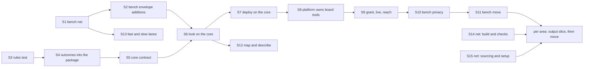

# The refactor plan: slices in order

Back to [level 1](README.md). Card [P323 #413](https://github.com/xmejkal/spark/issues/413), epic P158
[#94](https://github.com/xmejkal/spark/issues/94). Planned in detail on 2026-10-21. Every "today" claim cites
`file:line` from commit `3ce64f8`. A count marked "est." was not measured. A name that is not in the code yet is
proposed, and each area page lists its new names.

> TL;DR. Five steps, fifteen named slices, the bench first. Step 1 (two PRs, before walk 2 on 2026-10-27) records the bench
> CLIs' output as goldens and adds codes to the bench envelope. Step 2 builds the core and puts `look` and `deploy`
> on it. Step 3 makes the bench backend swappable and moves the bench area. Steps 4 and 5 add tooling, then the
> other areas, each pulled by a story.

Each slice is one PR that adds one thing and keeps every CLI working. A golden test runs each CLI from the outside,
so most of today's 2,817 tests stay as they are (the audit's count, [round4-testability.md](../council/round4-testability.md)).
The PO decides four things first, and each slice below says which decision it waits on.

## The invariants of every slice

1. **The goldens rule.** A golden is the stdout and exit code of one CLI run on one fixture project. It changes
   only in an output slice (S2, S10, and one per area later), never in a move. An output slice runs
   `tests/golden.py --accept OP` and says why in its description.
2. **Nothing public changes.** Every flag, JSON key, record key, exit code and script name stays. An output slice
   only adds keys.
3. **The push hook stays green** (`tools/pre-push` runs `tools/check_commit.py`). No slice skips a test.
4. **One PR per slice**, with the measure line before and after: known breaches, `mock.patch` lines, outside
   tests, suite seconds. From S3 on, no PR adds a baseline entry, and each pays one down in a file it edits.
5. **No journey status changes.** No slice changes a step of README's "What works today" or `tools/journey.py`,
   and `tests/test_journey.py` proves it. A slice that changes a CLI's output updates `docs/guide/agents.md` and
   the command page in the same PR.

## Step 1: the bench net, before walk 2

### S1. The bench net: goldens for the five bench CLIs

- **Goal.** Record what `look`, `deploy`, `grant --check`, `live` and `reach` print today, as tests no move breaks.
- **Why now.** Walk 2 of P100 runs on the bench. The bench tests have the least outside cover: `test_deploy_gate`
  76 inside tests, `test_board_grant` 64, `test_board_look` 38 (audit). `tests/golden/` does not exist.
- **Created.** `tests/golden.py` (the harness and `--accept OP`), `tests/test_golden_bench.py`,
  `tests/fake_modules/esptool/__main__.py`, `tests/fake_modules/mpremote/__main__.py`,
  `tests/fake_modules/serial/__init__.py`, the fixture `tests/data/projects/bench-c6/` (a requirements file, a
  passed run log, an image), and `tests/golden/<op>-<status>.json` and `.txt`.
- **How the fakes work.** esptool and mpremote are `kind: python` rows (`data/tools.json:130-149`). spark finds them
  with `importlib.util.find_spec` (`tools.py:164-165`) and runs `python -m esptool` (`tools.py:270-274`). A fake
  bin folder on `PATH` therefore finds nothing. The harness puts `tests/fake_modules` first on the child's
  `PYTHONPATH`. The fakes print the canned outputs in `tests/data/board_look/` (`c6-flash-id.txt`,
  `mpremote-devs-one.txt` and the rest). The fake `serial` serves `ConsoleProbe`'s pyserial script
  (`board_console.py:43-58`). The child inherits the scratch store through `SPARK_HOME` (`store.py:35-40`).
- **Goldens.** `look`: ok, problems (flash differs), could-not-run (two boards on USB). `deploy --dry-run`: ok.
  `deploy` with no token: the gate closes. `deploy` with a deploy grant in the scratch store: ready seen (est.
  the hardest fixture). `grant --check`: no grant. `live`: refused, no grant. `reach`: reached. Text goldens for
  `look` and `deploy --dry-run`. stderr is not golden. Paths print as `<project>` and `<store>`.
- **Tests.** All stay. New: the golden tests and a harness self-test.
- **Done when.** Each bench CLI has a golden per status its fixture reaches. A planted change in one envelope value
  fails exactly one golden. No golden holds a home path. The suite count rises only by the new tests.
- **Rule from then on.** T5 for the bench, enforced by the golden test (the rules test arrives in S3).
- **Size.** About 350 lines (est.), goldens not counted.
- **Risks and back-out.** A fake module shadows a real esptool only in the child. A flaky process test is the main
  risk: the harness gives each child a timeout. Back-out: revert one PR. It touches no script.

### S2. Bench envelope additions (an output slice)

- **Goal.** Claude branches on codes on the bench, not on sentences.
- **Why now.** `commands/deploy.md:22` tells Claude to read `problems` and relay words. A code per item makes walk 2's
  hand-offs exact.
- **Changed.** `scripts/board_envelope.py`: a `code` at its 6 item sites (`:58`, `:59`, `:61`, `:64`, `:77`, `:91`),
  a `fix_step` beside each string `fix`, `needs_person` on a step for a hand on the bench, and a top-level
  `backends` (`{"platform": "micropython", "chosen_by": "default", "flasher": ..., "board-shell": ...}`) in the
  look and deploy envelopes. `scripts/outcomes.py:84`: `step` gains `needs_person`, written only when a caller
  passes it, so `parts.py`'s steps keep their keys. Created: `scripts/board_codes.py`, one constant and one line
  of meaning per code. Docs: `docs/guide/agents.md` ("look.py and deploy.py's envelope"), `commands/deploy.md`.
- **Tests.** The S1 goldens of `look` and `deploy` are accepted once, for the new keys only. The `grant`, `live`
  and `reach` goldens stay: their JSON is not an envelope (`grant.py:63`, `live.py:68`, `reach.py:63`).
  `test_look`, `test_deploy` and `test_deploy_json` stay. New: a contract test in `tests/test_json_contracts.py`
  for the look and deploy top-level keys (today it has none) and for "every item has a listed code".
- **Done when.** The contract test fails on a removed key and on an unlisted code. `fix` is still a string.
- **Rule from then on.** C2 for the bench: every bench item carries a code from `board_codes.py`.
- **Size.** About 150 lines (est.).
- **Risks and back-out.** Claude reads the old keys, and they stay. Back-out: revert, then re-accept the goldens.

## Step 2: the core, and look and deploy on it

### S3. The rules test and its baseline

- **Goal.** One test reads the code with `ast` and holds every rule of [notes](notes.md#rule-reference).
- **Created.** `tests/test_architecture.py` (`ArchitectureRules`), `tests/architecture_baseline.json` (generated).
  Moved: `docs/discovery/2026-10-19-p322-code-architecture/measure.py` (213 lines) to `tools/measure.py`, with the
  columns "outside tests" and "suite s". Changed: `tools/mutate.py` gains `--retarget OLD NEW`, which rewrites the
  `file` of every row in `tests/mutations/*.json` (1,970 rows today, measured). Seven file walks switch from
  `glob` to `rglob`, because a module can now sit one folder down: `test_board_look.py:471`, `test_fab.py:50`,
  `test_orphans.py:52`, `:61`, `:82`, `test_self_confirmation.py:26`, `test_store.py:78`, `:83`.
  `docs/guide/developing.md:233-243`: the role table gains Operation and Records, folds Platform into Strategy,
  and names `FakeOutsideWorld` and `FakeFirmwarePlatform`.
- **Tests.** All stay, except the file-walk lines above. New: one planted breach per rule.
- **Done when.** Each planted breach is caught with its rule, file, line and reason. The generated baseline passes.
  `--retarget` moves a planted row. `tools/measure.py` prints the same numbers as the old path.
- **Rule from then on.** Every rule: no new breach, and the baseline only shrinks.
- **Size.** About 400 lines (est.) plus the baseline.
- **Risks and back-out.** A rule with many false hits: it enters the baseline, never a skip. Back-out: revert.

### S4. `outcomes` into the package

- **Goal.** `scripts/spark/` exists, and its first module is the one every CLI already shares.
- **Moved.** `scripts/outcomes.py` (106 lines, whole) to `scripts/spark/core/outcomes.py`. Created:
  `scripts/spark/__init__.py`, `scripts/spark/core/__init__.py`. Changed: the import line of 39 files (29 in
  `scripts/`, 7 in `tests/`, 3 in `tools/`, measured), and the 7 mutation rows of `outcomes.py` by `--retarget`.
- **Tests.** All goldens stay. `test_outcomes.py` and the 6 other test files change their import line only.
- **Done when.** No golden changes. No file imports `outcomes` by the old name. `mutate.py --anchors` passes.
- **Rule from then on.** U1: imports follow the area map. U2: `spark/` modules import modules, not names.
- **Size.** About 60 changed lines (est.) plus 106 moved.
- **Risks and back-out.** An import missed in a child process: the S1 goldens run children, so they catch it.

### S5. The core contract

- **Goal.** One result shape and one runner exist, tested alone with a toy Operation. No CLI uses them yet.
- **Created.** `spark/core/result.py` (`OperationResult`, `Finding`, `NextStep`), `spark/core/operation.py`
  (`Operation`, `Argument`, `COMMON_ARGUMENTS`), `spark/core/errors.py` (`SparkError`), `spark/core/codes.py`,
  `spark/core/outside.py` (`OutsideWorld`, `Privacy` as an empty pass-through until S10),
  `spark/core/cli.py` (`run_operation`, `run_cli`, `TextReport`, `JsonEnvelope`, `FlatJsonLine`),
  `spark/records/__init__.py`, `spark/records/backends.py` (`Backends` with one field, `tools`, a `ToolFinder` over
  today's `tools.find`, and `build_outside`). Test side: `FakeOutsideWorld` and `FakeToolFinder` in
  `tests/fakes.py`, `tests/test_core.py`.
- **Two corrections to the earlier design.** `OutsideWorld` gains `show_line`: `deploy` prints each line while the
  flash runs (`deploy.py:121-123`, `flush=True`), so `lines` rendered at the end are not enough. And `run_cli` and
  each `main` take `backends=None` beside `outside=None`: bench tests replace `tools.find` 19 times (measured over
  11 bench test files), and `Backends` is not part of `OutsideWorld`. `main` keeps three parameters (R3).
  `FlatJsonLine` renders `data` alone as one line, for the CLIs whose JSON is not an envelope.
- **Tests.** All stay. New: one test per path of the core flow (ok, problems, could-not-run, bad flag,
  `SparkError`, crash, undeclared effect) and the parity test helper.
- **Done when.** The toy Operation passes every path. A call to an undeclared effect raises code
  `undeclared_effect`. R1 to R6 hold in `spark/core/` with no baseline entry.
- **Rule from then on.** R1 to R6 are hard in `spark/`. C3: exit codes only from `EXIT_FOR`.
- **Size.** About 450 lines (est.), half of them tests.
- **Risks and back-out.** Nothing calls it yet, so revert is safe. The risk is a shape S6 and S7 reject: S5's PR
  carries the `look` sketch from S6 as a check.

### S6. `look` on the core

- **Goal.** The first CLI that only parses, calls one Operation and prints.
- **Created.** `spark/bench/__init__.py`, `spark/bench/operations.py` with `look` and its `Operation(...)`.
  Changed: `scripts/look.py` (72 lines): `main(argv=None, outside=None, backends=None)` calls `run_cli`. Its
  24-line `EPILOG` (`look.py:15-38`) stays in the CLI, so R1's CLI limit counts code lines, not help text.
  The body of `look.main` (`look.py:52-64`) and `_print_json` (`:67-68`) go to the Operation and the Renderers.
- **Tests.** The `look` goldens stay, text and JSON. `test_look.py` changes its call lines only: `run=run` at
  `test_look.py:36` becomes `outside=FakeOutsideWorld(run=run)`, and its 2 `tools.find` patches become
  `backends=Backends(tools=FakeToolFinder(...))`. New: the parity test for `look` (text and JSON carry the same
  codes and the same first step).
- **Done when.** No golden changes. `look.main` is at most 15 lines. `look.py` imports no area module but
  `spark.bench.operations`.
- **Rule from then on.** X2: a CLI on the core calls only `run_cli`. The rules test lists the CLIs not yet on it.
- **Size.** About 150 lines (est.).
- **Risks and back-out.** The look's stop path prints doctor lines to stderr in both modes (`look.py:55-56`), and
  the text golden does not cover stderr. A unit test pins that path. Back-out: revert.

### S7. `deploy` on the core, with effects and gates

- **Goal.** Every outside effect of `deploy` is declared and gated, and `--dry-run` is a recording `run`.
- **Changed.** `spark/bench/operations.py` gains `deploy`. `scripts/deploy.py` (236 lines): `main` (`:126-153`)
  shrinks, and `_deploy` (`:165-232`, 68 lines) becomes the Operation, split under 40 lines a function. The five
  keywords `run`, `consent`, `probe`, `clock`, `grant_service` (`deploy.py:126`) go. `DeployService.sleep`
  (`deploy_service.py:76`, a class attribute) takes the clock in `__init__`. The platform is still
  `FirmwarePlatform.micropython` (`deploy.py:171`), now named only in `operations.py`.
- **Tests.** The `deploy` goldens stay. The 2 `deploy.main` call sites (`test_deploy.py:82`,
  `test_journey_basic.py:160`) and the helper of `test_deploy_gate.py:105-108` change: one
  `outside=FakeOutsideWorld(run, clock, consent, show_line)` and `backends=`. A test that passed `probe` (5 lines in
  `test_deploy_gate.py` and `test_deploy_json.py`, measured) gets the real `ConsoleProbe` over the fake `run`,
  with a temp file as the port, because `ConsoleProbe` checks the port with `os.path.exists`
  (`board_console.py:89`). The `DeployService.sleep` patch becomes `FakeClock`. New: an erasing Operation with no
  gate fails; a call to an undeclared effect fails.
- **Done when.** No golden changes. `deploy.main` is at most 15 lines. No `mock.patch` line is added, and the
  deploy tests lose at least the `sleep` patch.
- **Rule from then on.** C4: effects are declared, and `board` and `erases` need consent. T1: only Adapters touch
  the outside, in `spark/bench/`.
- **Size.** About 400 lines (est.), most of it in `test_deploy_gate.py`'s helper.
- **Risks and back-out.** This is the safety path. The ready-seen golden and the gate tests guard it, and the
  refuter reviews it on the strongest model. Back-out: revert.

## Step 3: the bench backend swappable, then the bench move

### S8. The platform owns the board tools

- **Goal.** A second platform is one subclass and one registry line, and no bench caller changes.
- **Changed.** `scripts/firmware_platform.py` (84 lines): `FirmwarePlatform` (`:41`) becomes a Strategy base,
  `MicroPythonPlatform` fills it in place of the classmethod (`:53-60`), and it gains `make_port_finder` and
  `make_board_reader`. The 8 lookups outside it go: `live.py:84`, `reach.py:79`, `grant.py:88`, `:95`,
  `board_look.py:296`, `:297`, `board_doctor.py:160`, `:162`. `spark/bench/operations.py` gains `PLATFORMS` and
  `DEFAULT_PLATFORM`. `Backends` gains `platform`, always `DEFAULT_PLATFORM` today: `requirements.json` has no
  `platform` key (no script reads one), and the key enters with the second platform. `FakeFirmwarePlatform` in
  `tests/fakes.py`.
- **Tests.** All goldens stay. Unit tests of the Services pass `FakeFirmwarePlatform`. New:
  `FirmwarePlatformContract`, which `MicroPythonPlatform` and the Fake both pass, and a seam test that drives
  `LookService`, `DeployService`, `GrantService`, `LiveTryService` and `reach` with the Fake.
- **Done when.** No `tools.find("board-shell"` or `("flasher"` outside `firmware_platform.py` (grep). No golden
  changes.
- **Rule from then on.** X1: a bench Adapter is named only in `spark/bench/operations.py` and the platform. T3: a
  Strategy base has a contract test.
- **Size.** About 300 lines (est.).
- **Risks and back-out.** `board_doctor` runs on a failed read inside three CLIs. Its unit tests and the
  could-not-run goldens cover it. Back-out: revert.

### S9. `grant`, `live` and `reach` on the core

- **Goal.** All five bench CLIs are thin, and `GrantService` is built in one place.
- **Changed.** `spark/bench/operations.py` gains `grant`, `grant-check`, `live`, `reach`. `scripts/grant.py`
  (`main` 53 lines, `:66-118`), `live.py` (`:71-100`), `reach.py` (`:66-101`) shrink. `GrantService` today is
  built at `grant.py:90`, `:99`, `live.py:89`, `deploy.py:192`. Their `--json` stays one flat line through
  `FlatJsonLine`, with today's keys.
- **Tests.** Goldens stay. `test_board_grant.py`, `test_live.py`, `test_reach.py` and
  `test_json_contracts.py:206-212` change their call lines and their 5 `tools.find` patches (measured).
- **Done when.** No golden changes. Each bench `main` is at most 15 lines. `GrantService(` appears once in
  `scripts/`.
- **Rule from then on.** X2 for every bench CLI.
- **Size.** About 300 lines (est.).
- **Risks and back-out.** `grant --minutes` asks in the terminal, so it has no golden. A unit test with
  `FakeConsent` covers it. Back-out: revert.

### S10. Bench privacy (an output slice)

- **Goal.** No home path and no secret reaches a bench output.
- **Changed.** `spark/core/outside.py`: `Privacy` shortens the paths under the project and the store and masks
  each `account_env` value (`tools.py:339`). Today the deploy envelope prints absolute paths in `board_log`,
  `store_record` (`board_envelope.py:116`, `:118`) and in the step argv (`look.py:61` resolves the project).
- **Tests.** The bench goldens with such a path are accepted once. New: a secret-marker test over every bench CLI.
- **Done when.** The marker test passes. A grep of the bench goldens finds no `/Users/` and no `/home/`.
- **Rule from then on.** C4: no secret or home path reaches the output.
- **Size.** About 120 lines (est.). **Back-out:** revert, and re-accept the goldens.

### S11. The bench area move (waits on decision 4)

- **Goal.** The bench is one package that a reader finds in one folder.
- **Moved.** 16 modules into `scripts/spark/bench/`: `board_look`, `board_doctor`, `board_grant`, `board_live`,
  `board_reach`, `board_envelope`, `board_codes`, `board_facts`, `board_connection`, `board_console`,
  `deploy_gate`, `deploy_service`, `firmware_platform`, `flasher`, `ready_check`, `download_mode`. Today 15 of
  them hold 1,980 lines (measured), and S2 adds `board_codes`. The five CLIs stay in `scripts/`. 31 files import a
  bench module today, and the 236 mutation rows of these files move by `--retarget` (both measured). Renames per the [table](#into-bench). The Fakes
  `FakeFinder`, `FakeProbe` (`test_board_doctor.py:28`, `:38`), `FakeGrants`, `FakeDoctor`
  (`test_board_live.py:27`, `:140`) move to `tests/fakes.py`. `FakeClock` (`fakes.py:59`) and `FakeLocalClock`
  (`:88`) merge.
- **Tests.** Goldens stay. Unit tests change their imports and the renamed names, nothing else.
- **Done when.** No golden changes. The test count does not drop. The PR prints "rows 236, caught N".
- **Rule from then on.** C1: the glossary's names in bench. U1 for bench.
- **Size.** About 400 changed lines (est.) plus 1,980 moved.
- **Risks and back-out.** The biggest diff of the bench. It holds no logic change, so review reads the import
  lines and the goldens. Back-out: revert.

## Step 4: tooling

- **S12. `docs/guide/map.md` and `--describe OP`.** A generated map of each CLI, its Operations, each area's
  modules and their tests. A test fails when it is stale. About 200 lines (est.). Rule U3: one home per shared
  flag and code. Blocked by S6.
- **S13. Fast and slow lanes.** `slow_test_*.py` for real tools and spark's own tools. `check_commit.measure`
  (`tools/check_commit.py:127-145`) runs both lanes at once. The audit measured 122.2 s: `test_mutate` 27.3 s,
  `test_docs` 9.5 s, `test_needs.py:1416` 7.5 s. Moving the first and third leaves about 87 s (est.), so the
  target is "the fast lane is under 90 s on this Mac, and a test over 2 s in it fails unless baselined", not the
  60 s the earlier plan named. About 80 lines (est.). Rule T5: the net runs on every push. Blocked by nothing.

## Step 5: the other areas, each pulled by a story

First the nets: **S14** goldens for `check_spine` (a fake `tsci` that copies a canned `circuit.json`), `check_all`,
the five `check_*` plus `check_bom`, `compare_design`, `assign_pins`, `emit_board`, `emit_footprint`, `breadboard`,
`run_scenario`, `flash_image`, `import_firmware`. **S15** goldens for `parts.py`'s Operations, `cost`, `boards`,
`tools`, `init_project`. The `fetch` goldens run through `main(argv)` in the test process, because a child refuses
`file:` URLs (`store.py:339`). Each about 300 lines (est.).

Then each area gets two PRs, in this order: firmware, breadboard, checks, design with build, records with
sourcing. First its output slice adds its codes, `fix_step` and `backends`, and accepts its goldens. Then its move,
with the one new thing below. No module shim.

| Area | The one new thing its move adds | Removes |
|---|---|---|
| firmware | `SimulationEngine`, `WokwiCliEngine`, `RunLog` | 3 direct `subprocess` calls |
| breadboard | registries as dicts of classes, `WiringStep`, `WiringLog` | `NotKeptResult`, `DrawingDiffersResult` as own shapes |
| checks | `Check` with class attributes, one `Finding` | the sourcing to checks edge (`parts.py:495`), 3 finding shapes |
| design with build | `BuildService`, six `BuildStage`s in today's order, `TscircuitEngine`, the `audit` and `board-list` Operations | `check_spine.run`'s 192 lines (`:347-538`), the `emit_board.py` child process |
| records with sourcing | `RecordFolders`, `Records`, `RecordSchema`, `ToolFinder` everywhere | the records to design edge (`boards.py:243`, `:592`), `store.py:40`'s test branch |

## The order at a glance

| Slice | Serves | Size (est.) | Blocked by | Waits on decision |
|---|---|---|---|---|
| S1 bench net | walk 2: proof the bench stays the same | 350 | nothing | 3 |
| S2 bench envelope additions | walk 2: Claude reads codes | 150 | S1 | 3 |
| S3 rules test | every later slice | 400 + baseline | nothing | 1 |
| S4 outcomes into the package | the shape | 60 + 106 moved | S3 | 2 |
| S5 core contract | one result for every frontend | 450 | S4 | 2 |
| S6 look on the core | the first thin CLI | 150 | S2, S5 | 2 |
| S7 deploy on the core | gated effects on the safety path | 400 | S6 | 2 |
| S8 platform owns board tools | a swappable backend | 300 | S7 | 2 |
| S9 grant, live, reach | all bench CLIs thin | 300 | S8 | 2 |
| S10 bench privacy | no home path in output | 120 | S9 | 2 |
| S11 bench move | the bench in one folder | 400 + 1,980 moved | S10 | 4 |
| S12 map and describe | a reader finds code | 200 | S6 | 2 |
| S13 fast and slow lanes | a faster push | 80 | S1 | none |
| S14, S15 nets | the other areas' moves | 300 each | nothing | 4 |

## The four decisions for the PO

1. **Readability first.** The goals rank readable, testable, exchangeable, reusable, consistent. Example: S7 splits
   `_deploy` (68 lines) into functions under 40 lines, even where one 68-line function reads in one pass. A short
   function wins over a reusable one. Yes, or another order? S3 waits on it, because its thresholds encode it.
2. **The shape.** Scripts become thin CLIs over `scripts/spark/`, one Operation per job, one rules test. Example:
   `look.main` shrinks from 24 lines to about 15, `look.py` keeps its help text, flags, output and exit codes.
   Yes or no? S4 to S10 and S12 wait on it.
3. **S1 and S2 before walk 2 or after it.** (a) Both merge by 2026-10-23, so walk 2 on 2026-10-27 runs with codes
   and a net. (b) Walk 2 runs on today's envelope, and both follow. The planner proposes (a) only if S1 merges by
   2026-10-22. S1 and S2 wait on it.
4. **When area moves start.** Until v0.13 ([#94](https://github.com/xmejkal/spark/issues/94)) a story pulls its
   area. Example: walk 2 finds a `deploy` gap, so that story also lands S11. Confirm, or name a date. S11, S14,
   S15 and every area pair wait on it.

## What we will not do

- No DI container, entry points, `pyproject`, `src/` layout, `adapters/` tree or module shims.
- No `Frontend` base class until the MCP server is a second frontend, and no MCP client for tools (no card yet).
- No `Clock` class: the clock is a field of `OutsideWorld`. No serial port seam: `ConsoleProbe` runs through `run`.
- No base class with one implementation, unless a Fake in `tests/fakes.py` is its second case.
- No `platform` key in `requirements.json` until a second platform exists.
- No envelope for the flat JSON of `grant`, `live` and `reach` in this refactor: it renames public keys (no card yet).
- No catalog, `Workspace`, `project` area, online store layer or several MCUs per project (the store epic, P178).
- No public rename. `--keep`'s two meanings, `status: mismatch` (`check_vendor_pins.py:231`) and the missing-input
  exit 1 of `boards.py --get` and `parts.py --show` are cards for the PO, outside this refactor (no cards yet).
- No change to the demo projects or the examples (AGENTS.md).

## What moves where

Each table lists the files that move into one area, with `file:line` from commit `3ce64f8`.

### Into core

| Today | Becomes |
|---|---|
| `scripts/outcomes.py`, whole (106 lines) | `core/outcomes.py` (S4). 39 files change their import. |
| `parts.Answer` (`parts.py:230`) and `outcomes.answer` (`outcomes.py:49`) | `OperationResult` |
| `parts._problem` (`parts.py:238`), the item dicts in `board_envelope.py:58-91` | `Finding` |
| `outcomes.step` (`outcomes.py:84`), `board_envelope.look_step` and `deploy_step` (`board_envelope.py:43`, `:48`) | `NextStep` |
| `parts.OPERATIONS` and `OPTIONS` (`parts.py:1581`, `:1655`) | `Operation` and `Argument` |
| `parts._Parser` (`parts.py:1672`) and `look.main`'s body (`look.py:52-64`) | `run_cli` |
| `board_envelope.dumps` (`board_envelope.py:38`) | `JsonEnvelope` |
| `board_look.report_lines` (`board_look.py:234`) | `lines` of the result, rendered by `TextReport` |
| `deploy.show_line` (`deploy.py:121`) | `OutsideWorld.show_line` |

### Into records

| Today | Becomes |
|---|---|
| `scripts/store.py` (407 lines) | `records/store.py`. `home()` (`store.py:46`) feeds `RecordFolders`. |
| `store.layers`, `store.records` (`store.py:73`, `:86`) | `Records(kind)` over `RecordFolders` |
| `boards.validate`, `REQUIRED_KEYS` (`boards.py:340`, `:62`) | `RecordSchema("board")` |
| `parts.validate` (240 lines), `REQUIRED_KEYS`, `RECORD_TYPES` (`parts.py:621`, `:51`, `:311`) | `RecordSchema("part")`, one named rule per function |
| `compare_design.PULLUP_MIN_OHM` and `MAX` (imported at `parts.py:495`) | `records/schema.py`, which removes the sourcing to checks edge |
| `boards.load`, `ButtonPlaces`, `BoardError` (`boards.py:253`, `:269`, `:122`) | `records/board_records.py`. `BoardError` subclasses `SparkError`. |
| `boards.footprint_stop` (`boards.py:236`, its import at `:243`) | design, with the `board-list` Operation that calls it (`boards.py:592`) |
| `tools.find`, `merged`, `ToolProblem` (`tools.py:277`, `:79`, `:63`) | `ToolFinder` (S5 wraps it), `ToolMissingError`, code `tool_missing` |
| `tools.main` (`tools.py:568-650`, 83 lines) | seven Operations, one function each |
| the platform at `deploy.py:171`, `micropython_port` at `flash_image.py:89` | `Backends.platform` (S8). `micropython_port` stays a board fact. |

### Into sourcing

| Today | Becomes |
|---|---|
| `scripts/drawer.py` (421 lines) | `sourcing/drawer.py`. Its reads of `parts._parse` and `parts._problem` (`drawer.py:187`, `:226`) use `Records` and `Finding`. |
| `scripts/matching.py` (230 lines) | `sourcing/matching.py`. `UnknownMatcher` (`matching.py:31`) becomes `UnknownMatcherError`. |
| `keep_in_store`, `keep_local`, `EXIF_TYPE_BYTES`, `DATASHEET_SAYS` (`parts.py:1102`, `:1214`, `:1061`, `:1122`) | `sourcing/datasheets.py`. Its `pdftotext` run (`parts.py:1180`) goes behind `run`. |
| `parts.audit` (`parts.py:130-169`), which calls `emit_footprint.footprint_gaps` at `:165` | design's `audit` Operation |
| `cost.py`'s logic (302 lines) | `sourcing/run_cost.py`. `NoTranscript` (`cost.py:46`) becomes `NoTranscriptError`. It reads `CLAUDE_CODE_SESSION_ID` (`cost.py:69`, `:77`) from `OutsideWorld.environ`. |
| `parts.py`'s operation table and parser (`parts.py:1581`, `:1655`, `:1672`) | `sourcing/operations.py` and `run_cli` |

### Into design

| Today | Becomes |
|---|---|
| `scripts/design.py` (382 lines), `load` at `design.py:372` | `design/loader.py`. `DesignError` (`design.py:64`) subclasses `SparkError`. |
| `scripts/needs.py` (655 lines) | `design/needs.py`. Its `parts.py` handlers (`parts.py:2087-2179`) become Operations here. |
| `assign`, `render`, `pin_module` (`assign_pins.py:199`, `:368`, `:392`) | `design/pin_assigner.py` |
| the `EXIT_IMPOSSIBLE` alias (`assign_pins.py:46`) | gone. `Impossible` (`:113`) becomes `ImpossibleError` with status `problems`. |
| `emit_board.py`'s logic (`emit_board.py:64-1172`) | `design/board_emitter.py`, split under 600 lines a module |
| `emit_footprint.py` (243 lines) and `boards.footprint_stop` | `design/footprint_emitter.py` |
| `restricted_pins.py`, `netlist.py`, `fab.py`, `copper.py` | moved as is |

### Into firmware

| Today | Becomes |
|---|---|
| `flash_image.py`'s logic (`flash_image.py:37-118`) | `firmware/image_builder.py` |
| `import_firmware.py`'s logic (`import_firmware.py:53-93`) | `firmware/import_probe.py`, its run (`:58`) behind `run` |
| `project_image.py` (90 lines) | `firmware/project_image.py` |
| `sim_project.py` (201 lines), `find_wokwi_cli` (`sim_project.py:20`) | `firmware/sim_project.py`. The lookup goes to `Backends.tools`. |
| `ScenarioRun`, `verdict`, `run_record` (`run_scenario.py:124`, `:98`, `:212`) | `firmware/scenario_run.py`. `verdict` becomes `status_of_run`, `run_record` builds a `RunLog`. |
| the `wokwi-cli` runs at `run_scenario.py:171` and `sim_project.py:157` | `WokwiCliEngine`. The token read (`run_scenario.py:249`) goes to `OutsideWorld.environ`. |

### Into breadboard

| Today | Becomes |
|---|---|
| `breadboard.py` (603 lines), `NotBuilt` (`breadboard.py:108`) | `breadboard/sheet.py`, `NotBuiltError` |
| `breadboard_steps.py` (211 lines) | `breadboard/wiring_steps.py`, `Step` becomes `WiringStep` |
| `breadboard_drawing.py` (477 lines), `NotDrawn` (`:37`) | `breadboard/drawing.py`, `NotDrawnError` |
| `breadboard_keep.py` (338 lines), `NotKeptResult` (`:63`) | `breadboard/kept_moves.py`. `NotKeptResult` folds into `Finding`: it already holds a `code`. |
| `breadboard_changes.py` (235 lines), `WiringRecord` (`:103`) | `breadboard/bench_changes.py`, `WiringLog` |
| `breadboard_match.py` (93 lines), `DrawingDiffersResult` (`:29`) | `breadboard/drawing_match.py`, the result folds into `Finding` |
| `part_pictures.py`, `tabbed_page.py` | moved as is. `TscircuitExport` takes `run` (`tabbed_page.py:48`). |
| `DRAWING_RENDERERS`, a tuple of instances (`breadboard.py:94`) | a dict from name to class (rule X3) |

### Into checks

| Today | Becomes |
|---|---|
| `Check`, `CHECKS`, `CheckedFolder`, `render` (`check_all.py:63`, `:285`, `:316`, `:434`) | `checks/check.py`. `render` stays the person's text. |
| `RulesVsNetlist`, `Physics`, `Buildability`, `VendorTruth`, `TheOrder` (`check_all.py:121-264`) | `RulesCheck`, `PhysicsCheck`, `BuildCheck`, `VendorPinsCheck`, `OrderCheck` |
| `check_physics.Finding` (`:93`), `check_footprints.Finding` (`:54`), `compare_design.Failure` (`:44`) | core's `Finding`. `needs-measurement` maps to severity `unmeasured`. |
| `check_physics.Board` (`check_physics.py:114`) | `CircuitBoard` |
| `fetch_variant_header` (`check_vendor_pins.py:64`, its run at `:67`), `CouldNotKeep` (`:175`) | `GhVendorHeaders`, `CouldNotKeepError` |
| the `EXIT_MISMATCH` alias (`check_vendor_pins.py:44`) | `EXIT_FOR`, same exit code |
| `check_bom.py` (185 lines) | `checks/check_bom.py`, moved as is |
| the person-text keys `reason` (`check_all.py:82`), `detail` | new JSON says `sentence`. The old keys stay until a card retires them. |

### Into bench

| Today | Becomes |
|---|---|
| the bodies of `look.py`, `deploy.py`, `grant.py`, `live.py`, `reach.py` | Operations in `bench/operations.py` (S6, S7, S9) |
| `deploy._deploy` (`deploy.py:165-232`), which prints and picks exit codes | the `deploy` Operation, returning an `OperationResult` |
| `FirmwarePlatform.micropython` (`firmware_platform.py:53-60`) | `MicroPythonPlatform` (S8) |
| the 8 board-tool lookups listed in S8 | `make_port_finder`, `make_board_reader` |
| `GrantService` built at `grant.py:90`, `:99`, `live.py:89`, `deploy.py:192` | built once in `bench/operations.py` (S9) |
| `BoardCheckStrategy`, `CheckResult` (`board_doctor.py:74`, `:54`), `ReadyCheck` (`ready_check.py:43`), `FactsFile` (`board_facts.py:35`), `LookStop` (`board_look.py:53`) | `DoctorProbe`, `DoctorProbeResult`, `ReadyProbe`, `ReadingFile`, `LookStopError` (S11) |
| `STAGE_*` (`board_envelope.py:23`) | `DeployPhase`. The JSON key `stage` stays. |
| `DeployService.sleep`, a class attribute (`deploy_service.py:76`) | the clock, passed in `__init__` (S7) |
| `board_envelope.py`'s item dicts (`:58-91`) | `Finding` and `NextStep`, with codes. `fix` stays a string. |
| `FakeFinder`, `FakeProbe`, `FakeGrants`, `FakeDoctor` (`test_board_doctor.py:28`, `:38`, `test_board_live.py:27`, `:140`) | `tests/fakes.py` (S11) |

### Into build

| Today | Becomes |
|---|---|
| `check_spine.run` (`check_spine.py:347-538`, 192 lines) | `BuildService` and six `BuildStage`s in today's order, each under 40 lines |
| `check_spine.Stage` (`check_spine.py:100`) | each stage's `OperationResult`. `detail` stays the JSON key. |
| the `emit_board.py` child process (`check_spine.py:391`) | `SchematicStage` calls design's `BoardEmitter` in process |
| `toolchain_can_build` (`check_spine.py:151-164`), its `tsci build` (`:162`), `--version` (`:170`), the build (`:432`) | `TscircuitEngine` |
| `converter_command` (`check_spine.py:208`) and its run (`:509`) | `DiagramConverter` |
| the history comments at `check_spine.py:371` and `:453` | their cards. A comment keeps 4 lines at most (rule R5). |
| `init_project.py` (522 lines), `ai_files.py` (123 lines) | `build/project_setup.py`, `build/ai_files.py` |
