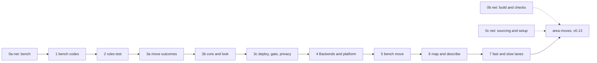

# The refactor plan: slices in order

Back to [level 1](README.md). Each slice is one PR. Line counts are estimates. Names marked "proposed" in the area
pages are new in the slice that adds them.

> TL;DR. First a net of tests that run every CLI from the outside and never change. Then small slices, the bench
> first because walk 2 (due 2026-10-27) runs there. Each slice adds one thing, keeps the net green and turns on the
> rule it makes true. Area moves wait for a story or for v0.13 (the PO's decision 4).

## The order at a glance

Walk 2 needs only 0a and 1. Everything after 1 lands per story until v0.13, unless the PO names a date.

## Slice 0: the outside-in safety net

The testability paper measured 2,817 tests on 2026-10-21 with an `ast` scan. 466 of them (17%) reach spark only
through a CLI's `main(argv)` or a child process. 470 (17%) reach a private name or patch a spark module, so a move
breaks them. The bench tests have the least outside cover: `test_deploy_gate` 76 inside tests, `test_board_grant`
64, `test_board_look` 38. `tests/golden/` does not exist yet. The net fixes this before any code moves.

How every golden works:

- A golden is one file per Operation and status: the `--json` envelope and the exit code, on a fixture project
  under `tests/data/projects/`. stderr is not golden, because its words improve.
- The test runs the CLI as a child process, or through `main(argv)`. Never through a private name, and never with a
  `mock.patch`. So no move can break it.
- Fake tools are processes, as `tests/fake_wokwi_cli.py` is today. A fake bin folder comes first on the child's
  `PATH`.
- The child gets its own temp `SPARK_HOME`. The test branch at `store.py:40` fires only when `unittest` is imported,
  so it does not protect a child process.
- The project root is written as `<project>` and tool versions are normalised, so a golden holds no home path.
- Only `tests/golden.py --accept OP` (proposed) rewrites a golden, and it prints the diff for the PR.
- A person reads the text, not the JSON, so `look`, `deploy --dry-run` and `check_all` also get one text golden.

| Slice | Covers | Lines | Done when |
|---|---|---|---|
| 0a | the harness, `fake_esptool.py`, `fake_mpremote.py`, goldens for `look`, `deploy --dry-run`, `grant --check`, `live`, `reach`, and a measure column "outside tests" | about 300 | each bench CLI has a golden per status the fixture reaches, a planted change in one envelope value fails exactly one golden, the suite count does not drop |
| 0b | goldens for `check_spine` (a fake `tsci` that copies a canned `circuit.json`), `check_all`, the five `check_*`, `compare_design`, `assign_pins`, `emit_board`, `emit_footprint`, `breadboard`, `run_scenario`, `flash_image`, `import_firmware` | about 300 | as 0a, before the first move of firmware, breadboard, checks, design or build |
| 0c | goldens for `parts.py`'s 29 Operations, `cost`, `boards`, `tools`, `init_project` | about 300 | as 0a, before the records and sourcing move |

The rule from slice 0 on (T5): no PR that moves code changes a golden. A PR that changes behaviour on purpose
accepts the golden with `--accept` and says why in its description. These tests stay unchanged through every slice.

## Slices 1 to 7

| # | Adds one thing | Lines | Done when | Tests that stay, and that change | Rule from then on |
|---|---|---|---|---|---|
| 1 | Codes and next steps for the bench: a `code` at the 6 item sites of `board_envelope.py`, `needs_person` on a step, `commands/deploy.md` reads the codes | about 150 | the contract test fails on a removed key and on an unlisted code | the 0a goldens are accepted once, for the new keys only. `test_look` and `test_deploy` stay. | C2 for the bench: every item has a listed code |
| 2 | `ArchitectureRules` and its baseline. `measure.py` moves to `tools/`. The guard tests that list `scripts/*.py` switch to `rglob`. | about 330 plus the baseline | each planted breach is caught with its rule, file, line and reason, and the generated baseline passes | all stay. `test_store`, `test_orphans`, `test_fab`, `test_self_confirmation` and `test_board_look` change their file walk only, because a module can now sit one folder down. | every rule: no new breach, and the baseline only shrinks |
| 3a | `scripts/spark/core/outcomes.py`, moved from `scripts/outcomes.py`. Mechanical. | about 150 | no golden changes, 39 importers updated, `mutate.py --retarget` moved every mutation row | the goldens stay. Tests that import `outcomes` change that line only. | U1: imports follow the area map |
| 3b | The core contract: `OperationResult`, `Finding`, `NextStep`, `SparkError`, `Operation`, `Argument`, `run_operation`, `run_cli`, the two Renderers, and `bench/operations.py` with `look`. `look.py` becomes a CLI of about 15 lines. | about 450 | the `look` goldens stay, the parity test passes, `look.py` is at most 40 lines | `test_look` stays: `look.main(argv, run=)` keeps its signature. New unit tests for core. | X2: a CLI only calls `run_cli`. R1 to R6 hard for `spark/`. |
| 3c | `deploy` as an Operation, `OutsideWorld` with only the declared effects, consent only for `board` or `erases`, `--dry-run` as a recording `run` and `write`, `Privacy` for paths and secrets | about 400 | the `deploy` goldens stay, an erasing Operation with no gate fails, the secret marker test passes | `test_deploy` and `test_deploy_json` stay: `deploy.main` keeps its keyword parameters (`deploy.py:126`) | C4: effects are declared and gated. T1: only Adapters touch the outside. |
| 4 | `Backends`, `ToolFinder`, `FirmwarePlatform` as a base with `MicroPythonPlatform`, `make_port_finder`, `make_board_reader`. `grant`, `live` and `reach` become Operations. | about 450 | a `FakePlatform` drives all five bench Operations with no caller edit, the 8 tool lookups outside the platform are gone, the goldens stay | the goldens stay. The bench tests that patch `tools.find` move to `FakeToolFinder`, because the patch target goes. `mock.patch` lines fall. | X1: a backend is picked only in `operations.py`. X3: one registry form. |
| 5 | The bench area move: 15 to 17 modules into `scripts/spark/bench/`, the renames (`DoctorStep`, `ReadyProbe`, `ReadingFile`, `DeployPhase`, `LookStopError`), the four Fakes into `tests/fakes.py`, one `FakeClock` | 19 to 34 importers, 190 to 240 mutation rows (design.md's estimate) | no golden changes, the test count does not drop, the PR prints "rows N, caught N" | the goldens stay. Unit tests change their imports and the renamed names, nothing else. | T3: a contract test per Strategy in bench. C1: the glossary's names. |
| 6 | The generated `docs/guide/map.md` and `--describe OP` | about 200 | a test fails when the map is stale | all stay | U3: one home per shared flag and code |
| 7 | Fast and slow lanes: `slow_test_*.py` for real tools and spark's own tools, the push hook runs both at once, measure gains "suite s" and "slowest test s" | about 80 | the fast lane stays under 60 s on this Mac, a test over 2 s in it fails unless baselined | `test_mutate`, `test_needs.py:1416` and the real `tsci` tests move file, their bodies stay | T5: the net runs on every push |

## After slice 7: the area moves

Each move is one or two PRs, in this order: firmware, breadboard, checks, design with build, records with sourcing.
Each needs its goldens from 0b or 0c first. Each follows the same rules as slice 5: modules move, every importer
changes in the same PR, no module shim, private names stay reachable where tests use them, and no behaviour changes.

| Move | The one new thing it adds | Removes |
|---|---|---|
| firmware | `SimulationEngine`, `WokwiCliEngine`, `RunLog` | 3 direct `subprocess` calls |
| breadboard | registries as dicts of classes, `WiringStep`, `WiringLog` | `NotKeptResult` and `DrawingDiffersResult` as own shapes |
| checks | `Check` with class attributes, one `Finding` | the sourcing to checks edge (`parts.py:495`), 3 finding shapes |
| design with build | `BuildService` and seven `BuildStage`s, `TscircuitEngine` | `check_spine.run`'s 192 lines, the `emit_board.py` child process |
| records with sourcing | `RecordFolders`, `Records`, `RecordSchema`, `ToolFinder` everywhere | the records to sourcing and design edges, `store.py:40`'s test branch |

A small separate PR fixes `no_board` (D16) when a story needs it: `no_board` only when neither the requirements nor
`boards/active.json` names a board.

## Every PR, always

- No new baseline entry, and at least one paid down in a file the PR edits.
- The PR pastes the measure line before and after: known breaches, fat CLIs, `mock.patch` lines, outside tests, suite s.
- No move PR changes a golden, a public flag, a JSON key, a record key or a script name.

## What we will not do

- No DI container, entry points, `pyproject`, `src/` layout, `adapters/` tree or module shims.
- No `Frontend` base class until the MCP server is the second frontend. No MCP client for tools.
- No `Clock` class. The clock is a field of `OutsideWorld`, filled by `SystemClock`.
- No serial port seam: `ConsoleProbe` runs pyserial through `run` and `FakeConsoleProbe` covers it.
- No base class with one implementation, unless a Fake in `tests/fakes.py` is its second case.
- No catalog, `Workspace`, `project` area, online store layer or several MCUs per project.
- No public rename. `--keep`'s two meanings, `status: mismatch` and the missing-input exit 1 of `boards.py --get`
  and `parts.py --show` are cards for the PO, outside this refactor.
- No area move before v0.13 unless a story pulls it.
