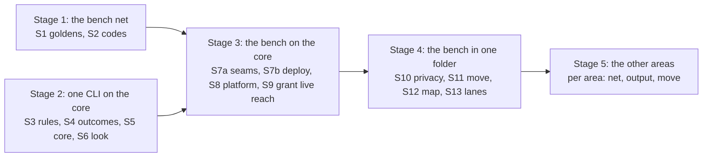

# The refactor plan: five stages, sixteen slices

Back to [level 1](README.md). Card [P323 #413](https://github.com/xmejkal/spark/issues/413), epic P158
[#94](https://github.com/xmejkal/spark/issues/94). Planned in detail on Opus and reviewed on Fable 5.1 on 2026-10-21
(rows 232 on in [the rows file](../../../observations/rows/p323-target-architecture.md)). Every "today" claim cites
`file:line` from main at commit `17708e6`. A number marked "est." is an estimate. A number without "est." was measured,
and the appendix [How the numbers were measured](#how-the-numbers-were-measured) gives the command. A name that is
not in the code yet is proposed, and each area page lists its new names.

> TL;DR. Five stages. Stage 1 (two PRs, before walk 2 on 2026-10-27) records what the five bench CLIs print as
> goldens and gives the bench envelope codes. Stage 2 builds the core and puts `look` on it. Stage 3 puts the other
> four bench CLIs on it and makes the platform swappable. Stage 4 moves the bench into one folder. Stage 5 does the
> other areas, one at a time, when a story pulls each. The work can stop after any stage, and spark still works.

Each slice is one PR that adds one thing and keeps every CLI working. A golden runs each CLI from the outside, so
most of today's 2,817 tests stay as they are. The PO decides four things first, and each stage says which decision it
waits on.

## The stages

| Stage | What works after it | Slices | Size (est.) | Waits on decision |
|---|---|---|---|---|
| 1. The bench net | Walk 2 runs on codes, and a golden catches any bench change | S1, S2 | 550 lines | 3 |
| 2. One CLI on the core | `look.py` is the worked example of the shape, and the rules test ratchets | S3, S4, S5, S6 | 1,060 lines, 106 moved | 1, 2 |
| 3. The bench on the core | Five thin bench CLIs, every effect gated, the platform swappable | S7a, S7b, S8, S9 | 1,100 lines | 2 |
| 4. The bench in one folder | `scripts/spark/bench/` holds the area, no home path in its output, a map | S10, S11, S12, S13 | 720 lines, 2,164 moved | 4 |
| 5. The other areas | Each area has a net, codes and its folder, pulled by a story | 3 PRs per area | 900 per area | 4 |

Stage 1 and stage 2 are independent. Stage 1 goes first, because walk 2 runs on the bench.

## The invariants of every slice

1. **The goldens rule.** A golden is the stdout and exit code of one CLI run on one fixture project. It changes only
   in an output slice (S2, S10, and one per area in stage 5), never in a move. An output slice runs
   `tests/golden.py --accept OP` and says why in its description.
2. **Nothing public changes.** Every flag, JSON key, record key, exit code and script name stays. An output slice
   only adds keys.
3. **The push hook stays green** (`tools/pre-push` runs `tools/check_commit.py`). No slice skips a test.
4. **One PR per slice**, with the measure line before and after: known breaches, `mock.patch` lines, outside
   tests, suite seconds. From S3 on, no PR adds a baseline entry, and each pays one down in a file it edits.
5. **No journey status changes.** No slice changes a step of README's "What works today" or `tools/journey.py`,
   and `tests/test_journey.py` proves it. A slice that changes a CLI's output updates `docs/guide/agents.md` and
   the command page in the same PR.
6. **Claims are checked.** Each slice's PR runs `python3 tools/factcheck.py` on this plan and quotes the output
   (`docs/guide/developing.md`, "Checking a plan"). A line that moved since `17708e6` is corrected in that PR.

## The four decisions for the PO

1. **Readability first.** The goals rank readable, testable, exchangeable, reusable, consistent. Example: S7b
   splits `_deploy` (71 lines, `deploy.py:185-255`) into functions under 40 lines, even where one 71-line function
   reads in one pass. A short function wins over a reusable one. Yes, or another order? Stage 2 waits on it,
   because S3's thresholds encode it.
2. **The shape.** Scripts become thin CLIs over `scripts/spark/`, one Operation per job, one rules test. Example:
   `look.main` shrinks from 29 lines (`look.py:44-72`) to about 15, and `look.py` keeps its help text, flags,
   output and exit codes. Yes or no? Stages 2 and 3 wait on it.
3. **Stage 1 before walk 2 or after it.** (a) Both slices merge by 2026-10-23, so walk 2 on 2026-10-27 runs with
   codes and a net. (b) Walk 2 runs on today's envelope, and both follow. The planner proposes (a) only if S1
   merges by 2026-10-22. Stage 1 waits on it.
4. **When area moves start.** Until v0.13 ([#94](https://github.com/xmejkal/spark/issues/94)) a story pulls its
   area. Example: walk 2 finds a `deploy` gap, so that story also lands S11. The reviewer proposes that the bench
   counts as pulled already, by walk 2, so stage 4 needs no new story. Confirm, or name a date. Stages 4 and 5
   wait on it.

## Stage 1: the bench net, before walk 2

After it: the five bench CLIs have goldens, and the look and deploy envelopes carry a code per item and the `backends`
that ran. A reader reads `docs/guide/agents.md` ("look.py and deploy.py's envelope") and `commands/deploy.md`.
Stage 3 relies on the goldens to prove each move silent.

**Done when:** `python3 -m unittest tests.test_golden_bench -q` passes on a clean clone with no esptool installed;
`ls tests/golden/*.json | wc -l` is at least 12; `grep -L '"code"' tests/golden/look-*.json tests/golden/deploy-*.json`
prints nothing; `grep -l /Users tests/golden/*` prints nothing; the contract test of S2 fails on a removed key.

### S1. Goldens for the five bench CLIs

- **Goal.** Record what `look`, `deploy`, `grant --check`, `live` and `reach` print today, as tests no move breaks.
  The bench tests have the least outside cover: `test_deploy_gate` 76 inside tests, `test_board_grant` 64,
  `test_board_look` 38 ([the audit](../council/round4-testability.md)). `tests/golden/` does not exist.
- **Files.** Created: `tests/golden.py` (the harness and `--accept OP`), `tests/test_golden_bench.py`,
  `tests/fake_modules/esptool/__main__.py`, `tests/fake_modules/mpremote/__main__.py`,
  `tests/fake_modules/serial/__init__.py`, the fixture `tests/data/projects/bench-c6/` (a requirements file, a
  passed run log, an image, a `firmware/main.py` for `--no-simulation`), and `tests/golden/<op>-<status>.json` and `.txt`.
- **How the fakes work.** esptool and mpremote are `kind: python` rows (`data/tools.json:130-149`). spark finds them
  with `importlib.util.find_spec` (`tools.py:164-165`) and runs `python -m esptool` (`tools.py:270-274`), so a fake
  bin folder on `PATH` finds nothing. The harness puts `tests/fake_modules` first on the child's `PYTHONPATH`. The
  fakes print the canned outputs in `tests/data/board_look/` (`c6-flash-id.txt`, `mpremote-devs-one.txt` and the
  rest). The fake `serial` serves `ConsoleProbe`'s pyserial script (`board_console.py:46-61`). The child inherits
  the scratch store through `SPARK_HOME` (`store.py:35-40`).
- **Goldens.** `look`: ok, problems (flash differs), `could-not-run` (two boards on USB), ok with `--no-simulation`
  (P337), a bad flag. `deploy --dry-run`: ok. `deploy` with no token: the gate closes. `deploy` with a deploy grant
  in the scratch store: ready seen (est. the hardest fixture). `deploy` with a bad flag. `grant --check`: no grant.
  `live`: refused, no grant. `reach`: reached. Text goldens for `look` and `deploy --dry-run`. stderr is not golden.
  Paths print as `<project>` and `<store>`.
- **Tests.** All stay. New: the golden tests and a harness self-test.
- **Done when.** Each bench CLI has a golden per status its fixture reaches. A planted change in one envelope value
  fails exactly one golden. No golden holds a home path. The suite count rises only by the new tests.
- **Rule, size, back-out.** T5 for the bench, by the golden test (the rules test arrives in S3). About 350 lines
  (est.), goldens not counted. A flaky process test is the main risk, so each child gets a timeout. Back-out:
  revert; it touches no script.

### S2. Bench envelope additions (an output slice)

- **Goal.** Claude branches on codes on the bench, not on sentences, and a bad flag with `--json` is an envelope.
  `commands/deploy.md:22` tells Claude to read `problems` and relay words. A code per item makes walk 2's hand-offs
  exact.
- **Files.** `scripts/board_envelope.py`: a `code` at its 6 item sites (`board_envelope.py:66`, `:67`, `:69`, `:72`,
  `:84`, `:104`), a `fix_step` beside each string `fix`, `needs_person` on a step for a hand on the bench, and a
  top-level `backends` (`{"platform": {"name": "micropython", "chosen_by": "default"}, "flasher": "esptool",
  "board-shell": "mpremote"}`) in the look and deploy envelopes. `scripts/outcomes.py:84`: `step` gains
  `needs_person`, written only when a caller passes it, so `parts.py`'s steps keep their keys. `look.py` and
  `deploy.py` get a parser as `parts._Parser` (`parts.py:1672`): a bad flag with `--json` prints an envelope with
  code `bad_argument`, exit 2, in place of usage text. Created: `scripts/board_codes.py`, one constant and one line
  of meaning per code. Docs: `docs/guide/agents.md`, `commands/deploy.md`.
- **Tests.** The S1 goldens of `look` and `deploy` are accepted once, for the new keys and the bad-flag envelope.
  The `grant`, `live` and `reach` goldens stay: their JSON is not an envelope (`grant.py:63`, `live.py:68`,
  `reach.py:63`). `test_look`, `test_deploy` and `test_deploy_json` stay. New: a contract test in
  `tests/test_json_contracts.py` for the look and deploy top-level keys (today it has none), including P337's
  `simulation` and P354's `doctor`, and for "every item has a listed code".
- **Done when.** The contract test fails on a removed key and on an unlisted code. `fix` is still a string.
- **Rule, size, back-out.** C2 for the bench: every bench item carries a code from `board_codes.py`, and a bad flag
  is an envelope. About 200 lines (est.). Claude reads the old keys, and they stay. Back-out: revert, then
  re-accept the goldens.

## Stage 2: the core, with `look` on it

After it: `scripts/spark/core/` holds the contract, `look.py` is the one thin CLI, and the rules test holds every
rule with a baseline that only shrinks. The four other bench CLIs keep today's shape, whole, with their goldens. A
reader reads `docs/guide/developing.md`'s role table and `look.py` as the worked example of README's "How a person
or an agent finds code". Stage 3 relies on `run_cli`, `OutsideWorld`, `Backends` and the Fakes.

**Done when:** `python3 -m unittest tests.test_architecture -q` passes and `tests/architecture_baseline.json` lists
no file under `scripts/spark/`; `python3 scripts/look.py --help` prints today's text; no golden changed since S2;
`look.main` is at most 15 lines by `ast` (`end_lineno - lineno + 1`).

### S3. The rules test and its baseline

- **Goal.** One test reads the code with `ast` and holds every rule of [notes](notes.md#rule-reference).
- **Files.** Created: `tests/test_architecture.py` (`ArchitectureRules`), `tests/architecture_baseline.json`
  (generated). Moved: `docs/discovery/2026-10-19-p322-code-architecture/measure.py` (213 lines) to
  `tools/measure.py`, with the columns "outside tests" and "suite s". Changed: `tools/mutate.py` gains
  `--retarget OLD NEW`, which rewrites the `file` of every row in `tests/mutations/*.json` (1,999 rows). Ten file
  walks switch from `glob` to `rglob`, because a module can now sit one folder down: `test_board_look.py:472`,
  `test_fab.py:50`, `test_orphans.py:52`, `:61`, `:82`, `test_self_confirmation.py:26`, `test_store.py:78`, `:83`,
  `tools/inventory.py:66`, `measure.py:157`. Each skips `scripts/stand_in/`, MicroPython's stand-in `machine`
  module, which is not spark code. `docs/guide/developing.md:233-243`: the role table gains Operation and Records,
  folds Platform into Strategy, and names `FakeOutsideWorld` and `FakeFirmwarePlatform`.
- **Tests.** All stay, except the file-walk lines above. New: one planted breach per rule.
- **Done when.** Each planted breach is caught with its rule, file, line and reason. The generated baseline passes.
  `--retarget` moves a planted row. `tools/measure.py` prints the same numbers as the old path.
- **Rule, size, back-out.** Every rule: no new breach, and the baseline only shrinks. About 400 lines (est.) plus
  the baseline. A rule with many false hits enters the baseline, never a skip. Back-out: revert.

### S4. `outcomes` into the package

- **Goal.** `scripts/spark/` exists, and its first module is the one every CLI already shares.
- **Files.** Moved: `scripts/outcomes.py` (106 lines, whole) to `scripts/spark/core/outcomes.py`. Created:
  `scripts/spark/__init__.py`, `scripts/spark/core/__init__.py`. Changed: the import line of 39 files (29 in
  `scripts/`, 7 in `tests/`, 3 in `tools/`), and the 7 mutation rows of `outcomes.py` by `--retarget`.
- **Tests.** All goldens stay. `test_outcomes.py` and the 6 other test files change their import line only.
- **Done when.** No golden changes. No file imports `outcomes` by the old name. `mutate.py --anchors` passes.
- **Rule, size, back-out.** U1: imports follow the area map. U2: `spark/` modules import modules, not names. About
  60 changed lines (est.) plus 106 moved. An import missed in a child process: the S1 goldens run children, so
  they catch it. Back-out: revert.

### S5. The core contract

- **Goal.** One result shape and one runner exist, tested alone with a toy Operation. No CLI uses them yet. S6 lands
  right after it, so the core has a user in the same stage.
- **Files.** Created: `spark/core/result.py` (`OperationResult`, `Finding`, `NextStep`), `spark/core/operation.py`
  (`Operation`, `Argument`, `COMMON_ARGUMENTS`: `--project`, `--json`, `--port`, `--dry-run`, `--out`, `--timeout`),
  `spark/core/errors.py` (`SparkError`), `spark/core/codes.py`, `spark/core/outside.py` (`OutsideWorld`, `Privacy` as
  an empty pass-through until S10), `spark/core/cli.py` (`run_operation`, `run_cli`, `TextReport`, `JsonEnvelope`,
  `FlatJsonLine`), `spark/records/__init__.py`, `spark/records/backends.py` (`Backends` with one field, `tools`, a
  `ToolFinder` over today's `tools.find`, and `build_outside`). Test side: `FakeOutsideWorld` and `FakeToolFinder`
  in `tests/fakes.py`, `tests/test_core.py`.
- **Classes.** `FlatJsonLine` is a third Renderer, proposed here: it renders `data` alone as one line, for the CLIs
  whose JSON is not an envelope. core.md gains it in this PR. `OutsideWorld` has `show_line`, because `deploy`
  prints each line while the flash runs (`deploy.py:136-138`, `flush=True`), so `lines` rendered at the end are not
  enough. `run_cli` and each `main` take `backends=None` beside `outside=None`: bench tests replace `tools.find` 19
  times over 11 bench test files, and `Backends` is not part of `OutsideWorld`. `main` keeps three parameters (R3).
  A crash prints its traceback to stderr, as today, and an envelope with code `crash` on stdout. No `--debug` flag.
- **Tests.** All stay. New: one test per path of the core flow (ok, problems, `could-not-run`, bad flag,
  `SparkError`, crash, undeclared effect) and the parity test helper.
- **Done when.** The toy Operation passes every path. A call to an undeclared effect raises code
  `undeclared_effect`. R1 to R6 hold in `spark/core/` with no baseline entry.
- **Rule, size, back-out.** R1 to R6 are hard in `spark/`. C3: exit codes only from `EXIT_FOR`. About 450 lines
  (est.), half of them tests. Nothing calls it yet, so revert is safe. The risk is a shape S6 and S7b reject, so
  S5's PR carries the `look` sketch from S6 as a check.

### S6. `look` on the core

- **Goal.** The first CLI that only parses, calls one Operation and prints.
- **Files.** Created: `spark/bench/__init__.py`, `spark/bench/operations.py` with `look` and its `Operation(...)`.
  Changed: `scripts/look.py` (80 lines): `main(argv=None, outside=None, backends=None)` calls `run_cli`. Its
  26-line `EPILOG` (`look.py:16-41`) stays in the CLI, so R1's CLI limit counts code lines, not help text. The body
  of `look.main` (`look.py:44-72`) and `_print_json` (`look.py:75-76`) go to the Operation and the Renderers. The
  S2 bad-flag parser goes to `run_cli`, with the same output.
- **Tests.** The `look` goldens stay, text and JSON. `test_look.py` changes its call lines only: `run=run` at
  `test_look.py:38` becomes `outside=FakeOutsideWorld(run=run)`, and its 2 `tools.find` patches become
  `backends=Backends(tools=FakeToolFinder(...))`. New: the parity test for `look` (text and JSON carry the same
  codes and the same first step).
- **Done when.** No golden changes. `look.main` is at most 15 lines. `look.py` imports no area module but
  `spark.bench.operations`.
- **Rule, size, back-out.** X2: a CLI on the core calls only `run_cli`, and the rules test lists the CLIs not yet
  on it. About 150 lines (est.). The look's stop path prints doctor lines to stderr in both modes
  (`look.py:63-64`), and the text golden does not cover stderr, so a unit test pins that path. Back-out: revert.

## Stage 3: the bench on the core

After it: every bench CLI is thin, every outside effect of `deploy` is declared and gated, and a second platform is
one subclass and one registry line. The bench's Services still sit in `scripts/` until stage 4. A reader reads
`spark/bench/operations.py`'s docstring as the bench's index. Stage 4 relies on `MicroPythonPlatform`,
`FakeFirmwarePlatform` and the five Operations.

**Done when:** no golden changed since S2; each bench `main` is at most 15 lines by `ast`;
`grep -c 'GrantService(' scripts/*.py scripts/spark/bench/*.py` sums to 1; `grep -rn 'tools.find("board-shell"\|tools.find("flasher"' scripts | grep -v firmware_platform.py` prints nothing;
`python3 -m unittest tests.test_deploy_gate -q` passes with no `mock.patch` line in that file.

### S7a. The deploy seams

- **Goal.** The deploy tests drop their patches and their `probe` seam before the Operation arrives, so S7b
  changes call lines only.
- **Files.** `scripts/deploy_service.py`: `DeployService.sleep` (`deploy_service.py:64`, a class attribute) goes,
  and the clock given in `__init__` (`deploy_service.py:66`) sleeps. `tests/fakes.py`: `FakeClock` (`fakes.py:59`)
  and `FakeLocalClock` (`fakes.py:88`) merge into one `FakeClock` with `now`, `monotonic` and `sleep`.
- **Tests.** The `sleep` patch at `test_deploy_gate.py:109` and `test_deploy_service.py:46` becomes `FakeClock`. The
  5 tests that pass `probe=` (3 in `test_deploy_gate.py`, 2 in `test_deploy_json.py`) get the real `ConsoleProbe` over
  the fake `run`, with a temp file as the port, because `ConsoleProbe` checks the port with `os.path.exists`
  (`board_console.py:92`). Goldens stay.
- **Done when.** No golden changes. The two `sleep` patches are gone. No test passes `probe=`.
- **Rule, size, back-out.** T2 for the deploy tests: their `mock.patch` count only falls. About 150 lines (est.).
  `FakeClock.sleep` records, so a timing assertion holds as before. Back-out: revert.

### S7b. `deploy` on the core, with effects and gates

- **Goal.** Every outside effect of `deploy` is declared and gated.
- **Files.** `spark/bench/operations.py` gains `deploy`. `scripts/deploy.py` (259 lines): `main`
  (`deploy.py:141-173`) shrinks, and `_deploy` (`deploy.py:185-255`, 71 lines, 9 parameters) becomes the
  Operation, split under 40 lines a function. The five keywords `run`, `consent`, `probe`, `clock`, `grant_service`
  (`deploy.py:141`) go. The platform is still `FirmwarePlatform.micropython` (`deploy.py:191`), now named only in
  `operations.py`. `image_evidence.py` (`ImageEvidence`, `image_evidence.py:30`) stays as it is: it already has the
  Strategy form.
- **Dry run.** `--dry-run` keeps today's path: it stops after `plan` and prints the planned commands
  (`deploy.py:203-207`). It never looks and never calls `run` for esptool, so it is not a recording `run`. With
  `--dry-run`, `build_outside` fills `board` and `erases` with refusing stubs, so a bug cannot flash.
- **Tests.** The `deploy` goldens stay. The call sites `test_deploy.py:85`, `test_journey_basic.py:160` and the
  helper `test_deploy_gate.py:85-111` change: one `outside=FakeOutsideWorld(run, clock, consent, show_line)` and
  `backends=`. The 12 `grant_service=` seams in `test_deploy_gate.py` become a grant file in the scratch store,
  written with `GrantStore`, and the clock from `outside`. New: an erasing Operation with no gate fails; a call to
  an undeclared effect fails.
- **Done when.** No golden changes. `deploy.main` is at most 15 lines. No `mock.patch` line remains in
  `test_deploy_gate.py`.
- **Rule, size, back-out.** C4: effects are declared, and `board` and `erases` need consent. T1: only Adapters
  touch the outside, in `spark/bench/`. About 350 lines (est.), most of it in `test_deploy_gate.py`'s helper. This
  is the safety path: the ready-seen golden and the gate tests guard it, and the refuter reviews it on the
  strongest model. Back-out: revert.

### S8. The platform owns the board tools

- **Goal.** A second platform is one subclass and one registry line, and no bench caller changes.
- **Files.** `scripts/firmware_platform.py` (84 lines): `FirmwarePlatform` (`firmware_platform.py:41`) becomes a
  Strategy base, `MicroPythonPlatform` fills it in place of the classmethod (`firmware_platform.py:53-60`), and it
  gains `make_port_finder` and `make_board_reader`. The 8 lookups outside it go: `live.py:84`, `reach.py:79`,
  `grant.py:88`, `grant.py:95`, `board_look.py:296`, `board_look.py:297`, `board_doctor.py:162`,
  `board_doctor.py:164`. `spark/bench/operations.py` gains `PLATFORMS` and `DEFAULT_PLATFORM`. `Backends` gains
  `platform`, a `Choice(name, chosen_by)`, always `DEFAULT_PLATFORM` today: `requirements.json` has no `platform`
  key, and the key enters with the second platform. The S2 `backends` envelope key is now derived from it.
- **Classes.** `FakeFirmwarePlatform`, `FakeBoardReader` and `FakePortFinder` (from `FakeFinder`,
  `test_board_doctor.py:28`) in `tests/fakes.py`. `FirmwarePlatformContract` and `FlasherContract` (T3: `Flasher`
  has one subclass and no Fake, so the contract test with a recording `run` is its second case).
- **Tests.** All goldens stay. Unit tests of the Services pass `FakeFirmwarePlatform`. New: the two contract
  tests, and a seam test that drives `LookService`, `DeployService`, `GrantService`, `LiveTryService` and `reach`
  with the Fake.
- **Done when.** No `tools.find("board-shell"` or `("flasher"` outside `firmware_platform.py` (grep). No golden
  changes.
- **Rule, size, back-out.** X1: a bench Adapter is named only in `spark/bench/operations.py` and the platform. T3:
  a Strategy base has a contract test. About 300 lines (est.). `board_doctor` runs on a failed read inside three
  CLIs; its unit tests and the `could-not-run` goldens cover it. Back-out: revert.

### S9. `grant`, `live` and `reach` on the core

- **Goal.** All five bench CLIs are thin, and `GrantService` is built in one place.
- **Files.** `spark/bench/operations.py` gains `grant`, `grant-check`, `live`, `reach`. `scripts/grant.py`
  (`main` 53 lines, `grant.py:66-118`), `live.py` (`live.py:71-100`), `reach.py` (`reach.py:66-101`) shrink.
  `GrantService` today is built at `grant.py:90`, `grant.py:99`, `live.py:89`, `deploy.py:212`. Their `--json`
  stays one flat line through `FlatJsonLine`, with today's keys. A bad flag on them keeps argparse's usage text:
  their JSON is not an envelope, so the bad-flag envelope is not theirs.
- **Tests.** Goldens stay. `test_board_grant.py`, `test_live.py`, `test_reach.py` and
  `test_json_contracts.py:206-212` change their call lines and their 5 `tools.find` patches.
- **Done when.** No golden changes. Each bench `main` is at most 15 lines. `GrantService(` appears once in
  `scripts/`.
- **Rule, size, back-out.** X2 for every bench CLI. About 300 lines (est.). `grant --minutes` asks in the terminal,
  so it has no golden; a unit test with `FakeConsent` covers it. Back-out: revert.

## Stage 4: the bench in one folder

After it: a reader finds the bench in `scripts/spark/bench/`, no bench output holds a home path or a secret, and
`docs/guide/map.md` is the first page to read. Stage 5 relies on the move recipe of S11 (retarget rows, rename per
the glossary, Fakes to `tests/fakes.py`).

**Done when:** `ls scripts/spark/bench/*.py | wc -l` is 18 (17 modules and `__init__.py`); `ls scripts/board_*.py
scripts/deploy_*.py` prints nothing; `grep -rl '/Users/\|/home/' tests/golden` prints nothing; `python3 -m unittest
tests.test_map -q` passes; the suite's fast lane runs under 90 s on the PO's Mac.

### S10. Bench privacy (an output slice)

- **Goal.** No home path and no secret reaches a bench output.
- **Files.** `spark/core/outside.py`: `Privacy` shortens the paths under the project and the store and masks
  each `account_env` value (`tools.py:339`). Today the deploy envelope prints absolute paths in `board_log`,
  `store_record` (`board_envelope.py:129`, `:131`) and in the step argv (`look.py:69` resolves the project).
- **Tests.** The bench goldens with such a path are accepted once. New: a secret-marker test over every bench CLI.
- **Done when.** The marker test passes. A grep of the bench goldens finds no `/Users/` and no `/home/`.
- **Rule, size, back-out.** C4: no secret or home path reaches the output. About 120 lines (est.). Back-out:
  revert, and re-accept the goldens.

### S11. The bench area move (waits on decision 4)

- **Goal.** The bench is one package that a reader finds in one folder.
- **Files.** Moved: 17 modules into `scripts/spark/bench/`: `board_look`, `board_doctor`, `board_grant`,
  `board_live`, `board_reach`, `board_envelope`, `board_codes`, `board_facts`, `board_connection`, `board_console`,
  `deploy_gate`, `deploy_service`, `firmware_platform`, `flasher`, `ready_check`, `download_mode`,
  `image_evidence`. Today 16 of them hold 2,164 lines, and S2 adds `board_codes`. The five CLIs stay in `scripts/`.
  31 files import a bench module, and the 217 mutation rows of these modules move by `--retarget`. Renames per the
  [table](#into-bench), with `make_ready_check` to `make_ready_probe`. The Fakes `FakeProbe`
  (`test_board_doctor.py:38`), `FakeGrants`, `FakeDoctor` (`test_board_live.py:27`, `:140`) move to `tests/fakes.py`.
- **Tests.** Goldens stay. Unit tests change their imports and the renamed names, nothing else.
- **Done when.** No golden changes. The test count does not drop. The PR prints "rows 217, caught N".
- **Rule, size, back-out.** C1: the glossary's names in bench. U1 for bench. About 400 changed lines (est.) plus
  2,164 moved. The biggest diff of the bench, with no logic change, so review reads the import lines and the
  goldens. Back-out: revert.

### S12. The map

- **Goal.** A reader finds code from one page.
- **Files.** Created: `tools/map.py` writes `docs/guide/map.md`: each CLI, its Operations, each area's modules
  with their first docstring line and test file, and each registry with its keys. `tests/test_map.py` fails when
  the page is stale. `--describe OP` waits for the MCP frontend: no caller needs it today.
- **Done when.** `python3 tools/map.py --check` exits 0 on a clean tree and 1 after a module is added.
- **Rule, size, back-out.** U3: one home per shared flag and code, read from the map. About 120 lines (est.).
  Back-out: revert.

### S13. Fast and slow lanes

- **Goal.** A push waits less.
- **Files.** `slow_test_*.py` for real tools and spark's own tools. `check_commit.measure`
  (`tools/check_commit.py:127-145`) runs both lanes at once. The audit measured 122.2 s: `test_mutate` 27.3 s,
  `test_docs` 9.5 s, `test_needs.py:1416` 7.5 s. Moving the first and third leaves about 87 s (est.).
- **Done when.** The fast lane is under 90 s on the PO's Mac, and a test over 2 s in it fails unless baselined.
- **Rule, size, back-out.** T5: the net runs on every push. About 80 lines (est.). Blocked by nothing; it lands
  when a push feels slow. Back-out: revert.

## Stage 5: the other areas, each pulled by a story

Each area gets three PRs when a story pulls it, in this order: firmware, breadboard, checks, design with build,
records with sourcing. First its net: goldens for its CLIs with a fake tool process where one is needed (a fake
`tsci` that copies a canned `circuit.json`; the `fetch` goldens run through `main(argv)` in the test process,
because a child refuses `file:` URLs, `store.py:339`). Then its output slice adds its codes, `fix_step` and
`backends`, and accepts its goldens. Then its move, with the names below and no module shim. About 300 lines
(est.) per PR.

| Area | Its net covers | Its move adds (every proposed name of its page) | Removes |
|---|---|---|---|
| firmware | `run_scenario`, `flash_image`, `import_firmware` | `SimulationEngine`, `WokwiCliEngine`, `ENGINES`, `RunLog`, `FlashImageBuilder`, `status_of_run`, `SimulationEngineContract` | 3 direct `subprocess` calls |
| breadboard | `breadboard` | registries as dicts of classes, `WiringStep`, `WiringLog`, `Layout`, `NotBuiltError`, `NotDrawnError` | `NotKeptResult`, `DrawingDiffersResult` as own shapes |
| checks | `check_all`, the five `check_*`, `check_bom`, `compare_design` | `Check` with class attributes, `CheckService`, `CheckContract`, the five `*Check` names, `CircuitBoard`, `GhVendorHeaders`, `CouldNotKeepError`, one `Finding` | the sourcing to checks edge (`parts.py:495`), 3 finding shapes |
| design with build | `check_spine`, `assign_pins`, `emit_board`, `emit_footprint`, `init_project` | `BuildService`, `BuildInputs`, `BuildStage` and six subclasses, `BUILD_STAGES`, `TscircuitEngine`, `DiagramConverter`, `ProjectSetupService`; `PinAssigner`, `PinMap`, `BoardEmitter`, `NeedsService`, `ImpossibleError`; the `audit` and `board-list` Operations | `check_spine.run`'s 192 lines (`check_spine.py:347-538`), the `emit_board.py` child process |
| records with sourcing | `parts.py`'s 29 Operations, `cost`, `boards`, `tools` | `RecordFolders`, `Records`, `RecordSchema` with `schema_too_new` and `migrate`, `ToolFinder` everywhere, `ToolMissingError`, `Backends.folders` and `.simulator`; `DrawerService`, `DatasheetService`, `RunCostService`, `MatcherContract`, `UnknownMatcherError`, `NoTranscriptError` | the records to design edge (`boards.py:243`, `:595`), `store.py:40`'s test branch |

## What we will not do

- No DI container, entry points, `pyproject`, `src/` layout, `adapters/` tree or module shims.
- No `Frontend` base class until the MCP server is a second frontend, and no MCP client for tools (no card yet).
  No `--describe` and no `--debug` flag until then.
- No `Clock` class: the clock is a field of `OutsideWorld`. No serial port seam: `ConsoleProbe` runs through `run`.
- No base class with one implementation, unless a Fake in `tests/fakes.py` or a contract test is its second case.
- No `platform` key in `requirements.json` until a second platform exists.
- No envelope for the flat JSON of `grant`, `live` and `reach` in this refactor: it renames public keys (no card yet).
- No catalog, `Workspace`, `project` area, online store layer or several MCUs per project (the store epic, P178).
- No public rename. `--keep`'s two meanings, `status: mismatch` (`check_vendor_pins.py:231`) and the missing-input
  exit 1 of `boards.py --get` and `parts.py --show` are cards for the PO, outside this refactor (no cards yet).
- No change to the demo projects or the examples (AGENTS.md).

## Appendix: what moves where

Each table lists the files that move into one area, with `file:line` from main at `17708e6`.

### Into core

| Today | Becomes |
|---|---|
| `scripts/outcomes.py`, whole (106 lines) | `core/outcomes.py` (S4). 39 files change their import. |
| `parts.Answer` (`parts.py:230`) and `outcomes.answer` (`outcomes.py:49`) | `OperationResult` |
| `parts._problem` (`parts.py:238`), the item dicts in `board_envelope.py:66-104` | `Finding` |
| `outcomes.step` (`outcomes.py:84`), `board_envelope.look_step` and `deploy_step` (`board_envelope.py:51`, `:56`) | `NextStep` |
| `parts.OPERATIONS` and `OPTIONS` (`parts.py:1581`, `:1655`) | `Operation` and `Argument` |
| `parts._Parser` (`parts.py:1672`) and `look.main`'s body (`look.py:44-72`) | `run_cli` |
| `board_envelope.dumps` (`board_envelope.py:46`) | `JsonEnvelope` |
| `board_look.report_lines` (`board_look.py:234`) | `lines` of the result, rendered by `TextReport` |
| `deploy.show_line` (`deploy.py:136`) | `OutsideWorld.show_line` |

### Into records

| Today | Becomes |
|---|---|
| `scripts/store.py` (407 lines) | `records/store.py`. `home()` (`store.py:46`) feeds `RecordFolders`. |
| `store.layers`, `store.records` (`store.py:73`, `:86`) | `Records(kind)` over `RecordFolders` |
| `boards.validate`, `REQUIRED_KEYS` (`boards.py:340`, `:62`) | `RecordSchema("board")` |
| `parts.validate` (240 lines), `REQUIRED_KEYS`, `RECORD_TYPES` (`parts.py:621`, `:51`, `:311`) | `RecordSchema("part")`, one named rule per function |
| `compare_design.PULLUP_MIN_OHM` and `MAX` (imported at `parts.py:495`) | `records/schema.py`, which removes the sourcing to checks edge |
| `boards.load`, `ButtonPlaces`, `BoardError` (`boards.py:253`, `:269`, `:122`) | `records/board_records.py`. `BoardError` subclasses `SparkError`. |
| `boards.footprint_stop` (`boards.py:236`, its import at `:243`) | design, with the `board-list` Operation that calls it (`boards.py:595`) |
| `tools.find`, `merged`, `ToolProblem` (`tools.py:277`, `:79`, `:63`) | `ToolFinder` (S5 wraps it), `ToolMissingError`, code `tool_missing` |
| `tools.main` (`tools.py:568-650`, 83 lines) | seven Operations, one function each |
| the platform at `deploy.py:191`, `micropython_port` at `flash_image.py:89` | `Backends.platform` (S8). `micropython_port` stays a board fact. |

### Into sourcing

| Today | Becomes |
|---|---|
| `scripts/drawer.py` (421 lines) | `sourcing/drawer.py`. Its reads of `parts._parse` and `parts._problem` (`drawer.py:187`, `:226`) use `Records` and `Finding`. |
| `scripts/matching.py` (230 lines) | `sourcing/matching.py`. `UnknownMatcher` (`matching.py:31`) becomes `UnknownMatcherError`. |
| `keep_in_store`, `keep_local`, `EXIF_TYPE_BYTES`, `DATASHEET_SAYS` (`parts.py:1102`, `:1214`, `:1061`, `:1122`) | `sourcing/datasheets.py`. Its `pdftotext` run (`parts.py:1180`) goes behind `run`. |
| `parts.audit` (`parts.py:130-169`), which calls `emit_footprint.footprint_gaps` at `parts.py:165` | design's `audit` Operation |
| `cost.py`'s logic (302 lines) | `sourcing/run_cost.py`. `NoTranscript` (`cost.py:46`) becomes `NoTranscriptError`. It reads `CLAUDE_CODE_SESSION_ID` (`cost.py:69`, `:77`) from `OutsideWorld.environ`. |
| `parts.py`'s operation table and parser (`parts.py:1581`, `:1655`, `:1672`) | `sourcing/operations.py` and `run_cli` |

### Into design

| Today | Becomes |
|---|---|
| `scripts/design.py` (382 lines), `load` at `design.py:372` | `design/loader.py`. `DesignError` (`design.py:64`) subclasses `SparkError`. |
| `scripts/needs.py` (655 lines) | `design/needs.py`. Its `parts.py` handlers (`parts.py:2087-2179`) become Operations here. |
| `assign`, `render`, `pin_module` (`assign_pins.py:199`, `:368`, `:392`) | `design/pin_assigner.py`: `PinAssigner`, `PinMap` |
| the `EXIT_IMPOSSIBLE` alias (`assign_pins.py:46`) | gone. `Impossible` (`assign_pins.py:113`) becomes `ImpossibleError` with status `problems`. |
| `emit_board.py`'s logic (`emit_board.py:64-1172`) | `design/board_emitter.py`, `BoardEmitter`, split under 600 lines a module |
| `emit_footprint.py` (243 lines) and `boards.footprint_stop` | `design/footprint_emitter.py` |
| `restricted_pins.py`, `netlist.py`, `fab.py`, `copper.py` | moved as is |

### Into firmware

| Today | Becomes |
|---|---|
| `flash_image.py`'s logic (`flash_image.py:37-118`) | `firmware/image_builder.py`, `FlashImageBuilder` |
| `import_firmware.py`'s logic (`import_firmware.py:53-93`) | `firmware/import_probe.py`, its run (`import_firmware.py:58`) behind `run` |
| `project_image.py` | `firmware/project_image.py`, moved as is |
| `sim_project.py` (201 lines), `find_wokwi_cli` (`sim_project.py:20`) | `firmware/sim_project.py`. The lookup goes to `Backends.tools`. |
| `ScenarioRun`, `verdict`, `run_record` (`run_scenario.py:124`, `:98`, `:211`) | `firmware/scenario_run.py`. `verdict` becomes `status_of_run`, `run_record` builds a `RunLog`. |
| the `wokwi-cli` runs at `run_scenario.py:170` and `sim_project.py:157` | `WokwiCliEngine`. The token read (`run_scenario.py:252`) goes to `OutsideWorld.environ`. |

### Into breadboard

| Today | Becomes |
|---|---|
| `breadboard.py` (603 lines), `NotBuilt` (`breadboard.py:108`) | `breadboard/sheet.py`, `NotBuiltError` |
| `breadboard_steps.py` (211 lines) | `breadboard/wiring_steps.py`, `Step` becomes `WiringStep` |
| `breadboard_drawing.py` (477 lines), `NotDrawn` (`breadboard_drawing.py:37`) | `breadboard/drawing.py`, `NotDrawnError`, `Layout` |
| `breadboard_keep.py` (338 lines), `NotKeptResult` (`breadboard_keep.py:63`) | `breadboard/kept_moves.py`. `NotKeptResult` folds into `Finding`: it already holds a `code`. |
| `breadboard_changes.py` (235 lines), `WiringRecord` (`breadboard_changes.py:103`) | `breadboard/bench_changes.py`, `WiringLog` |
| `breadboard_match.py` (93 lines), `DrawingDiffersResult` (`breadboard_match.py:29`) | `breadboard/drawing_match.py`, the result folds into `Finding` |
| `part_pictures.py`, `tabbed_page.py` | moved as is. `TscircuitExport` takes `run` (`tabbed_page.py:48`). |
| `DRAWING_RENDERERS`, a tuple of instances (`breadboard.py:94`) | a dict from name to class (rule X3) |

### Into checks

| Today | Becomes |
|---|---|
| `Check`, `CHECKS`, `CheckedFolder`, `render` (`check_all.py:63`, `:285`, `:316`, `:434`) | `checks/check.py`, `CheckService`. `render` stays the person's text. |
| `RulesVsNetlist`, `Physics`, `Buildability`, `VendorTruth`, `TheOrder` (`check_all.py:121-264`) | `RulesCheck`, `PhysicsCheck`, `BuildCheck`, `VendorPinsCheck`, `OrderCheck`, under `CheckContract` |
| `check_physics.Finding` (`check_physics.py:93`), `check_footprints.Finding` (`check_footprints.py:54`), `compare_design.Failure` (`compare_design.py:44`) | core's `Finding`. `needs-measurement` maps to severity `unmeasured`. |
| `check_physics.Board` (`check_physics.py:114`) | `CircuitBoard` |
| `fetch_variant_header` (`check_vendor_pins.py:64`, its run at `:67`), `CouldNotKeep` (`check_vendor_pins.py:175`) | `GhVendorHeaders`, `CouldNotKeepError` |
| the `EXIT_MISMATCH` alias (`check_vendor_pins.py:44`) | `EXIT_FOR`, same exit code |
| `check_bom.py` (185 lines) | `checks/check_bom.py`, moved as is |
| the person-text keys `reason` (`check_all.py:82`), `detail` | new JSON says `sentence`. The old keys stay until a card retires them. |

### Into bench

| Today | Becomes |
|---|---|
| the bodies of `look.py`, `deploy.py`, `grant.py`, `live.py`, `reach.py`; `deploy._deploy` (`deploy.py:185-255`), which prints and picks exit codes | Operations in `bench/operations.py`, each returning an `OperationResult` (S6, S7b, S9) |
| `FirmwarePlatform.micropython` (`firmware_platform.py:53-60`), the 8 board-tool lookups listed in S8 | `MicroPythonPlatform`, `make_port_finder`, `make_board_reader` (S8) |
| `GrantService` built at `grant.py:90`, `:99`, `live.py:89`, `deploy.py:212` | built once in `bench/operations.py` (S9) |
| `BoardCheckStrategy`, `CheckResult` (`board_doctor.py:76`, `:56`), `ReadyCheck` (`ready_check.py:43`), `FactsFile` (`board_facts.py:36`), `LookStop` (`board_look.py:53`) | `DoctorProbe`, `DoctorProbeResult`, `ReadyProbe`, `ReadingFile`, `LookStopError` (S11) |
| `STAGE_*` (`board_envelope.py:26`) | `DeployPhase`. The JSON key `stage` stays. |
| `DeployService.sleep`, a class attribute (`deploy_service.py:64`) | the clock, passed in `__init__` (S7a) |
| `board_envelope.py`'s item dicts (`board_envelope.py:66-104`) | `Finding` and `NextStep`, with codes. `fix` stays a string. |
| `image_evidence.py` (176 lines): `ImageEvidence`, `PassedRunEvidence`, `NoSimulationEvidence` (`image_evidence.py:30`, `:64`, `:99`) | `bench/image_evidence.py`, moved as is: it already is a Strategy with two subclasses (S11) |
| `FakeFinder`, `FakeProbe`, `FakeGrants`, `FakeDoctor` (`test_board_doctor.py:28`, `:38`, `test_board_live.py:27`, `:140`) | `tests/fakes.py` (S8 for `FakeFinder` as `FakePortFinder`, S11 for the rest) |

### Into build

| Today | Becomes |
|---|---|
| `check_spine.run` (`check_spine.py:347-538`, 192 lines) | `BuildService` and six `BuildStage`s in today's order, each under 40 lines |
| `check_spine.Stage` (`check_spine.py:100`) | each stage's `OperationResult`. `detail` stays the JSON key. |
| the `emit_board.py` child process (`check_spine.py:391`) | `SchematicStage` calls design's `BoardEmitter` in process |
| `toolchain_can_build` (`check_spine.py:151-164`), its `tsci build` (`check_spine.py:162`), `--version` (`:170`), the build (`:432`) | `TscircuitEngine` |
| `converter_command` (`check_spine.py:208`) and its run (`check_spine.py:509`) | `DiagramConverter` |
| the history comments at `check_spine.py:371` and `:453` | their cards. A comment keeps 4 lines at most (rule R5). |
| `init_project.py` (522 lines), `ai_files.py` (123 lines) | `build/project_setup.py` (`ProjectSetupService`), `build/ai_files.py` |

## Appendix: how the numbers were measured

On main at `17708e6`, 2026-10-21, from the repository root. Line counts are `wc -l`, function lengths `ast`'s
`end_lineno - lineno + 1`. The audit's numbers (2,817 tests, 122.2 s, the inside-test counts) are from
[round4-testability.md](../council/round4-testability.md).

- 39 files import `outcomes`: `grep -rlE "^(import outcomes|from outcomes import)" scripts tests tools | wc -l`.
  31 files import a bench module: the same grep over the 15 module names.
- 1,999 mutation rows, 7 for `outcomes.py`, 196 for the 15 bench modules, 21 for `image_evidence.py`: a Python
  loop over `tests/mutations/*.json` counting each row's `file`.
- 19 `tools.find` patches over 11 bench test files, 5 of them in the S9 files:
  `grep -cE 'patch(\.object)?\((tools, *"find"|"tools\.find")' tests/test_*.py`. 5 tests pass `probe=` and 12
  `grant_service=`: `grep -c` over `tests/test_deploy_gate.py` and `tests/test_deploy_json.py`.
- 29 Operations in `parts.py`: `ast` over the `OPERATIONS` tuple at `parts.py:1581`.
