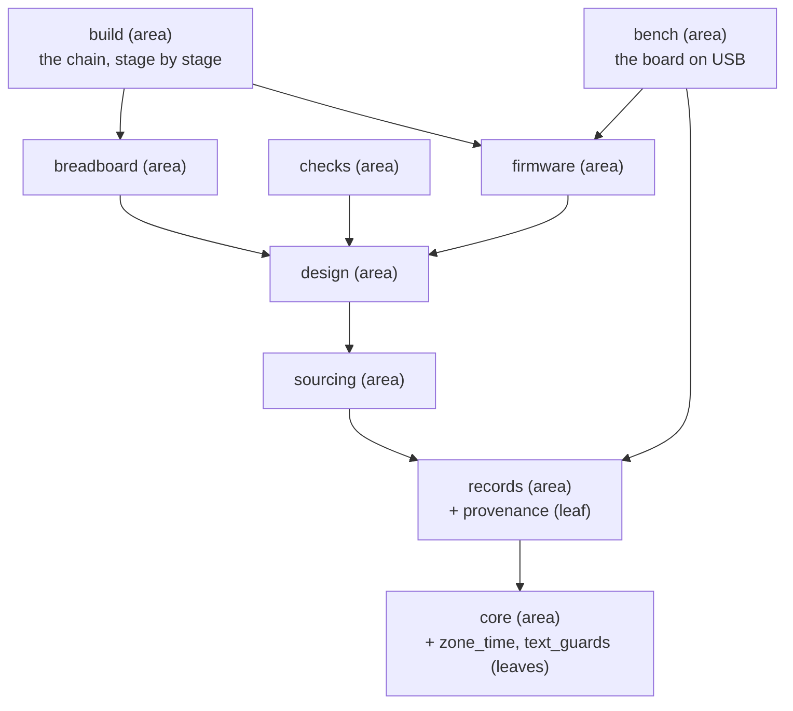
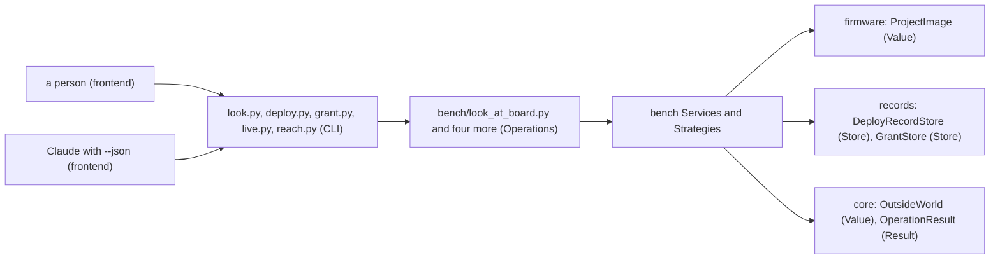
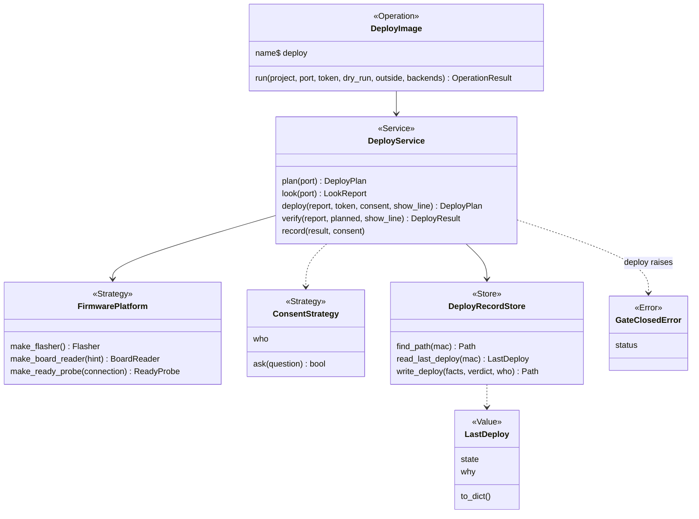
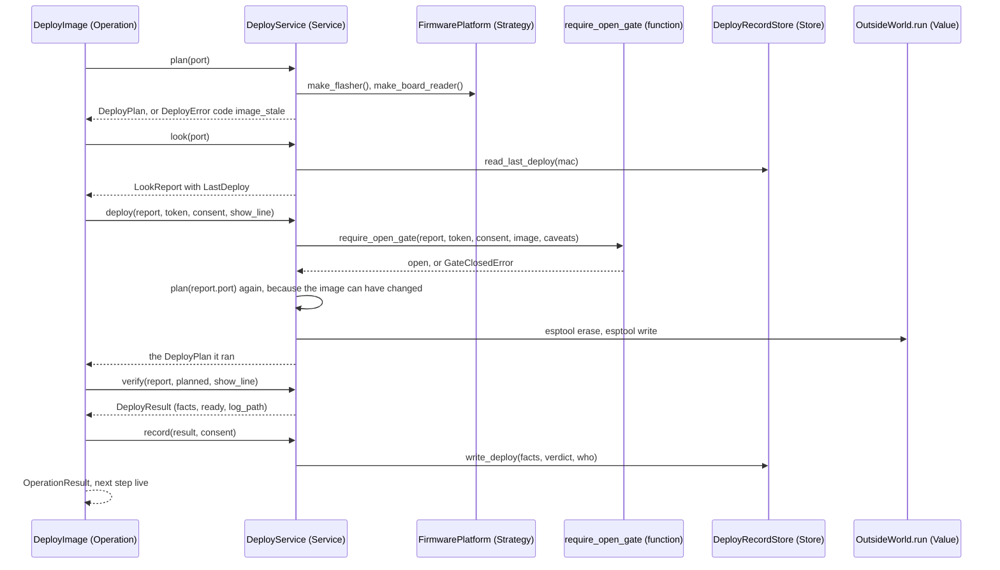
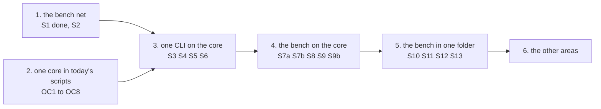

# The refactor plan, version 2: six waves, twenty-three slices

Version 2, card P385 [#494](https://github.com/xmejkal/spark/issues/494), base commit `d064a65` (the tag
`pre-refactor-2026-10-25`). Version 1 (card P323 [#413](https://github.com/xmejkal/spark/issues/413), cites at
`17708e6`) is in git. Back to [level 1](README.md). Epic P158 [#94](https://github.com/xmejkal/spark/issues/94).
A name that is not in the code yet is proposed. A number marked "est." is an estimate. Code is cited by module and
function name. A cite then moves only with a name.

> TL;DR. The plan has six waves. Wave 1's net is in (S1, P380). Wave 2 is new: eight small slices make today's
> scripts say one thing in one place, the fixes six councils asked for, and they wait on no decision. Wave 3 builds
> the core and puts `look` on it. Wave 4 puts the other four bench CLIs on it. Wave 5 moves the bench into one folder.
> Wave 6 does the other areas. The core is a contract other interfaces can call: a JSON Schema per Operation, no
> asking or printing inside, one hook for a tracer, masked before anything sees it. The PO answered all five decisions on 2026-10-26 (epic #94).
> They are readability first (1) and the shape (2). The others are the start of the moves (4), the printed names (5)
> and a relayed yes (6). On (6) he chose (b), not the recommended (a).

## What changed from version 1

- Wave 1 is written as built (S1 = P380, PR #492), and decision 3 is answered in the PO's words. Walk 2 ran on
  2026-10-23, so the old dates are gone.
- The plan's units are waves, because "stage" means a build stage (glossary). Version 1 and the cards say "stage"
  for them. A new wave 2, "one core in today's scripts", holds eight slices OC1 to OC8. Version 1's waves 2 to 5 are
  now waves 3 to 6.
- The slice count is 23, not "sixteen". Every slice id S1 to S13 keeps its name: S1, S2, OC1 to OC8, S3 to S6, S7a,
  S7b, S8, S9 and S10 to S13. S9b is new: it builds the relayed yes of decision 6.
- The PO answered the eight lesson questions on 2026-10-26 (epic #94). Section 10 holds the answers, and a new
  paragraph there sets the order of work. P418 did OC8, so `screen_text` is now `text_guards`.
- The council's round (rows 52 to 68 and 71 of the
  [rows file](../../../observations/rows/p385-prune-and-refactor.md)) changed nine things. The gate stays inside
  `DeployService.deploy`. An Operation is a class with `run()`, one module each. The import edges come from `ast`. The
  text guard is pure. Privacy runs before the trace. A crash is an output change. Consent pauses a graph between
  Operations. One clock. The words wave, seam, `deletes` and `ReadingFile`.

## 1. The bar, in the PO's words

On 2026-10-21 the PO chose walk 2 first, then the refactor: "So let's get ready first, prepare all we need." His goals:
spark becomes his job-application example of programming with AI, "really good code organization and architecture as
Anthropic recommends", clean Python with "very very little slop", pruned ("hide unnecessary code and revive it when we
need it"), and "I myself want to learn from it how to do it well, so explain clearly and give me options and
suggestion and teach me on it really."

On 2026-10-23: "We don't just create slop. We do reuse code. It's good: defined interfaces, a good, solid
object-oriented programming style, and good, clear naming and understandable code. It should be on 2, 3 levels, maybe
4, but it should be on each level. It should be systematic, or it should be understandable both if you go from bottom
up or from top to the bottom."

On 2026-10-25 he pulled the refactor: "Actually, we can tag this version in git or something and can come back, if
there's the need, but I'd like you to go on with the refactoring finally, so we have it dsone."

Each slice below is judged by two bars. AGENTS.md's one bar: it moves a basic project closer to a breadboard with
working firmware. The PO's 10-21 words add a second: he learns from the code.

## 2. The four levels

A level is one size of thing a reader looks at. spark has four: area, module, class, method. The same four rules hold on
every level. A reader goes down from the area map to one method, or up from one method to its area. The shape is
the same each time.

| Rule | On an area | On a module | On a class | On a method |
|---|---|---|---|---|
| One responsibility, said without "and" | its page's first sentence | its docstring's first line | its docstring's role word, then its job | its name, a verb then its object |
| The name says the role | a noun from the area map | what it is a library for | the role word ends it (`Service`, `Store`) or its docstring says it | `why_` returns a reason or None, `require_` raises |
| Imports point down, never up | only areas along the map's arrows | only modules of its own area or below | only the collaborators its `__init__` lists | only its own class and its arguments |
| Tested alone | goldens of its CLIs | its own `tests/test_<module>.py` | a Fake for what it is given | one test per path |

The role words are the table in `docs/guide/developing.md`, "Patterns and names in spark's core". The overview below
is the area level for the whole system. Then the bench is drawn on all four levels. Every box carries its role.

### The overview: nine areas and three leaves

A leaf is a module that imports nothing of spark. It sits at the bottom of its area, so any module reaches it without a
cycle (section 5).

### Level 1, the area: bench and its neighbours

The bench imports firmware, records and core, and one design module (`restricted_pins`), each along an arrow of the
overview. Nothing outside the bench imports a bench module.

### Level 2, the modules of bench

The import-edge diagram of the bench modules (an arrow is an import at `d064a65`, read with `ast`) is in
[areas/bench.md](areas/bench.md#its-components). The five Operation modules replace the bodies of today's CLIs, which
import the same modules.

Each module keeps its `board_` or `deploy_` prefix (decision N11), so a grep lands in one file. `board_live` and
`board_reach` stay two modules, one flow each. The edges that leave the bench point down the area map. They go to
`boards`, `tools`, `store`, `project_image`, `run_scenario`, `flash_image`, `restricted_pins` and `outcomes`.

### Level 3, the classes of one flow: deploy

`DeployService`, `FirmwarePlatform`, `ConsentStrategy` and `GateClosedError` exist (`deploy_service.py`,
`firmware_platform.py`, `deploy_gate.py`). `DeployRecordStore` exists too (`deploy_record_store.py`, P431), and the Operation is proposed. So are `make_board_reader`
(S8) and `make_ready_probe`, which is `make_ready_check` today (S11). `LastDeploy` lives in `deploy_record_store.py` and holds no words. The look says it with
`board_look.say_last_deploy` and the deploy question with `deploy_gate.say_last_deploy_in_question` (OC5, P431). The result types are today's: `plan` and `deploy` return
a `DeployPlan`, `verify` a `DeployResult` whose `ready` is a `ReadyResult`.

### Level 4, the methods of one class: `DeployService`

Each method does one step of the flow and returns a Result or raises an Error. None prints. `show_line` is the one
callable a method gets for text while esptool runs, and it is `OutsideWorld.show_line` after S7b. `image_stale` is a
code that S2 adds. The gate stays inside `DeployService.deploy`, as today, because that method is the only path to the
erase (`deploy_gate.py`, D8). A LangGraph node or an MCP tool that composes the service cannot skip it. The
Operation never calls the gate. The order is today's: plan, look, deploy (gate and plan inside), verify, record.
`record` needs `verify`'s result, so it comes last.

## 3. Names: the clashes and their role names

The standard is P381, `docs/guide/developing.md` "One responsibility, one name". One word has one meaning. A name says
what the thing is for. A function starts with a verb. A reader says `Reader`, `Finder` or `Probe`. Each clash below
gets one role name, and each old name becomes the new one in the slice named. Public record keys stay (glossary,
section 3).

| Clash | Meanings at `d064a65` | Role name | What each old name becomes |
|---|---|---|---|
| fact value | `emit_board.fact_value` reads the value at a key path. `boards.is_fact_value` says whether `pins.py` can write a value as a constant. `boards.fact_value_problems` is the shape rule plus that outlet rule | `provenance.read_value(record, *path)`, the one reader of a fact's value. `boards.is_pin_map_constant(value)`. `boards.board_fact_problems(where, fact)` | `emit_board.fact_value` is deleted, and the hand-read chain in `design.firmware_pulls` calls `read_value` (OC7, P431). The two `boards` names are renamed in the records move (wave 6). |
| power | a part's `power` list of supply pins. A board's `power` block of facts. `power_pads`. The function verb `power` in `parts.VERBS` | the record keys stay. In code, a part's list is `supply_pins` and a board's block is `power_facts`. The pads stay `power_pads`. The verb is a value of `VERBS` | `boards.POWER_FUNCTIONS` becomes `POWER_FACT_FUNCTIONS`, `boards._power_functions` becomes `_power_fact_functions`, `boards.power_problems` becomes `power_fact_problems`. Provisional until P405 [#529](https://github.com/xmejkal/spark/issues/529) reports. |
| the three text guards | `drawer.clean` (a word to the store), `screen_text.printable` (a word to the screen), `parts.one_line` (a word to a generated file) | one leaf, `text_guards.py`: "the guards where text leaves spark". The three function names stay, because P403 and P389 gave them and their tests use them. `clean` takes its caps `LABEL_MAX`, `TEXT_MAX`, `TAGS_MAX` with it, because `matching` reads them too | P418 (OC8) renamed `screen_text.py` to `text_guards.py`. It moved `drawer.clean` and `parts.one_line` into it with `parts.COMMENT_UNSAFE`. |
| board | `scripts/boards.py` reads dev board records. `tools/board.py` reads the team's GitHub board (P381 row 1) | `tools/kanban.py`: one word for the GitHub Projects board. Its subcommands `status` and `close` stay | `tools/board.py` is renamed in the prune PR. `scrum/README.md` and the session hook follow. |
| the record classes | plan v1 `Records`, `RecordFolders`, `RecordSchema`. P391 `RecordKind`, `Record`, `RecordFinder`, `ShelveRecord`, `scripts/records.py` | `RecordFinder` (a reader says Finder), `RecordKind` (a Strategy: what differs per kind, its version and required keys included), `Record` (Value), `RecordFolders` (Value), `ShelveRecord` (Operation) | `Records` becomes `RecordFinder`. `RecordSchema` folds into `RecordKind.validate`. The "Records role" in `areas/records.md` goes. P391's `scripts/records.py` becomes `records/record_kind.py` and `records/record_finder.py`. |
| brief | `parts._brief` is a three-key summary of a part. Comment 4's `Brief` is the project's brief, `.spark/project.json` | `Brief` (Value: `prefer`, `sellers`, `from_project(project)`) in `records/brief.py`. `parts._brief` becomes `_part_summary` | `parts.vendor_order` and `parts.sellers` become `Brief.from_project(project).prefer` and `.sellers` (wave 6, sourcing). `init_project` writes the file, so comment 4 called it the setup area. The reader lives in records, so sourcing reaches it along the arrows. |
| not checked | `LastDeploy.state` with `why`. `ScenarioSteps.unread`, a flag. `None` from a reader | one shape, section 6, OC4 | `ScenarioSteps.unread` becomes `state` and `why`. |
| limit, caveat | `boards.onboard_limits` returns `(component, sentence)` pairs. `ImageEvidence.caveats` is a list of sentences. P397 PR 2's `limits` key on a `--match` candidate is plain sentences, with no component. "limits" is also the WIP word in `docs/guide/developing.md` and on the board | the code keeps `limits` for what a passed run does not test (the glossary word, the file `WHAT-THIS-CANNOT-SHOW.md`, `write_limits`). `caveats` becomes `limits` in P345 PR 2 [#440](https://github.com/xmejkal/spark/issues/440), because it changes the look and deploy JSON and their goldens | two shapes stay and are named: a pair (`onboard_limits`) and a sentence (the `limits` key, `caveats`). A WIP limit is "a WIP limit" in prose, never bare "limits". Done in P397 PR 2: the docstrings of `boards.role_limits` and `needs.board_limits` say which shape each returns, and `--match --json`'s `limits` key holds sentences. |
| why | `SimulatedPart.why` (what stopped the reader), `SimulatedPart.why_not_simulated(gpio)` (why a scenario cannot reach a GPIO), `Fit.why` (the places a candidate matched a need's words) | three meanings, no rename in P397: each is a field or a method of its own class, and none is passed to another | revisit if a fourth appears. |
| deploy entry | `DeployEntry` in comments 4 and 5 | none. `LastDeploy` is the Value, and `DeployRecordStore.write_deploy` writes a dict | the name is out of the plan (comment 5). |
| look stop | `LookStop` (`board_look.py`) | `LookStopError` | renamed in S11, with `ReadyCheck` to `ReadyProbe`, `make_ready_check` to `make_ready_probe`, `FactsFile` to `ReadingFile` (glossary) and `assign_pins.Impossible` to `ImpossibleError` (wave 6). |
| Operation | the glossary and the standard say a class named verb + object with `run()`. `core.md` said a Value holding a function. The plan drew `class deploy` | one model: an Operation is a class with one public method `run()`, whose keyword parameters are its arguments' `dest` names (N6 keeps that half). Its module is named after it. The area's `OPERATIONS` sits in its `__init__.py`, so no file is named `operations.py` twice (rule C1) | bench: `LookAtBoard` (`look_at_board.py`), `DeployImage`, `IssueGrant`, `CheckGrant`, `RunLiveCode`, `ReachBoard`. 31 ops print today: the 29 of `parts.py`'s `OPERATIONS`, `look` and `deploy`. `grant`, `live` and `reach` print flat JSON with no `op`, and `grant-check` is in no script. Decision 5 settles the spellings. |
| clock | `board_console.SystemClock` (monotonic, sleep, an Adapter), `board_grant.read_local_time` (the wall time with its zone), and in tests `FakeClock` and `FakeLocalClock` | `SystemClock` is the one clock: `now`, `monotonic`, `sleep`. `OutsideWorld.clock` holds it | `read_local_time` becomes `clock.now()`. The two Fakes merge into one `FakeClock` (S7a). |
| port, seam | the board's serial device (`--port`, `Port`), and the "port" of ports and adapters | port is the serial device. The architecture's port is a seam: a Strategy base or a Value that a backend fills | the pages' "ports and adapters" become "seams and adapters". The `Retriever` is a Strategy. |
| stage, wave | a build stage (`check_spine.Stage`, JSON `stages`), deploy's `STAGE_*`, the plan's units, P391's units | stage is a build stage only. The plan's units are waves. `RefusedInput(stage, why)` names a build stage | the plan says wave. P391's units keep its own word, stage. `STAGE_*` becomes `DeployPhase` (S11). |

## 4. The core contract for other interfaces

The PO on 2026-10-22: "I will also later need to learn things as an ai engineer, so Langchain, Langgraph, langfuse,
some RAG, etc, so could we now revise the refactoring plan so that it would then also be easily migrated to that? So
like the logic etc separated out and then whether its being orchestrated by langgraph or make it into a plugin or an
mcp, skills, whatever, it would just be the interface and it would be easy to reuse it." S5 builds the core. These
rules are added to it, each checked by one test in `tests/test_core.py`:

1. `Operation.schema()` returns a JSON Schema for the arguments and one for the result, built from the `Argument`s
   and the envelope keys. An MCP tool, a LangChain tool and a LangGraph state field are generated from an area's
   `OPERATIONS`, never written by hand. The test: every `Argument.dest` is a property of the schema.
2. No Operation asks or prints. It asks only through `outside.consent`, a `ConsentStrategy`. The test: rule X2 of S3
   finds no `print`, `input`, `sys.stdin`, `sys.stdout` or `readline` in `spark/` outside the Renderers and the
   terminal consent.
3. `run_operation(operation, values, outside, backends, trace=None)` has one hook. `trace` is a callable that gets the
   Operation's name, the values, the result and the seconds, once per run, after `Privacy` masked them. A tracer that
   raises is caught and said on stderr, and the run's result stands. Langfuse plugs in there. The core imports no
   tracer. The test: a recording `trace` sees one call with the masked result.
4. `Privacy` runs inside `run_operation`, before `trace` and before any frontend sees the result. `run_cli` masks
   nothing of its own. S5 builds it as a pass-through, and S10 fills its rules. The test: a result with a store path
   reaches `trace` and the Renderer shortened.

Consent in a graph. A graph pauses between Operations, never inside one. `OutsideWorld.consent` is one of three
strategies. `TerminalConsentStrategy` asks in the person's terminal. `StandingConsentStrategy` reads a grant the
person made in their terminal. `DeferringConsentStrategy` (proposed, for a graph or an MCP client) never asks. Its
`require_ready` raises `GateClosedError` with `next_op` set to the command the person runs in their own terminal
(`line`), as `TerminalConsentStrategy.require_ready` does with no tty. `DeployService.deploy` and `GrantService.issue`
call `require_ready` before they ask, so `ask` is never reached and nothing records "answered no"
(`WHY_ANSWERED_NO`). The Operation then returns `problems` with a NextStep `needs_yes` that carries the question and
that command: `grant.py --minutes N` for live, `deploy.py --token T` for the erase (today's NEXT_DEPLOY path of
`GateClosedError`). The graph resumes with the next Operation (`look`, or `live`), not with the same one, so no node
restarts the board twice. A yes stays `typed` or `grant`, as `data.yes.kind` says today. A third kind, `relayed`, is a yes that another program
collected. It names `who` and the program. The gate refuses it for the erase. It can make a `live` grant only, never a
`deploy` grant. So every erase still needs a yes typed in the person's own terminal, or a deploy grant made there.
Claude never supplies a yes (`docs/guide/agents.md` stays). The PO chose the third kind (decision 6, epic #94,
2026-10-26). The `live`-only guard is a recorded reading of his answer, and he can change it. Slice S9b builds it.

The `Retriever` Strategy (comment 2's fourth rule) enters in wave 6 with the sourcing move, not in S5. Its
`search(words, project)` fits `parts.need` today. `scan_datasheet` reads pages, so the datasheet adapter and a vector
store come with the learning spike, where a second real adapter exists. No caller changes, because `need` keeps its name and
calls the Strategy. Nothing is added for a caller that does not exist (learned rule 6.1).

LangGraph, LangChain and Langfuse live only in `scripts/spark/frontends/`, one module each, installed by nobody who
uses spark (free, few and local). When two frontends share code, a `Frontend` base class enters (rule T3). The learning
spike in "Proposed cards" proves the contract after wave 3. One real Operation, `LookAtBoard`, the first on the core, runs
as a LangGraph node and as an MCP tool from the same `OPERATIONS`, traced by Langfuse. The core does not change.

## 5. The leaves and the named edges

A leaf imports nothing of spark. Today there are three. They are `zone_time` (times with their zone), `text_guards` (the
guards where text leaves spark, once `screen_text`) and `provenance` (what a fact must carry). The rule they came from: no
module imports upward. `board_facts` needed the time rule that `board_grant` holds. `board_grant` reaches
`board_look`, and `board_look` reaches `board_facts`. So the rule went into a leaf (comment 5). In the target, `zone_time` and
`text_guards` sit in core and `provenance` in records.

One test over every leaf, in `tests/test_imports.py`, replaced the old `screen_text` import test in
`tests/test_board_facts.py` (P418; P431 renamed that file `tests/test_deploy_record_store.py`): it reads each leaf with `ast` and fails on any spark import (rows 6 and 22: `zone_time`
has no test, and `provenance` has no import test). S3 folds it into `ArchitectureRules`.

An `ast` walk over `scripts/` at `d064a65` finds 242 import edges, 17 of them lazy (inside a function). 32 edges sit
on a cycle. Every cycle closes through one of eight lazy edges. The other 24 are top-level imports that point down
the area map. So removing the eight ends every cycle. Wave 2 removes none of them: it prepares the leaves. The eight:

| Lazy edge | Where | What removes it |
|---|---|---|
| `parts -> boards` | `function_of`, `audit`, `records_with_documents`, `_op_requirements` | the records move (wave 6) puts the board readers below `parts`, and the import goes to the top |
| `parts -> drawer`, `parts -> matching`, `parts -> needs` | the `_op_*` handlers. Each of the three imports `parts` at the top for the record contract | the sourcing move (wave 6): the contract goes to `records/record_kind.py`, and `parts.py` imports its Operation modules at the top |
| `parts -> emit_footprint` | `audit` | the `audit` Operation moves to design (N19, wave 6) |
| `parts -> tools` | the handlers that find a tool | `tools` becomes `ToolFinder` in records (wave 6) |
| `boards -> parts` | `footprint_stop` (`STOPS_AT_FOOTPRINT`), `validate` (`document_problems`, `SELECTOR_SAFE`, the rail rule) | P411 [#537](https://github.com/xmejkal/spark/issues/537) removes the constant. `RecordKind.validate` (P391's stage 2, in the records move) takes the shape rules |
| `boards -> emit_footprint` | `footprint_stop` | `footprint_stop` moves to design with the `board-list` Operation (N19) |

Two top-level edges are upward in the area map and go earlier. `matching -> drawer` (for `clean`, `TEXT_MAX`,
`TAGS_MAX`) goes in OC8, and `matching` keeps its `parts` import (`function_of`, `aliases`) until wave 6.
`assign_pins -> parts` loses its `one_line` use in OC8 and keeps `CAPABILITIES`, `BUSES`, `bus_line_of` and
`unverified` until wave 6. `image_evidence -> run_scenario` (for `ScenarioSteps`, `file_hashes`, `NO_MAIN`, `READY`,
the step constants) stays: bench reaches firmware along an arrow, and after the firmware move it imports
`firmware/scenario_steps.py`.

The footprint stop's wording is an input here, beside the three text guards: P411 counts four spellings
(`parts.STOPS_AT_FOOTPRINT`, a sentence in `needs.py`, the `--match` line, and the spine's footprint stage). P411 is a
card of its own and lands before OC1, so OC1 reads one wording from `emit_footprint.why_no_footprint`.

## 6. One core: the fixes the councils found, as slices

Each fix is one PR in today's scripts. It changes no flag, key or exit code, and the S1 goldens and today's tests prove
it. These are wave 2. Sizes are estimates.

One rule holds for every slice, from the PO's answer on decision 1 (epic #94, 2026-10-26: *"leta go with a then"*).
Readable ranks first, and a slice reuses every fact and keeps each module's judgement in that module. For example, the
onboard roles live once in `boards.ONBOARD_ROLES`. The pin assigner's penalty for an onboard pin stays a named
constant in `assign_pins.py`.

| Slice | What it changes | What proves it | Size |
|---|---|---|---|
| OC1, one refusal order | `emit_board.read_inputs(path, project)` returns `BoardInputs(design, assignments)` or raises `RefusedInput(stage, why)` in the order design, pins, footprint. `emit_board.main` and `check_spine.run` both call it. The repeated code before the spine's footprint stop goes, and the repeated work stays until wave 3, because the spine still runs `emit_board.py` as a child (W2-2). | one record with an unknown need and a footprint gap. `emit_board.py` and the spine give the same first sentence (row 10 of `p407-no-footprint.md`). The P407 and P411 tests over `(name, status, detail)` stay and are the net. No build golden runner is built in wave 2: the first build golden moves to S3 | 80 |
| OC2, the spine calls the renderer | `check_spine.run`'s footprint stage calls `emit_footprint.render(board, rules)` and writes the file. `emit_footprint.main` is a CLI only. | a board whose definition disagrees with itself gives a `footprint` stage whose detail says why, not the old "no footprint" line. No stderr is read. A test holds the file the spine writes byte-equal to the one `emit_footprint.main` prints | 40 |
| OC3, one guard before every print (done in P423) | `text_guards.guard_lines(text)` returns `text` with each of its lines passed through `printable`, newlines kept: the body of `parts._say`'s print, without the print. `parts._say`, `look.main`, `deploy.main`, `check_spine.main` and `run_scenario.main` print what it returns. The leaf stays pure (rule X2). The hand guards in `LastDeploy.line` and `needs._how_to_free` go, except on a name that can start a line (a holder, an entry key). **P423 built it with this newline rule:** `guard_lines` keeps a text's own newlines, so a name that can hold a newline is guarded with `printable` where it is put into a line, and the hand guards stay. The look's and deploy's report lines are guarded one by one, in `board_look.report_lines`, because none of them holds an intended newline. `deploy.py` prints through one local helper. `text_guards.CONTROL` also holds U+2028 and U+2029, and `store` reads it. | a planted newline and a bidi character in a record field show as `?` in every CLI's text. The leaf test passes | 90 |
| OC4, one "not checked" shape (done in P428; P397 PR 1 built the `SimulatedPart` reader the same way) | the words `RECORDED`, `NONE_RECORDED`, `NOT_CHECKED` move from `board_facts` to `outcomes`. A reader never raises and returns a Value with `state` and `why`. `ScenarioSteps.unread` becomes `state` and `why`. P397's `SimulatedPart` reader takes the same shape: `SimulatedPart(state, board_id, gpios, why)`, NONE_RECORDED when the record names no `WOKWI_DEFINITION` document and NOT_CHECKED (one sentence, `WHY_NOT_KEPT`) for the other causes. | one test per reader: a missing, a malformed and a good input give the three states. `ImageEvidence.caveats` and `onboard_limits` print the same "not checked" words | 70 |
| OC5, the store side and the look side (done in P431) | `DeployRecordStore` (Store) in `scripts/deploy_record_store.py` holds `find_path(mac)`, `read_last_deploy(mac)` and `write_deploy(facts, verdict, who)`, today `board_facts.record_path`, `read_last_deploy` and `record_deploy`. `LastDeploy` moves with it and keeps `state`, `why`, `to_dict`, `time_said` and the stored fields. `line()` and `in_question()` become `board_look.say_last_deploy(last)` and `deploy_gate.say_last_deploy_in_question(last)`. | the look and deploy goldens do not change. `tests/test_board_facts.py` moved its reader tests to `tests/test_deploy_record_store.py`, its line tests to `tests/test_board_look.py` and its question tests to `tests/test_deploy_gate.py`. One test holds the line and the question to the same words | 100 |
| OC6, two meanings of the project name (done in P431) | `store.find_listed_name(folder)` is the name on the person's list or None (today `project_name`). `store.plan_listed_name(folder)` is the name the folder holds or will hold (today `add_project(dry_run=True)`). `plan_` already means "say it, write nothing" in `plan_set` and `plan_pick`. `add_project` loses `dry_run`. Call sites that need the listed name: `drawer.plan_set`, `breadboard._have`, `parts.note_built`, `parts._record_path`, `parts._op_pick` (its "listed" check), `parts._op_step` (its "listed" check), `parts._op_tally`. Call sites that need the name it will hold: `needs.match` (it hands the name to `_candidate`), `needs.plan_pick`, `parts._op_pick` (the name it writes), `parts._op_step` with `--dry-run`. The calls that write the name stay `add_project(folder)`: `init_project`, and `_op_pick` and `_op_step` when they write. | `--match` and `--pick` already named the same project (P403's bug) through `add_project(dry_run=True)`, so this slice is a rename with one split. Every old call site is gone by grep | 60 |
| OC7, one reader of a fact's value (done in P431) | `provenance.read_value(record, *path)` reads a value along a key path through the fact's `value`. `emit_board.fact_value` is deleted, and the hand-read chain in `design.firmware_pulls` calls `read_value`. A bare number where a fact belongs reads as the value, as `fact_value` read a bare `io_volts`. | `firmware_pulls` on a board whose `internal_pull_up_ohms` is a bare number leaves the pull to the firmware (on main it raised AttributeError). A row asks whether `boards.board_fact_problems` must refuse a bare value at a fact position | 30 |
| OC8, one home for the text guards (done in P418) | The leaf `text_guards.py` (once `screen_text.py`) holds `printable`, `clean` and its caps, `one_line` and `COMMENT_UNSAFE`. `drawer`, `parts`, `matching`, `assign_pins`, `needs`, `board_facts` and `emit_footprint` import it. `tests/test_imports.py` reads imports with `ast`: each leaf imports nothing of spark, `matching` imports no `drawer`, and `assign_pins` calls no `parts.one_line`. S3 folds it into the rules test later, and until then it keeps OC8 from regressing. | `tests/test_imports.py` fails on the old code and passes on the new | 80 |

Three more findings are rules, not slices. `drawer.holders_of` is the one reader of "who holds this stock", and
`drawer.listing`, `needs.plan_pick` and `needs._candidate` stay its only callers (a U3 entry of S3). `provenance.fact_problems` is the
shape of a fact for part and board, and `boards.is_pin_map_constant` is the rule of one outlet, `pins.py`. They stay
apart, so P374 [#479](https://github.com/xmejkal/spark/issues/479) does not pull the second into part records. One role
is spelled in five tables (`PIN_ROLES`, the `ONBOARD_*` constants, `ONBOARD_ROLES`, `assign_pins.ROLE_PENALTY`,
`CONFLICTING_ROLES`). The example recorded with the PO's answer settles the penalty, as the plan's reading he can change: it stays a named constant in `assign_pins.py` and does not move into
`OnboardRole`. Lesson 3 takes the five tables as its worked input.

## 7. A home for what walk 2 added

Each class or function a walk 2 card added, merged or planned, with its target module and role. "exists" means it is in
the code at `d064a65` under this name.

| Name | Card | Target module | Role | Status |
|---|---|---|---|---|
| `SimulatedPart`, `read_simulated_part`, `WOKWI_DEFINITION` | P396, P397 | `records/board_records.py` | Value, a reader, a constant | exists. P397 PR 1: `state` and `why`, never None, never raises |
| `OnboardRole`, `ONBOARD_ROLES`, `POWER_FUNCTIONS` | P389 | `records/board_records.py` | Value, two tables | exists (`POWER_FUNCTIONS` renamed in section 3) |
| `onboard_entries`, `names_pins`, `pin_labels`, `onboard_functions`, `_power_functions` | P389, P397 | `records/board_records.py` | readers of the role table | exists. `onboard_functions` gives each pin role's function a `role` key (P397 PR 1) |
| `is_fact_value`, `fact_value_problems`, `role_entry_problems`, `power_problems` | P389 | `records/board_records.py`, inside `RecordKind.validate` | rules of the board record | exists, renamed in section 3 |
| `boards.onboard_limits`, `boards.gpio_limits`, `ONBOARD_GPIOS`, `NO_DEFINITION_NAMED`, `WHY_NOT_KEPT`; `sim_project.write_limits` | P396, P389, P397 | `records/board_records.py`; `firmware/sim_project.py` | functions, constants | exists. P397 PR 1 moved the first group from `sim_project` beside `SimulatedPart`, so the pick reads them without importing firmware code (rule U1) |
| `ScenarioSteps`, `SET_CONTROL`, `EXPECT_PIN`, `WAIT_SERIAL` | P345 PR 1 | `firmware/scenario_steps.py`, a module beside `scenario_run.py` | Value and its constants | exists in `run_scenario`. The module is not built yet |
| `ImageEvidence.caveats` and its four `_CAVEAT` constants | P345 PR 1 | `bench/image_evidence.py` | a Strategy method | exists |
| `LastDeploy` | P401 | `records/deploy_record_store.py` (the Value), `bench/board_look.py` (`say_last_deploy`), `bench/deploy_gate.py` (`say_last_deploy_in_question`) | Value | exists in `deploy_record_store.py`, split in OC5 (P431) |
| `DeployRecordStore`: `find_path`, `read_last_deploy`, `write_deploy` | P391, comment 4, P401 | `records/deploy_record_store.py` | Store | exists in `scripts/deploy_record_store.py` (P431), from `board_facts.record_path`, `read_last_deploy` and `record_deploy` |
| `find_listed_name`, `plan_listed_name` | P403, OC6 | `store.py` | functions | exists (P431), from `project_name` and `add_project(dry_run=True)` |
| `DeployEntry` | comments 4, 5 | none | none | out of the plan |
| `zone_time`, `text_guards`, `provenance` | P401, P403, P389 | `core/zone_time.py`, `core/text_guards.py`, `records/provenance.py` | leaves | exist (`text_guards` was `screen_text`, renamed in P418) |
| `why_no_footprint`, `footprint_gaps` | P407 | `design/footprint_emitter.py` | functions | exists |
| `NO_FOOTPRINT_HINT`, `REFUSED_INPUT_MESSAGE` | P407 | `build/stages.py`, `design/board_emitter.py` | constants | exists |
| `LookStopError` | plan v1 | `bench/board_look.py` | Error | exists as `LookStop` |
| `RunLog`, `status_of_run` | plan v1 | `firmware/scenario_run.py` | Value, a function | not built yet (`run_record` builds a tuple, `verdict` stays) |
| `Brief` | comment 4 | `records/brief.py` | Value | not built yet (exists as `parts.vendor_order` and `parts.sellers`) |
| `OutsideWorld`, `Backends` | plan v1 | `core/outside.py`, `records/backends.py` | Values | not built yet |
| the "not checked" note in `needs.plan_pick` | P397 PR 2 [#513](https://github.com/xmejkal/spark/issues/513) | `design/needs.py` | a sentence | not built yet. The `SimulatedPart` reader's state is built (PR 1) |
| `ScenarioSteps.component_ids`, the id check in `ScenarioRun.problem`, `--dry-run` | P399 [#515](https://github.com/xmejkal/spark/issues/515) | `firmware/scenario_steps.py`, `firmware/scenario_run.py` | a method, a check, an argument | not built yet |
| the must lines a scenario names, and the look's list of unnamed ones | P345 PR 2 [#440](https://github.com/xmejkal/spark/issues/440) | `firmware/scenario_steps.py`, `bench/board_look.py` | a Value field, a line | not built yet |
| `facts.*` entries in `--fact-set` | P374 | `sourcing/part_facts.py` (`_op_fact_set` and `_set_in_home`) | an Operation's path and the shared writer | not built yet. `--fact-set` exists and writes whole top-level keys (`CHAIN_FACTS`, `drawer.DESCRIBING`). `_set_in_home` also writes `--function-set` and replaces each key whole, so a `facts.*` entry needs a merge into the record's `facts` |
| `ROLE_PENALTY` | P405 | `design/pin_assigner.py` | a named constant | stays in `assign_pins.py` and moves with it, not into `OnboardRole` (the example recorded with the PO's answer, epic #94, 2026-10-26, a reading he can change) |

## 8. The MVP marks

The PO on 2026-10-22: "we do want to mark parts of the code as for MVP and not necessary yet, even if just by dividing
the code in the class or script definition into two parts, commented with what is what and if it's MVP or not."

A card marks the code it touches, in its own PR. The marks are three comment lines: `# --- MVP ---` opens a span,
`# --- end MVP ---` closes it (four modules carry both today: `boards.py`, `deploy_record_store.py`, `provenance.py`,
`sim_project.py`), and `# --- Later, not MVP: <why kept> ---` opens the rest, with the reason in the line. A mark is a
comment, so no test reads it, and a span holds whole functions or classes, never half of one. The per-module spans,
what is MVP and what is later in each module, live in the
[pruning list](../../2026-10-25-p385-prune-and-refactor/pruning-list.md#the-verdicts), not here.

## 9. The lessons

One lesson at a time, in chat, after the PR. The texts are in `lessons.md` of the P385 folder. It splits lesson 2 in two and lesson 3 in three, so the PO answers eight questions, one per lesson. The decisions table names each question. The PO answered all eight on epic #94 on 2026-10-26.

| # | Lesson | The slices it opens | The questions it asks |
|---|---|---|---|
| 1 | Pruning: what goes under the tag, what moves behind a module | the prune PR with `PRUNED.md`, the MVP marks per card | question 1: which of the verdict groups to take, in which order (answered: *"quck now, split later"*, so the prune PR does the quick work, and the splits of `boards.py` and `parts.py` wait for wave 6) |
| 2 | Package layout: `scripts/spark/`, areas, leaves, the move recipe | S4, S11, waves 5 and 6 | question 2 (decision 2, the shape) and question 3 (decision 4, when the moves start) |
| 3 | The core contract: Operation, result, Finding, the four rules of section 4, consent, the five role tables as its worked input | S3, S5, S6, OC4 | question 4 (decision 6, a relayed yes), question 5 (decision 1, readability first) and question 6 (decision 5, the printed names) |
| 4 | Tests: goldens, Fakes, the leaf test, the ratchet on `mock.patch` | S7a, S13, `tests/test_imports.py` | question 7: the quick run on a push, with no cap (S13, done in P425) |
| 5 | Claude Code forms: command, skill, agent, MCP, and what each gets from one Operation | the frontends, the learning spike | question 8: when the spike runs (answered: after wave 3) |

## 10. The waves and their slices

| Wave | What works after it | Slices | Size (est.) | Waits on decision |
|---|---|---|---|---|
| 1. The bench net | a golden catches any bench change (done), and the bench prints codes | S1 (done), S2 | 200 | none |
| 2. One core in today's scripts | every fact and every refusal has one home, the leaves have one test | OC1 to OC8 | 550 | none (OC1 waits on P411) |
| 3. One CLI on the core | `look.py` is the worked example, the rules test ratchets, the core has its four rules | S3, S4, S5, S6 | 1,150 | none |
| 4. The bench on the core | five thin bench CLIs, every effect gated, the platform swappable, a relayed yes for a live grant | S7a, S7b, S8, S9, S9b | 1,250 | none |
| 5. The bench in one folder | `scripts/spark/bench/` holds the area, no home path in its output, a map | S10, S11, S12, S13 | 720, 2,266 moved | none |
| 6. The other areas | each area has a net, codes and its folder | 3 PRs per area | 900 per area | none |

The order of work. The between-cards council set the order after P335. The PO accepted it in chat on 2026-10-26:
OC8, P333, OC3, S13, OC4, P397, OC7, P399, P374, OC5, P345 PR 2, S2, OC6, OC1 (after P411), OC2. The waves keep
their slices. S13 runs early because of the PO's answer on question 7 (epic #94, 2026-10-26: *"let's try option a,
lets see, how t works"*). It is an experiment, judged at a retro. The PO's "under 90 s" meant the quick run's test seconds: with the board check the whole push took 94 to 100 s. Today the push
hook takes 111 to 206 s. **S13 is done in P425 ([#559](https://github.com/xmejkal/spark/issues/559))**: a quick run on the hook
and a full run (`check_commit.py --full`) before a PR is ready, with no cap on the time. The hook prints the quick run's
seconds and count, and the retro decides any cap (W15b). Wave 5's closing 90 s check is dropped with the cap.

Waves 1 and 2 are independent and wait on no decision, so they run while the lessons run. Each PR holds the slices of one kind (decision 3) and keeps every CLI working. The invariants of version 1 hold: the goldens change only in an output
slice (S2, S10, one per area). Nothing public changes. The push hook stays green. Each PR has the measure line of
each slice in it. No journey status changes. Each PR runs `tools/factcheck.py` on this plan.

### The decisions

Decision 3 is answered. The PO on #413, 2026-10-21: S1 before walk 2, S2 and every later wave after the walk, one PR
at a time, "I don't want to break the system before MVP." The PO changed the "one PR at a time" half on 2026-10-27:
"we're going really slow ... do something less often, or in bigger chunks, that are better planned". Now the slices of
one kind go into one PR, one plan with one council covers the rest of a wave, and two lanes run in parallel
worktrees when two PRs touch different files. The refuter and one mutation run per PR stay. The same day he added:
"oh and yes, wave 3 should also become fewer bigger PRs as wave 2". So wave 3 is cut into PRs by kind, as wave 2 was,
and its wave plan proposes the cut. Waves 4 to 6 stay as planned, because he named neither. The nets stay too: S1
came before walk 2, and each area gets its net first. The PO answered the other five on epic #94 on 2026-10-26.
All are answered now. The Recommendation column stays as history, and the Answer column holds the PO's choice.

| # | Decision | Options | Recommendation | Answer | Asked by |
|---|---|---|---|---|---|
| 1 | Readability first | (a) v1's rank (N1): readable, testable, exchangeable, reusable, consistent. (b) the order of the PO's 10-23 words: "We do reuse code. It's good: defined interfaces, a good, solid object-oriented programming style, and good, clear naming and understandable code." (c) no rank, each slice names its goal. | (a). A function nobody reads is not reused, and R1's 40 lines apply only to new code in `spark/`, old code pays down by ratchet. The 10-23 words name reuse, interfaces, OO style, names and understandable code. They name neither "testable" nor "exchangeable": those two are v1's, from the council. | (a), in his words *"leta go with a then"* (epic #94, 2026-10-26). One rule for every slice: reuse every fact, and keep each module's judgement in that module. The penalty for an onboard pin stays a named constant in `assign_pins.py` (section 6). | question 5 |
| 2 | The shape | (a) thin CLIs over `scripts/spark/`, one Operation per job, one rules test (v1). (b) Operations inside today's flat `scripts/`, no package. (c) a `src/spark` package with `pyproject`. | (a). The package is what a LangGraph node or an MCP tool imports (section 4), and (b) cannot give one `OPERATIONS` per area without a folder. (c) is on the "not do" list: it installs something, and spark installs nothing heavy. | (a), in his words *"yes, option a please"* (epic #94, 2026-10-26). | question 2 |
| 4 | When the area moves start | (a) a story pulls its area (v1's decision 4). (b) now, the bench first, one PR at a time. (c) all areas in one pass. | (b). The PO pulled the refactor on 10-25, the bench's net exists (S1), and walk 2 ran on the bench. (c) broke the "one PR at a time" rule of decision 3. The 2026-10-27 change to decision 3 (a PR holds the slices of one kind) removes that reason against (c); the nets still decide when a move can start. | (b), back to back, one PR at a time. His words: *"I think for question 3 ideally we'd go all in one, so option c, but if it would take too much time, we can do continuous version"* (epic #94, 2026-10-26). Recorded as (b) because only the bench has a net today (S1's 13 goldens) and (c) goes against decision 3. If he still wants one pass once the nets exist, the last moves can go in one PR. The PO can change this. | question 3 |
| 5 | The printed names of the Operations | The standard (P381, rule 4) prints an Operation's words as its `op`: `show-part`. Today 31 ops print: the 29 in `parts.py`'s `OPERATIONS` (`audit` and `need` among them), `look` and `deploy`. A script that prints no envelope (`grant`, `live`, `reach`) prints no `op`. The goldens and command pages pin the spellings. (a) keep every op in a golden or a command page as a named exception, and only a new Operation follows rule 4. (b) rename each op to its class's words (`look-at-board`) in its area's output slice, a public change. | (a). The class names pass the rule now, and a public rename costs every page and habit (glossary, section 3). (b) can follow in a card of its own when the PO wants one spelling everywhere. | (a), in his words *"ok leta pick a, if you think its better"* (epic #94, 2026-10-26). Every op that a golden or a command page pins keeps its spelling. Only a new Operation prints its class's words. | question 6 |
| 6 | A yes relayed by another program | `data.yes.kind` is `typed` or `grant` today, and `agents.md` says Claude never supplies the yes. A graph's UI or an MCP client can collect a yes itself. (a) no third kind: a graph pauses, and the person gives the yes in their own terminal (section 4). (b) a third kind, `relayed`, with `who` and the program that collected it, refused by the gate for the erase and allowed for a grant. | (a). It needs no new rule and keeps the erase in the person's terminal. (b) is a safety change for the PO alone. | (b), in his words *"question 4 : option b"* (epic #94, 2026-10-26), against the recommended (a). The guard is a recorded reading, and the PO can change it. A relayed yes makes a `live` grant only, never a `deploy` grant (section 4). Slice S9b builds it. | question 4 |

### Wave 1: the bench net

S1 is done as P380 [#487](https://github.com/xmejkal/spark/issues/487), PR #492, and not as v1 wrote it. The runner
is `tests/golden_bench.py`, the accept switch is `SPARK_ACCEPT=<op>`, the project is built at test time around
`firebeetle2-esp32s3`, and the fakes are `tests/fake_modules/esptool`, `mpremote` and `serial`. `CASES` holds 13
cases and `tests/golden/` 13 files (11 json, 2 txt): look ok, problems, two boards, `--no-simulation`. Deploy dry run
(json and text), no terminal. Grant no grant, two boards. Live refused, two boards. Reach ok. Not built: a deploy with
the gate closed, a ready-seen deploy, a bad flag. `tests/test_golden_bench.py` adds three checks: no golden holds a
path of this machine, every golden has its case, the token ends in the image hash.

S2, the bench envelope additions (an output slice), stands as v1 wrote it, with the 2026-10-27 council's changes. It adds a
`code` at each item site of `board_envelope` (seven sites), with `needs_person`, and `scripts/board_codes.py`. A code
names the reason, as a required `reason` argument at each raise site (`GateClosedError.code` stays the exit code). A bad
flag with `--json` prints a `bad_argument` envelope. `fix_step` is dropped, because it would be null at every look
site. The top-level `backends` waits for S8, where `Backends` is built. One golden case is added, a bad flag with
`--json`. A deploy with the gate closed and a ready-seen deploy wait for S7a, because the golden child has no stdin for
a yes. Two checks close the slice. The contract test in `tests/test_json_contracts.py` fails on a removed key and an
unlisted code, and a test holds every item in every golden to a listed code. (`grep -L '"code"' tests/golden/look-*.json`
would print `look-ok.json`, which has no items, so the check is a test.)

### Wave 2: one core in today's scripts

The eight slices of section 6 and S2 run as three PRs by kind (decision 3, 2026-10-27), planned at once with one
council. OC8 (P418), OC3 (P423), OC4 (P428) and S13 (P425) are done. W2-1, P431 [#573](https://github.com/xmejkal/spark/issues/573):
one home for each fact (OC7, OC5, OC6) and the decision 3 edit. W2-2, P432 [#574](https://github.com/xmejkal/spark/issues/574):
one refusal order (OC1, OC2), after P411 [#572](https://github.com/xmejkal/spark/pull/572) merges. W2-3, P433
[#575](https://github.com/xmejkal/spark/issues/575): the bench envelope codes (S2). W2-1 and W2-3 touch different
files, so they are the two lanes. W2-2 follows both. The wave plan sits outside the repository. The order of work in
section 10 puts other cards between them. Wave 2 removes no cycle (section 5). It is done when `tests/test_imports.py`
passes and each OC proof holds. No golden changes except S2's, and no build golden is taken in wave 2: the first one
moves to S3. The Ready cards behind P385 (P397, P399, P345 PR 2 and P374, section 7) land in today's scripts during
waves 1 and 2, and each marks its span (section 8).

### Wave 3: one CLI on the core

The PO on 2026-10-27: "oh and yes, wave 3 should also become fewer bigger PRs as wave 2". So the slices below are
units to group, not one PR each. Wave 3's own plan proposes the cut by kind of change, with one council, as wave 2's
did.

S3, the rules test: `tests/test_architecture.py` (`ArchitectureRules`) and a generated baseline that only shrinks.
`measure.py` of P322 moves to `tools/measure.py`. `tools/mutate.py` gains `--retarget OLD NEW`. The leaf test
becomes a rule. When each planted breach is caught with its rule, the slice is done.

S4, `outcomes` and the two core leaves into the package: `scripts/spark/core/outcomes.py`, `core/zone_time.py` and
`core/text_guards.py`, with the 36 import lines in 32 files of `scripts/` and `tools/` (at `d064a65`) and the test imports changed.
`provenance` waits for the records move. The slice is done when `scripts/outcomes.py` is gone, `tests/test_outcomes.py`
imports `spark.core.outcomes`, and no golden changed.

S5, the core contract. It creates only what `look` needs in S6: `OperationResult`, `Finding`, `NextStep`, the
`Operation` base class with `schema()`, `Argument`, `SparkError`, `OutsideWorld`, `Privacy` as a pass-through,
`run_operation` with `trace`, `run_cli`, and the two Renderers `TextReport` and `JsonEnvelope`. `FlatJsonLine` comes in
S9 with its first caller, and `Backends` with `ToolFinder` in S6 with `look`'s `tools.find` patches. `SparkError.status`
is an instance field with the class default `could-not-run`, because `GateClosedError` carries 1 or 2 per instance
today. Section 4's four tests are in it. When a toy Operation passes every path (ok, problems, `could-not-run`, bad
flag, `SparkError`, crash, undeclared effect) and an unchecked Finding never gives `ok`, the slice is done.

S6, `look` on the core: `spark/bench/look_at_board.py` with `LookAtBoard`, `OPERATIONS` in `spark/bench/__init__.py`,
`Backends` with `ToolFinder`, and `look.main` at most 15 lines by `ast`. It is an output slice for one path. A crash
exits 1 with a traceback and no envelope today (`docs/guide/agents.md`). On the core it prints an envelope with
code `crash` and exits 2. The crash Finding's sentence is the exception class and a fixed message, because an exception
message can carry a home path. The traceback goes to stderr. The slice adds a crash golden and changes `agents.md`'s crash lines. S7b and S9 do the same
for the other four bench CLIs, and each area's output slice in wave 6 for the rest. When the look goldens change only
on the crash path and `look.py` imports no area module but `spark.bench`, the slice is done.

### Wave 4: the bench on the core

S7a, the deploy seams: the clock given in `DeployService.__init__` sleeps, one `FakeClock`, no `probe=` seam. S7b,
`deploy` on the core: `deploy._deploy` becomes the Operation, split under 40 lines a function, every effect declared
and gated, `--dry-run` fills `board` and `deletes` with refusing stubs. S8, the platform owns the board tools.
`FirmwarePlatform` becomes a Strategy base, and `MicroPythonPlatform` fills it. `make_port_finder` and
`make_board_reader` replace the eight lookups outside it. Those sit in `live.main`, `reach.main`, `grant.main` (two),
`board_look.looker` (two) and `board_doctor` (two). `FakeFirmwarePlatform` in `tests/fakes.py` is the base's second
case (rule T3). What the swap covers: flashing, reading and the ready probe. `DeployService.verify`'s download-mode
cure and the reset-button places (`download_mode`, `boards.ButtonPlaces`) are MicroPython's and move behind the
platform when a second one exists. S9, `grant`, `live` and `reach` on the core, `GrantService` built once.

S9b, the relayed yes (proposed): it builds decision 6's third kind of yes (section 4) on `GrantService`, which S9
builds once. The gate refuses a `relayed` yes for the erase. `GrantService.issue` accepts it for a `live` grant and
refuses it for a `deploy` grant. A `relayed` yes names `who` and the program that collected it. This placement after
S9 is the plan's reading, and the PO can change it. S9b changes a safety rule, so it runs the full council, and the
PO merges it in every mode. `docs/guide/agents.md` stays true: a relayed yes comes from a program's UI, never from
Claude. Its size is an estimate of 150 lines.

Four checks close the wave. Each bench `main` is at most 15 lines. No golden changed. No `mock.patch`
line remains in `tests/test_deploy_gate.py`. S9b's tests show that the gate refuses a `relayed` yes for the erase
and that `GrantService.issue` refuses it for a `deploy` grant.

### Wave 5: the bench in one folder

S10, bench privacy (an output slice): `Privacy` shortens paths under the project and the store and masks each
`account_env` value. S11, the bench area move. It moves 16 modules and S2's `board_codes` into `scripts/spark/bench/`,
today 2,266 lines that 35 files import. It retargets the 217 mutation rows. It applies the renames of section 3:
`LookStopError`, `ReadyProbe`, `DoctorProbe`, `DeployPhase`, `ReadingFile`. It moves the Fakes into `tests/fakes.py`.
`board_facts.py` moves as the bench's `ReadingFile`. `deploy_record_store.py` (OC5) stays in `scripts/`
until the records move. S12, the map: `tools/map.py` writes `docs/guide/map.md`. When the page is stale, a test fails. S13,
the quick run and the full run. S13 is done in P425 (the order of work in section 10). One check closes the wave: `ls scripts/board_*.py scripts/deploy_*.py` prints nothing.

### Wave 6: the other areas

When an area is pulled, it gets three PRs. The order of the areas is firmware, breadboard, checks, design with build,
records with sourcing. The moves run back to back, a PR for each kind of slice (decision 3). No story comes between them unless the PO pulls one (decision 4, epic
#94, 2026-10-26: *"I think for question 3 ideally we'd go all in one, so option c, but if it would take too much time,
we can do continuous version"*). If he still wants one pass once the nets exist, the last moves can go in one PR.
The first PR is its net: goldens, with a fake tool process where one is needed. The second is
its output slice: codes and `needs_person` (`backends` comes with S8). The third is its move, with the names of its page and no module shim.
The `firmware` move adds `scenario_steps.py` and takes `stand_in/machine.py` as is. The `records` move adds P391's
stage 2 (its own word: `RecordKind`, `RecordFinder`, `Record`, `ShelveRecord`). It moves `deploy_record_store.py` in, adds `Brief`, and applies the renames of section 3 in `board_records.py`. The `sourcing` move splits `parts.py` by
the job groups of the pruning list and adds the `Retriever` Strategy. The `design` move takes `footprint_stop` and the
`board-list` Operation, `BoardEmitter` with `read_inputs`, and `PinAssigner`. The `build` move replaces
`check_spine.run` with `BuildService` and the `BuildStage`s (the spine names seven stages in a run: `parts`, `board`,
`schematic`, `schematic-notes`, `footprint`, `build`, `simulation`, and `areas/build.md` maps them to six classes). The
spine then calls `BoardEmitter` in process.

## 11. The cites

Every claim about today's code names a module and a function, and each was read at `d064a65`. This plan holds no line numbers.
`tools/factcheck.py` exits 0 on this
file, and that proves only that each cited file and line exists. The names were checked by reading them. The headings
of this file are its anchors, so `drift.md`'s comment map points at a heading's slug.

## 12. P391's design and P322's facts

P391's `design.md` gets only these edits. Its stale line cites are fixed: 50 of 95, with each number of a list counted
once (P385 re-measured them, and drift section 2 counted 37 of 77 by whole cite). Its stage 4 (its own word) gains the one note comment 4
asks: the Wokwi definition is a `documents` source under its sha256. Its names follow section 3, so `scripts/records.py`
becomes `records/record_kind.py` and `records/record_finder.py` in the records move. Its stage 4 no longer "waits for
P389", because P389 merged.

P322's `facts.md` is a measurement dated 2026-10-19 and stays as printed (learned rule 3.2). [`drift.md`](../../2026-10-25-p385-prune-and-refactor/drift.md) lists what moved since.

## Proposed cards

1. Spike: the core contract is not proven for another interface → `LookAtBoard` runs as a LangGraph node and
   an MCP tool from the same `OPERATIONS`, with a Langfuse trace, and the core does not change. Filed as P417
   [#545](https://github.com/xmejkal/spark/issues/545), to run after wave 3 (the PO, epic #94, 2026-10-26:
   *"question 8: oprtion a"*).
2. Chore: `PRUNED.md` does not exist → the prune PR lands it at the root with the verdicts of the pruning list, the
   tag `pre-refactor-2026-10-25`, and one restore command per entry.

The other cards repeat a section and are cut: `tools/kanban.py` (section 3), `Brief` (sections 3 and 7), and OC4 and OC7 (section 6).

## Still to do for the area pages

The P385 PR applied every other edit to the pages. One is left: `docs/guide/developing.md` (not edited here) gains in
the standard's rule 4 "an `op` in a golden or a command page keeps its spelling until decision 5".

## What we will not do

Version 1's list holds. No DI container, entry points, `pyproject`, `src/` layout or module shims. No `Frontend` base
class until two frontends share code. No new clock class: `SystemClock` is the one clock. No base class with one implementation, unless a Fake or a
contract test is its second case. No `platform` key in `requirements.json` until a second platform exists. No public
rename. No change to the demo projects. Three lines are added. No vector store, LangChain or Langfuse import anywhere
but `scripts/spark/frontends/`. No `Retriever` class before the sourcing move. No `Tracer` class, because the hook is
one callable.

## Appendix: what moves where, by name

Each area page holds its own rows of the target: [core](areas/core.md), [records](areas/records.md),
[sourcing](areas/sourcing.md), [design](areas/design.md), [build](areas/build.md), [checks](areas/checks.md),
[breadboard](areas/breadboard.md), [firmware](areas/firmware.md) and [bench](areas/bench.md). These rows of version 1
still hold and sit on no page.

| Today | Becomes |
|---|---|
| `parts.Answer`, `outcomes.answer` | `OperationResult` |
| `parts._problem`, the item dicts of `board_envelope` | `Finding` |
| `outcomes.step`, `board_envelope.look_step`, `deploy_step` | `NextStep` |
| `board_envelope.dumps`, `board_look.report_lines`, `deploy.show_line` | `JsonEnvelope`, `TextReport`, `OutsideWorld.show_line` |
| `store.py`, `store.layers`, `store.records` | `records/store.py`, `RecordFinder` over `RecordFolders` |
| `boards.validate`, `parts.validate`, `REQUIRED_KEYS` of both | `RecordKind.validate`, one named rule per function |
| `parts.keep_in_store`, `keep_local`, `scan_datasheet`, `read_datasheet`, `fetch_documents` | `sourcing/datasheets.py`, the `Retriever`'s datasheet adapter |
| `parts.audit`, `boards.footprint_stop` | design's `audit` and `board-list` Operations |
