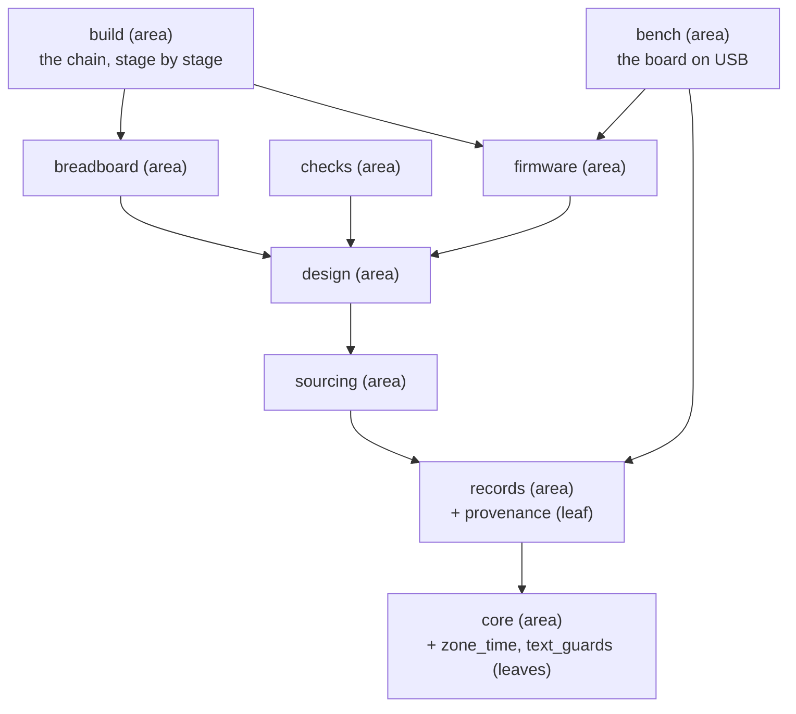
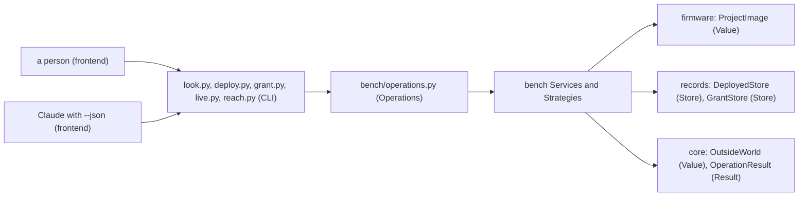
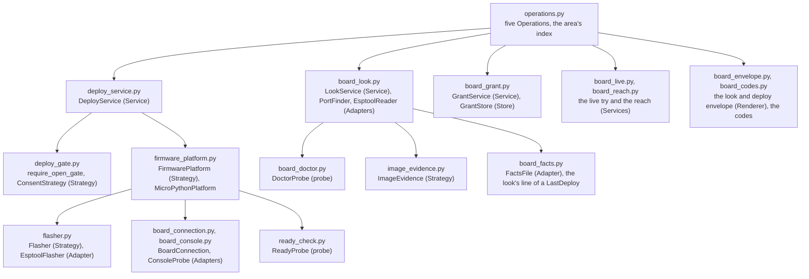
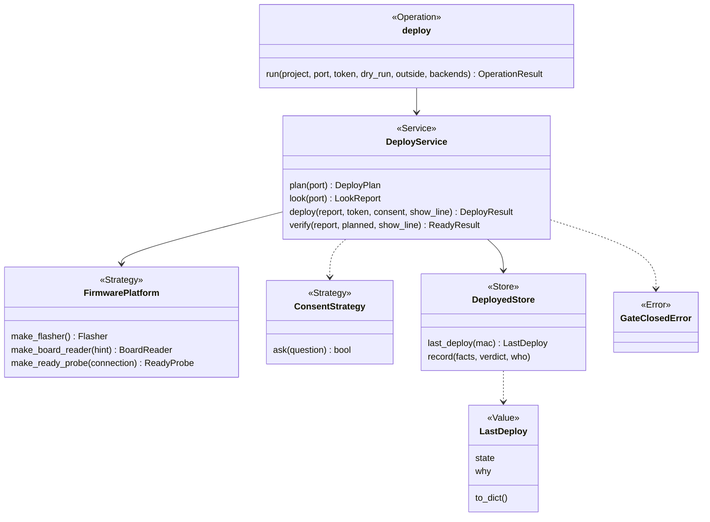
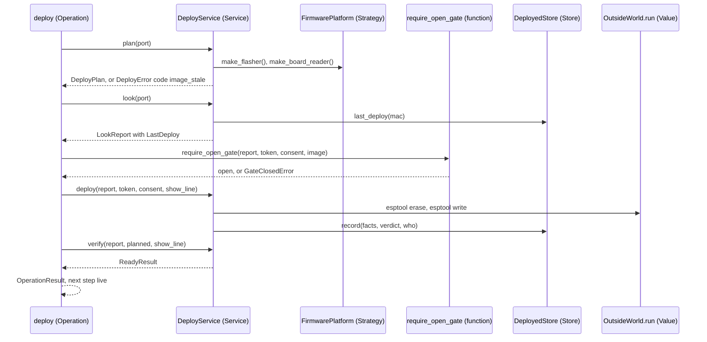
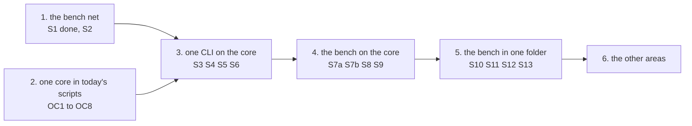

# The refactor plan, version 2: six stages, twenty-two slices

Version 2, card P385 [#494](https://github.com/xmejkal/spark/issues/494), base commit `d064a65` (the tag
`pre-refactor-2026-10-25`). Version 1 (card P323 [#413](https://github.com/xmejkal/spark/issues/413), cites at
`17708e6`) is in git. Back to [level 1](README.md). Epic P158 [#94](https://github.com/xmejkal/spark/issues/94).
A name that is not in the code yet is proposed. A number marked "est." is an estimate. Code is cited by module and
function name. A cite then moves only with a name.

> TL;DR. Stage 1's net is in (S1, P380). Stage 2 is new: eight small slices make today's scripts say one thing in one
> place, the fixes six councils asked for, and they wait on no decision. Stage 3 builds the core and puts `look` on
> it. Stage 4 puts the other four bench CLIs on it. Stage 5 moves the bench into one folder. Stage 6 does the other
> areas. The
> core is a contract other interfaces can call: a JSON Schema per Operation, no asking or printing inside, one hook for
> a tracer. The PO decides three things, one per lesson: readability first (1), the shape (2), the start of the moves (4).

## What changed from version 1

- Stage 1 is written as built (S1 = P380, PR #492), and decision 3 is answered in the PO's words. The dates "walk 2 on
  2026-10-27" are gone, because walk 2 ran on 2026-10-23.
- A new stage 2, "one core in today's scripts", holds eight slices OC1 to OC8. Version 1's stages 2 to 5 are now
  stages 3 to 6. Every slice id S1 to S13 keeps its name, so a comment that says "S5" still points right.
- The slice count is 22, not "sixteen". They are S1, S2, OC1 to OC8, S3 to S6, S7a, S7b and S8 to S13.
- The plan has the PO's bar and the four levels, a names section (P381), the core contract for other interfaces, the
  leaves and their edges, a home for every class walk 2 added, the MVP marks, the lessons, and the edits the area
  pages need. The long "what moves where" tables are cut to the rows that still hold, cited by name.
- Line cites are gone except where a line matters. `tools/factcheck.py` sees a missing file or a line past the end,
  and nothing else (rows 13 and 14 of the [rows file](../../../observations/rows/p385-prune-and-refactor.md)).

## 1. The bar, in the PO's words

On 2026-10-21 the PO chose walk 2 first, then the refactor: "So let's get ready first, prepare all we need." His goals:
spark becomes his job-application example of programming with AI, "really good code organization and architecture as
Anthropic recommends", clean Python with "very very little slop", pruned ("hide unnecessary code and revive it when we
need it"), and "I myself want to learn from it how to do it well, so explain clearly and give me options and
suggestion and teach me on it really."

On 2026-10-23: "We don't just create slop. We do reuse code. It's good: defined interfaces, a good, solid
object-oriented programming style, and good, clear naming and understandable code. It should be on 2, 3 levels, maybe
4, but it should be on each level. It should be systematic, or it should be understandable both if you go from bottom
up or from top to the bottom."

On 2026-10-25 he pulled the refactor: "Actually, we can tag this version in git or something and can come back, if
there's the need, but I'd like you to go on with the refactoring finally, so we have it dsone."

Each slice below is judged by this bar and by AGENTS.md's one bar: it moves a basic project closer to a breadboard with
working firmware, or it serves the person who reads the code to learn from it.

## 2. The four levels

A level is one size of thing a reader looks at. spark has four: area, module, class, method. The same four rules hold on
every level. A reader goes down from the area map to one method, or up from one method to its area. The shape is
the same each time.

| Rule | On an area | On a module | On a class | On a method |
|---|---|---|---|---|
| One responsibility, said without "and" | its page's first sentence | its docstring's first line | its docstring's role word, then its job | its name, a verb then its object |
| The name says the role | a noun from the area map | what it is a library for | the role word ends it (`Service`, `Store`) or its docstring says it | `why_` returns a reason or None, `require_` raises |
| Imports point down, never up | only areas along the map's arrows | only modules of its own area or below | only the collaborators its `__init__` lists | only its own class and its arguments |
| Tested alone | goldens of its CLIs | its own `tests/test_<module>.py` | a Fake for what it is given | one test per path |

The role words are the table in `docs/guide/developing.md`, "Patterns and names in spark's core". The overview below
is the area level for the whole system. Then the bench is drawn on all four levels. Every box carries its role.

### The overview: nine areas and three leaves

A leaf is a module that imports nothing of spark. It sits at the bottom of its area, so any module reaches it without a
cycle (section 5).

### Level 1, the area: bench and its neighbours

The bench imports firmware, records and core, each along an arrow of the overview. Nothing imports the bench.

### Level 2, the modules of bench

Each module keeps its `board_` or `deploy_` prefix (decision N11), so a grep lands in one file. `board_live` and
`board_reach` stay two modules, one flow each.

### Level 3, the classes of one flow: deploy

`DeployService`, `FirmwarePlatform`, `ConsentStrategy` and `GateClosedError` exist (`deploy_service.py`,
`firmware_platform.py`, `deploy_gate.py`). `DeployedStore` and the Operation are proposed. `LastDeploy` exists in
`board_facts.py` with its text methods, which section 6 moves to the look side (OC5).

### Level 4, the methods of one class: `DeployService`

Each method does one step of the flow and returns a Result or raises an Error. None prints. `show_line` is the one
callable a method gets for text while esptool runs, and it is `OutsideWorld.show_line` after S7b.

## 3. Names: the clashes and their role names

The standard is P381, `docs/guide/developing.md` "One responsibility, one name". One word has one meaning. A name says
what the thing is for. A function starts with a verb. A reader says `Reader`, `Finder` or `Probe`. Each clash below
gets one role name, and each old name becomes the new one in the slice named. Public record keys stay (glossary,
section 3).

| Clash | Meanings at `d064a65` | Role name | What each old name becomes |
|---|---|---|---|
| fact value | `emit_board.fact_value` reads the value at a key path. `boards.is_fact_value` says whether `pins.py` can write a value as a constant. `boards.fact_value_problems` is the shape rule plus that outlet rule | `provenance.read_value(record, *path)`, the one reader of a fact's value. `boards.is_pin_map_constant(value)`. `boards.board_fact_problems(where, fact)` | `emit_board.fact_value` and the hand-read chain in `design.firmware_pulls` call `read_value` (OC7). The two `boards` names are renamed in the records move (stage 6). |
| power | a part's `power` list of supply pins. A board's `power` block of facts. `power_pads`. The function verb `power` in `parts.VERBS` | the record keys stay. In code, a part's list is `supply_pins` and a board's block is `power_facts`. The pads stay `power_pads`. The verb is a value of `VERBS` | `boards.POWER_FUNCTIONS` becomes `POWER_FACT_FUNCTIONS`, `boards._power_functions` becomes `_power_fact_functions`, `boards.power_problems` becomes `power_fact_problems`. Provisional until P405 [#529](https://github.com/xmejkal/spark/issues/529) reports. |
| the three text guards | `drawer.clean` (a word to the store), `screen_text.printable` (a word to the screen), `parts.one_line` (a word to a generated file) | one leaf, `text_guards.py`: "the guards where text leaves spark". The three function names stay, because P403 and P389 gave them and their tests use them. `clean` takes its caps `LABEL_MAX`, `TEXT_MAX`, `TAGS_MAX` with it, because `matching` reads them too | `screen_text.py` is renamed `text_guards.py`. `drawer.clean` and `parts.one_line` move into it with `parts.COMMENT_UNSAFE` (OC8). |
| board | `scripts/boards.py` reads dev board records. `tools/board.py` reads the team's GitHub board (P381 row 1) | `tools/kanban.py`: one word for the GitHub Projects board. Its subcommands `status` and `close` stay | `tools/board.py` is renamed in the prune PR. `scrum/README.md` and the session hook follow. |
| the record classes | plan v1 `Records`, `RecordFolders`, `RecordSchema`. P391 `RecordKind`, `Record`, `RecordFinder`, `ShelveRecord`, `scripts/records.py` | `RecordFinder` (a reader says Finder), `RecordKind` (a Strategy: what differs per kind, its version and required keys included), `Record` (Value), `RecordFolders` (Value), `ShelveRecord` (Operation) | `Records` becomes `RecordFinder`. `RecordSchema` folds into `RecordKind.validate`. The "Records role" in `areas/records.md` goes. P391's `scripts/records.py` becomes `records/record_kind.py` and `records/record_finder.py`. |
| brief | `parts._brief` is a three-key summary of a part. Comment 4's `Brief` is the project's brief, `.spark/project.json` | `Brief` (Value: `prefer`, `sellers`, `from_project(project)`) in `records/brief.py`. `parts._brief` becomes `_part_summary` | `parts.vendor_order` and `parts.sellers` become `Brief.from_project(project).prefer` and `.sellers` (stage 6, sourcing). `init_project` writes the file, so comment 4 called it the setup area. The reader lives in records, so sourcing reaches it along the arrows. |
| not checked | `LastDeploy.state` with `why`. `ScenarioSteps.unread`, a flag. `None` from a reader | one shape, section 6, OC4 | `ScenarioSteps.unread` becomes `state` and `why`. |
| deploy entry | `DeployEntry` in comments 4 and 5 | none. `LastDeploy` is the Value, and `record_deploy` writes a dict | the name is out of the plan (comment 5). |
| look stop | `LookStop` (`board_look.py`) | `LookStopError` | renamed in S11, with `ReadyCheck` to `ReadyProbe` and `make_ready_check` to `make_ready_probe`. |

## 4. The core contract for other interfaces

The PO on 2026-10-22: "I will also later need to learn things as an ai engineer, so Langchain, Langgraph, langfuse,
some RAG, etc, so could we now revise the refactoring plan so that it would then also be easily migrated to that? So
like the logic etc separated out and then whether its being orchestrated by langgraph or make it into a plugin or an
mcp, skills, whatever, it would just be the interface and it would be easy to reuse it." S5 builds the core. These
four rules are added to it, each checked by one test in `tests/test_core.py`:

1. `Operation.schema()` returns a JSON Schema for the arguments and one for the result, built from the `Argument`s
   and the envelope keys. An MCP tool, a LangChain tool and a LangGraph state field are generated from an area's
   `OPERATIONS`, never written by hand. The test: every `Argument.dest` is a property of the schema.
2. No Operation asks or prints. Consent reaches it as `OutsideWorld.consent`, a `ConsentStrategy`: the terminal one
   asks, `StandingConsentStrategy` reads a stored grant, and a graph's one pauses the graph and resumes with the
   person's yes. `--token` is already an argument. The test: rule X2 of S3 finds no `print` or `input` in `spark/`.
3. `run_operation(operation, values, outside, backends, trace=None)` has one hook. `trace` is a callable that gets the
   Operation's name, the values, the result and the seconds, once per run. Langfuse plugs in there. The core imports
   no tracer. The test: a recording `trace` sees one call with the result's status.
4. A `Retriever` port answers a question over the parts library and the kept datasheets: `search(words, project)`.
   Its first two adapters are today's `parts.need` with the `Matcher` registry and `parts.scan_datasheet`. A vector
   store is a third adapter. No caller changes, because `need` and `read_datasheet` keep their names and call the
   port. It enters with the sourcing move (stage 6), not before, so no class waits for a caller (learned rule 6.1).

LangGraph, LangChain and Langfuse live only in `scripts/spark/frontends/`, one module each, installed by nobody who
uses spark (free, few and local). When two frontends share code, a `Frontend` base class enters (rule T3). The learning
spike in "Proposed cards" proves the contract after the refactor. One real Operation, the build, runs as a LangGraph
node and as an MCP tool from the same `OPERATIONS`, traced by Langfuse. The core does not change.

## 5. The leaves and the named edges

A leaf imports nothing of spark. Today there are three: `zone_time` (times with their zone), `screen_text` (the
screen guard, renamed `text_guards` in OC8) and `provenance` (what a fact must carry). The rule they came from: no
module imports upward. `board_facts` needed the time rule that `board_grant` holds. `board_grant` reaches
`board_look`, and `board_look` reaches `board_facts`. So the rule went into a leaf (comment 5). In the target, `zone_time` and
`text_guards` sit in core and `provenance` in records.

One test over every leaf, `tests/test_leaves.py`, replaces `test_screen_text_imports_no_spark_module` in
`tests/test_board_facts.py`: it reads each leaf with `ast` and fails on any spark import (rows 6 and 22: `zone_time`
has no test, and `provenance` has no import test). S3 folds it into `ArchitectureRules`.

| Edge today | Where | Kept or removed |
|---|---|---|
| `boards -> parts` | lazy, in `footprint_stop` (for `STOPS_AT_FOOTPRINT`) and `validate` (for `document_problems` and the rail rule) | removed. P411 [#537](https://github.com/xmejkal/spark/issues/537) builds the one footprint wording from `emit_footprint.footprint_gaps`, so `footprint_stop` needs no `parts` constant. The two shape rules move to `RecordKind` (P391 stage 2). |
| `parts -> boards` | lazy, in `function_of`, `audit`, `records_with_documents`, `_op_requirements` | kept, and made a top-level import once `boards -> parts` is gone. Row 18: the two lazy edges are a cycle today, and only one side needs to go. |
| `assign_pins -> parts` | for `one_line` | removed by OC8: `assign_pins` imports `text_guards`. |
| `matching -> drawer` | for `clean` and `TEXT_MAX` | removed by OC8: `matching` imports `text_guards`. |
| `image_evidence -> run_scenario` | for `ScenarioSteps`, `file_hashes`, `NO_MAIN`, `READY`, the step constants | kept: bench reaches firmware along an arrow. After the firmware move it imports `firmware/scenario_steps.py`. |
| `boards.footprint_stop -> emit_footprint` | lazy | removed. `footprint_stop` moves to design with the `board-list` Operation (N19). |

The footprint stop's wording is an input here, beside the three text guards: P411 counts four spellings
(`parts.STOPS_AT_FOOTPRINT`, a sentence in `needs.py`, the `--match` line, and the spine's footprint stage). P411 is a
card of its own and lands before OC1, so OC1 reads one wording from `emit_footprint.why_no_footprint`.

## 6. One core: the fixes the councils found, as slices

Each fix is one PR in today's scripts. It changes no flag, key or exit code, and the S1 goldens and today's tests prove
it. These are stage 2. Sizes are estimates.

| Slice | What it changes | What proves it | Size |
|---|---|---|---|
| OC1, one refusal order | `emit_board.read_inputs(path, project)` returns `BoardInputs(design, assignments)` or raises `RefusedInputError(stage, why)` in the order design, pins, footprint. `emit_board.main` and `check_spine.run` both call it. The repeated `design.load` and `assign_pins.assign` before the spine's footprint stop go. | one record with an unknown need and a footprint gap. `emit_board.py` and the spine give the same first sentence (row 10 of `p407-no-footprint.md`). The P407 tests stay | 80 |
| OC2, the spine calls the renderer | `check_spine.run`'s footprint stage calls `emit_footprint.render(board, rules)` and writes the file. `emit_footprint.main` is a CLI only. | a board whose definition disagrees with itself gives a `footprint` stage whose detail says why, not the old "no footprint" line. No stderr is read | 40 |
| OC3, one print edge | `text_guards.say(text, file)` prints `text` with each of its lines guarded, the body of `parts._say`'s print. `parts._say`, `look.main`, `deploy.main`, `check_spine.main` and `run_scenario.main` call it. The hand guards in `LastDeploy.line` and `needs._how_to_free` go, except on a name that can start a line (a holder, an entry key). | a planted newline and a bidi character in a record field show as `?` in every CLI's text. The leaf test passes | 90 |
| OC4, one "not checked" shape | the words `RECORDED`, `NONE_RECORDED`, `NOT_CHECKED` move from `board_facts` to `outcomes`. A reader never raises and returns a Value with `state` and `why`. `ScenarioSteps.unread` becomes `state` and `why`. P397's `SimulatedPart` reader takes the same shape. | one test per reader: a missing, a malformed and a good input give the three states. `ImageEvidence.caveats` and `onboard_limits` print the same "not checked" words | 70 |
| OC5, the store side and the look side | `DeployedStore` (Store) in `store.py`'s neighbourhood holds `last_deploy(mac)` and `record(facts, verdict, who)`, today `board_facts.read_last_deploy` and `record_deploy`. `LastDeploy` keeps `state`, `why`, `to_dict` and the stored fields. `line()` and `in_question()` become `board_look.last_deploy_line(last)` and `deploy_gate.last_deploy_in_question(last)`. | the look and deploy goldens do not change. `tests/test_board_facts.py` moves its reader tests to `tests/test_deployed_store.py` | 100 |
| OC6, two meanings of the project name | `store.listed_name(folder)` is the name on the person's list or None (today `project_name`). `store.name_when_listed(folder)` is the name the folder holds or will hold (today `add_project(dry_run=True)`). `add_project` loses `dry_run`. Call sites that need the listed name: `drawer.linkable`, `breadboard` (the sheet's title), `parts.note_built`, `parts._record_path`, `parts._op_pick` (its "listed" check), `parts._op_step`, `parts._op_tally`. Call sites that need the name it will hold: `needs._candidate`, `needs.plan_pick`, `parts._op_pick` (the name it writes), `parts._op_step` with `--dry-run`. | `--match` and `--pick` on an unlisted folder name the same project (P403's bug). Every old call site is gone by grep | 60 |
| OC7, one reader of a fact's value | `provenance.read_value(record, *path)` reads a value along a key path through the fact's `value`. `emit_board.fact_value` and the hand-read chain in `design.firmware_pulls` call it. | a board whose `internal_pull_up_ohms` is a bare number and one whose fact has no `value` give the same answer from both callers | 30 |
| OC8, one home for the text guards | `screen_text.py` becomes `text_guards.py` with `printable`, `clean` and its caps, `one_line` and `COMMENT_UNSAFE`. `drawer`, `parts`, `matching`, `assign_pins`, `needs` and `board_facts` import it. `tests/test_leaves.py` covers the three leaves. | `matching` and `assign_pins` import no high module (grep). The leaf test passes on all three | 80 |

Three more findings are rules, not slices. `drawer.holders_of` is the one reader of "who holds this stock", and
`needs.plan_pick` and `needs._candidate` stay its only callers (a U3 entry of S3). `provenance.fact_problems` is the
shape of a fact for part and board, and `boards.is_pin_map_constant` is the rule of one outlet, `pins.py`. They stay
apart, so P374 [#479](https://github.com/xmejkal/spark/issues/479) does not pull the second into part records. One role
is spelled in five tables (`PIN_ROLES`, the `ONBOARD_*` constants, `ONBOARD_ROLES`, `assign_pins.ROLE_PENALTY`,
`CONFLICTING_ROLES`). The plan waits for P405's finding before it moves the penalty into `OnboardRole`, and lesson 3
takes the five tables as its worked input.

## 7. A home for what walk 2 added

Each class or function a walk 2 card added, merged or planned, with its target module and role. "exists" means it is in
the code at `d064a65` under this name.

| Name | Card | Target module | Role | Status |
|---|---|---|---|---|
| `SimulatedPart`, `read_simulated_part`, `WOKWI_DEFINITION` | P396 | `records/board_records.py` | Value, a reader, a constant | exists |
| `OnboardRole`, `ONBOARD_ROLES`, `POWER_FUNCTIONS` | P389 | `records/board_records.py` | Value, two tables | exists (`POWER_FUNCTIONS` renamed in section 3) |
| `onboard_entries`, `names_pins`, `pin_labels`, `onboard_functions`, `_power_functions` | P389 | `records/board_records.py` | readers of the role table | exists |
| `is_fact_value`, `fact_value_problems`, `role_entry_problems`, `power_problems` | P389 | `records/board_records.py`, inside `RecordKind.validate` | rules of the board record | exists, renamed in section 3 |
| `sim_project.onboard_limits`, `write_limits` | P396, P389 | `firmware/sim_project.py` | functions | exists |
| `ScenarioSteps`, `SET_CONTROL`, `EXPECT_PIN`, `WAIT_SERIAL` | P345 PR 1 | `firmware/scenario_steps.py`, a module beside `scenario_run.py` | Value and its constants | exists in `run_scenario`. The module is not built yet |
| `ImageEvidence.caveats` and its three `_CAVEAT` constants | P345 PR 1 | `bench/image_evidence.py` | a Strategy method | exists |
| `LastDeploy` | P401 | `records/deployed_store.py` (the Value), `bench/board_look.py` (its line) | Value | exists in `board_facts`, split in OC5 |
| `read_last_deploy`, `record_deploy` | P401 | `records/deployed_store.py` | Store methods `last_deploy`, `record` | exists as two functions |
| `DeployedStore` | P391, comment 4 | `records/deployed_store.py` | Store | not built yet |
| `DeployEntry` | comments 4, 5 | none | none | out of the plan |
| `zone_time`, `screen_text`, `provenance` | P401, P403, P389 | `core/zone_time.py`, `core/text_guards.py`, `records/provenance.py` | leaves | exist (`screen_text` renamed in OC8) |
| `why_no_footprint`, `footprint_gaps` | P407 | `design/footprint_emitter.py` | functions | exists |
| `NO_FOOTPRINT_HINT`, `REFUSED_INPUT_MESSAGE` | P407 | `build/stages.py`, `design/board_emitter.py` | constants | exists |
| `LookStopError` | plan v1 | `bench/board_look.py` | Error | exists as `LookStop` |
| `RunLog`, `status_of_run` | plan v1 | `firmware/scenario_run.py` | Value, a function | not built yet (`run_record` builds a tuple, `verdict` stays) |
| `Brief` | comment 4 | `records/brief.py` | Value | not built yet (exists as `parts.vendor_order` and `parts.sellers`) |
| `OutsideWorld`, `Backends` | plan v1 | `core/outside.py`, `records/backends.py` | Values | not built yet |
| the "not checked" note in `needs.plan_pick`, the `SimulatedPart` reader's state | P397 [#513](https://github.com/xmejkal/spark/issues/513) | `design/needs.py`, `records/board_records.py` | a sentence, a Value state | not built yet |
| `ScenarioSteps.component_ids`, the id check in `ScenarioRun.problem`, `--dry-run` | P399 [#515](https://github.com/xmejkal/spark/issues/515) | `firmware/scenario_steps.py`, `firmware/scenario_run.py` | a method, a check, an argument | not built yet |
| the must lines a scenario names, and the look's list of unnamed ones | P345 PR 2 [#440](https://github.com/xmejkal/spark/issues/440) | `firmware/scenario_steps.py`, `bench/board_look.py` | a Value field, a line | not built yet |
| `--fact-set` on `facts.*` | P374 | `sourcing/part_facts.py` (`_set_in_home`) | an Operation's path | not built yet |
| `ROLE_PENALTY` as a field of `OnboardRole` | P405 | `records/board_records.py` | a Value field | waits for the finding |

## 8. The MVP marks

The PO on 2026-10-22: "we do want to mark parts of the code as for MVP and not necessary yet, even if just by dividing
the code in the class or script definition into two parts, commented with what is what and if it's MVP or not."

A card marks the code it touches, in its own PR. The marks are three comment lines: `# --- MVP ---` opens a span,
`# --- end MVP ---` closes it (four modules carry both today: `boards.py`, `board_facts.py`, `provenance.py`,
`sim_project.py`), and `# --- Later, not MVP: <why kept> ---` opens the rest, with the reason in the line. A mark is a
comment, so no test reads it, and a span holds whole functions or classes, never half of one. The per-module spans,
what is MVP and what is later in each module, live in the
[pruning list](../../2026-10-25-p385-prune-and-refactor/pruning-list.md#the-verdicts), not here.

## 9. The lessons

One lesson at a time, in chat, after the PR. The texts are in `lessons.md` of the P385 folder. Each asks one question.

| # | Lesson | The slices it opens | The decision it asks |
|---|---|---|---|
| 1 | Pruning: what goes under the tag, what moves behind a module | the prune PR with `PRUNED.md`, the MVP marks per card | which of the verdict groups to take, in which order |
| 2 | Package layout: `scripts/spark/`, areas, leaves, the move recipe | S4, S11, stages 5 and 6 | decisions 2 (the shape) and 4 (when the moves start) |
| 3 | The core contract: Operation, result, Finding, the four rules of section 4, the five role tables as its worked input | S3, S5, S6, OC4 | decision 1 (readability first) |
| 4 | Tests: goldens, Fakes, the leaf test, the ratchet on `mock.patch` | S7a, S13, `tests/test_leaves.py` | the fast lane's budget on a push (S13) |
| 5 | Claude Code forms: command, skill, agent, MCP, and what each gets from one Operation | the frontends, the learning spike | whether the spike runs before stage 6 |

## 10. The stages and their slices

| Stage | What works after it | Slices | Size (est.) | Waits on decision |
|---|---|---|---|---|
| 1. The bench net | a golden catches any bench change (done), and the bench prints codes | S1 (done), S2 | 200 | none (3 is answered) |
| 2. One core in today's scripts | every fact and every refusal has one home, the leaves have one test | OC1 to OC8 | 550 | none |
| 3. One CLI on the core | `look.py` is the worked example, the rules test ratchets, the core has its four rules | S3, S4, S5, S6 | 1,150 | 1, 2 |
| 4. The bench on the core | five thin bench CLIs, every effect gated, the platform swappable | S7a, S7b, S8, S9 | 1,100 | 2 |
| 5. The bench in one folder | `scripts/spark/bench/` holds the area, no home path in its output, a map | S10, S11, S12, S13 | 720, 2,266 moved | 4 |
| 6. The other areas | each area has a net, codes and its folder | 3 PRs per area | 900 per area | 4 |

Stages 1 and 2 are independent and wait on no decision, so they run while the lessons run. Each slice is one PR that
adds one thing and keeps every CLI working. The invariants of version 1 hold: the goldens change only in an output
slice (S2, S10, one per area). Nothing public changes. The push hook stays green. Each slice is one PR with the
measure line. No journey status changes. Each PR runs `tools/factcheck.py` on this plan.

### The decisions

Decision 3 is answered. The PO on #413, 2026-10-21: S1 before walk 2, S2 and every later stage after the walk, one PR
at a time, "I don't want to break the system before MVP." Three stay open. Each lesson asks one.

| # | Decision | Options | Recommendation | Asked by |
|---|---|---|---|---|
| 1 | Readability first | (a) readable, testable, exchangeable, reusable, consistent, as v1 ranks. (b) reusable first, as the 10-23 words list it ("We do reuse code"). (c) no rank, each slice names its goal. | (a). A function nobody reads is not reused, and R1's 40 lines apply only to new code in `spark/`, old code pays down by ratchet. The 10-23 words name all five, and readability is what makes the other four visible. | lesson 3 |
| 2 | The shape | (a) thin CLIs over `scripts/spark/`, one Operation per job, one rules test (v1). (b) Operations inside today's flat `scripts/`, no package. (c) a `src/spark` package with `pyproject`. | (a). The package is what a LangGraph node or an MCP tool imports (section 4), and (b) cannot give one `OPERATIONS` per area without a folder. (c) is on the "not do" list: it installs something, and spark installs nothing heavy. | lesson 2 |
| 4 | When the area moves start | (a) a story pulls its area (v1 D13). (b) now, the bench first, one PR at a time. (c) all areas in one pass. | (b). The PO pulled the refactor on 10-25, the bench's net exists (S1), and walk 2 ran on the bench. (c) breaks the "one PR at a time" rule of decision 3. | lesson 2 |

### Stage 1: the bench net

S1 is done as P380 [#487](https://github.com/xmejkal/spark/issues/487), PR #492. It was built like this, not as v1
wrote it. The runner is `tests/golden_bench.py`. The accept switch is the variable `SPARK_ACCEPT=<op>`. The project
is built at test time around the board `firebeetle2-esp32s3`. The fakes are `tests/fake_modules/esptool`, `mpremote`
and `serial`. `CASES` holds 13 cases and `tests/golden/` 13 files (11 json, 2 txt). Look has ok, problems, two
boards and `--no-simulation` as `could-not-run`. Deploy has the dry run (json and text) and no terminal. Grant has no
grant and two boards. Live has the refusal and two boards. Reach has ok. Not built: a deploy with the gate closed, a
ready-seen deploy, a bad flag. `tests/test_golden_bench.py` adds three checks. No golden holds a path of this machine.
Every golden has its case. The token ends in the image hash.

S2, the bench envelope additions (an output slice), stands as v1 wrote it. It adds a `code` at each item site of
`board_envelope`, with `fix_step` and `needs_person`. It adds a top-level `backends`, a `bad_argument` envelope for a
bad flag with `--json`, and `scripts/board_codes.py`. The three missing goldens above are added here, because S2
re-accepts the look and deploy goldens anyway. Two checks close the slice. The contract test in
`tests/test_json_contracts.py` fails on a removed key and an unlisted code. `grep -L '"code"' tests/golden/look-*.json
tests/golden/deploy-*.json` prints nothing.

### Stage 2: one core in today's scripts

The eight slices of section 6, in the order OC8, OC3, OC7, OC4, OC6, OC5, OC1, OC2. The leaf home comes first because
OC3 prints through it. OC1 waits for P411's one wording. Done when: `tests/test_leaves.py` passes on three leaves,
`matching.py` and `assign_pins.py` import no module above them, `grep -c "import boards" scripts/parts.py` is 1 and at
the top, and no golden changed.

### Stage 3: one CLI on the core

S3, the rules test: `tests/test_architecture.py` (`ArchitectureRules`) and a generated baseline that only shrinks.
`measure.py` of P322 moves to `tools/measure.py`. `tools/mutate.py` gains `--retarget OLD NEW`. The leaf test
becomes a rule. When each planted breach is caught with its rule, the slice is done.

S4, `outcomes` into the package: `scripts/spark/core/outcomes.py`, the first module of the package, with the 32
import lines of `scripts/` and `tools/` and the test imports changed. When no golden changes, the slice is done.

S5, the core contract. It creates `OperationResult`, `Finding`, `NextStep`, `Operation` with `schema()`, `Argument`
and `SparkError`. It creates `OutsideWorld`, `run_operation` with `trace`, `run_cli` and the three Renderers
`TextReport`, `JsonEnvelope`, `FlatJsonLine`. It creates `Backends` with `ToolFinder`, and the Fakes in
`tests/fakes.py`. Section 4's four tests are in it. Nothing calls it yet. When a toy Operation passes every path (ok,
problems, `could-not-run`, bad flag, `SparkError`, crash, undeclared effect), the slice is done.

S6, `look` on the core: `spark/bench/operations.py` with `look`, and `look.main` at most 15 lines by `ast`. When no
golden changes and `look.py` imports no area module but `spark.bench.operations`, the slice is done.

### Stage 4: the bench on the core

S7a, the deploy seams: the clock given in `DeployService.__init__` sleeps, one `FakeClock`, no `probe=` seam. S7b,
`deploy` on the core: `deploy._deploy` becomes the Operation, split under 40 lines a function, every effect declared
and gated, `--dry-run` fills `board` and `erases` with refusing stubs. S8, the platform owns the board tools.
`FirmwarePlatform` becomes a Strategy base, and `MicroPythonPlatform` fills it. `make_port_finder` and
`make_board_reader` replace the eight lookups outside it. Those sit in `live.main`, `reach.main`, `grant.main` (two),
`board_look.looker` (two) and `board_doctor` (two). S9, `grant`, `live` and `reach` on the core, `GrantService` built
once. Three checks close the stage: each bench `main` is at most 15 lines, no golden changed, and no `mock.patch`
line remains in `tests/test_deploy_gate.py`.

### Stage 5: the bench in one folder

S10, bench privacy (an output slice): `Privacy` shortens paths under the project and the store and masks each
`account_env` value. S11, the bench area move. It moves 15 modules and S2's `board_codes` into `scripts/spark/bench/`,
today 2,266 lines that 34 files import. It retargets the 217 mutation rows. It applies the renames of section 3:
`LookStopError`, `ReadyProbe`, `DoctorProbe`, `DeployPhase`. It moves the Fakes into `tests/fakes.py`.
`board_facts.py` splits: `FactsFile` and the look's line stay in bench, and `DeployedStore` goes to records (OC5
prepared it). S12, the map: `tools/map.py` writes `docs/guide/map.md`. When the page is stale, a test fails. S13,
fast and slow lanes. Two checks close the stage: `ls scripts/board_*.py scripts/deploy_*.py` prints nothing, and the
fast lane runs under 90 s on the PO's Mac.

### Stage 6: the other areas

When an area is pulled, it gets three PRs. The order of the areas is firmware, breadboard, checks, design with build,
records with sourcing. The first PR is its net: goldens, with a fake tool process where one is needed. The second is
its output slice: codes, `fix_step`, `backends`. The third is its move, with the names of its page and no module shim.
The `firmware` move adds `scenario_steps.py`. The `records` move adds P391's stage 2 (`RecordKind`, `RecordFinder`,
`Record`, `ShelveRecord`). It also adds `DeployedStore`, `Brief`, and the renames of section 3 in `board_records.py`. The `sourcing` move splits `parts.py` by
the job groups of the pruning list and adds the `Retriever` port. The `design` move takes `footprint_stop` and the
`board-list` Operation, `BoardEmitter` with `read_inputs`, and `PinAssigner`. The `build` move replaces
`check_spine.run` with `BuildService` and six `BuildStage`s, and the spine calls `BoardEmitter` in process.

## 11. The cites

Every claim about today's code names a module and a function, and each was read at `d064a65`. A line number appears
only in "Changes for the area pages", where it names a stale cite to replace. `tools/factcheck.py` exits 0 on this
file, and that proves only that each cited file and line exists. The names were checked by reading them. The headings
of this file are its anchors, so `drift.md`'s comment map points at a heading's slug.

## 12. P391's design and P322's facts

P391's `design.md` gets only two kinds of edit: its stale line cites (37 of 77, drift section 2) are fixed, and stage 4
gains the one note comment 4 asks: the Wokwi definition is a `documents` source under its sha256. Its names follow
section 3. Its stage 4 no longer "waits for P389", because P389 merged. P322's `facts.md` is a measurement dated 2026-10-19 and stays as it was printed (learned rule
3.2). Three things in it are out of date. The score: classes 16 % and roles 56/103 are 17 % and 63/110 today. The
counts: 59 modules, 14,313 lines, 103 classes and 647 functions are 63, 15,014, 110 and 668. The five function lengths
it names: `deploy.main` 28 is 33, `check_spine.run` 192 is 204, `parts.validate` 240 is 230, `boards.validate` 161 is
172, `emit_board.main` 115 is 117.

## Proposed cards

Six at most, in the card style, one sentence each. The council decides which to file and in which order.

1. Spike: the core contract is not proven for another interface → the build Operation runs as a LangGraph node and
   an MCP tool from the same `OPERATIONS`, with a Langfuse trace, and the core does not change (after stage 3).
2. Chore: `PRUNED.md` does not exist → the prune PR lands it at the root with the verdicts of the pruning list, the
   tag `pre-refactor-2026-10-25`, and one restore command per entry.
3. Chore: `tools/board.py` shares a word with `scripts/boards.py` → `tools/kanban.py`, with `scrum/README.md` and the
   session hook following.
4. Story: the project's brief is read by two functions in `parts.py` → one `Brief` Value in records, which the
   callers of `vendor_order` and `sellers` read.
5. Story: `ScenarioSteps.unread` and `read_last_deploy` spell "not checked" two ways → one shape with `state` and
   `why` (OC4), ready for P397's reader.
6. Story: a fact's value is read by hand in `design.firmware_pulls` and by `emit_board.fact_value` → one
   `provenance.read_value` (OC7).

## Changes for the area pages

A later step applies these edits so the pages agree with this version. Line cites that moved are listed in
`drift.md`, section 2, and are replaced by function names.

- `README.md`: "Your call" 3 is answered, cut it. The TL;DR's "the bench first for walk 2" becomes "the bench first,
  because its net exists". The area map gains the three leaves. The pages list says "six stages, twenty-two slices".
- `areas/bench.md`: line 4 "This area moves first, because walk 2 of P100 runs on the bench" becomes "Its net landed
  first (S1, P380)". `ready_probe` is today `ready_check.py`, `ReadyProbe` is `ReadyCheck`, `make_ready_probe` is
  `make_ready_check`, all renamed in S11. The cites `board_console.py:80` and `:86`, `board_doctor.py:160` and `:162`,
  `board_look.py:296` become `SystemClock`, `ConsoleProbe`, the two lookups in `board_doctor`, `looker`. Add the edge
  `image_evidence -> scenario_steps`, the `LastDeploy` line on the look side, and `DeployedStore` in the deploy
  sequence. The modules diagram of section 2 replaces its components paragraph.
- `areas/core.md`: drop `--describe` and `--debug` from `COMMON_ARGUMENTS` and the "only with `--debug`" sentence (S5
  prints the traceback to stderr always). Add `Operation.schema()`, `run_operation(..., trace=None)` and the two
  leaves `zone_time` and `text_guards` to the module table. Cites `run_scenario.py:249`, `assign_pins.py:113`,
  `parts.py:1672` become `ScenarioRun`, `Impossible`, `_Parser`.
- `areas/records.md`: `Records` becomes `RecordFinder`, `RecordSchema` becomes `RecordKind` with `version`,
  `required`, `validate`, `stops_at`, `shelf_copy`, `digest`. The "Records role" goes. Add `records/brief.py`
  (`Brief`), `records/deployed_store.py` (`DeployedStore`, `LastDeploy`), `records/provenance.py` (leaf). The board
  record row adds `OnboardRole`, `ONBOARD_ROLES`, `POWER_FACT_FUNCTIONS`, `SimulatedPart`, `read_simulated_part`,
  `WOKWI_DEFINITION` and the readers. Cites `boards.py:553-561`, `:592`, `:553`, `tools.py:572-578` become `main`,
  `footprint_stop`, `main`.
- `areas/firmware.md`: add the row `firmware/scenario_steps.py` (`ScenarioSteps`, the step constants,
  `component_ids` after P399). The `sim_project` row adds `onboard_limits` and `write_limits`. Cites
  `run_scenario.py:124`, `:171`, `:212`, `:252`, `sim_project.py:157` become `ScenarioRun`, its `wokwi-cli` run,
  `run_record`, the token read, `stage_chips`.
- `areas/design.md`: cites `boards.py:236`, `emit_footprint.py:208`, `assign_pins.py:392`, `:113`, `check_all.py:406`
  become `footprint_stop`, `main`, `pin_module`, `Impossible`, and the fifth is cut (its text is gone). The
  `board_emitter` row adds `read_inputs`, `RefusedInputError` and `REFUSED_INPUT_MESSAGE`. The `footprint_emitter`
  row adds `why_no_footprint`. A note: `ROLE_PENALTY` waits on P405.
- `areas/build.md`: cites `tests/test_needs.py:1416`, `check_spine.py:767`, `:635`, `:509`, `:432` become the test's
  name and `run`'s stages. `build/stages.py` gains `NO_FOOTPRINT_HINT`. The footprint stage calls `render`, not
  `main`.
- `areas/sourcing.md`: "The goldens of S15" becomes "the goldens of stage 6". Cites `parts.py:130`, `:1581` become
  `audit`, `OPERATIONS`. Add the `Retriever` port row with its two adapters. Add the note that `matching` imports
  `text_guards` and no longer `drawer`. Add `Brief` as the records Value that sourcing reads.
- `areas/checks.md`: mark `OrderCheck`, `BuildCheck` and `PhysicsCheck` as later, not MVP, behind the `CHECKS`
  registry (the pruning list's verdict).
- `areas/breadboard.md`: its cites hold. Only the link below changes.
- every area page: the link `../refactor-plan.md#into-<area>` becomes `../refactor-plan.md#appendix-what-moves-where-by-name`,
  because the appendix is one table now.
- `glossary.md`: cites `board_envelope.py:23`, `parts.py:230`, `:238`, `emit_footprint.py:236`, `board_facts.py:35`,
  `board_doctor.py:74`, `:188` become `STAGE_*`, `Answer`, `_problem`, `_report`, `FactsFile`, `BoardCheckStrategy`,
  `describe`. The consent row adds "or given by a stored grant, so a graph can pause and resume". New words: leaf,
  text guard, Brief, DeployedStore, RecordKind, RecordFinder, Record, kanban, trace. `RecordFolders` keeps its row.
  New clash rows: fact value, power, board (the Kanban one), brief, not checked, each settled as in section 3.
- `notes.md`: the conflicts row "0a only if it merges by 2026-10-23" gets the text "answered on #413". Add decisions N24 to
  N28: one refusal order, the three leaves and their one test, `RecordKind` over `RecordSchema`, `Brief` in records,
  the `trace` hook.
- P391 `design.md`: section 12 above.

## What we will not do

Version 1's list holds. No DI container, entry points, `pyproject`, `src/` layout or module shims. No `Frontend` base
class until two frontends share code. No `Clock` class. No base class with one implementation, unless a Fake or a
contract test is its second case. No `platform` key in `requirements.json` until a second platform exists. No public
rename. No change to the demo projects. Three lines are added. No vector store, LangChain or Langfuse import anywhere
but `scripts/spark/frontends/`. No `Retriever` class before the sourcing move. No `Tracer` class, because the hook is
one callable.

## Appendix: what moves where, by name

The rows of version 1 that still hold, cited by function name. The area pages hold the full target.

| Today | Becomes |
|---|---|
| `scripts/outcomes.py`, whole | `core/outcomes.py` (S4), with the three "not checked" words of OC4 |
| `parts.Answer`, `outcomes.answer` | `OperationResult` |
| `parts._problem`, the item dicts of `board_envelope` | `Finding` |
| `outcomes.step`, `board_envelope.look_step`, `deploy_step` | `NextStep` |
| `parts.OPERATIONS`, `OPTIONS`, `_Parser`, `look.main`'s body | `Operation`, `Argument`, `run_cli` |
| `board_envelope.dumps`, `board_look.report_lines`, `deploy.show_line` | `JsonEnvelope`, `TextReport`, `OutsideWorld.show_line` |
| `store.py`, `store.layers`, `store.records` | `records/store.py`, `RecordFinder` over `RecordFolders` |
| `boards.validate`, `parts.validate`, `REQUIRED_KEYS` of both | `RecordKind.validate`, one named rule per function |
| `boards.load`, `ButtonPlaces`, `BoardError`, `OnboardRole` and its readers, `SimulatedPart` | `records/board_records.py` |
| `board_facts.read_last_deploy`, `record_deploy` | `DeployedStore` (OC5) |
| `tools.find`, `merged`, `ToolProblem`, `tools.main` | `ToolFinder`, `ToolMissingError`, seven Operations |
| `drawer.py`, `matching.py`, `cost.py`'s logic | `sourcing/drawer.py`, `sourcing/matching.py`, `sourcing/run_cost.py` |
| `parts.keep_in_store`, `keep_local`, `scan_datasheet`, `read_datasheet`, `fetch_documents` | `sourcing/datasheets.py`, the `Retriever`'s datasheet adapter |
| `parts.vendor_order`, `sellers` | `Brief` in records |
| `parts.audit`, `boards.footprint_stop` | design's `audit` and `board-list` Operations |
| `design.py`, `needs.py`, `assign_pins.assign`, `render`, `pin_module` | `design/loader.py`, `design/needs.py`, `design/pin_assigner.py` |
| `emit_board.py`'s logic, `read_inputs` | `design/board_emitter.py`, `BoardEmitter`, split under 600 lines a module |
| `emit_footprint.py` | `design/footprint_emitter.py` |
| `flash_image.py`, `import_firmware.py`, `project_image.py`, `sim_project.py` | `firmware/image_builder.py`, `import_probe.py`, `project_image.py`, `sim_project.py` |
| `run_scenario.ScenarioRun`, `verdict`, `run_record`, `ScenarioSteps` | `firmware/scenario_run.py` (`RunLog`, `status_of_run`), `firmware/scenario_steps.py` |
| `breadboard*.py`, `part_pictures.py`, `tabbed_page.py` | `breadboard/` as `areas/breadboard.md` lists them |
| `check_all.Check`, `CHECKS`, the five checks, `check_bom.py` | `checks/` as `areas/checks.md` lists them, the PCB checks marked later |
| the bench modules of S11, `image_evidence.py` | `bench/`, moved with the renames of section 3 |
| `check_spine.run`, `init_project.py`, `ai_files.py` | `build/build_service.py`, `build/stages.py`, `build/project_setup.py`, `build/ai_files.py` |
