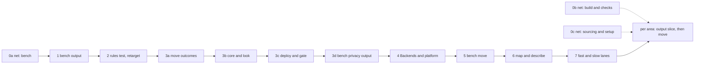

# The refactor plan: slices in order

Back to [level 1](README.md). Each slice is one PR. Line counts are estimates. A name that is not in the code yet is
proposed, and each area page lists its new names.

> TL;DR. First a net of tests that run every CLI from the outside. Then small slices, the bench first because walk 2
> (due 2026-10-27) runs there. A golden changes only in an output slice, never in a move. Area moves wait for a
> story or for v0.13 (the PO's decision 4).

## The golden rule

A golden is the expected `--json` envelope and exit code of one Operation on one fixture project. It changes only in
an output slice, never in a move. An output slice changes what a CLI prints on purpose: it adds envelope keys
(`code`, `fix_step`, `needs_person`, `backends`) or shortens paths and masks secrets. It accepts the changed goldens
with `tests/golden.py --accept OP` and says why in its description. Every other PR leaves every golden as it is.

## The order at a glance

Walk 2 needs only 0a and 1, and the PO decides both together (decision 3). Everything after 1 lands per story until
v0.13, unless the PO names a date.

## Slice 0: the outside-in safety net

The testability paper measured 2,817 tests on 2026-10-21 with an `ast` scan. 466 of them (17%) reach spark only
through a CLI's `main(argv)` or a child process. 470 (17%) reach a private name or patch a spark module, so a move
breaks them. The bench tests have the least outside cover: `test_deploy_gate` 76 inside tests, `test_board_grant`
64, `test_board_look` 38. `tests/golden/` does not exist yet. The net fixes this before any code moves.

How every golden works:

- One file per Operation and status, on a fixture project under `tests/data/projects/` (a proposed folder). stderr
  is not golden, because its words improve.
- The test runs the CLI as a child process, or through `main(argv)`. Never through a private name, and never with a
  `mock.patch`. So no move can break it.
- Fake tools are processes, as `tests/fake_wokwi_cli.py` is today. A fake bin folder comes first on the child's
  `PATH`.
- A child inherits the test's scratch store through `SPARK_HOME` (`store.py:35-39`). Inside the child, `unittest` is
  not imported, so `store.fetch` refuses `file:` URLs (`store.py:339`). The `fetch` goldens of 0c therefore run
  through `main(argv)` in the test process, and no golden needs the network.
- The project root is written as `<project>` and tool versions are normalised, so a golden holds no home path.
- A person reads the text, not the JSON, so `look`, `deploy --dry-run` and `check_all` also get one text golden.

| Slice | Covers | Lines | Done when |
|---|---|---|---|
| 0a | the harness `tests/golden.py`, `fake_esptool.py`, `fake_mpremote.py`, goldens for `look`, `deploy --dry-run`, `grant --check`, `live`, `reach`, a measure column "outside tests" | about 300 | each bench CLI has a golden per status the fixture reaches, a planted change in one envelope value fails exactly one golden, the suite count does not drop |
| 0b | goldens for `check_spine` (a fake `tsci` that copies a canned `circuit.json`), `check_all`, the five `check_*`, `compare_design`, `assign_pins`, `emit_board`, `emit_footprint`, `breadboard`, `run_scenario`, `flash_image`, `import_firmware` | about 300 | as 0a, before the first output slice or move of firmware, breadboard, checks, design or build |
| 0c | goldens for `parts.py`'s 29 Operations, `cost`, `boards`, `tools`, `init_project` | about 300 | as 0a, before the records and sourcing slices |

## Slices 1 to 7

| # | Adds one thing | Lines | Done when | Tests that stay, and that change | Rule from then on |
|---|---|---|---|---|---|
| 1 | Bench output slice: a `code` at the 6 item sites of `board_envelope.py`, `fix_step` beside each string `fix`, `needs_person` on a step, `backends` naming today's platform with `chosen_by: default`. `commands/deploy.md` reads the codes. | about 150 | the contract test fails on a removed key and on an unlisted code | the 0a goldens are accepted once, for the new keys only. `test_look` and `test_deploy` stay. | C2 for the bench: every item has a listed code |
| 2 | `ArchitectureRules` and its baseline. `measure.py` moves to `tools/`. The guard tests that list `scripts/*.py` switch to `rglob`. `tools/mutate.py --retarget OLD NEW` rewrites the mutation rows of a moved module. developing.md's role table gains Operation and Records, folds Platform into Strategy, and names Fakes in full (`FakeOutsideWorld`, `FakeFirmwarePlatform`). | about 400 plus the baseline | each planted breach is caught with its rule, file, line and reason, the generated baseline passes, and `--retarget` moves a planted row | all stay. `test_store`, `test_orphans`, `test_fab`, `test_self_confirmation` and `test_board_look` change their file walk only, because a module can now sit one folder down. | every rule: no new breach, and the baseline only shrinks |
| 3a | `scripts/spark/core/outcomes.py`, moved from `scripts/outcomes.py`. Mechanical. | about 150 | no golden changes, 39 importers updated, `mutate.py --retarget` moved every mutation row | the goldens stay. Tests that import `outcomes` change that line only. | U1: imports follow the area map |
| 3b | The core contract: `OperationResult`, `Finding`, `NextStep`, `SparkError`, `Operation`, `Argument`, `run_operation`, `run_cli`, the two Renderers, and `bench/operations.py` with `look`. `look.py` becomes a CLI of about 15 lines with `main(argv=None, outside=None)`. | about 450 | the `look` goldens stay, the parity test passes, `look.py` is at most 40 lines | the goldens stay. `test_look` changes its call lines only: `run=run` becomes `outside=FakeOutsideWorld(run=run)`. New unit tests for core. | X2: a CLI only calls `run_cli`. R1 to R6 hard for `spark/`. |
| 3c | `deploy` as an Operation. `OutsideWorld` fills only the declared effects, with `runs` gating `run`. Consent only for `board` or `erases`. `--dry-run` as a recording `run` and `write`. | about 400 | the `deploy` goldens stay, an erasing Operation with no gate fails, a call to an undeclared effect fails | the goldens stay. `test_deploy_gate`, `test_deploy` and `test_deploy_json` change their call lines: the five keywords `run`, `consent`, `probe`, `clock`, `grant_service` (`tests/test_deploy_gate.py:108`) become one `outside=FakeOutsideWorld(...)`. A test that passed its own probe or grant service gets them through the fake `run` and the scratch store. Why: one `outside=` keeps `main` at two parameters (R3) and the CLI free of wiring (X2). | C4: effects are declared and gated. T1: only Adapters touch the outside. |
| 3d | Bench output slice: `Privacy` shortens paths and masks secrets before any bench CLI prints | about 120 | the secret marker test passes, no home path in any bench output | the bench goldens with a printed path are accepted once | C4: no secret or home path reaches the output |
| 4 | `Backends`, `ToolFinder`, `FirmwarePlatform` as a base with `MicroPythonPlatform`, `DEFAULT_PLATFORM`, `make_port_finder`, `make_board_reader`. `grant`, `live` and `reach` become Operations. | about 450 | a `FakeFirmwarePlatform` drives all five bench Operations with no caller edit, the 8 tool lookups outside the platform are gone, the goldens stay | the goldens stay. The bench tests that patch `tools.find` move to `FakeToolFinder`, because the patch target goes. `mock.patch` lines fall. | X1: a backend is picked only in `operations.py`. X3: one registry form. |
| 5 | The bench area move: 15 to 17 modules into `scripts/spark/bench/`, the renames (`DoctorProbe`, `ReadyProbe`, `ReadingFile`, `DeployPhase`, `LookStopError`), the four Fakes into `tests/fakes.py`, one `FakeClock` | 19 to 34 importers, 190 to 240 mutation rows (design.md's estimate) | no golden changes, the test count does not drop, the PR prints "rows N, caught N" | the goldens stay. Unit tests change their imports and the renamed names, nothing else. | T3: a contract test per Strategy in bench. C1: the glossary's names. |
| 6 | The generated `docs/guide/map.md` and `--describe OP` | about 200 | a test fails when the map is stale | all stay | U3: one home per shared flag and code |
| 7 | Fast and slow lanes: `slow_test_*.py` for real tools and spark's own tools, the push hook runs both at once, measure gains "suite s" and "slowest test s" | about 80 | the fast lane stays under 60 s on this Mac, a test over 2 s in it fails unless baselined | `test_mutate`, `test_needs.py:1416` and the real `tsci` tests move file, their bodies stay | T5: the net runs on every push |

## After slice 7: the other areas

Each area gets two PRs, in this order: firmware, breadboard, checks, design with build, records with sourcing.
First its output slice adds its codes, `fix_step` and `backends`, and accepts its goldens. Then its move: modules
move, every importer changes in the same PR, no module shim, private names stay reachable where tests use them, and
no golden changes. Each needs its goldens from 0b or 0c first.

| Area | The one new thing its move adds | Removes |
|---|---|---|
| firmware | `SimulationEngine`, `WokwiCliEngine`, `RunLog` | 3 direct `subprocess` calls |
| breadboard | registries as dicts of classes, `WiringStep`, `WiringLog` | `NotKeptResult` and `DrawingDiffersResult` as own shapes |
| checks | `Check` with class attributes, one `Finding` | the sourcing to checks edge (`parts.py:495`), 3 finding shapes |
| design with build | `BuildService` and six `BuildStage`s in today's order, `TscircuitEngine`, the `audit` and `board-list` Operations | `check_spine.run`'s 192 lines, the `emit_board.py` child process |
| records with sourcing | `RecordFolders`, `Records`, `RecordSchema`, `ToolFinder` everywhere | the records to design edge (`boards.py:243`, `:592`), `store.py:40`'s test branch |

A small separate PR fixes `no_board` (D16) when a story needs it: `no_board` only when neither the requirements nor
`boards/active.json` names a board. It changes output, so it is an output slice.

## Every PR, always

- No new baseline entry, and at least one paid down in a file the PR edits.
- The PR pastes the measure line before and after: known breaches, fat CLIs, `mock.patch` lines, outside tests, suite s.
- No move PR changes a golden, a public flag, a JSON key, a record key or a script name.

## What we will not do

- No DI container, entry points, `pyproject`, `src/` layout, `adapters/` tree or module shims.
- No `Frontend` base class until the MCP server is the second frontend. No MCP client for tools.
- No `Clock` class. The clock is a field of `OutsideWorld`, filled by `SystemClock`.
- No serial port seam: `ConsoleProbe` runs pyserial through `run` and `FakeConsoleProbe` covers it.
- No base class with one implementation, unless a Fake in `tests/fakes.py` is its second case.
- No catalog, `Workspace`, `project` area, online store layer or several MCUs per project.
- No public rename. `--keep`'s two meanings, `status: mismatch` and the missing-input exit 1 of `boards.py --get`
  and `parts.py --show` are cards for the PO, outside this refactor.
- No area move before v0.13 unless a story pulls it.

## What moves where

Each table lists the files that move into one area, with `file:line` from 2026-10-21. A name that is not in the code yet is proposed: each area page lists its new names.

### Into core

| Today | Becomes |
|---|---|
| `scripts/outcomes.py`, whole (106 lines) | `core/outcomes.py`. 39 importers change their import. |
| `parts.Answer` (`parts.py:230`) and `outcomes.answer` (`outcomes.py:49`) | `OperationResult` |
| `parts._problem` (`parts.py:238`), the item dicts in `board_envelope.py:54-80` | `Finding` |
| `outcomes.step` (`outcomes.py:84`), `board_envelope.look_step` and `deploy_step` (`board_envelope.py:43,48`) | `NextStep` |
| `parts.OPERATIONS` tuples and `OPTIONS` (`parts.py:1581`, `:1655`) | `Operation` and `Argument` |
| `parts._Parser` (`parts.py:1672`) and `look.main`'s body (`look.py:41-64`) | `run_cli` |
| `board_envelope.dumps` (`board_envelope.py:38`) | `JsonEnvelope` |
| `board_look.report_lines` (`board_look.py:234`) as the text form | `lines` of the result, rendered by `TextReport` |

### Into records

| Today | Becomes |
|---|---|
| `scripts/store.py` (407 lines) | `records/store.py`. `home()` (`store.py:46`) feeds `RecordFolders`. |
| `store.layers`, `store.records` (`store.py:73`, `:86`) | `Records(kind)` over `RecordFolders` |
| `boards.validate`, `REQUIRED_KEYS` (`boards.py:340`, `:62`) | `RecordSchema("board")` |
| `parts.validate`, `REQUIRED_KEYS`, `RECORD_TYPES` (`parts.py:621`, `:51`, `:311`) | `RecordSchema("part")`, one named rule per function |
| `compare_design.PULLUP_MIN_OHM` and `MAX` (read at `parts.py:495`) | `records/schema.py`, which removes the sourcing to checks edge |
| `boards.load`, `ButtonPlaces`, `BoardError` (`boards.py:253`, `:269`, `:122`) | `records/board_records.py`. `BoardError` subclasses `SparkError`. |
| `boards.footprint_stop` (`boards.py:236`), which imports `emit_footprint` and `parts` | design, with the `board-list` Operation that calls it (`boards.py:592`). This removes the records to design edge. |
| `tools.find`, `merged`, `ToolProblem` (`tools.py:277`, `:79`, `:63`) | `ToolFinder`, `ToolMissingError` (proposed), code `tool_missing` |
| `tools.main` (`tools.py:568`, 83 lines, nesting 5) | seven Operations, one function each |
| the platform hard-coded at `deploy.py:171` and `micropython_port` at `flash_image.py:89` | `Backends.platform`. `micropython_port` stays a board fact the platform reads. |

### Into sourcing

| Today | Becomes |
|---|---|
| `scripts/drawer.py` (421 lines) | `sourcing/drawer.py`. Its reads of `parts._parse` and `parts._problem` (`drawer.py:187`, `:226`) use records' public `Records` and core's `Finding`. |
| `scripts/matching.py` (230 lines) | `sourcing/matching.py`. `UnknownMatcher` (`matching.py:31`) becomes `UnknownMatcherError`. |
| `parts.py` datasheet code: `keep_in_store`, `keep_local`, `EXIF_TYPE_BYTES`, `DATASHEET_SAYS` (`parts.py:1102`, `:1214`, `:1061`, `:1122`) | `sourcing/datasheets.py` |
| `parts.validate` (`parts.py:621`, 240 lines) | records' `RecordSchema("part")` |
| `parts.audit` (`parts.py:130`), which calls `emit_footprint.footprint_gaps` at `:165` | design's `audit` Operation. This removes the sourcing to design edge for audit. |
| `cost.py`'s logic (302 lines) | `sourcing/run_cost.py`. `NoTranscript` (`cost.py:46`) becomes `NoTranscriptError`. |
| `parts.py`'s operation table and parser (`parts.py:1581`, `:1655`, `:1672`) | `sourcing/operations.py` and core's `run_cli` |

### Into design

| Today | Becomes |
|---|---|
| `scripts/design.py` (382 lines), `load` at `design.py:372` | `design/loader.py`. `DesignError` (`design.py:64`) subclasses `SparkError`. |
| `scripts/needs.py` (655 lines) | `design/needs.py`. Its `parts.py` handlers (`parts.py:2087-2179`) become Operations here. |
| `assign_pins.py` logic: `assign`, `render`, `pin_module` (`assign_pins.py:199`, `:368`, `:392`) | `design/pin_assigner.py` |
| `EXIT_IMPOSSIBLE` alias (`assign_pins.py:46`) | gone, `ImpossibleError.status` says `problems` |
| `emit_board.py` logic (`emit_board.py:64-1172`) | `design/board_emitter.py`, split under 600 lines per module |
| `emit_footprint.py` logic, and `boards.footprint_stop` (`boards.py:236`) | `design/footprint_emitter.py` |
| `restricted_pins.py`, `netlist.py`, `fab.py`, `copper.py` | moved as is |

### Into firmware

| Today | Becomes |
|---|---|
| `flash_image.py` logic (`flash_image.py:37-118`) | `firmware/image_builder.py` |
| `import_firmware.py` logic (`import_firmware.py:53-93`) | `firmware/import_probe.py`, its subprocess behind `run` |
| `project_image.py` (90 lines) | `firmware/project_image.py` |
| `sim_project.py` (201 lines), `find_wokwi_cli` (`sim_project.py:20`) | `firmware/sim_project.py`. The tool lookup goes to `Backends.tools`. |
| `run_scenario.py` `ScenarioRun`, `verdict`, `run_record` (`run_scenario.py:124`, `:98`, `:212`) | `firmware/scenario_run.py`. `verdict` becomes `status_of_run`, `run_record` builds a `RunLog`. |
| the `wokwi-cli` calls at `run_scenario.py:171` and `sim_project.py:157` | `WokwiCliEngine` |

### Into breadboard

| Today | Becomes |
|---|---|
| `breadboard.py` logic (603 lines), `NotBuilt` (`breadboard.py:108`) | `breadboard/sheet.py`, `NotBuiltError` |
| `breadboard_steps.py` (211 lines) | `breadboard/wiring_steps.py`, `Step` becomes `WiringStep` |
| `breadboard_drawing.py` (477 lines), `NotDrawn` (`:37`) | `breadboard/drawing.py`, `NotDrawnError` |
| `breadboard_keep.py` (338 lines), `NotKeptResult` (`:63`) | `breadboard/kept_moves.py`. `NotKeptResult` folds into core's `Finding`, it already holds a `code`. |
| `breadboard_changes.py` (235 lines), `WiringRecord` (`:103`) | `breadboard/bench_changes.py`, `WiringLog` |
| `breadboard_match.py` (93 lines), `DrawingDiffersResult` (`:29`) | `breadboard/drawing_match.py`, the result folds into `Finding` |
| `part_pictures.py`, `tabbed_page.py` | moved as is. `TscircuitExport` takes `run` (`tabbed_page.py:48`). |
| `DRAWING_RENDERERS`, a tuple of instances (`breadboard.py:94`) | a dict from name to class (rule X3) |

### Into checks

| Today | Becomes |
|---|---|
| `check_all.py` `Check`, `CHECKS`, `CheckedFolder`, `render` (`check_all.py:63`, `:285`, `:316`, `:434`) | `checks/check.py`. `render` stays the person text. |
| `RulesVsNetlist`, `Physics`, `Buildability`, `VendorTruth`, `TheOrder` (`check_all.py:121-264`) | `RulesCheck`, `PhysicsCheck`, `BuildCheck`, `VendorPinsCheck`, `OrderCheck` |
| `check_physics.Finding` (`check_physics.py:93`), `check_footprints.Finding` (`check_footprints.py:54`), `compare_design.Failure` (`compare_design.py:44`) | core's `Finding`. `needs-measurement` maps to severity `unmeasured`. |
| `check_physics.Board` (`check_physics.py:114`) | `CircuitBoard` |
| `check_vendor_pins.fetch_variant_header` (`check_vendor_pins.py:64`), `CouldNotKeep` (`:175`) | `GhVendorHeaders`, `CouldNotKeepError` |
| `EXIT_MISMATCH` alias (`check_vendor_pins.py:44`) | `EXIT_FOR`, same exit code |
| `status: mismatch` (`check_vendor_pins.py:231`) | unchanged in the move. Its envelope card puts the state under its own key, so `status` holds only status words. |
| the person text keys `reason` (`check_all.py:82`), `detail` | new JSON says `sentence`. The old keys stay until a card retires them. |

### Into bench

| Today | Becomes |
|---|---|
| `look.py`, `deploy.py`, `grant.py`, `live.py`, `reach.py` bodies | Operations in `bench/operations.py`. The CLIs shrink to about 15 lines each. |
| `deploy._deploy` (`deploy.py:165`), which prints and picks exit codes | the `deploy` Operation, returning an `OperationResult` |
| `FirmwarePlatform.micropython` (`firmware_platform.py:53`) | `MicroPythonPlatform` |
| the 8 tool lookups listed above | `make_port_finder`, `make_board_reader` |
| `GrantService` built in `grant.py:90`, `:99`, `live.py:89`, `deploy.py:192` | built once in `bench/operations.py` |
| `BoardCheckStrategy`, `CheckResult` (`board_doctor.py:74`, `:54`), `ReadyCheck` (`ready_check.py:43`), `FactsFile` (`board_facts.py:35`), `LookStop` (`board_look.py:53`) | `DoctorProbe`, `DoctorProbeResult`, `ReadyProbe`, `ReadingFile`, `LookStopError` |
| `STAGE_*` (`board_envelope.py:23`) | `DeployPhase`. The JSON key `stage` stays. |
| `DeployService.sleep` as a class attribute (`deploy_service.py:76`) | the clock, passed in `__init__` |
| `board_envelope.py`'s item dicts (`board_envelope.py:54-80`) | core's `Finding` and `NextStep`, with codes. `fix` stays a string, `fix_step` is added. |
| `FakeFinder`, `FakeProbe`, `FakeGrants`, `FakeDoctor` (`test_board_doctor.py:28`, `:38`, `test_board_live.py:27`, `:140`) | `tests/fakes.py` |

### Into build

| Today | Becomes |
|---|---|
| `check_spine.run` (`check_spine.py:347`) | `BuildService` and six `BuildStage`s in today's order, each under 40 lines of logic |
| `check_spine.Stage` (`check_spine.py:100`) | each stage's `OperationResult`. `detail` stays the JSON key, filled from the sentence. |
| `subprocess.run` of `emit_board.py` (`check_spine.py:391`) | `SchematicStage` calls design's `BoardEmitter` in process |
| `toolchain_can_build`, `tsci build`, `--version` (`check_spine.py:162`, `:170`, `:432`) | `TscircuitEngine` |
| `converter_command` and its run (`check_spine.py:509`) | `DiagramConverter` |
| the history comments at `check_spine.py:371` and `:453` | their cards. Comments keep 4 lines at most (rule R5). |
| `init_project.py` logic (522 lines) | `build/project_setup.py` |
| `ai_files.py` | `build/ai_files.py` |
