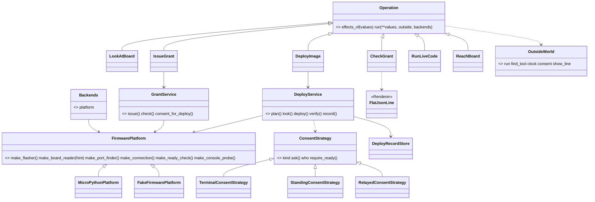
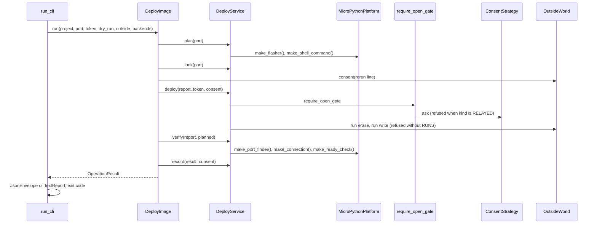

# Wave 4 plan: the bench on the core (P474, #649)

> Four PRs. W4-1 gives every board tool and clock one seam. W4-2 puts deploy on the core. W4-3 puts grant, live and
> reach on the core. W4-4 adds the relayed yes, which the PO merges in every mode. The plan waits for the PO's approval.

Fable 5.1 wrote this plan on 2026-11-01 in auto mode, with one council of two rounds inside. It was planned on
`origin/main` 67c37600 with PR #648 (P462) read as merged. So the line numbers for `deploy.py`, `deploy_service.py`,
`firmware_platform.py`, `tests/fakes.py` and `tests/test_deploy_gate.py` are the P462 branch's. The held P464 plan
touches only `result.py:31-37`, and W4-2 uses `to_envelope` as it is.

## Council

Round 1:

- Tech lead: four PRs by kind. W4-1 is the seams (S7a and S8). W4-2 is deploy on the core (S7b). W4-3 is grant, live
  and reach (S9). W4-4 is the relayed yes (S9b). W4-1 runs alone. W4-2 and W4-4 run in parallel worktrees, because
  their files differ. W4-3 comes after both.
- Refuter, against the code:
  - The refactor plan's "the clock given in `__init__` sleeps" meets three clocks on #648: `DeployService.sleep` (:70),
    `start_clock` (:72, a class attribute that a test overwrites, test_deploy_gate:106-107) and `clock` (:74).
  - bench.md's lines for the fakes are stale. `FakeClock` is fakes.py:75, `FakeLocalClock` :118, and #648 put
    `FakePortFinder` at fakes.py:89.
  - The eight lookups hold: live.py:88, reach.py:82, grant.py:91 and :98, board_look.py:487 (two), board_doctor.py:164
    and :166.
  - `OutsideWorld` has only `run` and `find_tool` (outside.py:18). `consent`, `clock`, `show_line`, `DELETES` and
    `WRITES` do not exist yet (operation.py:17), and `build_outside_world` gates only `run` (:33-35). S7b adds them.
  - `_deploy` is 72 lines and `main` 40 (baseline).
  - "No `mock.patch`": 16 lines count for T2 (baseline 16). Six `mock.patch.dict(os.environ...)` lines are T2's named
    exception (measure.py:272). So the check reads as "the `T2:tests/test_deploy_gate.py` baseline entry is gone".
  - grant.py has two jobs in one parser (:73-75), and `run_cli` takes one Operation.
  - grant `--check`, live and reach print flat JSON. Without a `FlatJsonLine` Renderer, three goldens change.
  - The golden runner compares stdout only (golden_bench.py:134). esptool's echo must still reach fd 2 under `--json`.
- Architecture: `FirmwarePlatform` becomes the base that owns every board tool. The looker, the doctor and
  `GrantService` take a platform. `DeployService(project, platform, evidence, outside, records)` ends the R3 breach
  (7 parameters). The platform reaches an Operation as `Backends.platform`, as the plan's level 3 says, not through
  `OutsideWorld`.
- AI-UX: a deploy crash becomes a `crash` envelope with exit 2 (agents.md:445, :556-557, :599, :688). For the CLIs that
  print flat JSON, `FlatJsonLine` prints the one unchecked item `{code, sentence, fix}` on a crash. `data.yes.kind` gains
  `relayed`, documented as "never from Claude".

Round 2:

- The PO's assistant cut `DeferringConsentStrategy` (no caller), the S11 renames (`ReadyProbe`, `LookStopError`), a
  `FirmwarePlatformContract` over every record, `Privacy`, fewer patches in test_board_grant, test_live and test_reach,
  and a `platform` key in requirements. Each is a row.
- Senior, names and edges:
  - `ConsentStrategy.kind` (`TYPED`, `GRANT`, `RELAYED`) replaces the isinstance test at deploy.py:246.
  - `RelayedConsentStrategy(who, program)`, the code `relayed_yes_refused` and `WHY_RELAYED_YES`.
  - `OutsideWorld.consent` is a factory, `consent(line)`.
  - An empty `who` or `program` is refused before any look.
  - The scope refusal sits with the scope check (board_grant.py:222), before `require_one_board` restarts anything.
  - A dry run with `run` refused still builds the REPL line, which needs no run.
  - Under `--json` the typed question goes to stderr.
  - `FakeClock.now` defaults to a zoned datetime.

## The PRs

### W4-1, the seams (S7a and S8)

Goal: every board tool and clock that the five bench CLIs reach comes from one platform or one clock. So a test swaps
them without a patch.

Classes:

- `FirmwarePlatform`, a Strategy base: `make_flasher`, `make_shell_command`, `make_connection`, `make_ready_check`,
  `make_console_probe`, `make_port_finder`, `make_board_reader(hint)` and `board_of`.
- `MicroPythonPlatform`, a Strategy. It replaces the classmethod with lambdas (firmware_platform.py:54-62).
- `FakeFirmwarePlatform` and `FakeBoardReader`, Fakes built from `FakePortFinder`, `FakeConsoleProbe`,
  `FakeBoardConnection` and a `Flasher`.
- `SystemClock` gains `now` (board_console.py:83-88). One `FakeClock` holds `now`, `monotonic` and `sleep`, and
  `FakeLocalClock` goes.
- `FakeDeployRecordStore`.

Files: firmware_platform.py:43-90. deploy_service.py:70-77 (three clocks become one `clock`, and a `records` seam),
:145-147, :175, :191-194. board_look.py:481-489 (`looker` builds the platform, and `LookService` takes it).
board_doctor.py:157-166 (`after_esptool(stop, project, platform)`). grant.py:91 and :98. live.py:88-92. reach.py:82-89.
board_grant.py:130-132 (`read_local_time` becomes `SystemClock().now`). deploy_gate.py:66-71 (a `user_name=getpass.getuser`
seam). deploy.py:161 (`platform=` and `clock=` parameters replace `probe` and `clock`). fakes.py:75-157. In
test_deploy_gate.py: :99-136 and the patches at :132, :235, :260 (a project's own record under `boards/`, boards.py:46),
:310, :376, :386, :402, :409, :724, :816 and :918.

Net: the goldens do not change. The T2 entry goes from 16 to 5. Mutation table `p474-seams.json`: the platform hands
the shell for the flasher, `make_board_reader` drops the hint, `now` has no zone, `user_name` is ignored, the records
seam is ignored. Docs: the developing.md role table (a Platform row) and the bench.md seams table (stale lines).

### W4-2, deploy on the core (S7b)

Goal: deploy.py is a 15-line CLI over `DeployImage`. Every effect is declared and gated, and the goldens stay byte-equal.

Classes:

- `DeployImage`, an Operation in `spark/bench/deploy_image.py`. Its effects are `READS RUNS BOARD DELETES WRITES`.
  `effects_of(values)` returns `(READS,)` under `--dry-run`, so `run` refuses.
- `Backends`, a Value holding `platform`, from `spark.bench.build_backends`.
- `OutsideWorld` gains `clock`, `consent(line)` and `show_line`.
- `LineWriter`, an Adapter in core/outside.py and on rule X2's list. It writes to stdout, or to stderr under `--json`,
  and gives esptool the fd to echo to.
- `ConsentStrategy.kind`.
- `DeployService(project, platform, evidence, outside, records=None)`.

Files: deploy.py:117-289 (the helpers move, and `main` shrinks from :161-200 to about 8 lines). board_envelope.py:74-125
(`deploy_envelope` splits into `deploy_data` and the Findings and NextSteps builders, keys in today's order).
core/outside.py:18 and :33-35. core/operation.py:17 and :30-44. core/cli.py:89-115 (`outside_builder(project, effects,
out)`, `backends`). bench/__init__.py:11-17. deploy_service.py:63-120. test_deploy_gate.py moves onto
`deploy.main(argv, outside=FakeOutsideWorld(...), backends=...)`. The last patches go. They are :131 and :1178
(find_tool), :472 (a `FakeConsent` that deletes the log while it asks), :661 (a log fixture with no file lines) and :988
(a unit test of the line builder). test_deploy_json.py and test_deploy.py follow.

Net: the goldens do not change. S6 found no input that crashes, so no crash golden comes. The T2 entry goes,
and so do the R1 entries for `_deploy` and `main` and the R3 entry for `__init__`. Mutation: 34 deploy.py rows are
retargeted. New rows: a dry run keeps `RUNS`. The gate is skipped before the erase. `kind` is wrong for a grant. The
echo goes to stdout under `--json`. `DELETES` is undeclared. Docs: the agents.md crash lines, commands/deploy.md and the
developing.md core section.

### W4-3, grant, live and reach on the core (S9)

Goal: the three last CLIs are 15-line mains over `IssueGrant`, `CheckGrant`, `RunLiveCode` and `ReachBoard`. They print
today's lines and today's flat JSON.

Classes: the four Operations, one module each. `FlatJsonLine`, a Renderer that `Operation.json_renderer` picks (the
default stays `JsonEnvelope`). `GrantService.of(platform, clock)`, built once (board_grant.py:207-215).

Files: grant.py:68-128. With `--check` in argv, `main` chooses `CheckGrant`. So `--help` splits per mode, the one
public change, named in the PR. live.py:74-105. reach.py:68-106. core/cli.py:108-112. bench/__init__.py
`OPERATIONS`. test_grant, test_live and test_reach move onto `FakeOutsideWorld`.

Net: the goldens do not change (five flat-JSON cases). Mutation: 30 rows retargeted (grant 19, reach 8, live 3). New
rows: the renderer swapped, the exit 1 path as `COULD_NOT_RUN`. Docs: the agents.md crash lines and the `--help` texts.

### W4-4, the relayed yes (S9b, the full council, the PO merges it in every mode)

Goal: a yes that another program collected is a third kind. It can make a live grant, and it never opens the erase.

Classes: `RelayedConsentStrategy(who, program)`, a Strategy in deploy_gate.py, with `kind=RELAYED` and `who` as "relayed
by %s through %s". `require_open_gate` (:96-121) refuses `RELAYED` first, with the reason
`board_codes.RELAYED_YES_REFUSED`. `GrantService.issue` (:216-239) refuses it for `SCOPE_DEPLOY` (`WHY_RELAYED_YES`) at
:222 and accepts it for a live grant. No CLI flag carries it, only `outside.consent`.

Tests: the two S9b checks, a relayed live grant that round-trips through `check`, and an empty `who` that is refused.
Mutation: the refusal inverted, the scope check dropped, the `kind` constant wrong. Docs: the agents.md yes kinds,
refactor-plan sections 4 and 10 marked done, and a developing.md example.

## The bench after wave 4

## The four checks that close the wave

1. Each bench `main` is at most 15 lines (W4-2 and W4-3, look already is).
2. No golden changed (every PR).
3. `T2:tests/test_deploy_gate.py` is gone from the baseline (W4-2).
4. S9b's two refusals are tested (W4-4).

## Risks

1. #648 is not merged. W4-1 branches from it, and a change there means a rebase.
2. R1 allows 40 lines a function in `scripts/spark/`. `_deploy` (72 lines) splits into about four functions.
3. The goldens must stay byte-equal with Findings. `deploy_envelope` chooses its items from the exit code, and the
   builder keeps that mapping. One test compares both paths.
4. `grant.py --help` per mode is a visible change. The PR names it.
5. 64 mutation rows are retargeted. A refused row is a lost guard, so each is re-anchored, never dropped.
6. W4-4 waits on the PO. If it is still open, W4-3 rebases on it.

## Review size

- W4-1: about 250 product lines and 200 test lines. Lenses on the everyday model, the refuter on the strongest, one
  mutation run.
- W4-2: about 300 product lines (150 new) and 400 test lines rewritten. The same, with a whole-branch review before the PR.
- W4-3: about 350 product lines and 300 test lines. The same.
- W4-4: about 60 product, 80 test and 30 doc lines. The full council, and the PO's merge.
