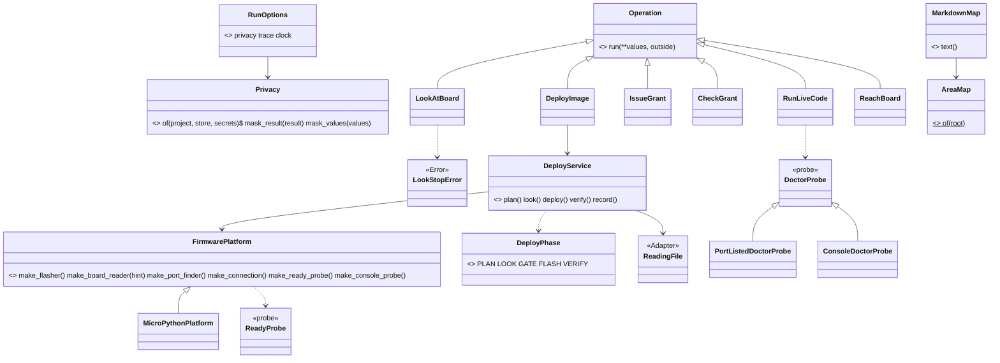

# Wave 5 plan: the bench in one folder (P676, #907)

> Three PRs. W5-1 (S10) gives `Privacy` its rules, so no home path and no account token leaves a bench run. W5-2 (S12)
> writes `docs/guide/map.md` from the code. If the page is stale, a test fails. W5-3 (S11) moves the 20 bench
> modules into `scripts/spark/bench/` and applies the five renames of section 3. W5-1 and W5-2 run now, in two
> worktrees. W5-3 starts on a main that holds PR #906 (W4-4), because #906 edits four of the files it moves.

Fable 5.1 wrote this plan on 2026-11-07, against `origin/main` a57c304a. S13 is done (P425, #559). Every count below
is from that tree. A name marked "proposed" is not in the code yet.

## Council

(filled after the council)

## What the refactor plan said, and what the tree says

The refactor plan (section 10, "Wave 5") counts 16 modules, 2,266 lines and 35 importing files at `d064a65`. Today:

- 20 modules are the bench's, as `areas/bench.md` draws them. The twelve `board_*` modules: `codes`, `connection`,
  `console`, `doctor`, `envelope`, `facts`, `grant`, `live`, `look`, `pads`, `reach`, `start`. The three `deploy_*`
  modules: `gate`, `service`, `stages`. The five others: `firmware_platform`, `flasher`, `ready_check`,
  `download_mode`, `image_evidence`. Together 3,001 lines. `deploy_record_store.py` (103 lines)
  stays in `scripts/` until the records move, as the plan says.
- 63 files under `scripts/`, `tests/` and `tools/` import one of them, in 186 import lines.
- 360 mutation rows in `tests/mutations/*.json` name one of them by path. Six name `deploy_record_store.py` and stay.
  Two name `scripts/board_ready.py`, a file that no longer exists (`mutate.py:184` reports such a row). W5-3 retargets
  352 rows and reports the two dead ones as a row in its rows file.
- 17 keys of `tests/architecture_baseline.json` hold a bench path. The 11 `R6` keys name these classes:
  `ReadyCheck`, `CompileCheck`, `EsptoolFlasher`, `PortFinder`, `LookService`, `EsptoolReader`, `BoardReader`,
  `GrantStore`, `FactsFile`, `PortListedBoardCheck`, `ConsoleBoardCheck`. The 6 `T1` keys: `image_evidence.py:subprocess`,
  `deploy_service.py:subprocess`, `deploy_service.py:file-write`, `board_look.py:subprocess`, `board_facts.py:time`,
  `board_facts.py:file-write`.
- The Fakes are in `tests/fakes.py` already (`FakeBoardConnection` :26 to `FakeOutsideWorld` :286). No `class Fake`
  is left under `scripts/`. That part of S11 is done.
- 169 files under `docs/`, `README.md`, `AGENTS.md`, `skills/` and `agents/` name a bench module path.

## The order, and PR #906

PR #906 (W4-4, the relayed yes) changes `scripts/deploy_gate.py`, `scripts/board_grant.py`, `scripts/board_codes.py`
and `tests/fakes.py` (its diff against a57c304a: 18 files, 279 insertions). The PO merges it at a time he picks. A
move of those four files under an open PR makes #906 unmergeable, and a rebase of his PR rewrites his branch. So:

1. W5-1 (S10) and W5-2 (S12) start now, in two worktrees. Their files do not overlap. Neither touches a file of #906.
2. W5-3 (S11) branches from the first main that holds #906. If #906 is still open when W5-1 and W5-2 are merged, the
   reply to the PO names #906 as the one thing wave 5 waits on (open question 2).

The order of the two early PRs does not matter. W5-2 before W5-3 is useful: the map test then forces W5-3 to
regenerate the page, which shows the move on one page.

## The PRs

### W5-1, bench privacy (S10, an output slice)

Goal: a bench run shows no path under the person's home and no account token. Spark is public, and people paste
`--json` output into issues.

Today `Privacy` passes everything through (`spark/core/privacy.py:9-19`). `run_cli` runs every Operation with
`DEFAULT_RUN = RunOptions(Privacy(), None, SystemClock())` (`cli.py:36-38`), and `run_operation` calls
`mask_result` (`cli.py:56`) and `mask_values` (`cli.py:60`). The store is SPARK_HOME, else XDG_DATA_HOME/spark, else
`~/.local/share/spark` (`store.py:8`). A tool with an account names its token's variable in `account_env`
(`tools.py:327`). The golden runner scrubs each run's own paths after the run (`golden_bench.py:187-191`: `<project>`,
`<store>`, `<repo>`, `<python>`). 12 of the 25 files in `tests/golden/` hold such a placeholder, so today the scripts do
print the raw paths.

Classes:

- `Privacy` (Strategy, `privacy.py`) gains rules: `Privacy.of(project, store, secrets)` (proposed) builds the ordered
  replacement list, longest path first, as `replacements_of` does (`golden_bench.py:188`). `mask_result` walks every
  string of the `OperationResult` (`result.py`): `data`, each Finding's sentence and fix, the diagnostics and the next
  steps. `mask_values` masks the values the same way. A path under the project becomes relative to it
  (`sim/flash-with-firmware.bin`). A path under the store becomes `<store>/boards/....json`, the placeholder the
  goldens use already. A secret value becomes `***`. The industry word is data masking (OWASP, "Logging Cheat Sheet":
  mask or redact sensitive data before it is written).
- `account_secrets()` (proposed, `tools.py`): the value of each `account_env` of the merged tool lists. `tools.py`
  reads the environment at `:327` already, and T1 keeps the read out of `spark/core/`.
- `run_cli` (`cli.py`) builds `RunOptions(Privacy.of(project, store.home(), tools.account_secrets()), ...)` from the parsed
  project. `DEFAULT_RUN` stays the pass-through for a caller that gives none.
- The rerun lines keep their real paths: `deploy_image.py:54` (`format_rerun_line(DEPLOY_SCRIPT, deploy_argv(project.resolve(), ...))`),
  `:59` (the grant command) and `board_grant.py:82` and `:88` (`<repo>/scripts/grant.py` in 3 goldens). A line to paste
  must run, so a `NextStep.command` is the one named exception (open question 1). `Privacy` skips that field.

Tests, in a new `tests/test_privacy.py`:

- a project path becomes relative, and a store path gets `<store>`.
- a path outside both stays.
- a secret in a Finding sentence becomes `***`.
- `mask_values` masks the trace's values.
- a command keeps its path.
- if the store sits under the project, the longest rule wins.

The 12 goldens with a placeholder are regenerated, and
the PR names each one: this is the wave's visible change. The scrub keeps `<repo>` and `<python>` and the hash. It
drops `<project>` and `<store>` for `data`, so a raw path that leaks is a golden diff from then on (est.: the scrub
needs a per-field split for the rerun lines, about 15 lines in `golden_bench.py`).

Mutation (`p<card>-privacy.json`, est. 8 rows). The store rule skipped. The project rule applied before the store rule.
A secret left in a Finding. `mask_values` returns the raw values. The command field masked. An empty secret masks
every string.

Docs: `agents.md` (what `--json` shows of a path), `areas/core.md:23-32` (`Privacy` no longer "waits") and the
developing.md core section. If `commands/deploy.md` or `commands/look.md` shows a path, it follows. Mark the new code
`# --- MVP ---`.

### W5-2, the map (S12)

Goal: `docs/guide/map.md` lists three things (`architecture/README.md:141-142`). Each CLI with its Operations. Each
area's modules with their first docstring line and test file. Each registry with its keys. If the page is stale, a
test fails, as `tests/test_journey.py` fails for a stale README picture (`test_journey.py:1`, `tools/journey.py`).

Classes (all proposed, in `tools/map.py`, with `main()` that only parses and writes):

- `AreaMap` (Value): the areas under `scripts/spark/` with their modules. For each module, its first docstring line
  (read with `ast`, as `measure.py` reads the tree) and its test file. The test file is `tests/test_<module>.py`, or
  none. The CLIs in `scripts/*.py` that import an area's `OPERATIONS`. Each registry with its keys:
  `spark.bench.OPERATIONS` (`bench/__init__.py:17`), `parts.OPERATIONS`, `WIRING_VIEWS`, `DRAWING_RENDERERS`, and
  `PLATFORMS` once it exists.
- `MarkdownMap` (Renderer: what it draws, then its form, `patterns-and-names.md:23`): the page's text from an
  `AreaMap`. It decides nothing again.
- `tests/test_map.py`: `MarkdownMap(AreaMap.of(ROOT)).text() == map.md`, a module without a docstring is listed as
  "(no docstring)", a registry with one key renders one row. The push hook runs it.

In wave 5 the map covers `scripts/spark/` (core and bench) and the five bench CLIs. Wave 6 adds each area as it moves,
and the stale test makes each move regenerate the page.

Mutation (`p<card>-map.json`, est. 5 rows): a module skipped, the docstring's second line taken, a registry's keys
unsorted, the test compares a prefix, the CLI column dropped.

Docs: `docs/guide/README` links (`docs/guide/developing.md` "Where the work is planned", `:362`), the journey guide's
"for developers" pointer, `architecture/README.md:141` from "proposed" to done.

### W5-3, the bench area move (S11, after #906)

Goal: `ls scripts/board_*.py scripts/deploy_*.py` prints only `scripts/deploy_record_store.py`. The 20 modules live in
`scripts/spark/bench/` under their names (bench.md: "the modules keep today's `board_` and `deploy_` prefixes", rule
C1). Every import, mutation row, baseline key and guide page follows. The goldens stay byte-equal.

Moves: `git mv scripts/<m>.py scripts/spark/bench/<m>.py` for the 20 modules, `ready_check.py` as `ready_probe.py`
(bench.md: "`ready_probe` is `ready_check.py` today"). Then the 186 import lines become `from spark.bench import <m>`
or `from spark.bench.<m> import ...`. `tests/fakes.py:12` is one of them. The industry words are Move Module and
Rename (Fowler, Refactoring, 2nd ed., "Move Function" and "Rename Variable" families).

The five renames of section 3, each with its sites:

| Today | Becomes | Sites |
|---|---|---|
| `LookStop` (`board_look.py:80`) | `LookStopError` (rule C1: an exception ends in Error) | `stops.py:25`, :35 and :38, the raisers in `board_look.py`, the tests |
| `ReadyCheck` (`ready_check.py:43`), `make_ready_check` (`firmware_platform.py:69`, `:110`) | `ReadyProbe`, `make_ready_probe` (glossary:41, "probe: a read-only look") | `FakeFirmwarePlatform` (`fakes.py:175`), `deploy_service.py`, `test_ready_check.py` renamed `test_ready_probe.py` |
| `BoardCheckStrategy` (`board_doctor.py:76`) with `PortListedBoardCheck` (:85), `ConsoleBoardCheck` (:106) | `DoctorProbe`, `PortListedDoctorProbe`, `ConsoleDoctorProbe` (proposed), `DoctorProbeResult` for `BoardDoctorResult` (bench.md) | `board_doctor.py`, `stops.py:35` docstring, `board_envelope.doctor_fix` (:82), `test_board_doctor.py` |
| `STAGE_PLAN ... STAGE_VERIFY` (`deploy_stages.py:8`) | `DeployPhase` (Value, glossary:96), a class with the five constants, JSON `stage` keys unchanged | `deploy_service.py:102-183`, `board_envelope.py:16` and `:140`, `issue_grant.py:18`, `look_at_board.py:52`, `board_start.py:108` |
| `FactsFile` (`board_facts.py:41`) | `ReadingFile` (glossary:99) | `board_look.py`, `deploy_service.py`, `test_board_look.py` |

`deploy_stages.py` (8 lines) folds into `board_envelope.py` as `DeployPhase`, so one module goes.

What the rules do at the move, checked at a57c304a:

- R1: `FUNCTION_LINES` is 40 under `scripts/spark/` and 60 elsewhere (`measure.py:241`, `long_code` :444). No
  function of the 20 modules is 41 to 60 lines (measured with `ast`), and none is named `main`. So no new R1 breach.
- X2: the `print`, `sys.stdin` and `sys.exit` text in `board_console.py:47-61`, `ready_check.py:24-34` and
  `image_evidence.py:76-105` sits inside the child programs' strings. `measure.py` reads the tree, not the text, so no
  X2 breach (est.: the PR runs `tools/measure.py` before the first commit and reports the figure).
  `TerminalConsentStrategy` (`deploy_gate.py:77`) is in `TERMINAL_CLASSES` (`measure.py:251`).
- U1: a leaf is known by stem (`LEAVES` :247, `leaf_imports` :525-531), so `board_codes` stays a leaf under bench.
- The 17 baseline keys are rewritten to the new paths. The `R6` keys of `ReadyCheck` and `FactsFile` go, because the
  renamed classes get their role word. The baseline only shrinks (`test_architecture.py:1-5`).
- The 352 mutation rows get the new `file` path. A row whose `find` text names an old class gets the new name. No
  row is dropped. The retargeted tables run once, as the PR's one mutation run (est.: minutes, clocked in the PR).

Tests: the 12 `tests/test_board_*.py` and `tests/test_deploy_*.py` files keep their names and import from
`spark.bench`. One new test in `test_architecture.py`: no `scripts/board_*.py` or `scripts/deploy_*.py` exists but
`deploy_record_store.py`, the wave's closing check.

Docs: `developing.md` (the role table rows that cite paths) and `patterns-and-names.md`. `agents.md` and the command
pages where they name a module. `areas/bench.md` (the diagram's file names, the "today" sentences).
`refactor-plan.md` section 10 (wave 5 marked done) and the appendix. The 169 files are not all touched. The pages in
`docs/discovery/` and `docs/archive/` are history and keep the old paths, and the PR says so. The push hook's docs
check decides which guide pages must be current (est.: see `tools/check_docs.py`).

## The bench after wave 5

All of these sit in `scripts/spark/bench/` after W5-3, except `Privacy` and `RunOptions` (`spark/core/`) and the two
map classes (`tools/map.py`).

## The checks that close the wave

1. `ls scripts/board_*.py scripts/deploy_*.py` prints only `scripts/deploy_record_store.py` (W5-3, a test).
2. No golden changed in W5-2 and W5-3. W5-1 names its 12.
3. `tests/golden/` holds no path under a home folder, and `test_privacy.py` holds the masking rules (W5-1).
4. `tests/test_map.py` passes on the committed `docs/guide/map.md` (W5-2, W5-3).
5. The baseline has no key with an old bench path, and no row of the 352 is dropped (W5-3).

## Risks

1. #906 merges late. W5-3 waits, and nothing else in wave 5 does. Wave 6's first net can start in the meantime.
2. The rerun lines carry real paths by design. If the PO wants them masked too, the line stops being pasteable
   (open question 1).
3. A store under the project (`SPARK_HOME=./store`) makes the rules overlap. Longest-first solves it, and one test
   pins it.
4. 186 import lines and 352 rows change by hand or by one script. A missed row fails the mutation run, not the suite.
   The PR runs `tools/mutate.py` on every bench table once and reports "N planted, M caught" per table.
5. The move changes 20 file paths that 169 docs name. The hook's docs check draws the line between a guide and history.
6. R1 and X2 hold at a57c304a. A merge of #906 adds about 60 lines to `deploy_gate.py` and `board_grant.py`. W5-3
   measures again on its own base.

## Review size

- W5-1 (S10): about 120 product lines (`privacy.py`, `cli.py`, `tools.py`, `golden_bench.py`), 120 test lines and 12
  regenerated goldens. It holds logic: the lenses on the everyday model, the refuter on the strongest, one mutation run.
- W5-2 (S12): about 150 product lines in `tools/map.py`, 60 test lines and the generated page. It holds logic: one
  reviewer on the everyday model, the refuter on the strongest, one mutation run.
- W5-3 (S11): 3,001 lines moved, about 190 import lines, 5 renames at about 60 sites (est.), 352 rows and 17 baseline
  keys retargeted, the guide pages. No new logic. One reviewer on the everyday model checks the renames. The refuter
  on the strongest checks the goldens and the rules. The retargeted tables are the one mutation run. A whole-branch
  review runs before the PR, because it is the wave's biggest diff.
