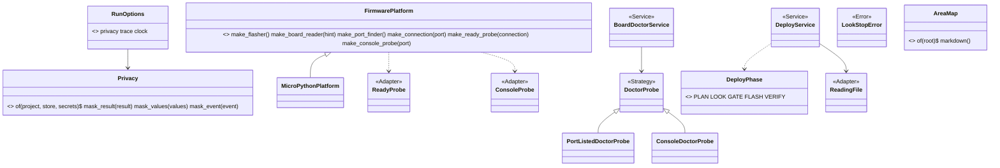

# Wave 5 plan: the bench in one folder (P676, #907)

> Four PRs. W5-1 (S10) gives `Privacy` its rules, so no home path leaves a bench run, except in a line a person
> pastes. W5-2 (S12) writes `docs/guide/map.md` from the code. If the page is stale, a test fails. W5-3a (S11) moves
> 18 bench modules into `scripts/spark/bench/`, and W5-3b applies the five renames of section 3. W5-1 and W5-2 run
> now, in two worktrees. W5-3a starts on a main that holds PR #906 (W4-4), because #906 edits three of the files it
> moves.

A pasted line is a raw place: `Privacy` never sees it. "Raw" names only that marker in this plan.

Fable 5.1 wrote this plan on 2026-11-07, against `origin/main` a57c304a. S13 is done (P425, #559). Every count below
is from that tree. A name marked "proposed" is not in the code yet.

## Council

Round 1 (2026-11-07): the refuter on Opus (11 findings, 10 held) and an architecture lens on Sonnet (6 findings).
What changed:

- The baseline keys are 23, not 17: `C1:board_look.py:LookStop`, `R2:board_facts.py:FactsFile.write` and four `R3`
  keys (`board_facts:facts`, `GrantService.issue`, `LiveTryService.__init__`, `LookReport.__init__`) were missed.
- R6 reads a docstring's first word (`measure.class_without_role`, `ROLES`). "probe" is no role word. Each renamed
  class's docstring starts with Adapter or Strategy, and so do the diagram's stereotypes.
- The move makes an import cycle: `spark/bench/__init__.py` imports every Operation, and `boards.py`,
  `project_image.py`, `missing_facts.py`, `assign_pins.py`, `breadboard.py` and `emit_board.py` import the leaves
  `board_pads` or `board_codes`. The refuter reproduced "partially initialized module 'boards'". The two leaves stay
  in `scripts/` until wave 6, and a test imports each moved module alone.
- Four `__file__` paths break at the move (`GRANT_COMMAND`, `DEPLOY_GRANT_COMMAND`, `PLUGIN_JSON`, `next_text`), and
  `tests/test_boards.py` names `board_pads.py` by path. W5-3a names each.
- W5-1 masks `OperationResult.lines` and `.notes`, the live Events of `TerminalReporter`, and `<repo>` and `<python>`
  under home too. The goal is narrowed to "except in a line a person pastes", and the raw places are named.
  `NextStep` has no `command` field, so the exception is named by place.
- W5-1 and W5-2 do touch files of #906 (`commands/deploy.md`, `docs/guide/agents/json.md`) and both edit
  `developing.md`: text conflicts only, and the later PR rebases.
- Counts: 182 import lines in 58 files (181 by `ast`), 170 doc files. W5-3a recounts the rows on its own base, because
  #906 adds `tests/mutations/p675-relayed-yes.json`.
- W5-2 is one class, `AreaMap` with `markdown()`, a `--write` command and the stale-page test. No Renderer, no
  `PLATFORMS`.
- W5-3 is split: W5-3a moves and retargets, W5-3b renames. Each stays green alone.
- The diagram is partial, and `make_console_probe` and `RunLiveCode ..> DoctorProbe` are explained.
- Line numbers go where a symbol name is enough.

Round 2 (the refuter on Opus, the changes only): 5 held, 1 rejected. What changed:

- A `spark.bench.CLI_DIR` in `__init__` makes a cycle ("cannot import name 'CLI_DIR' from partially initialized module
  'spark.bench'", reproduced for `board_grant`, `deploy_gate`, `look` and `check_spine`). It is dropped. Each module
  writes `Path(__file__).resolve().parents[2]` inline, as `DEPLOY_SCRIPT` in `deploy_image.py` and `GRANT_SCRIPT` in
  `issue_grant.py` do.
- `tests/test_deploy_service.py` `TheServiceHoldsNoPrintTest` reads `ROOT / "scripts" / <name>`. It is on W5-3a's fix
  list.
- Masking broke pasted lines: the grant command of `board_grant.MESSAGE_FOR` reaches an Event through
  `DeployImage.say` ("standing yes: not used"), and the `no_terminal` Finding's sentence holds
  `SPARK_HOME=<store> .../deploy.py` and `grant.py`. The rule is now one rule: a pasted line travels in a field or an
  Event marked raw, which `Privacy` never sees. The raw places are named by Finding code and by Event, and tested on
  the `no-terminal` and `no-grant` goldens.
- `<python>` also sits in lines nobody pastes (`running:`, `would run:`, `retry in`, the flash-failed sentence). Masked
  as `~/.pyenv/...`, the golden scrub no longer matched. The scrub now replaces the `~/` form of the repo and of the
  Python too, so the goldens stay machine-free.
- `DeployPhase` stays in the leaf `deploy_stages.py` (its docstring says why: a Service and the envelope both read it).
  A fold into `board_envelope.py` makes a cycle through `deploy_service`. Its site list gains `deploy_image.py`.
- Rejected: the 18-module move imports cleanly, each module alone, and 23 baseline keys is right.

PR council (2026-11-07, one Sonnet reviewer, the refuter on Opus on the round-2 diff). What changed:

- `GRANT_SCRIPT` with inline `parents[2]` is in `issue_grant.py`, not `deploy_image.py`, which builds it with `with_name`.
- `look_at_board.py` is back on the `DeployPhase` site list: it reads `board_envelope.STAGE_LOOK` through the re-export
  in `board_envelope.py`, and two rows of `p507-event-seam-e1.json` find that text.
- The scrub keeps replacing `<project>` and `<store>` in the raw places, per key, because the pasted lines hold them.
- Two raw places added: the envelope's `next[].argv` and `next[].env`, and the image-mismatch Finding whose sentence
  holds `flash_image.build_command` and `own_build_hint_for`'s lines.
- `Event.raw` defaults to False, so `Event("begin", "toy", None)` keeps working.
- The four cards and their Ready order, the docs-check rule, an example `<store>` hint line, why W5-1 is one PR, and
  the "raw" line under the short version.

## Open questions

Only the PO answers these. Until he does, the plan takes the default.

1. The lines a person pastes keep their real paths: `data["run_in_terminal"]`, `data["grant_argv"]`
  (`deploy_image.py`, the `reached` dict), the `next:` lines of `board_envelope.next_text` and the command inside a
  Finding sentence (`board_grant.MESSAGE_FOR`). Default: they keep them, because a pasted line must run.
2. If #906 is still open when W5-1 and W5-2 are merged, W5-3a waits for his merge. Default: it waits. Nobody rewrites
  his PR.

## What the refactor plan said, and what the tree says

The refactor plan (section 10, "Wave 5") counts 16 modules, 2,266 lines and 35 importing files at `d064a65`. Today:

- 20 modules are the bench's, as `areas/bench.md` draws them: the twelve `board_*.py`, the three `deploy_*.py` but
  `deploy_record_store.py`, and `firmware_platform`, `flasher`, `ready_check`, `download_mode`, `image_evidence`.
  Together 3,001 lines. 18 move. `board_codes.py` and `board_pads.py` are leaves that five other areas import, so
  they stay in `scripts/` until wave 6 (the Council, the cycle). Core's leaves live in `spark/core/` already
  (`codes.py`, `outcomes.py`, `text_guards.py`, `zone_time.py`), and wave 6 picks the home. `deploy_record_store.py`
  stays until the records move, as the plan says.
- 58 files under `scripts/`, `tests/` and `tools/` import one of the 20, in 182 import lines (181 by `ast`).
  `check_spine.py` imports `board_envelope`, so the build area loads the bench package after the move.
- 360 mutation rows name one of the 20 by path. Six name `deploy_record_store.py` and stay. Two name
  `scripts/board_ready.py`, a file that no longer exists. W5-3a recounts on its own base, because #906 adds rows, and
  reports the two dead ones as a row in its rows file.
- 23 keys of `tests/architecture_baseline.json` hold a bench path. 11 are `R6` keys of bench classes, `ReadyCheck`
  and `FactsFile` among them. 6 are `T1` keys of `image_evidence`, `deploy_service`, `board_look` and `board_facts`.
  One is `C1:board_look.py:LookStop`. One is `R2:board_facts.py:FactsFile.write`. 4 are `R3` keys: `board_facts:facts`,
  `GrantService.issue`, `LiveTryService.__init__` and `LookReport.__init__`.
- The Fakes are all in `tests/fakes.py` already. That part of S11 is done.
- 170 files under `docs/`, `README.md`, `AGENTS.md`, `skills/` and `agents/` name a bench module path.

## The order, and PR #906

PR #906 (W4-4, the relayed yes) changes `scripts/deploy_gate.py`, `scripts/board_grant.py`, `scripts/board_codes.py`,
`tests/fakes.py`, `commands/deploy.md` and `docs/guide/agents/json.md` (its diff against a57c304a: 18 files, 279
insertions). The PO merges it at a time he picks. A move of `deploy_gate.py` and `board_grant.py` under an open PR
makes #906 unmergeable, and a rebase of his PR rewrites his branch. So:

1. W5-1 (S10) and W5-2 (S12) start now, in two worktrees. Their code files do not overlap. W5-1 edits
   `commands/deploy.md` and `docs/guide/agents/json.md`, which #906 edits too, and both edit `developing.md`: text
   conflicts only. The PR merged later rebases and resolves them.
2. W5-3a (S11, the move) branches from the first main that holds #906. W5-3b (the renames) follows it. If W5-1 and
   W5-2 are merged and #906 is still open, the reply to the PO names #906 as the one thing wave 5 waits on.

After this plan merges, four cards are filed as sub-issues of P323, in this Ready order: W5-1 (S10), W5-2 (S12), W5-3a
(S11 move), W5-3b (S11 renames). P476 #652 and P399 #515 follow them in Ready.

## The PRs

### W5-1, bench privacy (S10, an output slice)

Goal: a bench run shows no path under the person's home and no account token, except in a line a person pastes. Spark
is public, and people paste `--json` output and the terminal's lines into issues.

Today `Privacy` passes everything through (`spark/core/privacy.py`), and `run_operation` (`cli.py`) calls its
`mask_result` and `mask_values`. The store is SPARK_HOME, else `~/.local/share/spark` (`store.py`). A tool with an
account names its token's variable in `account_env` (`tools.py`). The golden runner scrubs each run's paths after the
run (`golden_bench.replacements_of`). 12 of the 25 golden files hold a placeholder, so the scripts print raw paths
today. The live Events of `TerminalReporter` print raw too (`deploy-ok-ready-seen.json.stderr`).

Classes:

- `Privacy` (Strategy, `privacy.py`) gains rules. `Privacy.of(project, store, secrets)` (proposed) builds the ordered
  replacement list, longest path first, as `replacements_of` does. A path under the project becomes relative to it
  (`sim/flash-with-firmware.bin`). A path under the store becomes `<store>/boards/....json`, the placeholder the
  goldens use. A path under the home folder that is neither, such as the repo or the Python, becomes `~/...`. A secret
  value becomes `***`. `mask_result` walks every string of the `OperationResult`. That is `data`, `findings`, `next`, `lines`,
  `diagnostics` and `notes`. `mask_values` masks the values the same way. `mask_event(event)` (proposed) masks an
  Event's text.
- The pasted lines (open question 1) follow one rule: a pasted line travels in a field or an Event marked raw, which
  `Privacy` never sees. The raw places are these. The `data` keys `run_in_terminal` and `grant_argv`. Each
  `next[].argv` and `next[].env`, because `mask_result` walks `next`. The `next:` lines of `next_text`. A Finding
  whose code is in `board_codes.PASTED_CODES` (proposed). That set holds `NO_TERMINAL`, `NO_GRANT` and the other codes
  whose `MESSAGE_FOR` sentence holds a command. It also holds the image-mismatch code (`IMAGE_CHANGED`, est.), whose
  sentence holds `flash_image.build_command` and `own_build_hint_for`'s lines. An Event with `raw=True`. `raw` is a new `Event`
  field with the default False (namedtuple defaults), so `Event("begin", "toy", None)` in `test_core.py` keeps working.
  `DeployImage.say` sets it for the "standing yes: not used" line that carries the grant command. The industry word
  is data masking (OWASP, "Logging Cheat Sheet": mask or redact sensitive data before it is written).
- `account_secrets()` (proposed, `tools.py`): the value of each `account_env` of the merged tool lists. `tools.py`
  reads the environment already, and T1 keeps the read out of `spark/core/`.
- `run_cli` (`cli.py`) builds `RunOptions(Privacy.of(project, store.home(), tools.account_secrets()), ...)` from the
  parsed project, and wraps the Reporter so each Event passes `mask_event` first. `DEFAULT_RUN` stays the pass-through.
- One doc line, in `agents.md` and in the first `<store>` line a person acts on: `<store>` is SPARK_HOME. A printed
  `<store>` line that asks the person to open a file carries that hint, or the path itself. The example W5-1 writes:
  `the board's record: <store>/boards/dc-da-0c-xx-xx-xx.json (<store> is SPARK_HOME, ~/.local/share/spark unless set)`.

Tests, in a new `tests/test_privacy.py`:

- a project path becomes relative, and a store path gets `<store>`.
- a repo path under home becomes `~/...`, and a path outside home stays.
- a secret in a Finding sentence, in a `lines` entry, in `notes` and in an Event becomes `***`.
- `mask_values` masks the trace's values.
- `run_in_terminal`, `grant_argv`, the `next:` line, a `PASTED_CODES` Finding and a raw Event keep their paths, checked
  on the `deploy-could-not-run-no-terminal` and `grant-problems-no-grant` goldens.
- a `<store>` line a person acts on carries the SPARK_HOME hint or a raw path.
- if the store sits under the project, the longest rule wins.

The 12 goldens with a placeholder and the `.stderr` goldens with a live line are regenerated, and the PR names each
one: this is the wave's visible change. `<python>` also sits in lines nobody pastes (`running:`, `would run:`,
`retry in`, the flash-failed sentence), where it becomes `~/.pyenv/...`. So the scrub also replaces the `~/` form of
the repo and of the Python. In the raw places it keeps replacing all four placeholders, per key. The pasted lines
hold them: `deploy-could-not-run-no-terminal.json`'s `run_in_terminal`, and its `.stderr`. Outside the raw
places it stops replacing `<project>` and `<store>`. So a leaked path is a golden diff from then on (est.: about 20
lines in `golden_bench.py`).

Mutation (`p<card>-privacy.json`, est. 10 rows). The store rule skipped. The project rule applied before the store
rule. A secret left in a Finding. `lines` or `notes` not walked. An Event printed raw. `mask_values` returns the raw
values. A `PASTED_CODES` Finding masked. A raw Event masked. An empty secret masks every string.

Docs: `agents.md` (what `--json` shows of a path, and the `<store>` line) and `docs/guide/agents/json.md`.
`commands/deploy.md` and `commands/look.md` where they show a path. `areas/core.md` (`Privacy` no longer "waits") and
the developing.md core section. Mark the new code `# --- MVP ---`.

### W5-2, the map (S12)

Goal: `docs/guide/map.md` lists three things (`architecture/README.md`, "A generated page"). Each CLI with its
Operations. Each area's modules with their first docstring line and test file. Each registry with its keys. If the page
is stale, a test fails, as `tests/test_journey.py` fails for a stale README picture (`tools/journey.py`).

One class (proposed), in `tools/map.py`, with a `main()` that only parses and prints:

- `AreaMap` (Value): `AreaMap.of(root)` reads the areas under `scripts/spark/` with their modules. For each module,
  its first docstring line (read with `ast`, as `measure.py` reads the tree) and its test file, `tests/test_<module>.py`
  or none. The CLIs in `scripts/*.py` that import an area's `OPERATIONS`. Each registry with its keys:
  `spark.bench.OPERATIONS`, `parts.OPERATIONS`, `WIRING_VIEWS`, `DRAWING_RENDERERS`. `markdown()` is the page's text.
- `python3 tools/map.py --write` writes the page. Without `--write` it prints the page.
- `tests/test_map.py`: `AreaMap.of(ROOT).markdown()` equals `map.md`, a module without a docstring is listed as
  "(no docstring)", a registry with one key renders one row. The push hook runs it.

In wave 5 the map covers `scripts/spark/` (core and bench) and the five bench CLIs. Wave 6 adds each area as it moves.
Mutation (`p<card>-map.json`, est. 5 rows): a module skipped, the docstring's second line taken, a registry's keys
unsorted, the test compares a prefix, the CLI column dropped. Docs: the `docs/guide` links (`developing.md` "Where the
work is planned") and `architecture/README.md` from "proposed" to done.

### W5-3a, the bench area move (S11, after #906)

Goal: `ls scripts/board_*.py scripts/deploy_*.py` prints only `board_codes.py`, `board_pads.py` and
`deploy_record_store.py`. The 18 modules live in `scripts/spark/bench/` under their names (bench.md: "the modules keep
today's `board_` and `deploy_` prefixes", rule C1). Every import, mutation row, baseline key and guide page follows.
No class or function is renamed. The goldens stay byte-equal.

Moves: `git mv scripts/<m>.py scripts/spark/bench/<m>.py` for the 18 modules. Then the 182 import lines become
`from spark.bench import <m>` or `from spark.bench.<m> import ...`. `tests/fakes.py` is one of them. The industry word is
Move Module (Fowler, Refactoring, 2nd ed., the "Move Function" family).

The `__file__` paths that break, each fixed in this PR:

- `board_grant.GRANT_COMMAND` and `DEPLOY_GRANT_COMMAND` build `Path(__file__).resolve().parent / "grant.py"`. After the
  move that is `spark/bench/grant.py`, which does not exist. Each writes `Path(__file__).resolve().parents[2] /
  "grant.py"` inline, as `DEPLOY_SCRIPT` in `deploy_image.py` and `GRANT_SCRIPT` in `issue_grant.py` do. No shared
  constant in `__init__`,
  because that makes a cycle (the Council, round 2).
- `board_facts.PLUGIN_JSON` reads `.claude-plugin/plugin.json` two folders up. It becomes four.
- `board_envelope.next_text` builds the `next:` line with `Path(__file__).with_name("%s.py" % op)`. It writes
  `Path(__file__).resolve().parents[2] / ("%s.py" % op)` inline.
- `tests/test_deploy_service.py` `TheServiceHoldsNoPrintTest` parses `ROOT / "scripts" / <name>` and
  `firmware_platform.py` by path. The paths follow the move.
- `tests/test_boards.py` (`test_no_other_python_file_reads_the_key`) allows `scripts/board_pads.py` by path. The leaf
  stays, so the test stays. The PR says so.

What the rules do at the move, checked at a57c304a:

- R1: `FUNCTION_LINES` is 40 under `scripts/spark/` and 60 elsewhere (`measure.long_code`). No function of the 20
  modules is 41 to 60 lines (measured with `ast`), and none is named `main`. So no new R1 breach.
- X2: the `print`, `sys.stdin` and `sys.exit` text in `board_console.READ_CONSOLE`, `ready_check`'s hash child and
  `image_evidence.COMPILE_CHILD` sits inside the child programs' strings. `measure.py` reads the tree, not the text, so
  no X2 breach (est.: the PR runs `tools/measure.py` before the first commit and reports the figure).
  `TerminalConsentStrategy` (`deploy_gate.py`) is in `TERMINAL_CLASSES`.
- U1: a leaf is known by stem (`LEAVES`, `measure.leaf_imports`). The two leaves do not move, so U1 is untouched.
- The 23 baseline keys are rewritten to the new paths. The baseline only shrinks (`test_architecture.py`).
- The mutation rows on the 18 modules get the new `file` path, recounted on the PR's base (352 at a57c304a, plus
  #906's). No row is dropped. The retargeted tables run once, as the PR's one mutation run (est.: minutes, clocked in
  the PR).

Tests: the `tests/test_board_*.py` and `tests/test_deploy_*.py` files keep their names and import from `spark.bench`.
Two new tests in `test_architecture.py`: the closing `ls` check, and each moved module imports alone in a child Python
(`python3 -c "import spark.bench.<m>"`), which catches a partially initialized module. The page is regenerated with
`python3 tools/map.py --write`.

Docs: `developing.md`, `patterns-and-names.md`, `agents.md` and the command pages where they name a module.
`areas/bench.md` (file names, the two leaves) and `refactor-plan.md` section 10. The 170 files are not all touched: the
pages in `docs/discovery/` and `docs/archive/` are history and keep the old paths. The rule is `tools/check_docs.py`'s.
"The docs name only what is there" holds for `README.md`, `AGENTS.md` and `docs/guide/**/*.md`. It also holds for every
page that `scripts/`, `data/`, `commands/`, `skills/` or `agents/` cite.

### W5-3b, the five renames (S11)

Goal: the names of section 3 are in the code. The goldens stay byte-equal, and the JSON `stage` keys stay. Each
renamed class's docstring starts with its role word (R6), so its `R6` key goes. Each rename is one commit.

| Today | Becomes | Sites |
|---|---|---|
| `LookStop` (`board_look.py`) | `LookStopError` (C1: an exception ends in Error) | `stops.py`, `board_look.py`, the tests. The `C1` key goes |
| `ReadyCheck`, `make_ready_check` | `ReadyProbe` in `ready_probe.py`, `make_ready_probe`, an Adapter | `firmware_platform.py`, `FakeFirmwarePlatform`, `deploy_service.py`, `test_ready_probe.py` |
| `BoardCheckStrategy`, `PortListedBoardCheck`, `ConsoleBoardCheck`, `BoardDoctorResult` | `DoctorProbe` (a Strategy), `PortListedDoctorProbe`, `ConsoleDoctorProbe`, `DoctorProbeResult` | `board_doctor.py`, `stops.py`, `board_envelope.doctor_fix`, `test_board_doctor.py` |
| `STAGE_PLAN ... STAGE_VERIFY` | `DeployPhase` (Value), a class with the five constants, in the leaf `deploy_stages.py` | `deploy_service.py`, `board_envelope.py` (the re-export too), `issue_grant.py`, `deploy_image.py`, `look_at_board.py` (it reads `board_envelope.STAGE_LOOK`), `board_start.py`. Two rows of `p507-event-seam-e1.json` find `board_envelope.STAGE_LOOK` and get the new name |
| `FactsFile` (`board_facts.py`) | `ReadingFile`, an Adapter | `board_look.py`, `deploy_service.py`, `test_board_look.py`. The `R2` and `R3` keys follow |

The industry word is Rename (Fowler, "Rename Variable" and "Rename Field"). Mutation: the rows whose `find` text names
an old class get the new name. No row is dropped. The retargeted tables are the one mutation run.

Docs: `areas/bench.md`, the glossary rows, `developing.md` where it names a class, `refactor-plan.md` sections 3 and 10.

## The bench after wave 5 (partial: renamed and new classes only)

`make_console_probe(port)` exists today (`firmware_platform.py`) and builds `board_console.ConsoleProbe`.
`BoardDoctorService` runs the doctor's probes, and `stops.stop_result` asks it through `doctor_for`. The Operations and
Services of wave 4 are unchanged (`wave4-plan.md`). After W5-3a all of these sit in `scripts/spark/bench/`, except
`Privacy` and `RunOptions` (`spark/core/`) and `AreaMap` (`tools/map.py`).

## The checks that close the wave

1. `ls scripts/board_*.py scripts/deploy_*.py` prints `board_codes.py`, `board_pads.py` and `deploy_record_store.py`
   (W5-3a, a test).
2. No golden changed in W5-2, W5-3a and W5-3b. W5-1 names each one it regenerates.
3. `tests/golden/` holds no path under a home folder outside a pasted line, and `test_privacy.py` holds the rules (W5-1).
4. `tests/test_map.py` passes on the committed `docs/guide/map.md` (W5-2, W5-3a).
5. The baseline has no key with an old bench path, each moved module imports alone, and no row is dropped (W5-3a).
6. The five names of section 3 are in the code, and the `C1` key and three `R6` keys are gone (W5-3b).

## Risks

1. #906 merges late. W5-3a waits, and nothing else in wave 5 does. Wave 6's first net can start in the meantime.
2. The pasted lines carry real paths by design. If the PO wants them masked too, the line stops being pasteable
   (open question 1).
3. A store under the project (`SPARK_HOME=./store`) makes the rules overlap. Longest-first solves it, and one test
   pins it.
4. 182 import lines and about 360 rows change by one script. A missed row fails the mutation run, not the suite.
5. The move changes 18 file paths that 170 docs name. The hook's docs check draws the line between a guide and history.
6. R1 and X2 hold at a57c304a. #906 adds about 60 lines to two moved files, so W5-3a measures again on its own base.

## Review size

- W5-1 (S10): about 150 product lines (`privacy.py`, `cli.py`, `tools.py`, `golden_bench.py`), 150 test lines and the
  regenerated goldens. It holds logic: the lenses on the everyday model, the refuter on the strongest, one mutation run.
  It stays one PR because it is one visible output change, and its goldens are regenerated with it.
- W5-2 (S12): about 120 product lines in `tools/map.py`, 60 test lines and the generated page. It holds logic: one
  reviewer on the everyday model, the refuter on the strongest, one mutation run.
- W5-3a (S11, the move): 18 modules, 182 import lines, four `__file__` fixes, about 360 rows and 23 baseline keys. No
  new logic. One reviewer on the everyday model and the refuter on the strongest. The retargeted tables are the one
  mutation run. A whole-branch review runs before the PR, because it is the wave's biggest diff.
- W5-3b (S11, the renames): five renames at about 60 sites (est.), one commit each. One reviewer on the everyday model,
  the refuter on the strongest, the retargeted tables as the one mutation run.
