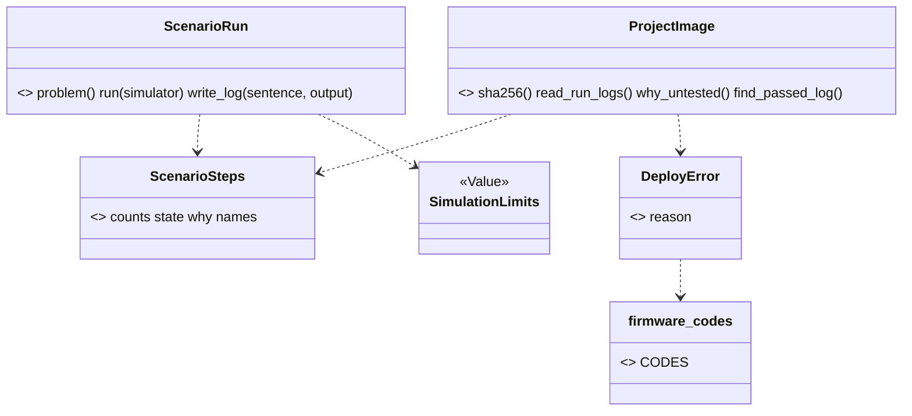

# Wave 6 plan: the other areas, firmware first (P681, #916)

> Pin down what the firmware tools print. Give their refusals codes. Then move the files. Wave 6 moves the eight
> areas that are still flat in `scripts/`, in the order of section 10: firmware, breadboard, checks, design with
> build, records with sourcing. Firmware, breadboard and checks are refined here, into three PRs each. W6-F1 gives the three firmware CLIs
> a golden net with `fake_wokwi_cli.py`, and no run spends a Wokwi minute. W6-F2 gives their refusals codes, text
> unchanged. W6-F3 is the move: six modules and the stand-ins go into `scripts/spark/firmware/` under the names of
> `areas/firmware.md`, and no module re-exports an old name. W6-F1 starts now. W6-F2 and W6-F3 wait for PR #906 and PR #915 (W5-3a).
> Breadboard and checks are refined too (P690): W6-B2 and W6-C2 give their refusals codes, text unchanged but for
> P688's item 3 (a package with no `bom.csv`: a sentence and exit 2, two new goldens), and the move is two PRs, W6-B3
> and W6-C3, because together they are three times W6-F3. Design with build is refined too (P698). It gets seven PRs.
> W6-D1 is one golden net with a fake `tsci` and a fake converter. W6-D2 and W6-U2 are the codes, design then build.
> W6-D3a, W6-D3b, W6-D3c and W6-U3 are the moves, each at most W6-F3's size, 605 mutation rows in all. `BuildService`
> and the N19 Operations are later cards, because a move PR adds no logic. Records with sourcing is refined too (P710): seven PRs,
> W6-R1 the net that never reaches the network, W6-R2 and W6-S2 the codes, and four moves, W6-R3a, W6-R3b, W6-S3a and
> W6-S3b, 728 rows in all. P391's classes, `ToolFinder` and `Brief` are later cards. Every group is now refined. Open
> question 1 is answered: a big move is one PR per area, or more.

Fable 5.1 wrote this plan on 2026-11-07, against `origin/main` 4e63057e. W5-1 (#914) and W5-2 (#913) are in main.
W5-3a (#915) and W5-3b are stacked on PR #906. Every firmware count below is from that tree. A name marked "proposed" is not
in the code yet, and "est." marks a guess. P690 (2026-11-08) refined the breadboard and checks sections against
`origin/main` 46bca725, and every breadboard and checks count is from that tree, with W6-F1, W6-F2, W6-B1 and W6-C1 merged and W6-F3 (P685) in Build.
P698 (2026-11-08) refined the design-with-build group against `origin/main` 924e48a4. Every count of that group is from
that tree, with the firmware group done and W6-B2 merged.
P710 (2026-11-08) refined the records-with-sourcing group against `origin/main` 8bfaeffa. Every count of that group is
from that tree, with the firmware, breadboard and checks groups done, W6-D1 merged and W6-D2 in Build.

## Council

Round 1 (2026-11-07): the refuter on Opus (10 findings, 8 held, 2 rejected: the counts and "no import cycle" hold)
and an architecture lens on Sonnet. What changed:

- A golden child with the shim missing ran the real `wokwi-cli` with the real token: `~/.local/bin` is on PATH,
  `~/.zshrc` exports `WOKWI_CLI_TOKEN`, `golden_bench.child_env` passes every non-`SPARK_*` variable on, and
  `tools.merged` keeps the default `also` list. W6-F1 sets a fake token in the child env, sets `"also": []` on the
  project's entry, and a test asserts the shim is the command found. The mutation row that unset the shim is gone.
  It is risk 1.
- `import_child.py` moved as is adds `X2:scripts/spark/firmware/import_child.py:main:1` (reproduced). W6-F3 renames
  its `main` to `import_one`.
- Sites were missing from W6-F3. `tests/test_import_firmware.py:613` runs `scripts/import_child.py` by path. The
  three stand-ins name their own old path in a sentence (`machine.py:228`, `fallback/framebuf.py:39`,
  `fallback/micropython.py:39`). Tests at lines 138 and 371 assert those sentences.
- W6-F2 breaks 5 mutation rows whose `find` is `reason=board_codes.X` in `project_image.py` (`p239-pr5`,
  `p429-firmware-line`, `p433-bench-codes`). W6-F2 rewrites them and proves them with `--anchors`.
- "W6-F2 touches no file of #906 or #915" was untrue: `scripts/board_codes.py`, `docs/guide/agents/json.md`,
  `commands/deploy.md` and `tests/test_json_contracts.py` are #906's, and `test_json_contracts.py` and
  `golden_bench.py` are #915's. W6-F2 branches from the first main that holds both.
- `needs_person` means the person must use their hands first (`json.md`, line 399). A paid run is consent, not
  hands: the `run-scenario` step carries an `effects` entry that names the spent Wokwi CI minutes (round 2 dropped
  this). `needs_person` stays on the token and install steps (round 2 dropped this too).
- A table maps each name of `run_scenario.py` to its new file.
- Numbers: `emit_board.py` is 1,208 lines, `project_image.py` raises 4 codes at 5 sites, and the 47 import lines
  are those outside the six modules. 5 more sit among them.
- The lens: `--json` for `run_scenario.py` and `flash_image.py` does not serve the bar and is out of W6-F2. When an
  agent needs it, it becomes a card. W6-F2 is codes, text unchanged (round 2 drops the step fields too). Open
  question 2 is gone.
- Batching: a later area's net PR (tests only) can open while a move PR is open. One move PR at a time stays.
- The short version starts with three plain sentences, the diagram is "after W6-F3", and each later group is two
  sentences.

Round 2 (2026-11-07, the refuter on Opus, the changes only): 4 held, 2 rejected (no path to a paid run is left, and
the rest of the W6-F3 list holds). What changed:

- The W6-F1 row "the fake token not set" survived on the PO's machine: `tools/mutate.py:98` hands `os.environ` to
  the run, `child_env` passes it on, and `fake_wokwi_cli.py` never reads `WOKWI_CLI_TOKEN`. The shim now exits
  non-zero unless `WOKWI_CLI_TOKEN` equals the fake value, so the row dies on every machine.
- The W6-F2 row counts are 1 in `p239-pr5`, 1 in `p429-firmware-line` and 3 in `p433-bench-codes`. The 3 swap rows
  of `p433` name `board_codes.X` in `replace` too, so both `find` and `replace` are rewritten, then `--anchors`.
- The step fields had nowhere to show: `import_firmware.py:120` returns `answer(...)` with no `next`, and `--json`
  is dropped. W6-F2 is the codes only, text unchanged. The `effects` entry, the `needs_person` part, their rows and
  closing check 2 are gone. The step fields come with the later `--json` card.
- One more W6-F3 site: `tools/check_commit.py:94` leaves out only paths that start with `scripts/stand_in/`. After the
  move it tests for `stand_in` in the path's parts, as `measure.py:238` does.

P690 round 1 (2026-11-08, the refuter on Opus and an architecture lens on Sonnet, on f6cbf0f1). The PO decided: P688's
`SystemExit` folds into W6-C2 (X2 counts a `raise SystemExit`, `measure.py:509`), the nine Extract Functions go into
the codes PRs so the moves stay `git mv`, and the two-PR move is open question 1's proposal. The rest: the codes an
agent can receive, the diagram's arrow, `Refusal`'s home, the `MAY_READ` keys, the rows by hand, the `NotDrawn` sites,
`--accept-new`, the area page's C1 note, the table test's tuple and the `check_spine` arrow.

P698 round 1 (2026-11-08, the refuter on Opus and an architecture lens on Sonnet, on 9428ddb2). The coordinator decided:
`Stage` goes to `stages.py` and `said_of_a_crash` to `build_service.py`, so the `check_spine` split makes no cycle.
The fakes call `/bin/mkdir`, `/bin/cp` and an absolute Python, and the tools override sets `"needs": []`, because a
`PATH` of the shim folder alone broke both (reproduced). The rest: `boards.PLUGIN_ROOT` for `SCRIPTS.parent`, a
reference-design Case, the counts (20 refusal Stages in `run`, 30 `DesignError` and 11 `Impossible` sites, 21 `MAY_READ`
keys, six `NotDrawn` sites in `part_shape.py`), `part_shape`'s move as a done-item with its page edits, `json.md` for the
new `code` key, and the rows file `docs/observations/rows/p698-wave6-plan-design.md`. Round 2 (the refuter on Opus, on
d5fe9864) held both blockers and added five fixes: `simulation_could_not_look`'s home, the `stages` name clash and
import by name, the reference Case's store override, the one `part_shape` site, and the 20 patch sites as a done-item.

P710 round 1 (2026-11-08, the refuter on Opus and an architecture lens on Sonnet, on a9cb0346). The coordinator decided:
the handler modules are `part_handlers.py` and `goal_handlers.py` (C1 refuses two `operations.py`), `load`,
`broken_problems` and `validate` go to `part_rules` and `_parse` to `record_kind` (the split made a cycle), the rows of
`parts.py` are mapped by a script and the cut is W6-S3a with `matching` and `cost` (160 rows after round 2) and W6-S3b with `drawer`
(268 after round 2), `PartError` stays in sourcing with its code, the band goes straight into `part_rules.py` in W6-S2,
`_op_describe` and `_op_needs_drop` stay in the CLI, the net's guard test proves no `curl`, `python3`, `brew`, `npm` or
`claude` in a child, the fake `pdftotext` exits 1 for `-f 2`, and the counts (`BoardError` 8, `ToolProblem` 23,
`PartError` 7, `--get`, `cost.py`'s one argument) are corrected. Rows 13 to 20 of `p710-wave6-plan-records.md`. Round 2 (the refuter on Opus, on 8b625860) held C1, the row
split and the safety, and added: `definition_path` to `part_records` (it raises `PartError`), `_op_tally` to
`goal_handlers` (it imports `needs`), the `_set_in_home` chain to `part_handlers` and `_write_record` to `record_kind`
(a two-way import with `drawer`), `part_rules` split into `part_rules` and `part_records` (R1 counts every line), the
12 dead rows closed, `--off`, `--pin` and `--new` write Cases, the guard list from `tools.MANAGERS`. Rows 21 to 25.

PR council (2026-11-07, PR #919: one Sonnet reviewer, the refuter on Opus). What changed:

- W6-F1 opens with a guard line, and the token check lives in the temp-folder shim, not in `fake_wokwi_cli.py`,
  which four places run directly (`test_run_scenario.py:30`, `test_deploy.py:36`, `test_journey_basic.py:51`,
  `golden_bench.py:35` and `:154`).
- One word for one thing: W6-F1 is the golden net, W6-F2 the codes, W6-F3 the move. "Shim" is the wrapper script
  alone, and `fake_wokwi_cli.py` is the fake tool.
- W6-F2's size is one pair, in its section and in Review size.
- W6-F3: the `run_scenario.py` split is its own commit, and the goldens gate each commit.
- Four rows name `board_codes.X` in `replace`, not three: `p429`'s one and `p433`'s three.
- `check_commit.py:94` is in `scripts_size()`, the size line's code count (P99), not the lint.
- The round-1 `effects` bullet says that round 2 dropped it.

## Open questions

Only the PO answers these. Until he does, the plan takes the default.

1. Batching. Decision 4 (epic #94, 2026-10-26, his words in `refactor-plan.md`'s decisions table) asks for one pass
   if it does not take too long, else a continuous version. Once an area's golden net exists, its move is a mechanical PR
   with no new logic. When the files of two areas do not overlap, their moves can share one PR: breadboard with
   checks, and design with build (the page already pairs them). Records with sourcing stays its own PR, because it
   splits `parts.py`. Default: the golden net and the codes stay one PR per area. The moves go in batches: firmware
   alone, then design with build. Records with sourcing follows. One move PR is open at a time, so a broken main is one
   revert away. A later area's golden net PR holds tests only, so it can open while a move PR is open, in its own
   worktree. P690's fact: breadboard with checks is 4,909 lines, 284 rows (about 7.6 hours of one serial mutation run)
   and 44 keys, three times W6-F3. Proposal: two move PRs, W6-B3 then W6-C3, decision 4's "else a continuous version".
   The cards are filed as two. Only W6-B3's start waits on the PO. If he says one PR, the two branches become one.
   Answered: the PO, 2026-11-08, "yes, nice, go on". Two move PRs, W6-B3 then W6-C3.

## What the refactor plan said, and what the tree says

The refactor plan (section 10, "Wave 6") gives each area three PRs and about 900 lines. `areas/firmware.md` names the
target modules. Today:

- Six modules are the firmware's: `flash_image.py` (315 lines), `import_firmware.py` (126), `import_child.py` (87),
  `run_scenario.py` (590), `project_image.py` (128) and `sim_project.py` (410). Together 1,656 lines. Beside them sit
  `stand_in/machine.py` (231) and `stand_in/fallback/` (`framebuf.py`, `micropython.py`, 86 lines), which are not
  spark code. The page does not name `import_child.py`. It is the child program of `import_firmware.py`, run by path
  with `-I`, and moves beside it.
- 26 files outside the six import one of them, in 47 import lines: 11 under `scripts/` (15 lines) and 15 under
  `tests/` (32). 5 more import lines sit among the six (`run_scenario` imports `flash_image` and `sim_project`,
  `project_image` imports all three). No import is lazy. Nine importers are bench files: `deploy_service`, `board_look`, `firmware_platform`,
  `ready_check`, `board_connection`, `image_evidence`, `board_console`, `download_mode` (W5-3a moves all eight) and
  `spark/bench/deploy_image.py`. `check_spine.py` (build) and `onboard_parts.py` import `sim_project`.
- The six import `boards`, `store`, `tools`, `emit_board`, `parts`, `board_codes` and `spark.core`. Firmware reaches
  design, records and core along the arrows of the overview. `sim_project` reaches sourcing (`parts.chip_folder`,
  `CHIP_SOURCE_SUFFIXES`, `definition_path`) through design's arrow. `project_image` imports the bench leaf
  `board_codes` for four `DeployError` reasons at five raise sites: an upward edge. W6-F2 gives those four codes a
  firmware home.
- 228 mutation rows in 34 tables name one of the six by path (`flash_image` 64, `run_scenario` 69, `sim_project` 46,
  `import_firmware` 24, `project_image` 15, `import_child` 10).
- 15 keys of `tests/architecture_baseline.json` hold a firmware path: `R1` for the `main` of `flash_image.py` (36
  lines) and `run_scenario.py` (28), `R6:scripts/run_scenario.py:ScenarioRun`, eight `T1` keys and four `T2` keys.
- Every `print` and `sys.exit` of the three CLIs sits in its `main` or its module tail (checked with `ast`). No
  function of the six is over 40 lines. When each `main` stays in `scripts/`, the library parts move under
  `scripts/spark/` with no new R1 or X2 breach.
- The 25 goldens in `tests/golden/` are all the bench's. `tests/test_json_contracts.py` checks `import_firmware
  --json`. `golden_bench.build_project` already runs `ScenarioRun(...).run(FAKE_WOKWI_CLI)` with
  `tests/fake_wokwi_cli.py`, and `tests/test_run_scenario.py` runs `main` with `tools.find` patched.
- The five test files (`test_flash_image`, `test_import_firmware`, `test_run_scenario`, `test_project_image`,
  `test_sim_project`) hold 3,103 lines. 14 pages under `README.md`, `docs/guide/`, `skills/`, `agents/` and
  `commands/` name a firmware module path, and 182 files in all docs.

## The order, and wave 5's open PRs

W5-3a (#915) moves 18 bench modules. Eight of them import firmware, and W6-F3 rewrites those import lines. W5-3b
renames nothing in a firmware file. So:

1. W6-F1 starts now. It adds files under `tests/` and edits no file of #906 or #915. `tests/golden_bench.py` is
   imported, not edited.
2. W6-F2 edits `scripts/board_codes.py`, `docs/guide/agents/json.md`, `commands/deploy.md` and
   `tests/test_json_contracts.py`, which #906 edits, and `test_json_contracts.py` and `golden_bench.py`, which #915
   edits. So W6-F2 branches from the first main that holds #906 and #915. W6-F3 follows it. If W6-F1 is merged and
   #906 is still open, the reply to the PO names #906 as the one thing the firmware group waits on. Nobody rewrites
   his PR.

After this plan merges, three cards are filed as sub-issues of epic #94, in this Ready order: W6-F1, W6-F2, W6-F3.
When a later group is next, it gets its cards.

## The PRs

### W6-F1, the golden net

Guard, do not skip: every child gets a fake `WOKWI_CLI_TOKEN`, the shim's tools entry sets `"also": []`, and the
shim refuses any other token. The PO allows no paid Wokwi run (2026-10-31).

Goal: what `run_scenario.py`, `flash_image.py` and `import_firmware.py` print today stays what they print, so no
move breaks it. The fake tool is `tests/fake_wokwi_cli.py`, which exists. The shim is the new wrapper script in the
temp folder that the tools layers find and that runs the fake tool.

Files: `tests/golden_firmware.py` (proposed, a helper beside `golden_bench.py`) and `tests/test_golden_firmware.py`.
The helper reuses `golden_bench.build_project`, `child_env`, `scrub` and `replacements_of`. It adds what a child run
of `run_scenario.py` needs that the in-process run did not: a `wokwi-cli` the tools layers find. The project's
`.spark/tools.json` names the simulator with `"kind": "path"`. Its `"exe"` is a shim in the temp folder, and the
shim runs `python3 tests/fake_wokwi_cli.py "$@"`. `tools.find` uses `shutil.which(exe)`, which takes an absolute
path. The entry sets `"also": []`, so `tools.merged` adds no other command for the role. The child env sets
`WOKWI_CLI_TOKEN` to a fake value, because `child_env` passes the parent's variables on and the PO's shell exports the
real token. The shim exits non-zero unless `WOKWI_CLI_TOKEN` equals that fake value. So a child that reaches the shim
with the real token fails its golden, on every machine. The check sits in the shim, not in `fake_wokwi_cli.py`. Four
places run the fake tool directly with no token: `test_run_scenario.py:30`, `test_deploy.py:36`,
`test_journey_basic.py:51`, and `golden_bench.py` at lines 35 and 154. A test asserts that `tools.find("simulator", project)` in the
golden project is the shim. No golden run spends a Wokwi minute (the PO, 2026-10-31: no paid Wokwi runs). The Case is a `namedtuple` of its own:
`golden_bench.Case` without the two canned board files.

Goldens, est. 8 files: `run-scenario-ok.txt`, `run-scenario-problems-never-ready.txt`,
`run-scenario-could-not-run-no-token.txt`, `run-scenario-could-not-run-no-sim.txt`, `flash-image-ok.txt`,
`flash-image-could-not-run-no-interpreter.txt`, `import-firmware-ok.json`, `import-firmware-problems.json` (a
firmware module whose import raises). The scrub replaces the run's paths as the bench's does: `<project-dir>`,
`<spark-home>`, `<repo>` and `<python>`. It also replaces the run log's date and sha256 lines (`golden_bench.CLOCK`
and a sha256 pattern). None of the three CLIs runs through `run_cli`, so a firmware run has no `Privacy`. A path in
the text is a scrubbed path, not a masked one.

Tests: one test per Case, and `SPARK_ACCEPT=run-scenario` writes the goldens from today's output and fails, as the
bench's does. The class takes `needs_littlefs` (`flash_image` imports the `littlefs` package).

Mutation (`p<card>-firmware-net.json`, est. 4 rows). The scrub skipped. A Case's exit code ignored. The sha256
pattern dropped. The fake token not set, so the shim exits non-zero and the golden fails. No row unsets the shim,
because that row runs the real CLI. Proven with `--anchors`, run with `--copy`.

Review: no new product logic. One reviewer on the everyday model and the refuter on the strongest. Size est.: 120
test lines and 8 goldens.

### W6-F2, the codes (after #906 and #915)

Goal: each refusal of the three CLIs has a code. An agent decides on the code (P260). The text lines stay byte-equal
to the W6-F1 goldens, and the exit codes stay.

Files: `scripts/firmware_codes.py` (proposed, a leaf, the shape of `board_codes.py` and `idea_codes.py`: the
constants, then `CODES` with one sentence each). The name is unique under `scripts/` (C1), because
`spark/core/codes.py` exists. `run_scenario.py` and `flash_image.py` keep their text output. Each refusal site
raises or returns with its code, so the code is in the library for the Operation that comes later. The
`import_firmware.py --json` items gain a `code` key. `project_image.py` raises four `DeployError` reasons at five
sites: `NO_SIM_TOML`, `FIRMWARE_LINE_BAD` (twice), `NO_IMAGE` and `LOG_UNREADABLE`. It takes them from
`firmware_codes`. `board_codes` keeps the four names as aliases until W6-F3. In W6-F3 the bench reads them from
firmware. That ends the upward edge. A `--json` for the two text CLIs does not serve the bar today (the lens, round
1). When an agent needs it, it becomes a card.

The codes, est. 16, read from the refusal sites. `run_scenario.py`: `no_token`, `no_sim_project`, `never_ready`,
`step_timeout`, `simulator_lost`, `board_silent`, `simulator_not_started`, `simulator_failed`. `flash_image.py`:
`no_interpreter`, `files_not_folder`, `build_unknown`, `interpreter_damaged`, `tool_missing`. `import_firmware.py`:
`import_failed`, `nothing_to_import`, `import_timeout`. The PR reads each site and reports the real count.

No step fields in this PR. `import_firmware.py:120` returns `answer(...)` with no `next`, and the two text CLIs
print no envelope, so an `effects` entry or `needs_person` has nowhere to show. They come with the later `--json`
card. The refactor plan's "codes and `needs_person`" is read so for firmware.

Tests: in the three existing test files. Each code is asserted as a literal (`test_self_confirmation`, P677 row 26).
Each refusal site names its code. The `import_firmware --json` output is checked against the envelope contract in
`test_json_contracts.py`. The text output of each W6-F1 Case is unchanged. `CODES` names every constant once. Five
mutation rows name `board_codes.X` in `project_image.py`: one in `p239-pr5.json`, one in `p429-firmware-line.json`
and three in `p433-bench-codes.json`. Four of them name it in `replace` too: `p429`'s one and `p433`'s three. Both
`find` and `replace` get the new module name, proven with `--anchors`.

Mutation (`p<card>-firmware-codes.json`, est. 8 rows). A code dropped from an item. Two sites with one code swapped.
`CODES` missing a constant. The text line changed. The exit code changed. The alias in `board_codes` broken.

Docs: `docs/guide/agents/json.md` (the three ops and their codes), `agents.md`, `commands/build.md` and
`commands/deploy.md` where they show the output. Mark the new code `# --- MVP ---`.

Review: it holds logic. The lenses on the everyday model, the refuter on the strongest, one mutation run. Size est.:
80 product lines, 80 test lines, the 8 goldens unchanged.

The build's check of this section (P684, 2026-11-08, rows 8 to 17 of `docs/observations/rows/p684-firmware-codes.md`)
changed three things before any code:

- One code per refusal site, not per cause. A site whose one `except` catches several causes gets one code that names
  what they share: `ScenarioRun.problem()`'s `try` and `flash_image`'s `ToolProblem`. No `try` is split and no reason
  is added to `ToolProblem`. A split is a card when an agent needs to tell the causes apart. The one exception is
  `flash_image`'s bad `--config`, which today shares the damaged interpreter's `except`: it gets its own `except` and
  its own code, because the shared code would be wrong. The PR reports the real count.
- In `import_firmware.py --json`, only a `modules` entry that was not imported gains a `code` key. `problems` and
  `unchecked` stay plain strings, and "nothing to import" and "no `firmware/` folder" keep their codes in the library
  only. So `import-firmware-problems.json` is accepted again with the new key, and the other 7 goldens stay unchanged.
  The test asserts a `code` on each such entry. `import_firmware.py` prints no envelope.
- `firmware_codes` is a leaf, and `board_codes` stays one (U1). `board_codes` keeps its four names, and
  `TOOL_MISSING`, as equal literals, not imports. A test asserts that the five are equal in both modules, and the
  table test that keeps code tables apart lists these five as the one allowed overlap, until W6-F3.
  `firmware_codes` joins `measure.LEAVES` (`tools/measure.py:247`) and `planted_tree.LEAF_NAMES`
  (`tests/planted_tree.py:11`) in the same commit.

The refuter's plan check of this delta (rows 18 to 23) added four things:

- `flash_image.py`'s `except ValueError` (`:303`) catches six "use the build for the board's chip" errors and two
  "damaged" ones, so its code is `interpreter_unusable`, not `interpreter_damaged`. `ScenarioRun.problem()`'s last
  return (`why_outside_sim`, `run_scenario.py:466`) is the same cause as `project_image.py:55`, so it takes
  `FIRMWARE_LINE_BAD`. A `LittleFSError` that escapes `:303` as a traceback is a bug for a card, not this PR, because
  its fix changes the output.
- How a code travels: a refusal that raises gives its exception a `code` attribute. A refusal that returns a sentence
  returns a `Refusal`, a `str` subclass in `firmware_codes` with a `code` attribute. So no return shape changes, and
  the callers in `test_run_scenario.py`, `golden_bench.py:155` and `test_journey_basic.py:262` stay as they are.
- The mutation row "the alias in `board_codes` broken" becomes "a literal in `board_codes` differs from its
  `firmware_codes` twin". `sprint-10-p82-5.json:4` anchors on `flash_image.py`'s `except ToolProblem` print: the
  print stays byte-equal, and the row is proven again with `--anchors`. `json.md:191` names the new key.
- Size est.: 100 product lines, 100 test lines, one golden accepted again.

The second plan check (row 24) added one rule. A `%` format or a `.strip()` turns a `Refusal` back into a plain
`str`, so a site builds its `Refusal` from the final text. Four refusals never pass through a library function: the
missing simulator and the unset token in `run_scenario.main` (`:575`, `:578`), and `no_interpreter` and
`files_not_folder` in `flash_image.main` (`:291`-`:297`). Their codes are named in `main` only in this PR, and they
reach the library with the Operation in W6-F3 or later. The `Refusal` docstring starts with its role word ("Value:"),
as `Interpreter`'s does (R6).

### W6-F3, the firmware move (after #915)

Goal: `ls scripts/*.py` prints no firmware library module. `scripts/spark/firmware/` holds the area under the
names of its page. The three CLIs stay in `scripts/` as a `main` that parses and prints, with no module shim: no
`scripts/run_scenario.py` re-exports a name. Every import, mutation row, baseline key and guide page follows. The
goldens stay byte-equal.

Moves (`git mv`, then the page's names, one commit each, and the goldens run green after each commit). The
`run_scenario.py` split is its own commit. It splits in two.
`spark/firmware/scenario_run.py` holds `ScenarioRun` and the run log writer. `spark/firmware/scenario_steps.py`
holds `ScenarioSteps`, `StepNames`, the step constants, `file_hashes`, `printed_text` and `READY`. The library of
`flash_image.py` becomes `spark/firmware/image_builder.py`. The library of `import_firmware.py` becomes
`spark/firmware/import_probe.py`. `project_image.py`, `sim_project.py` and `stand_in/` move as they are.
`import_child.py` moves, and its `main` becomes `import_one`, because X2 counts a `main` under `scripts/spark/`
(reproduced in round 1). The child is a program run by path, so no caller names that function.

Where each name of `run_scenario.py` goes:

| Name | New file |
|---|---|
| `ScenarioRun`, `run_record`, `verdict`, `image_in`, `with_ready_wait`, `DEFAULT_IMAGE`, `ONE_RUN_MESSAGE`, `PASSED`, `PASSED_WITH_CAVEAT`, `NO_MAIN` | `scenario_run.py` |
| `ScenarioSteps`, `StepNames`, `file_hashes`, `printed_text`, `READY`, `READY_STEP`, `SET_CONTROL` and the other step constants | `scenario_steps.py` |

`scenario_steps.py` imports nothing of firmware, so the bench's imports of `READY`, `printed_text`, `ScenarioSteps`
and `file_hashes` pull no run logic in. `firmware_codes.py` moves in as the area's leaf. `spark/firmware/__init__.py` holds the index docstring
and nothing else: no `OPERATIONS` and no imports, because an `__init__` that imports its modules made the cycles of
wave 5 (P676 rows 4 and 10). The three `sys.path.insert` lines go. The industry words are Move Module and Extract
Module (Fowler, Refactoring, 2nd ed.).

The `__file__` paths that break, each fixed in this PR:

- `import_firmware.STAND_IN` and `CHILD` build `Path(__file__).parent / "stand_in"` and `/ "import_child.py"`.
  Both move into `import_probe.py`, beside the files they name, so the expressions stay. `import_child.STAND_IN_FOLDER`
  stays for the same reason.
- `flash_image.py:225` builds the rerun line with `store.format_rerun_line(Path(__file__), ...)`. In the library
  that names `image_builder.py`, not the CLI a person runs. The CLI passes its own `Path(__file__)` in.
- `tools/check_commit.py:94` leaves out only the paths that start with `scripts/stand_in/`. After the move it tests
  for `stand_in` in the path's parts, as `measure.py:238` does, so the stand-ins stay out of the size line's code
  count (`scripts_size()`, P99).
- `tests/test_import_firmware.py` names `scripts/stand_in/machine.py` (lines 36, 138) and
  `scripts/stand_in/fallback/<module>.py` (371, 382) by path, and line 613 runs `scripts/import_child.py` by path.
  The paths follow the move. `SCRIPT` (line 39) stays, because the CLI stays.
- The three stand-ins name their own path in the sentence they raise (`machine.py:228`, `fallback/framebuf.py:39`,
  `fallback/micropython.py:39`), and the tests at lines 138 and 371 assert it. The sentences say the new path.

What the rules do at the move, checked at 4e63057e:

- R1: no function of the six is over 40 lines, so none breaches the `scripts/spark/` limit. The two `R1` `main` keys
  stay, because the CLIs keep their path. Where the library takes a block, the PR trims that `main` toward 15 lines.
  When a `main` fits, its key goes.
- R6: `ScenarioRun`'s docstring starts with "Service", as the page says, and its key goes.
- X2: every `print` and `sys.exit` sits in the three `main`s, which stay in `scripts/`. So `scripts/spark/firmware/`
  prints nothing. The one X2 hit of the move is `import_child.main`, renamed above.
- T1: the eight keys are rewritten to the new paths. The baseline only shrinks (`test_architecture.py`).
- U1: `firmware_codes` joins `measure.LEAVES`. `project_image` no longer imports `board_codes`, and the bench's
  `image_evidence`, `ready_check`, `board_connection`, `board_console` and `download_mode` import
  `spark.firmware.scenario_steps` for `READY`, `printed_text`, `ScenarioSteps` and `file_hashes`.
- The 47 import lines become `from spark.firmware import <m>` or `from spark.firmware.<m> import ...`.
- The 228 rows move with `python3 tools/mutate.py --retarget scripts/<old>.py scripts/spark/firmware/<new>.py`,
  then `--anchors`. The rows of a function that moved from `run_scenario.py` to `scenario_steps.py` are retargeted
  by hand, and `--anchors` proves each `find` occurs once. No row is dropped. The retargeted tables run once, in
  parallel `--copy` shards, as the PR's one mutation run.

Tests: the five test files keep their names and import from `spark.firmware`. `test_architecture.py` gains the
closing `ls` check. The import-alone test of W5-3a extends to the firmware modules. It imports each one in a child
Python, with `python3 -c`. The page is regenerated with `python3 tools/map.py --write`. `firmware` appears
on it, because the map lists each folder under `scripts/spark/` with an `__init__.py` (P678 row 2).

Docs: the 14 agent-facing pages and `areas/firmware.md` (the file names, `import_child.py`, what waits). The pages
under `docs/discovery/` and `docs/archive/` are history and keep the old paths (`tools/check_docs.py`'s rule).

Not in this PR, with the reason. `SimulationEngine`, `WokwiCliEngine`, `ENGINES`, `RunLog`, `FlashImageBuilder` and
`SimulationEngineContract` are new shapes. Each has one implementation ("No base class with one implementation",
the not-do list). They wait for a second simulator or a second platform. The firmware Operations on `run_cli` wait
for a card of their own, as the bench's did in wave 4.

Review: no new logic. One reviewer on the everyday model and the refuter on the strongest, the retargeted tables as
the one mutation run. A whole-branch review runs before the PR, because it is the group's biggest diff. Size est.:
1,656 lines moved, 52 import lines, 228 rows, 15 baseline keys, 3 `__file__` fixes, 5 path sentences and tests.

P685 claims check (2026-11-08, against 46bca725). Each claim above was read in the code. These are wrong or stale:

1. The split table makes a cycle. `ScenarioSteps.passed_sentence` reads `PASSED`, `PASSED_WITH_CAVEAT` and the caveat
   sentences (`run_scenario.py:363`), and `from_log`, `run_record` and `file_hashes` share `_header` (`:534`).
   Decision: `scenario_steps.py` keeps its name (`run_log` is the file in `sim/runs/`, the refuter) and holds the run
   log's words and their reader: `ScenarioSteps`, `StepNames`, the step kinds, `READY` and the header lines. It also
   holds the `WHY_*`, `PASSED`, the caveats, `NO_MAIN`, `_header`, `run_record`, `file_hashes` and `printed_text`.
   `scenario_run.py` holds the rest, with `find_simulator` (the table misses it). The docstring and `EPILOG` stay.
2. It is false that the steps module imports nothing of firmware. `from_log` reads `sim_project.WHY_LOG_UNREADABLE`
   (`:316`), and `sim_project` imports `emit_board` and `parts`. Decision: the sentence moves to `scenario_steps.py`,
   and `sim_project.py:184` and `image_evidence.py:23` read it there. It then imports only `spark.core`.
3. `project_image.py:52` reads `run_scenario.DEFAULT_IMAGE`. Decision: it moves to `sim_project` beside
   `UNNAMED_FIRMWARE`, which is built from it, so `project_image` never imports `scenario_run`.
4. No `ready_check` exists. The bench readers are `board_connection`, `board_console`, `download_mode`, `ready_probe`
   and `image_evidence` (also `NO_MAIN`, `ONE_RUN_MESSAGE`, `PASSED`). After 1 to 3, all read `scenario_steps` only.
5. `build_command` (`flash_image.py:233`) is called by `project_image.py:57` and `image_evidence.py:415`, not by the
   CLI. Decision: `image_builder` names the CLI as `deploy_image.py:40` does (`parents[2]`), with a test.
6. `import_one` is taken (`import_firmware.py:70`). Decision: `import_child.main` becomes `import_named` (3 rows).
7. The CLIs keep `sys.path.insert` (`test_scripts_isolated.py:31` runs them with `-I`). Its `EXEMPT` (`:22`) goes.
8. Missed paths: `pyproject.toml:15`, `test_journey_basic.py:55`, `import_firmware.py:13` (help text),
   `tools/measure.py:8`, `tools/mutate.py:48,128` (docstrings) and `test_check_commit.py:98` (a planted path).
9. 15 test files import a firmware module, not five. Seven patches name `run_scenario`: `run_record` (3 sites, and
   `project_image` calls `scenario_steps.run_record` through the module), `subprocess` (2, global) and
   `STARTUP_ALLOWANCE_S` (`test_run_scenario.py:864`, to `scenario_run`). T2 counts stay.
10. Counts: 2,087 lines in the files, about 1,900 move. 59 import lines. 267 rows: run_scenario 74, flash_image 68,
    sim_project 46, stand_in 27, import_firmware 25, project_image 15, import_child 10, firmware_codes 2. 11 baseline
    keys name an old path: 2 R1, 1 R6, 8 T1.
11. `--retarget` moves every row of a file, but the CLIs stay. Decision: `--retarget` the 7 files that move whole (100
    rows). 16 rows stay on a CLI path (the three `main`s, `project_here`, `DEFAULT_TIMEOUT_S`, the import_firmware
    docstring). A scratch script gives each other run_scenario row to the one file that holds its `find` once.
    7 rows change their text. `--anchors` refuses one `sim_project` row today (`p97-council.json`, "re-check 1"),
    not this PR's miss.
12. 7 T1 keys move. `T1:scripts/flash_image.py:file-write` (`:329`, in `main`) and the two R1 `main` keys stay. So
    check 5 reads "no key of a moved library names an old path".
13. P684 did U1 (`LEAVES`, `LEAF_NAMES`). `MAY_READ` keys are stems and stay. Risk 5 is stale: five codes are
    shared, and they stay. `board_codes.py:15` and `test_json_contracts.py:255` say what is true now.
14. 6 guide pages name a moved file, not 14 (`agents/firmware-codes.md`, `agents/scripts.md`, `developing.md`,
    `how-it-works.md`, `journey/firmware.md`, `patterns-and-names.md`). The area page is under `docs/discovery/`.

These claims hold: R1 (the longest is `from_text`, 38 lines) and X2. The goldens run the CLIs by path
(`golden_firmware.py:117`). The bench makes no cycle. `tools/map.py` and `mutate.import_spec` need no change.

### W6-B1, the breadboard golden net

Goal: what `breadboard.py` prints today, and the files it writes beside the sheet, stays what it prints, so the
breadboard codes and the move break nothing. This net is the first of the breadboard group's three PRs.

Nothing is faked, and no run spends anything. `breadboard.py` runs no tool and opens no URL. This was checked: with
`subprocess.run`, `subprocess.Popen`, `urlopen` and `socket.create_connection` set to raise, `main` on
`button-light-xiao` returns 0. `page.html` and its `tsci` export are written by `check_spine.keep_tabbed_page`
(`check_spine.py:894`, `:766`), not by `breadboard.py`. So the paragraph below and `areas/breadboard.md:17` are wrong
to say "tsci faked" and "runs `tsci` for the page". This PR fixes both, `areas/breadboard.md:128` (the same error),
`:17` (it leaves out `breadboard.svg` and `wiring-record.json`), and the stale `tests/fakes.py:137`/`:147` there. Each child gets an empty store, so the sheet's "have" column is blank (the docstring, and
the store was still empty after each probe run). The child env is `golden_bench.child_env` (`tests/golden_bench.py:162`). It drops only `SPARK_*`, so the helper
pops `WOKWI_CLI_TOKEN`, and a test checks that. It passes the bench's canned flash id and device list, which
`breadboard.py` never reads.

The CLI: `breadboard.py requirements.json [--out FILE]`. Exit 0 means the sheet is written. Exit 2 means the run stopped
(`breadboard.py:67`, `:583`). It has no handled exit 1. A renderer that raises still exits 1 with a traceback
(`:548`-`:553`, `:559`-`:563`). Cases, est. 7, each probed on a copy of its fixture in
`tests/data/breadboard/`. Each copy keeps the fixture's folder name, because the sheet's title is that name
(`breadboard.py:451`):

| Golden | Fixture and change | Exit |
|---|---|---|
| `breadboard-ok-xiao.txt` | `button-light-xiao`: the sheet, `breadboard.json` and `breadboard.svg` | 0 |
| `breadboard-ok-firebeetle.txt` | `button-light`: the SVG only, "breadboard.json not written: Wokwi has no part with this board's pins" | 0 |
| `breadboard-ok-not-drawn.txt` | `motor`: no drawing, "nothing says how to draw L9110sModule in Wokwi" | 0 |
| `breadboard-ok-rebuild.txt` | `button-light-xiao`, run, then `button-only-xiao`'s requirements and `dist/` as `test_breadboard_keep.change_requirements` (`:44`) does, run again: `change:` and `not kept:` lines | 0 |
| `breadboard-could-not-run-not-built.txt` | `button-light` without `dist/board/circuit.json` | 2 |
| `breadboard-could-not-run-stale.txt` | `button-light` with `motor`'s `requirements.json` | 2 |
| `breadboard-could-not-run-bad-out.txt` | `button-light`, `--out no/such/x.md` | 2 |

The folder is `tests/golden-breadboard/`. A golden holds stdout, then stderr after `golden_firmware.STDERR_MARK`, then
`breadboard.json`, `breadboard.svg` and `wiring-record.json`, each after `LOG_MARK` with its name. A rebuild's golden
holds only the second run. Reuse, with no copy: `golden_bench.child_env`, `replacements_of`, `scrub`, `op_of` (from
`breadboard.py`, the op is `breadboard`), `check_golden(case, text, golden_dir=GOLDEN_DIR)` and `RUN_TIMEOUT_S`. The
scrub needs nothing new: no output of the probes held a run date or a hash. No Case reaches the `drawing differs:`
line (`:592`-`:593`) or the sheet's matching paragraph: only a mocked `_plan_layout` does, and
`tests/test_breadboard_match.py:126`-`:137` covers both.

Files: `tests/golden_breadboard.py`, `tests/test_golden_breadboard.py`, the 7 goldens,
`tests/mutations/p686-breadboard-net.json`, `docs/observations/rows/p686-breadboard-net.md`, and
`docs/guide/developing.md` beside the firmware lines (`:76`, `:96`). The helper (proposed) holds `CASES`, `run_script`
and a `Case` namedtuple: `golden script fixture argv exit_code plant then`. `golden_bench.py` is imported, not edited, because #915 edits it.

Tests: one test per Case. `SPARK_ACCEPT=breadboard` writes the goldens and fails. A test checks that every golden
has its Case. Another checks that no golden holds a path of this machine. These two repeat `test_golden_firmware.py`,
and a row asks to lift both into `golden_bench` once #915 merges. No `needs_littlefs`.

Mutation (est. 6 rows, proven with `--anchors`, not run in this PR): the scrub is skipped. A Case's exit code is
wrong. The stderr is dropped. The written files are not appended. The rebuild's first run is skipped. One product
row: `breadboard.py` stops printing its `not kept:` lines.

Review: no new product logic. One reviewer on the everyday model, the refuter on the strongest, one mutation run.
Size est.: 110 test lines and 7 goldens.

### W6-C1, the checks golden net

Goal: what the six check CLIs print today stays what they print, so the checks move breaks nothing. Tests only. It
edits no file of #906, #915 or #917.

Guard, do not skip. Only `check_vendor_pins.py` starts a child, `gh` (`check_vendor_pins.py:68`), and only without
`--offline`. The vendor-truth check of `check_all.py` reads offline (`check_all.py:256`). So `gh` is faked. A shim
named `gh` is W6-F1's shape: `#!/bin/sh`, then `exec` of the absolute `sys.executable` on `tests/fake_gh.py`
(proposed, the shape of `fake_wokwi_cli.py`). A bare `python3` fails on a `PATH` this short. The fake prints spark's kept header
(`.spark/cache/dfrobot_firebeetle2_esp32s3.pins_arduino.h`) in base64. A Case can change one pin in it. A Case can
also give an exit code, and then the fake fails. The child's `PATH` is the shim's folder alone. A test asserts that
it equals that folder and that the `gh` found on it is the shim. Why alone: in a probe for this plan, the interpreter of a shim did not start.
The search went on, and the real `gh` ran (a free public read). No Case runs `wokwi-cli`, KiCad or `tsci`. The six
call no `urlopen`, but `store.fetch` (`store.py:400`) can be reached through `boards.py`. So every child sets
`http_proxy`, `https_proxy`, `HTTP_PROXY` and `HTTPS_PROXY` to `http://127.0.0.1:9` and has no `WOKWI_CLI_TOKEN`, and
a test checks the child env. The live Cases check a board file copied into the project. So the header is kept in the
project's cache, not in spark's (`project_header`, `check_vendor_pins.py:117`). A test asserts that spark's cache is
unchanged.

The project: `build_project` (proposed) copies `tests/data/breadboard/button-light`, which holds a built
`dist/board/circuit.json`. It runs `init_project.py --board firebeetle2-esp32s3 --circuit dist/board/circuit.json`
as a child with its own store. It also writes `floating-rules.json`: the same rules with `pulled_by_firmware` empty.

Cases, est. 17. Each golden is `<op>-<name>`, and each exit code was seen in a probe run, except the one marked "read":
- `check-all`: `ok.txt` (rules removed, 0), `problems-floating-input.json` (`--rules floating-rules.json`, 1),
  `could-not-run.txt` (physics cannot assess the LED's series resistor, 2).
- `check-physics`: `could-not-run.txt` (2), `could-not-run-no-rules.json` (2, read: `check_physics.py:637-641`). No
  ok Case: run alone, physics reads no part records, so the LED's resistor cannot clear (`check_physics.py:629-630`).
- `check-footprints`: `ok.json` (0), `could-not-run-no-circuit.txt` (2).
- `compare-design`: `ok.json` (0), `problems-floating-input.txt` (1), `could-not-run-no-rules.txt` (2).
- `check-bom`: `ok.txt` (0), `problems-no-supplier-part.txt` (1), `could-not-run-no-package.txt` (2). The two zips
  are planted as bytes.
- `check-vendor-pins`: `ok-offline.txt` (spark's kept header, 0), `ok-live.json` (0), `problems-mismatch.txt` (1),
  `could-not-run-fetch-failed.txt` (2).

Folder: `tests/golden-checks/`. Files: `tests/golden_checks.py` (proposed, the helper) and
`tests/test_golden_checks.py`. Reuse, no copy: `golden_bench.op_of`, `scrub`, `replacements_of`, `RUN_TIMEOUT_S` and
`check_golden(golden_dir=...)`, and `golden_firmware.Case`, `plant` and `run_script`. Two small changes go into
`golden_firmware.py`: `plant` writes bytes as bytes, and `run_script` takes the child's `env` (the checks' env: no
token, the proxies, the shim's `PATH`). `golden_bench.py` is not edited, because #915 edits it. None of the six runs through `run_cli`, so a path in
the text is scrubbed, not masked.

Tests: one test per Case. `SPARK_ACCEPT=<op>` writes that op's goldens and fails. No golden holds a path of this
machine, and every golden has its Case. The guard tests are above. No `needs_littlefs`.

Mutation (`p687-checks-net.json`, 9 rows as built). The scrub skipped. A Case's exit code wrong. The proxies not set (the
child env test). The fake `gh` ignores its exit code. `floating-rules.json` keeps `pulled_by_firmware`. The child's `PATH` keeps
another folder. The token or `no_proxy` reaches the child. Planted bytes are written as text. Proven
with `--anchors`, run with `--copy` in parallel shards.

Not pinned, rows for the PR's rows file and proposed cards. `check_vendor_pins.py` on a missing board file ends in a
traceback with exit 1, which reads as a mismatch (`:204`). `check_bom.py` on a zip with no `bom.csv` exits 1 by
`SystemExit` (`:58`). For a missing circuit, `check_footprints.py --json` prints text (`:561-563`).

Review: no new product logic. One reviewer on the everyday model and the refuter on the strongest. Size est.: 110
helper lines, 110 test lines, 20 lines of the fake, 17 goldens.

### W6-B2, the breadboard codes

Goal: each refusal of `breadboard.py` has a code. The text stays byte-equal to the 7 W6-B1 goldens, and exit 2 stays.

What exists. Four code tables already sit in the area, each beside the Result or Value it decides for:
`breadboard_drawing.CODES` (`:44`, a dict with sentences, P412), `breadboard_keep.CODES` (`:39`, with `MESSAGES`),
`breadboard_changes.CODES` (`:28`) and `breadboard_match.CODES` (`:21`). `NotDrawn` carries a `code` (`breadboard_drawing.py:66`).
They stay where they are: each is read inside the area, and `check_spine.py` (design) imports `breadboard` anyway
(`:64`), a downward arrow of the overview. Twelve `NotDrawn` sites in `breadboard_drawing.py` (`:142` to `:392`) and
one in `part_shape.py` (`:226`, breadboard's after W6-D3b) raises with `code=None`. They end as a `NotWritten` with exit 0
(`breadboard.py:404`, "an older refusal", `breadboard_drawing.py:55`), not as a refusal of the run, so they are out of
scope and a card. The one refusal of the run with no code is `NotBuilt` (`breadboard.py:108`), raised at eight sites (`:183`, `:188`, `:190`, `:192`, `:195`,
`:201`, `:350`, `:356`), and `main`'s one `except` (`:581`), which also catches
`design.DesignError`, `store.StoreProblem` and `OSError`.

Files: `scripts/breadboard_codes.py` (proposed, a leaf, the shape of `firmware_codes.py`). `NotBuilt` gains a `code`
attribute as `NotDrawn` has (`__init__(message, code)`), and each raise site names its code. The codes, est. 5, read from
the sites: `not_built` (`:183`, `:350`), `built_from_other_requirements` (`:190`, `:201`), `build_failed` (`:195`),
`build_unreadable` (`:188`, `:192`, `:356`) and `input_unreadable` for the three outside exceptions, named in `main`
only, as W6-F2's four. The PR reports the real count. `breadboard_codes` joins `measure.LEAVES` (`tools/measure.py:247`),
`planted_tree.LEAF_NAMES` (`tests/planted_tree.py:11`) and the tuple of `TheBenchCodesTableTest`
(`tests/test_json_contracts.py:265`). No `Refusal`: every breadboard refusal raises. The page's "no module name repeats the area's name" yields to C1's basename
uniqueness, as `firmware_codes` did, and the page says so. This PR also extracts the three functions of 41 to 60 lines
that R1's 40-line limit would catch after the move (`_wiring` 45, `sheet` 42, `write` 47), one commit each, goldens
green, so W6-B3 stays a move.

Tests: in `tests/test_breadboard.py`. Each site's code as a literal (P677 row 26), `CODES` names every constant once,
the 7 goldens unchanged. Mutation (`p<card>-breadboard-codes.json`, est. 6 rows): two sites with one code swapped,
`NotBuilt` drops its code, `CODES` missing a constant, the sentence changed, the exit code changed.

Docs: `areas/breadboard.md` gains the module row. `json.md` gains nothing: `breadboard.py` has no `--json`, so the table
is library-only until the Operation. Review: it holds logic. One reviewer and the refuter on the strongest, one mutation
run. Size est.: 80 product lines, 60 test lines.
It touches no file of P685 but `measure.py:247`, `planted_tree.py:11` and `test_json_contracts.py`, one line each.

P692 claims check (2026-11-08, on main 6338f89e). The check stopped before any code, for one decision. The
coordinator decided it on the same day:

- Choice 2. `points`, `_wiring` and what they alone need (`Point`, `ROW_HOLES`, `_natural`, `printed_label`) move to
  `breadboard_steps.py` in one Move Function commit, before the code commits. W6-B3's table changes: they move
  with `breadboard_steps.py` to `wiring_steps.py`. The free lines are taken too. The module docstring stays.
- The three outside exceptions get three codes, because each asks for another action (P684's rule). A store
  problem reuses `board_codes.STORE_PROBLEM`'s literal. A small function maps them.
- P691 (#933) is corrected to 13 sites and takes the `check_spine.py:843` finding.

What the check found:

- Decision needed. `breadboard.py` is 600 lines, R1's module limit (`tools/measure.py:242`, counted by
  `splitlines`, `:449`). Every line the card adds there is the new key `R1:scripts/breadboard.py:<module>`, and the
  baseline can only shrink. The card adds about 20 lines. The import is 1, `NotBuilt.__init__` 4, the three
  extractions about 2, 5 and 5, and the wrapped raise lines about 3. A library function that gives the three outside
  exceptions their code adds 5 more, because `main` is the R1 key at 26 and cannot grow (P684 row 28). Prunes that lose no words give about 8.
  They are the orphan comment at `:74` and three docstrings whose `"""` sit on their own lines. About 12 lines more
  must go, by one of three choices:
  - Cut the module docstring, which is the `--help` text (43 lines).
  - Move code to another module, for example `points` and `_wiring` to `breadboard_steps.py`, which holds the step
    rule. This changes W6-B3's table.
  - Leave the code of the three outside exceptions to the Operation card.
- Counts: `LEAVES` is at `measure.py:245`, not `:247`. `NotDrawn` is at `breadboard_drawing.py:62`. In `part_shape.py`
  one `NotDrawn` site has no code (`:226`), not five: `:145`, `:161`, `:168` and `:173` pass one. P691's scope is 13
  sites, not 17.
- For a card: `check_spine.py:843` writes the sheet's `not written` entry with no `code`, while each drawing's entry has
  one, and it also catches `ValueError`, which `breadboard.main` does not.
- The rest holds. That is the four tables, `check_spine.py:64`, the 12 sites in `breadboard_drawing.py`, `:404` and
  `:55`. It is also `NotBuilt` at `:108` and its eight sites, the `except` at `:581`, and the three spans (45, 42 and
  47 lines).

### W6-C2, the checks codes (after P685)

Goal: each refusal of the six check CLIs has a code. The text and the JSON stay byte-equal to the 17 W6-C1 goldens.
One output changes, by the PO (P688's item 3): a package with no `bom.csv` gets a sentence and exit 2 from `check_bom.py`
(today a `SystemExit` on stderr and exit 1), and `check_all.py` loses its `SystemExit: ` prefix on that line. Two new
goldens pin both, and the comment at `tests/test_check_all.py:132` ("raises SystemExit") is updated.

Files: `scripts/check_codes.py` (proposed, a leaf). The page's `checks/codes.py` repeats `spark/core/codes.py`'s
basename, which C1 counts (`tools/measure.py:633`), so the name is `check_codes`, as `firmware_codes` and
`spark/idea/idea_codes.py` are named. The findings of a check keep their `rule` key: a Finding's `code` is the page's
target shape, not a refusal, and waits for the Operation card.

The sites, 20, and their codes, 14, read at 46bca725. The PR reports the real count.

| CLI | Sites | Codes |
|---|---|---|
| `check_all.py` | `Check.run` `:82` ambiguous, `:92` `RulesError`, `:95` any exception, `main` `:532` `DesignError` | `input_ambiguous`, `rules_refused`, `check_crashed`, `project_unusable` |
| `check_physics.py` | `rules_or_reason` `:617` (a loop over two files), `:620` `RulesError` | `no_circuit` or `no_rules_file` (the code rides in the loop's tuple, no new branch), `rules_refused` |
| `check_footprints.py` | `main` `:562` no circuit, `rules_asked` `:542`, `:546` | `no_circuit`, `no_rules_file`, `rules_refused` |
| `compare_design.py` | `compare` `:241`, `:246`, `:254`, `:258`, `:267` | `no_circuit`, `no_rules_file`, `rules_refused`, `circuit_not_json`, `no_rule_stated` |
| `check_vendor_pins.py` | `check_board` `:207`, `:217`, `:223`, `:228` | `no_vendor_variant`, `no_cached_header`, `header_not_fetched`, `header_has_no_pins` |
| `check_bom.py` | `main` `:166`, `read_bom` `:58` (P688's item 3) | `no_package`, `no_bom_in_package` |

How a code travels. Every site but three returns its sentence in a dict's `reason` or `unchecked`, or in a
`(None, why)` pair, so each sentence becomes a `Refusal`: a `str`, so `json.dumps` and every caller print the same
bytes. `Refusal` moves from `firmware_codes.py:17` to `spark/core/result.py` (the next paragraph says why), and the
three firmware import lines follow, after P685: `spark/firmware/image_builder.py:26`, `import_firmware.py:49` and
`run_scenario.py:47` on branch `p685-firmware-move`. No re-export stays. That is why this PR waits for P685. Two more
things follow the class: the mutation row `p684-firmware-codes.json:10` ("a Refusal drops its code", `refusal.code =
code`) points at `scripts/spark/core/result.py`, proven with `--anchors`, and `firmware_codes.py:7`'s sentence about
`Refusal` names its new home. The three sites that print in `main`
(`check_footprints.py:562`, `check_bom.py:166`, `check_all.py:532`) name their code in `main` only, as W6-F2's four.
`skipped` (`check_all.py:88`) is a status, not a refusal, and gets no code. No code reaches a JSON in this PR: a `reason`
stays the same string, so `json.md` gains nothing and every table is library-only until an Operation writes codes.

`Refusal` goes to `spark/core/result.py`, the home of what an Operation returns (`Finding`, `NextStep`), not to
`codes.py`, whose docstring says it is a table. `result.py`'s docstring gains one sentence: a `Refusal` is the sentence
with its code a refusal returns before there is an `OperationResult`. Nothing deep-copies a refusal: the five
`copy.deepcopy` calls in the tree are tests on board dicts, so `Refusal` gets no `__reduce__`, and the refuter's
`TypeError` is a row.

P688 (#926): item 3 folds in here, by the PO. `read_bom` (`check_bom.py:58`) raises `PackageUnreadable` (proposed, an
`Error` with a `code`) instead of `SystemExit`, which X2 counts (`measure.py:509`). `check_bom.main` catches it, prints
its sentence and exits 2, and `TheOrder.call` (`check_all.py:271`) catches it and answers `unchecked` with its
`Refusal`, so `:95`'s `check_crashed` stays for defects only. One golden Case each, `check-bom-could-not-run-no-bom.txt`
and its `check-all` twin. Items 1 and 2 stay apart in P688, after W6-C3: they change text and a JSON shape, and a logic
PR must not be open on a file a move PR moves. This PR also extracts the six functions of 41 to 60 lines that R1 would
catch after the move (`discover` 57 and `render` 45 in `check_all.py`, `check_trace_currents` 60 and
`Board.narrowest_by_net` 49 in `check_physics.py`, `check_i2c_pullups` 58 and `compare` 43 in `compare_design.py`), one
commit each, goldens green.

Tests: in the six test files. Each site's code as a literal, `CODES` names every constant once, the tables share no
code (`TheBenchCodesTableTest`'s tuple of modules gains `check_codes`), the 17 goldens unchanged and 2 added. `check_codes` joins
`measure.LEAVES` and `planted_tree.LEAF_NAMES`. Mutation (`p<card>-check-codes.json`, est. 10 rows): three sites with one
code swapped, a `Refusal` turned back into a plain `str`, `CODES` missing a constant, a sentence changed, an exit code
changed, the loop's tuple with its codes swapped, the `Refusal` import in one firmware module broken.

Docs: `docs/guide/agents/json.md` (the six ops), `docs/guide/journey/checks.md`, `areas/checks.md` (`check_codes`, not
`codes`). Review: it holds logic. The lenses on the everyday model, the refuter on the strongest, one mutation run. Size
est.: 140 product lines, 110 test lines.

P693 claims check (2026-11-08, on main 924e48a4). Each claim was read in the code. No decision changes. These are
wrong or stale, and the build takes the corrections:

- R1 room. `check_physics.py` is 659 lines, a baseline key (`R1:scripts/check_physics.py:<module>`) that cannot rise,
  so its two extractions and the import are paid for by free lines in the same file. `check_footprints.py` is 582.
  Every `main` of the six is a key that cannot grow (`check_all` 48, `check_bom` 29, `check_footprints` 30,
  `check_physics` 32, `check_vendor_pins` 45, `compare_design` 17).
- The three `main` sites name their code in the library, not in `main`, as P684 (row 28) and P692 (row 14) did: a
  small function returns the refusal (`check_all.CheckedFolder.named`, `check_bom.order_rows`, `check_footprints.built_design`),
  so each code is testable with no `mock.patch` and no `main` grows.
- `check_vendor_pins.py:223`'s `CouldNotKeep` has three causes (`:189` no project owns the board file, `:193` the fetch,
  `:198` the write), each with its own fix, so it carries a code: `board_has_no_project`, `header_not_fetched`,
  `header_not_kept`. 16 codes, not 14.
- The `Refusal` importers after P685 are `spark/firmware/image_builder.py:26`, `spark/firmware/import_probe.py:11` and
  `spark/firmware/scenario_run.py:19`; `import_firmware.py` and `run_scenario.py` import none.
- Confirmed: the 20 sites at the stated lines (`check_physics.py:621` for `:620`), the six spans, the mutation row
  `p684-firmware-codes.json:10`, `firmware_codes.py:7`, `test_check_all.py:132`, no code shared with another table.

### W6-B3, the breadboard move (after W6-B2)

Why two move PRs, not one. Breadboard with checks is 4,909 lines in 15 modules, 284 mutation rows in 38 tables, 44
baseline keys and 86 import lines: three times W6-F3 in lines and keys, and 284 rows at 1.6 minutes is 7.6 hours of one
serial mutation run. So the move is two PRs, W6-B3 then W6-C3, each about W6-F3's size (open question 1). One move PR is
open at a time. Each is `git mv`, the page's names and the import lines, one commit per module, the goldens green after
each commit. The CLIs stay in `scripts/` as a `main`, and no module re-exports an old name. The R1 extractions are the
codes PRs', so nothing but a move is in either.

Goal: `ls scripts/breadboard*.py scripts/part_pictures.py scripts/tabbed_page.py` prints only `breadboard.py`, and
`scripts/spark/breadboard/` holds the area under the names of its page. The 7 goldens stay byte-equal.

| Old file (lines) | New file | Rows | Note |
|---|---|---|---|
| `breadboard.py` (600) | `spark/breadboard/sheet.py`, the CLI stays | 54 | `write`, `sheet` and the flow |
| `breadboard_steps.py` (211) | `spark/breadboard/wiring_steps.py` | 1 | |
| `breadboard_drawing.py` (585) | `spark/breadboard/drawing.py` | 22 | `__file__` fix |
| `breadboard_keep.py` (338) | `spark/breadboard/kept_moves.py` | 47 | |
| `breadboard_changes.py` (235) | `spark/breadboard/bench_changes.py` | 8 | |
| `breadboard_match.py` (93) | `spark/breadboard/drawing_match.py` | 8 | |
| `breadboard_catalog.py` (64) | `spark/breadboard/drawing_catalog.py` (proposed) | 2 | not on the page, which gains the row |
| `part_pictures.py` (55) | `spark/breadboard/part_pictures.py` | 1 | `__file__` fix |
| `tabbed_page.py` (143) | `spark/breadboard/tabbed_page.py` | 23 | |
| `breadboard_codes.py` | `spark/breadboard/breadboard_codes.py` | 0 | the leaf, as `firmware_codes` in W6-F3 |

`WiringStep` for `Step`, `WiringLog` for `WiringRecord` and the `Error` suffix of `NotBuilt` and `NotDrawn` (two `C1`
keys) are renames that tests assert, so they are a card, not a move. `__init__.py` holds the index docstring alone, as
W6-F3's.

The `__file__` paths that break: `breadboard_drawing.py:22`-`:23` and `part_pictures.py:17` reach `data/` by
`parent.parent`. Under `scripts/spark/breadboard/` that is `scripts/spark/`. They take `parents[3]`, as
`spark/bench/board_facts.py:20` does. `breadboard_catalog.py:10`'s `sys.path.insert` goes. The CLI keeps its one.

What the rules do at the move, checked at 46bca725. The rules are the same for W6-C3, which points here.

- R1: the limit is 40 lines under `scripts/spark/` and 60 elsewhere (`tools/measure.py:241`). The three functions of
  41 to 60 lines were extracted in W6-B2, so no new breach. The one `R1` key, `breadboard.py:main`, stays. A moved key is
  accepted with `measure.py --accept-new` (`:707`), because `--accept` refuses a new key (P679, commit 86f74c84).
- R6: 9 keys. Each docstring that has no role word gets one, and its key goes, as `ScenarioRun`'s did.
- X2: no `print` or `sys.exit` sits outside a `main` (checked with `ast`), so the moved libraries print nothing.
- T1: 2 keys (`breadboard.py:file-write`, `breadboard_changes.py:file-write`) follow their file. T2: no key names these
  files. C1 2, R2 1 and R3 2 keys follow their file. 17 keys in all.
- U1: `breadboard_codes` is in `LEAVES` and `LEAF_NAMES` since W6-B2. `MAY_READ` (`tests/test_self_confirmation.py:43`-`:91`)
  has 10 keys on the nine, and 8 take the new module name (the two `part_pictures` keys stay). `constant_reads` keys on
  the imported name, not the `as` name (`:101`), so a read through an aliased import is skipped with no error. A test
  imports a moved module as `from spark.breadboard import drawing`, never `as breadboard_drawing`. A `MAY_READ` key that
  no read matches still fails at `:120`.
- Import lines: 40 outside the nine (6 under `scripts/`: `onboard_parts.py:10`, `part_shape.py:24` and `:26`,
  `check_spine.py:64`, `:65` and `:75`, and 34 in test files) and 13 among them. `check_spine` (design) keeps importing
  `breadboard`, a downward arrow.
- The 166 rows move with `tools/mutate.py --retarget`, which rewrites a row's `file` and nothing else
  (`tools/mutate.py:272`). Two kinds of rows are then moved by hand, as W6-F3's were. 4 rows find text inside the
  `main` that stays (`p191-breadboard`, `p273-keep-moves`, `p279-drawing-check`, `p686-breadboard-net`) and go back to
  the CLI's file. 5 rows name an old module as `module.name` or `import module` in `find` or `replace`
  (`breadboard.py` 2, `check_spine.py` 2, `part_shape.py` 1) and take the new name. `--anchors` proves each `find`
  occurs once. No row is dropped. The retargeted tables run once, in parallel `--copy` shards.

Tests: the 10 test files keep their names and import from `spark.breadboard`. The import-alone test of W5-3a extends to
each moved module. `test_architecture.py` gains the closing `ls` check. The map is regenerated with
`python3 tools/map.py --write`, and `breadboard` appears on it.

Docs: 2 agent-facing pages name a breadboard path (`commands/build.md`, `docs/guide/journey/recorded-run.md`).
`areas/breadboard.md` and `developing.md` follow. History keeps the old paths.

Review: no new logic. One reviewer on the everyday model and the refuter on the strongest, the retargeted tables as the
one mutation run, a whole-branch review before the PR. Size: 2,324 lines moved, 40 import lines, 166 rows, 17 keys,
3 `__file__` fixes.

P694 claims check (2026-11-08, against dac6d4d2). Each claim above was read in the code. These are wrong or stale:

1. Lines: `breadboard.py` is 528, not 600, and `breadboard_steps.py` 321, not 211 (P692). The ten files hold 2,393.
2. Rows: 175 in 14 tables, not 166. `breadboard.py` 47, `breadboard_steps.py` 15, `breadboard_drawing.py` 22,
   `breadboard_keep.py` 47, `_changes` 8, `_match` 8, `_catalog` 2, `part_pictures.py` 1, `tabbed_page.py` 23,
   `breadboard_codes.py` 2. `--anchors` refuses 13 of them on main (`breadboard.py` 5, `breadboard_keep.py` 8).
3. 5 rows sit in the `main` that stays, not 4 (`p692-breadboard-codes` row 6 joins). Decision: `--retarget` the ten
   files, then a scratch script gives the 5 back to the CLI. The CLI imports `CHANGE_LIST`, `REFUSALS`, `SHEET` and
   `write` by name from `sheet`, as P685's CLIs do, so `main`, the 5 rows and its R1 key (26) stay byte-equal.
4. 4 rows change text, not 5: `p273-keep-moves` 15, `p287-keep-jumpers` 30, `p273-keep-moves` 24 (`check_spine.py`)
   and `p412-record-board` 25 (`part_shape.py`). `tabbed_page` and `breadboard_codes` keep their names.
5. Two name clashes break the move. `breadboard.py:302` defines a function `drawing`, which in `sheet.py` hides the
   module `drawing` that `_plan_layout` reads (`:298`). `check_spine.py:834` binds a local `sheet` in a function that
   reads `breadboard.SHEET`, so `sheet.SHEET` raises `UnboundLocalError`. Decision: Rename Function `drawing` to
   `drawing_text` (one caller, `test_breadboard_layout.py:194`) and the local to `sheet_path` (`:834` to `:844`).
   No row anchors on either.
6. Baseline: 16 keys name a moved file, not 17 (R6 8, not 9). C1 2, R2 1, R3 2, R6 8 and T1 2 follow their file, and
   the R1 `main` key stays. The move done in a copy gives no new R1 key (`write` is 40, the limit) and no X2 key.
7. MAY_READ: 12 keys, not 10 (`breadboard_codes.CODES` and `breadboard.REFUSALS` are new). 9 take the new module name
   (`drawing`, `kept_moves` 2, `wiring_steps` 3, `sheet` 3). `breadboard_codes.CODES` and the two `part_pictures` stay.
8. Import lines: 56, not 53. 14 among the ten, 6 in `scripts/` as listed, 36 in 14 test files. 4 are lazy and stay so
   (`fakes.py:262`, `:276`, `test_check_spine.py:470`, `:1488`). 10 reads go through a module (`base.breadboard_keep`
   and `base.breadboard_drawing` 7, `breadboard.breadboard_drawing` 1, `breadboard.design` 2). 15 test files change.
9. mock.patch: 11 `patch.object` sites. 4 patch `breadboard._plan_layout`, looked up in `sheet`, so they name `sheet`
   (`test_breadboard_layout.py:395`, `test_breadboard_match.py:128`, `:145`, `test_breadboard_record.py:154`). 5 patch
   an object and 2 `tabbed_page.subprocess` (global). No test patches a name the CLI imports.
10. Docs: `commands/build.md` and `recorded-run.md` name the CLI, which stays. To change: `agents/scripts.md:204` to
    `:240`, `patterns-and-names.md:47`, `data/wokwi-geometry.json:2`, the CLI's help (`breadboard.py:21`) and the moved
    docstrings that name `breadboard.py`. `areas/breadboard.md` lacks `drawing_catalog`, cites stale lines
    (`breadboard.py:575`, `:96`, `:86`) and puts `OPERATIONS` in `__init__.py`. Decision: the docstring alone, as above.
11. The closing check is a test, as P685's `TheFirmwareAreaTest` (`breadboard.py` defines `main` only), not `ls`, which
    exits 2 when two of its files are gone.
12. Missed (the refuter): `tools/map.py:32`-`:33` register `WIRING_VIEWS` and `DRAWING_RENDERERS` under `breadboard`, so
    they name `spark.breadboard.sheet` and `map.py --write` follows. Comments at `spark/core/outcomes.py:45` and
    `onboard_parts.py:42`, `:130` name the new homes. The 12th patch site is `os.replace`, global.

These hold: the three `__file__` paths take `parents[3]`, and `breadboard_catalog.py:10` goes. The import graph has no
cycle, and no moved module builds a format string at import. `LEAVES` and `LEAF_NAMES` hold `breadboard_codes`. Note:
`part_shape` (design) imports `drawing`, and `drawing_catalog` imports `part_shape`, a two-way edge for the design wave.

### W6-C3, the checks move (after W6-C2 and W6-B3)

Goal: `ls scripts/check_*.py scripts/compare_design.py` prints the six CLIs and `check_spine.py` only, and
`scripts/spark/checks/` holds the area under the names of its page. The 19 goldens stay byte-equal.

| Old file (lines) | New file | Rows | Note |
|---|---|---|---|
| `check_all.py` (563) | `spark/checks/check.py`, the CLI stays | 39 | `Check`, `CHECKS`, `CheckedFolder`, the five checks |
| `compare_design.py` (302) | `spark/checks/rules_check.py` | 11 | |
| `check_physics.py` (659) | `spark/checks/physics_check.py` | 30 | its `R1:<module>` key follows |
| `check_footprints.py` (582) | `spark/checks/build_check.py` | 13 | `check_physics.py:50` imports `package_of` from it |
| `check_vendor_pins.py` (293) | `spark/checks/vendor_pins_check.py` | 19 | |
| `check_bom.py` (186) | `spark/checks/order_check.py` | 6 | |
| `check_codes.py` | `spark/checks/check_codes.py` | 0 | the leaf |

The five classes of `check_all.py` keep their names (`RulesVsNetlist`, `Physics`, `Buildability`, `VendorTruth`,
`TheOrder`) and stay in `check.py`. The page's `RulesCheck` and the rest, and the `Error` suffix of `CouldNotKeep` (a
`C1` key), are renames that tests assert, so they are a card, not a move. `__init__.py` holds the index docstring alone.

The `__file__` paths that break: `check_all.py:48` and `check_physics.py:38` build `SCRIPTS` for `sys.path` only. Both
go with the library's `sys.path.insert` lines (`check_bom.py:47`, `check_footprints.py:37`, `check_vendor_pins.py:42`,
`compare_design.py:25`). Each CLI that stays keeps its one.

The rules, as in W6-B3, with these counts. R1: the six functions of 41 to 60 lines were extracted in W6-C2. Of the 10
`R1` keys, the 6 `main` keys stay, and `check_cross_pluggable_connectors`, `check_resistor_power`, `run` and `<module>`
follow their file. R6: 12 keys. T1: 2 keys (`check_vendor_pins.py:file-write` and `:subprocess`). C1 1, C3 1 and R2 1
keys follow their file. 27 keys in all. U1: `check_codes` is in `LEAVES` and `LEAF_NAMES` since W6-C2, and the 6
`MAY_READ` keys on the six (`check_physics` 3, `check_all` 2, `check_footprints` 1) all take the new module name.
Import lines: 25 outside the six (`parts.py:493`, lazy, and 24 in test files) and 8 among them, the 7 lazy ones of
`check_all.py` among those. The 8 lazy imports stay lazy: a move changes no import shape. Rows: the 118 move with
`--retarget`. 14 rows find text inside a `main` that stays (`check_vendor_pins` 5: `p179-vendor-cache`,
`p181-p179-docs`, `sprint-6-p42`. `check_all` 3: `p197-clean-check`, `p319-one-project`. `check_footprints` 3:
`p434-rule-kinds`, `sprint-6-p42`, `sprint-8-p57`. `check_physics` 2: `sprint-6-p34`, `sprint-6-p41`. `check_bom` 1:
`sprint-8-p54`, `return EXIT_PROBLEMS`, `check_bom.py:182`) and go back to the CLI's file. 4 rows name an old module in
`find` or `replace` (`check_all.py` 3, `check_physics.py` 1) and take the new name. `--anchors`, no row dropped, one
run in shards.

Tests: the 6 test files keep their names and import from `spark.checks`. The import-alone test extends to each moved
module. `checks` appears on the regenerated map.

Docs: 7 agent-facing pages name a check path (`docs/guide/how-it-works.md`, `agents/json.md`, `agents/never-assume.md`,
`journey/checks.md`, `journey/from-draft-to-order.md`, `skills/spark-review/SKILL.md`, `commands/init.md`), and 91
files in all name a path of the fifteen. `areas/checks.md` follows. History keeps the old paths.

Review: as W6-B3. Size: 2,585 lines moved, 25 import lines, 118 rows, 27 keys, 2 `SCRIPTS` lines.

P695 claims check (2026-11-08, against 087ae1a4). Each claim above was read in the code. These are wrong or stale:

1. Lines (P693): `check_all.py` 590, `compare_design.py` 314, `check_physics.py` 659, `check_footprints.py` 591,
   `check_vendor_pins.py` 302, `check_bom.py` 208, `check_codes.py` 44. The seven hold 2,708. `package_of` is
   imported at `check_physics.py:48`, not `:50`.
2. Rows: 132 in 27 tables, not 118. `check_all.py` 44, `check_physics.py` 32, `check_vendor_pins.py` 21,
   `check_footprints.py` 14, `compare_design.py` 12, `check_bom.py` 8, `check_codes.py` 1. `--anchors` refuses 1 of them
   on main (`sprint-8-p52` 21, `check_all.py`).
3. 15 rows sit in a `main` that stays, not 14: `p693-check-codes` 11 (`check_bom`) joins. As W6-B3: `--retarget` the
   seven files, then a scratch script gives the 15 back to the CLIs. Each CLI imports the names its `main` reads by
   name from its library, so the six `main`s, their rows and their R1 keys stay byte-equal.
4. 5 rows change text, not 4: `p693-check-codes` 3 (`check_bom.PackageError`), `sprint-2` 8, `sprint-3-p13` 1 and
   `sprint-8-p52` 21 (refused on main) in `check_all.py`, `sprint-3-p13` 3 in `check_physics.py`. The two
   `sprint-3-p13` rows load a second copy by `SCRIPTS / "check_footprints.py"`. `SCRIPTS` goes, so their `replace`
   loads `Path(__file__).resolve().parent / "build_check.py"`. `check_codes` keeps its name, so its rows keep their text.
5. Name clashes break the move. Tests bind a local `check` 16 times in functions that read `check_all.`
   (`test_check_all.py` 13, `test_check_footprints.py:593`, `test_check_physics.py:743`, `test_compare_design.py:126`),
   so `check.CHECKS` raises `UnboundLocalError`. Decision: Rename Variable, `each` in a loop and `chosen` for a
   `next(…)`, and the static method `check` (`test_check_all.py:706`) becomes `demo_check`, in their own commit. No
   row anchors on them. No other new name (`rules_check`, `physics_check`, `build_check`, `vendor_pins_check`,
   `order_check`) is bound in an importer or a moved module.
6. Baseline: 26 keys name a moved file, not 27 (R2 0, not 1: no `R2` key names them). C1 1, R1 4 (two functions over
   60, `run` and `<module>`), R6 12 and T1 2 follow their file, 19 keys. The 6 `main` R1 keys and
   `C3:check_vendor_pins.py:EXIT_MISMATCH` stay: `test_outcomes.py:38` reads `EXIT_MISMATCH` from the CLI. The moved
   code holds no function of 41 to 60 lines and no `print`, `sys.exit` or `sys.stderr` outside a `main` (`ast`).
   `<module>` falls with the CLI's docstring and `main`, so it may go.
7. MAY_READ: 7 keys, not 6. 6 take the new name (`physics_check` 3, `check` 2, `build_check` 1).
   `check_codes.CODES` stays.
8. Import lines: 26 outside the seven, not 25 (`parts.py:493`, lazy, and 25 in 11 test files, 7 of them lazy), and
   14 among them (8 in `check_all.py`, 7 lazy; 5 of `check_codes`; `check_physics.py:48`).
9. Patch sites: `_patched_run` (`test_check_footprints.py:564`) and two direct assignments of `check_physics.run`
   (`test_check_physics.py:685`, `:741`) replace `run`. Two tests then call `main`, which looks `run` up in the CLI, so
   they patch the CLI. The rest call a `Check` of `check.py`, which looks it up in the library. The 8 `patch.object`
   sites on `check_vendor_pins` and the 1 on `check_footprints` (`test_check_all.py:950`) name the library.
10. Missed: `test_check_all.py:913`-`:916` find the checks by `scripts/check_*.py` and match them against each
    `Check`'s `co_names`, so they read `scripts/spark/checks/`. `test_board_look.py:968` exempts `check_physics.py` by
    name, and `test_check_footprints.py:600` and `test_check_physics.py:753` read the moved source by path. Each follows.

These hold: the two `SCRIPTS` lines and the four `sys.path.insert` lines go with the libraries, and the CLIs keep
theirs. The import graph has no cycle (`physics_check` imports `build_check`, `check` imports the five lazily). The 19
goldens call the CLIs by path. `LEAVES` and `LEAF_NAMES` hold `check_codes`. `tools/map.py` registers no checks table.

### The design-with-build group (P698, at 924e48a4)

The group is 13 flat modules, 5,808 lines: the ten of `areas/design.md` and the three of `areas/build.md`. The first
paragraph's "15 modules, 6,075 lines" was not reproduced, and no file list gives it. The five CLIs are `assign_pins.py`,
`emit_board.py`, `emit_footprint.py`, `check_spine.py` and `init_project.py`. `design.py` and `needs.py` have no `main`.
605 mutation rows in 96 tables name one of the 13. 36 baseline keys do. 90 import lines outside the 13 name one (35
under `scripts/`, 26 of them lazy, and 55 in 28 test files), and 27 sit among them. 16 agent-facing pages name a path.
The 14 test files hold 10,578 lines. This is three times W6-F3 in lines and 2.3 times in rows (267), so the group gets
seven PRs, none bigger than W6-F3. Two decisions, with the reason:

- `BuildService` and the six `BuildStage`s are not in the move. They replace `check_spine.run` (189 lines,
  `check_spine.py:362`), which 126 rows guard, and the in-process `BoardEmitter` call replaces a child process
  (`:415`). Both are logic, and a move PR adds none. "No base class with one implementation" does not stop them, because
  six stages implement one Strategy. They are one card after W6-U3, with W6-D1's goldens as its net.
- The `board-list` and `audit` Operations (N19) wait too. No design Operation runs on `run_cli` today, `boards.py`
  and `parts.py` are the next group's files, and the firmware Operations waited the same way.

### W6-D1, the design-with-build golden net

Guard, do not skip. Every child has no `WOKWI_CLI_TOKEN`, the four proxies of W6-C1, and a `PATH` of the shim folder
alone. None of the five CLIs runs `wokwi-cli` or `gh`. `check_spine.run` runs `tsci` (`check_spine.py:461`, `:183`,
`:191`), the converter (`:560`) and `emit_board.py` as a child (`:415`). `init_project.main` asks the tools list
(`init_project.py:426`). With a `PATH` of the shim folder alone, a shell fake's `mkdir` and `cp` print "command not
found" and exit 0, and a `#!/usr/bin/env python3` fake exits 127 (the refuter, reproduced). So the fakes call
`/bin/mkdir` and `/bin/cp` by absolute path and run an absolute Python, as `golden_checks.GH_SHIM` does. `tools.find`
refuses `tscircuit` ("needs bun") and `circuit-to-wokwi` ("needs node") even with `kind`, `exe` and `also` set, so the
project's override sets `"needs": []` on both entries (entries merge field by field, and `meets` is kept). Three tests
prove it: `tools.find("board-engine", project).command[0]` is the fake, the same for `diagram-converter`, and a Case
whose fake `tsci` writes a marker file passes only when the marker exists. The real tools never run, because the child's
`PATH` holds no other folder, the tools list names no other command, and its `HOME` is an empty folder, so the
defaults' `~/.local/bin/wokwi-cli` (which `sim_project.find_wokwi_cli` reads with no project) is not the person's (P699).

Goal: what the five CLIs print, and what `--keep` writes, stays byte-equal through the codes and the moves. Two fakes,
no copy. The fake `tsci` is `test_check_spine.fake_tsci` (`tests/test_check_spine.py:1234`). It answers `--version`
with `0.0.0-fake` and copies a canned `circuit.json`. It moves to `tests/fakes.py` beside `FakeTscircuitExport`
(`:267`), so both files import it. The fake converter is new (proposed, `tests/fake_converter.py`): it writes a canned
`diagram.json` to its `--out`. The project's `.spark/tools.json` names it as the `diagram-converter` with `"kind":
"path"` and `"also": []`, as W6-F1's shim does. The project is `golden_checks.build_project`'s copy of
`tests/data/breadboard/button-light`, which holds a built `dist/board/circuit.json`.

Cases, est. 19, each `<op>-<status>[-<scenario>]`. `assign-pins`: `ok.json`, `ok.txt`, `problems-impossible.txt`
(`EXIT_IMPOSSIBLE`), `could-not-run-no-requirements.txt`. `emit-board`: `ok.txt` (the board file on stdout),
`could-not-run-no-footprint.txt`, `could-not-run-refused.txt`. `emit-footprint`: `ok.json`,
`could-not-run-no-footprint.txt`. `check-spine`: `ok.json`, `ok-keep.txt` (the `kept` lines), `problems-build.txt` (the
fake `tsci` with errors), `could-not-run-no-tsci.txt`, `could-not-run-requirements.txt`, `board-only.json`,
`ok-reference.json` (no argument, the reference design, `check_spine.py:373`). With no argument,
`converter_stage_problem` reads the plugin folder, where the project's override does not apply, so this Case also writes
the override into the child store's `tools.json` (the refuter proved the converter then resolves to the fake).
`init-project`: `ok.txt`, `nothing-to-do.txt` (`EXIT_NOTHING_TO_DO`), `could-not-run-no-board.txt`. The PR probes each
and reports the real count. A Case that reaches the `simulation` stage holds the fake converter's diagram.

Files: `tests/golden_design.py` (proposed, the helper, named after the group's first area, and it holds both areas'
Cases), `tests/test_golden_design.py`, the goldens in `tests/golden-design/`, `tests/mutations/p<card>-design-net.json`.
Reuse: `golden_firmware.Case`, `plant`, `run_script(env=...)`, `golden_checks.child_env`, `build_project`, and
`golden_bench.scrub`, `replacements_of`, `op_of`, `check_golden`. The scrub adds a pattern only if a probe shows a date
or a hash. The `kept` lines name files under `<project-dir>`, scrubbed. `SPARK_ACCEPT=<op>` writes that op's goldens.

Mutation (est. 7 rows): the scrub skipped, an exit code wrong, the proxies not set, the `PATH` with another folder, the
fake `tsci` answers `--version` wrong, the written files not appended, the fake converter writes no diagram. Proven
with `--anchors`, run with `--copy`. Review: no product logic. One reviewer on the everyday model and the refuter on the
strongest. Size est.: 130 helper lines, 120 test lines, 30 lines of the fake converter, 19 goldens. Tests only, so it
can open while a move PR is open.

P699 claims check (at b716bd87). Each cited line holds: `check_spine.py:183`, `:191`, `:461` (tsci), `:415` (the
`emit_board.py` child), `:560` (the converter), `:373` and `:582` (`SCRIPTS.parent`), `converter_stage_problem`
(`:230`), `fake_tsci` (`test_check_spine.py:1234`), `FakeTscircuitExport` (`fakes.py:267`), and the merge field by
field (`tools.py:80`). `tools.find` refuses both fakes without `"needs": []` and finds them with it (reproduced). Two
corrections: `init_project.py:426` reads the tools list (`tools.merged`) and finds no tool, and `--keep` runs the fake
`tsci` a third time, as `tsci export` for the page (`tabbed_page.py:46`). So the lifted fake answers `--version` and
`build` alone, and refuses any other command. The build made `ok-reference.json` into
`check-spine-could-not-run-reference.json`: a passed build stages the reference design's two chips, and a chip's binary
older than its source runs `wokwi-cli chip compile`. So that Case writes no store override, and the converter, read
from the plugin's folder, is refused before any chip (`docs/observations/rows/p699-design-net.md`, row 6). The PR's
refuter (#957) added a Case for each refusal W6-D2 moves that a CLI reaches, 38 in all, and an empty `HOME` for
every child (rows 17 to 21).

### W6-D2, the design codes (after W6-D1 and P693)

Goal: each refusal of the four design CLIs and of `design.load` has a code. Text and exit codes stay byte-equal.

Files: `scripts/design_codes.py` (moved to `scripts/spark/design/design_codes.py` in P703; a leaf, as `firmware_codes`. C1 refuses `codes.py`). The sites, read at
924e48a4: `DesignError` at 30 `raise` sites (`design.py:118` to `:447`), `Impossible` at 11 (`assign_pins.py:193` to
`:476`), `RefusedInput` at 2 (`emit_board.py:1093`, `:1096`), `emit_board.main`'s 6 returns (`:1115` to `:1177`),
`emit_footprint.main`'s 3 (`:315`, `:319`, `:323`). One code per refusal an agent acts on differently (P684, P692 row 13),
so the 30 `DesignError` sites share about 8 codes. Est. 24 codes. The PR reports the real count. How a code travels:
`DesignError`, `Impossible` and `RefusedInput` gain a `code` attribute, as `NotBuilt` did. `why_no_footprint`
(`emit_footprint.py:151`) returns a `Refusal` from `spark/core/result.py` (its home once P693 merges, so W6-D2 waits for it). Each `main` is an R1
key that cannot grow (P684 row 28). So `emit_board.main`'s 6 refusals move into one library function. It returns the
refusal with its code, as `check_footprints.built_design` did (P693 row 5). `emit_board.py` (1,208) and `needs.py`
(831) are over R1's 600, so each line added there raises an `R1:<module>` key. The PR pays with prunes, else
`--accept-new` with the reason. `assign_pins.py` has 25 lines of room.

This PR also extracts the eight functions of 41 to 60 lines that R1 catches after the move: `design.read` 51 (`:114`),
`signals_of` 41 (`:381`), `needs.plan_pick` 57 (`:475`), `requirements` 55 (`:771`), `assign_pins.onboard_lines` 44
(`:435`), `emit_board.rail_loads` 60 (`:512`), `header_lines` 46 (`:598`), `emit_footprint.render` 44 (`:253`). One
commit each, goldens green. `assign_pins.assign` (116) keeps its key, and the key moves with `--accept-new`.

Tests: in the four test files. Each site's code as a literal. `CODES` names every constant once. `design_codes` joins
`measure.LEAVES` (`tools/measure.py:247`), `planted_tree.LEAF_NAMES` (`tests/planted_tree.py:11`) and
`TheBenchCodesTableTest`'s tuple. Mutation (est. 9 rows): three rows with one site's code swapped (one per CLI with a leaf code), an error drops its code, a
`Refusal` back to a plain `str`, `CODES` missing a constant, a sentence changed, an exit code changed, the library
function lets a refusal through. Docs: `areas/design.md` (the leaf's row). `json.md` gains nothing: no code reaches a
JSON. Review: logic. The lenses on the everyday model, the refuter on the strongest, one mutation run. Size est.: 150
product lines, 120 test lines.

P700 claims check (at 2746d0e8). Every cited line holds: 30 `DesignError` raises (`design.py:118` to `:447`), 11
`Impossible` (`assign_pins.py:193` to `:476`), `RefusedInput` at `emit_board.py:1093` and `:1096`, `emit_board.main`'s
six refusal returns (`:1115`, `:1135`, `:1145`, `:1155`, `:1165`, `:1177`) and `emit_footprint.main`'s three (`:315`,
`:319`, `:323`): nine `main` returns, not eight. The eight spans hold, and `assign` is 116, `LEAVES` at `measure.py:247`,
`LEAF_NAMES` at `planted_tree.py:11`. Three corrections, none changes a decision. A 31st `DesignError` is raised outside
`design.py` (`check_all.py:339`), and two tests build one (`test_breadboard.py:256`, `test_check_all.py:956`): the
`code` is a required keyword, so each names one. `emit_board.main`'s first refusal is `read_inputs`'s `RefusedInput`,
already a library function shared with the spine, so it carries its code there; the other five move into one function.
The extractions in `needs.py` (831, a module key) add a `def` each, paid by prunes in that module. P700's review: they
broke no rule today (60 lines outside `scripts/spark/`), and a module key may not rise for them, so the four in
`needs.py` and `emit_board.py` were reverted and go with the moves (W6-D3b, W6-D3c). `emit_board.py` paid its codes by
rewrapping `PART_GAPS`' sentences and two comments: 1207.

### W6-U2, the build codes (after W6-D2)

Goal: each refusal of `check_spine.py` and `init_project.py` has a code. Text and JSON stay byte-equal.

Files: `scripts/build_codes.py` (proposed, a leaf). `Stage` (`check_spine.py:121`) gains an optional `code`. `report`
(`:1012`) prints `name`, `status` and `detail` only (`:1031`), so the JSON is unchanged. The sites: `run` builds 20 refusal Stages
(`:379` to `:543`), `convert` 2 (`:566`, `:568`), `converter_stage_problem` 1 (`:233`), `main` 3 (`:718`, `:745`,
`:750`), `board_alone` 1, `init_project.main` 4 (`:423`, `:428`, `:486`, `:515`). Est. 14 codes, the page's
`tool_cannot_build` among them.
`init_project.main` (112 lines) is an R1 key, so its codes come from one small library function. `check_spine.py`
(1,048) is over 600, paid as in W6-D2. This PR extracts `check_spine.islands_in` 56 (`:285`). `rules_for` (70) and
`run` (189) keep their keys.

Two small prunes from P691 and P694's review: `check_spine.py:843` and `keep_pins` (`:962`) spell out the refusal
tuple by hand. `:843` becomes `sheet.REFUSALS + (ValueError,)` (`spark/breadboard/sheet.py` after P694, today
`breadboard.py:114`), and `:962` names its own tuple once. The "not written" entry gains a `code` from
`sheet.refusal_code` (today `:117`). That `kept` entry is in the JSON, so the key is agent-visible: one golden is
accepted again, read by eye, and `docs/guide/agents/json.md` says `kept[].code` is new and what it holds. P691 (#933) keeps
the 12 `NotDrawn` sites of `drawing.py` and the one of `part_shape.py`, and loses its `:843` sentence.

Tests, mutation (est. 7 rows: two codes swapped, `Stage` drops its code, `CODES` missing a constant, the `kept` entry's
code dropped, an exit code changed, a sentence changed) and review as W6-D2. Size est.: 90 product lines, 80 test lines.

**P701 claims check** (main 05179935, before any code). No claim changes a decision; the corrections:

- The lines moved. `Stage` is `:118`, `report` `:1010`, its stage dict `:1028`. `run`'s refusals are `:377` to `:541`:
  19, and the `schematic-notes` problems stage (`:430`) is the 20th. `convert` `:564`, `:566`;
  `converter_stage_problem` `:233`; `main` `:716`, `:743`, `:748`. `board_alone` has 2 (`:579`, and `given.why` at
  `:582`). `init_project.main` `:423`, `:428`, `:486`, `:515`, and a fifth exit, `:518`: two built designs, so no rail
  was seeded (could-not-run).
- `check_spine.py` is 1,046 lines, its R1 module key 1046 (P700 lowered it). No R1 key may rise
  (`patterns-and-names.md:183`, P700 row 17). `islands_in` (56) breaks no rule today (60 outside `scripts/spark/`), so
  its extraction goes to W6-U3, after the `git mv`, as P700 moved its eight to W6-D3.
- The prunes are `:841` and `:960`. `sheet.REFUSALS` is `(NotBuilt, DesignError, StoreProblem, OSError)`, so
  `sheet.REFUSALS + (ValueError,)` equals the hand-written tuple. `sheet.refusal_code` has no code for a `ValueError`
  (it raises `StopIteration`): that entry takes the build's `stage_crashed`, an error the step did not expect.
- No W6-D1 golden runs `--keep` with `--json` (`check-spine-ok-keep.txt` is text, and the three `.json` goldens have no
  `kept`), so every golden stays byte-equal and none is accepted. A test in `test_check_spine.py` pins `kept[].code`.
- P691 (#933) losing its `:843` sentence is an issue edit, for the session that runs `gh`.

### The four moves, W6-D3a, W6-D3b, W6-D3c and W6-U3 (what they share)

Why four. 5,808 lines and 605 rows at 1.6 minutes is 16 hours of one serial mutation run. Four PRs keep each under
W6-F3 (1,900 lines, 267 rows). The order is bottom-up along the imports among the 13, so no moved module imports a flat
one for long. One move PR is open at a time. Each PR is `git mv`, the page's names, the import lines and the rows, one
commit per module, goldens green after each commit. The CLIs stay in `scripts/` as a `main`, and no module re-exports
an old name. Each PR extends `TheDesignAreaTest` or `TheBuildAreaTest` (proposed), the shape of `TheFirmwareAreaTest`
(`tests/test_architecture.py:312`) with its `CLIS` dict, and the import-alone test (`each_module_imports_alone`,
`test_architecture.py:301`). The map is regenerated. History keeps the old paths.

| PR | Old file (lines) | New file | Rows | Keys | Note |
|---|---|---|---|---|---|
| D3a | `fab.py` (134), `copper.py` (122) | `spark/design/fab.py`, `copper.py` | 21, 2 | 0 | `fab.py:30` `__file__` to `parents[3]` |
| D3a | `design.py` (450) | `spark/design/loader.py` | 53 | 1 | no CLI, `design.py:38` goes |
| D3a | `restricted_pins.py` (81), `netlist.py` (138) | `spark/design/restricted_pins.py`, `netlist.py` | 0, 6 | 2 | |
| D3a | `assign_pins.py` (575) | `spark/design/pin_assigner.py`, the CLI stays | 39 | 8 | `R1:assign` moves, `main` keys stay |
| D3b | `emit_footprint.py` (344) | `spark/design/footprint_emitter.py`, the CLI stays | 19 | 2 | `_report` prints (`:337`), so it stays with `main` |
| D3b | `emit_board.py` (1,208) | `spark/design/board_emitter.py`, the CLI stays | 67 | 6 | `R1:<module>` moves with `--accept-new`, named in the PR body for the PO (`measure.py:705`, P441 row 4), its value does not rise |
| D3b | `part_shape.py` (232) | `spark/breadboard/part_shape.py` | 24 | 0 | the edge fix below |
| D3b | `design_codes.py` | `spark/design/design_codes.py` | 0 | 0 | the leaf |
| D3c | `needs.py` (831) | `spark/design/needs.py` | 221 | 2 | `parts.py` keeps its 7 lazy imports |
| U3 | `check_spine.py` (1,048) | `spark/build/build_service.py`, `stages.py`, `board_engine.py`, `kept_files.py` (proposed), the CLI stays | 126 | 11 | the split, one commit before the `git mv` |
| U3 | `init_project.py` (522) | `spark/build/project_setup.py`, the CLI stays | 27 | 4 | |
| U3 | `ai_files.py` (123) | `spark/build/ai_files.py` | 0 | 1 | `ai_files.py:25` to `parents[3]` |
| U3 | `build_codes.py` | `spark/build/build_codes.py` | 0 | 0 | the leaf |

Shared rules, checked at 924e48a4, with each PR's share below. R1: the nine extractions are the codes PRs', so no new
breach. The five `main` keys stay, and a moved key moves with `--accept-new`. R6: each docstring gets its role word and
its key goes. X2: `emit_footprint._report` and `check_spine.report` print, and both stay in their CLI. No other `print`
or `sys.exit` sits outside a `main` (checked with `ast`). T1: the two `file-write` keys in a `main` (`assign_pins.py:550`,
`emit_footprint.py:327`) stay, the rest follow their code. C3 keys sit in a `main` and stay. U1: the two leaves are in
`LEAVES` since the codes PRs. `MAY_READ` (`tests/test_self_confirmation.py:50` to `:80`) has 21 keys on the 13, and 15
take the new module name (`emit_footprint.*` becomes `footprint_emitter.*`, `check_spine.CONVERTER_PATHS` becomes
`board_engine.*`, and the `copper`, `fab`, `netlist`, `ai_files` and `check_spine.REFERENCE` keys keep their stem).
Import lines: 90 outside and 27 among. The 26 lazy ones (12 in `scripts/`, 14 in tests) stay lazy. `sim_project.py:20`
(firmware) and `board_envelope.py:17` (bench) read design along their arrows. Rows: `--retarget` for each file that
moves whole. The rows of a CLI's `main` go back to the CLI's file by a scratch script, as P685 row 11 did. `--anchors`
proves each `find` occurs once. No row is dropped. Each PR's retargeted tables run once, in parallel `--copy` shards.
Review of each: no new logic. One reviewer on the everyday model and the refuter on the strongest, the retargeted
tables as the one mutation run, a whole-branch review before the PR.

Cards filed with this plan, under #94: the seven PRs, then `BuildService` with the in-process `BoardEmitter` call,
the N19 Operations, the `emit_board.py` split (1,208 lines, one module over R1's 600), and the renames.
Renames the pages ask for are a card, not a move: `ImpossibleError` for `Impossible`, `PinAssigner`, `PinMap`,
`BoardEmitter`, `NeedsService`, `BuildInputs`, `ProjectSetupService`, `TscircuitEngine`, `DiagramConverter`. Tests
assert the old names. `__init__.py` holds the index docstring alone, in `design` and in `build`.

### W6-D3a, the design values (after W6-U2)

Files: the six D3a rows of the table, 1,500 lines, into `scripts/spark/design/` with its `__init__.py`. `__file__`:
`fab.py:30` takes `parents[3]`, and the `SCRIPTS` lines of `design.py:38` and `assign_pins.py:41` go from the library.
Keys: 11 (`C1` and `R6` `Impossible`, `C3:EXIT_IMPOSSIBLE`, `R1:assign`, two `R1`/`R2` `main` keys, `R2` `onboard_lines`,
`rails_requested`, `Netlist.__init__`, `R6:Netlist`, `T1:file-write`). The `main`, `C3` and `T1` keys stay. Tests: 16
test files, 24 import lines, and 28 in `scripts/`. Rows: 121. Docs: 9 agent-facing pages and `areas/design.md`. Size:
1,500 lines, 52 import lines, 121 rows, 11 keys. Done when `ls scripts/*.py` shows `assign_pins.py` alone of the six.

P702 claims check (2026-11-08, against 2d131ffd). Each claim above was read in the code. None changes a decision. These
are wrong or stale:

1. Lines (P700): `design.py` 477, not 450, and `assign_pins.py` 589, not 575. The six hold 1,541.
2. Keys: 10, not 11. `R6:Impossible` went in P700. `R1:assign` (116), `C1:Impossible`, `R2:onboard_lines`,
   `R2:rails_requested`, `R2:Netlist.__init__` and `R6:Netlist` follow their file. `R1:main` (62), `R2:main`,
   `C3:EXIT_IMPOSSIBLE` (the CLI's `outcomes` import, read by `main` alone) and `T1:file-write` (`:550`, in `main`) stay.
   No function of 41 to 60 lines is moved (`assign` 116 and `main` 62 are the only ones over 40), and no `print` or
   `sys.exit` sits outside `main` but the `__main__` line (`ast`).
3. Rows: 127 in 33 tables, not 121: `design.py` 55, `assign_pins.py` 43, `fab.py` 21, `netlist.py` 6, `copper.py` 2.
   `--anchors` refuses 5 of them on main (all `fab.py`, P434), 114 in all. 3 rows sit in `assign_pins.main`
   (`p699-design-net` 12, `sprint-4-p20` 1, `sprint-8-p36` 7) and go back to the CLI. 17 rows of 11 tables name a moved
   module in `find` or `replace` (`design.`, `design_library.`, `assign_pins.` in an importer) and follow its new name.
4. Import lines: 56, not 52: 3 among the six, 29 in `scripts/` (not 28; 2 lazy, `init_project.py:73`,
   `spark/checks/check.py:173`), 24 in 16 test files (4 lazy).
5. Name clashes: no importer or moved module binds `loader` or `pin_assigner`, so no rename commit. But `design` is
   also a local `Design` value in `emit_board.py`, `check_spine.py` and the tests (`design.board`, `design.signals`),
   so the module's reads are renamed by scope (`symtable`), never by text.
6. MAY_READ: 11 keys on the six, 6 take the new name (`assign_pins.*` 5 to `pin_assigner`, `design.CIRCUIT_PATHS` to
   `loader`). The 3 `copper` and 2 `fab` keys keep their stem.
7. Patch sites: 2, both on a module attribute read through the module at call time (`test_check_all.py:951`,
   `design.parts_of`; `test_check_spine.py:2224`, `check_spine.design.load`). They name `loader`.
8. Docs: 3 agent-facing pages name a moved path or name, not 9 (the rest name the CLI `assign_pins.py`, which stays):
   `how-it-works.md:125`, `:127`, `:146` to `:149`, `patterns-and-names.md:241`, `:243`, `developing.md:303`.
   `areas/design.md` and the docstring example of `tools/mutate.py:19` follow.

These hold: `fab.py:30` takes `parents[3]`. `design.py:38` and `assign_pins.py:41` are `SCRIPTS` lines, each with its
`sys.path.insert`, and go from the library. No cycle: `copper` imports `fab`, `loader` imports `fab`, `pin_assigner`
imports `loader`, and no flat module they import (`boards`, `parts`, `provenance`, `board_pads`, `missing_facts`,
`design_codes`) imports one of the six at its top. `design_codes` stays flat until W6-D3b.

### W6-D3b, the emitters (after W6-D3a and W6-B3)

Files: the four D3b rows, 1,784 lines. The `SCRIPTS` lines of `emit_board.py:36`, `emit_footprint.py:45` and
`part_shape.py:22` go from the libraries. Done-item 1, the edge fix. `part_shape.py` imports `breadboard_drawing` for
`NotDrawn`, three codes and `WOKWI_GEOMETRY_FILE` (`part_shape.py:24`, `:26`), and `breadboard_catalog.py:15` imports it
back. Under design that is an upward edge and a U1 cycle (P694's review). It moves to `spark/breadboard/` instead: its
job is a part's pixel shape in the Wokwi drawing, and its one design import, `emit_footprint` (`:25`), is a downward
arrow. So this PR waits for W6-B3 (P694), which makes the folder. The appendix row is corrected (`refactor-plan.md:639`),
`areas/breadboard.md` gains the row, and W6-B2's section says it is breadboard's. `part_shape.py` has six `NotDrawn`
sites (`:110` returns one, five raise), and only `:226` has no code (P691). Done-item 2: `R1:scripts/emit_board.py:<module>`
moves with `--accept-new` (`measure.py:705`, P441 row 4), named in the PR body for the PO, and its value does not rise.
Keys: 8 (`C1` and `R6` `RefusedInput`, `R1:<module>`, two `R1` `main` keys, `R2:host_part_lines`, `R3:emit`,
`R3:power_trace`, `T1:file-write` of `emit_footprint`). Tests: 9 test files, 11 import lines, and 18 in `scripts/`.
Rows: 110. Docs: 7 agent-facing pages, `areas/design.md`, `areas/breadboard.md`. Size: 1,784 lines, 29 import lines,
110 rows, 8 keys. Done when `ls scripts/*.py` shows `emit_board.py` and `emit_footprint.py` of the three, and
`part_shape.py` is under `spark/breadboard/`. Done-item 3 (P700): the extractions W6-D2 left, `emit_board.rail_loads`
(60) and `header_lines` (46), each its own commit after the `git mv`, where R1's 40 lines apply. `R6:RefusedInput` went
in P700, so the keys are 7.

P703 claims check (2026-11-08, against fd967e0f). Each claim above was read in the code. None changes a decision. These
are wrong or stale:

1. Lines: `emit_board.py` 1,207 (P700), `emit_footprint.py` 369, not 344, `part_shape.py` 232, `design_codes.py` 56:
   1,864, not 1,784.
2. Keys: 8, not 7: `C1:RefusedInput`, `R1:<module>` (1207), `R1:main` of both CLIs (55, 27), `R2:host_part_lines`,
   `R3:emit`, `R3:power_trace`, `T1:file-write` (`emit_footprint.main`). The two `main` keys and `T1` stay with the CLIs.
3. Rows: 124 in 24 tables, not 110: `emit_board.py` 74, `emit_footprint.py` 25, `part_shape.py` 24, `design_codes.py`
   1. 35 rows of 12 other tables name one of the four in `find` or `replace`. `--anchors` refuses 114 on main, 1 of
   them in the 124 (`p97-council` F9, `emit_board.py`).
4. Import lines: 37, not 29: 4 among the four, 21 in `scripts/` (7 lazy: `boards.py:255`, `init_project.py:98`,
   `:109`, `:131`, `parts.py:150`, `check.py:174`, `:198`), 12 in 9 test files. `breadboard_catalog.py:15` is
   `drawing_catalog.py:9` since W6-B3, and `sheet.py:17` imports `part_shape` too.
5. The extractions go before the `git mv` (the brief), not after: under `scripts/spark/` a 60-line function is a new
   R1 breach at the move. `rail_loads` (60, `:514`) and `header_lines` (46, `:600`) hold. The module key rises by
   their few lines between those commits and falls at the move, where `main` leaves for the CLI.
6. Name clashes: no importer binds `board_emitter`, `footprint_emitter`, `part_shape` or `design_codes` (`symtable`).
7. Patch sites: 5, all `mock.patch.object` on `check_spine.emit_board` or `.emit_footprint` (`test_check_spine.py:1797`
   to `:1943`). `:1797` patches the CLI's `main` to prove the spine never runs it, and `:1811` runs it: both name the
   CLI `emit_footprint`, the rest `check_spine.footprint_emitter` and `check_spine.board_emitter`.
8. MAY_READ: 5 keys on the four, 4 take the new name (`emit_board.VIA_*` 2, `emit_footprint.*` 2); `design_codes.CODES`
   keeps its stem.
9. Docs: the agent-facing pages name the CLIs, which stay. `refactor-plan.md:639` and W6-B2's section already say
   `part_shape` is breadboard's (P698).

These hold: the `SCRIPTS` lines (`emit_board.py:36`, `emit_footprint.py:45`, `part_shape.py:22`), the edge
(`part_shape.py:24` to `:26`, `drawing` for `NotDrawn`, its codes and `WOKWI_GEOMETRY_FILE`), six `NotDrawn` sites with
`:110` returned and `:226` without a code, and no other function of the four over 40 lines.

### W6-D3c, the needs (after W6-D3b)

Files: `needs.py` alone, 831 lines, to `spark/design/needs.py`. It has no `main` and no `__file__`. Keys: 2
(`R1:<module>`, with `--accept-new` as D3b's, and `R3:candidates`). Tests: 2 test files, 2 import lines, and 9 in
`scripts/` (`parts.py`'s 7 lazy ones stay lazy, `check_spine.py:69`, `spark/idea/drop_need.py:8`). Rows: 221, the
group's biggest run, in shards. Docs: 2 agent-facing pages and `areas/design.md`. Size: 831 lines, 11 import lines,
221 rows, 2 keys. Done when `ls scripts/*.py` shows no design library module and `TheDesignAreaTest` passes whole.
Done-item (P700): the extractions W6-D2 left, `plan_pick` (57) and `requirements` (55), each its own commit after the
`git mv`, where R1's 40 lines apply.

P704 claims check (2026-11-08, against 508798dc). Each claim above was read in the code. None changes a decision. These
are wrong or stale:

1. The extractions go before the `git mv` (the brief, P703's claim 5), not after: under `scripts/spark/` a 57-line
   function is a new R1 breach at the move. They are P700's, reverted there: `_picks_given` and `_passed_over` from
   `plan_pick` (57, `:475`), `_part_picks` and `_held_file` from `requirements` (55, `:771`), and `p97-cost`'s layer
   row that follows `plan_pick`'s shorter line. They add lines, and the module has no `main` to lose at the move, so
   the module key (831) is paid before the move: by `kept_reason` to `text_guards` (P704 row 2), 829.
2. Rows: 221 in 22 tables. `--anchors` refuses 114 on main, 13 of them in the 221. 7 rows of 5 tables name the module
   in an importer's text (`needs.write`, `needs.entry_keys`, `needs.REQUIREMENTS`, `needs.unserved_keys`): the bound
   name stays `needs`, so they stay.
3. Name clashes: every importer binds `needs` by `from spark.design import needs`, the same name as `import needs`
   (`symtable`): `check_spine.py` and `drop_need.py` at the top, 7 functions of `parts.py`, `test_needs.py` at the top
   and `test_design.py:449`. The one other binding, a local `needs` in
   `test_a_board_whose_file_has_no_header_geometry_says_it_stops_at_the_footprint`, reads no module attribute. No
   rename commit.
4. Patch sites: none names `needs`. `MAY_READ` has no key on it.

These hold: 831 lines, no `main`, no `__file__`, no `SCRIPTS` line. Keys 2 (`R1:<module>` 831, `R3:candidates` 6).
11 import lines: 9 in `scripts/` (`parts.py`'s 7 lazy, `check_spine.py:69`, `drop_need.py:8`), 2 in 2 test files
(`test_needs.py:30`, `test_design.py:449` lazy). No flat module `needs.py` imports imports it back at its top. The 2
agent-facing pages are `developing.md:238` and `how-it-works.md:153`.

### W6-U3, the build move (after W6-D3c)

Files: the four U3 rows, 1,693 lines, into `scripts/spark/build/`. `ai_files.py:25` takes `parents[3]`, and the
`SCRIPTS` lines of `init_project.py:35` and `check_spine.py:58` go from the libraries. Done-item 1, the `check_spine.py`
split, as W6-F3's, its own commit before the `git mv`, with the page's names. `stages.py` holds `Stage` (`:121`) and
`NO_FOOTPRINT_HINT`, a small module the other two import, so `convert` (`:566`, `:568`) and `converter_stage_problem`
(`:233`) make no cycle. The name clashes (P694's lesson): `stages` is a local in `run` (`:372`) and `main` (`:743`), a
parameter of 7 functions, and `stages =` 46 times in `test_check_spine.py`. The module keeps the page's name, and every
importer imports by name, `from spark.build.stages import Stage, NO_FOOTPRINT_HINT`, never the module. `REFERENCE`
(`:86`) is read by `main` alone (`:716`), so it stays in the CLI and keeps its `MAY_READ` key. `CONVERTER_PATHS` goes to
`board_engine`. `board_engine.py` holds the tool adapters: `find_toolchain`, `modules_for`, `toolchain_can_build`,
`tsci_version`, `find_converter`, `converter_command`, `converter_stage_problem`, `simulation_could_not_look` (`:246`,
called by `convert` alone), `convert` and their constants (`:131` to `:250`, `:553`). `kept_files.py` holds the files
`--keep` writes into DIR and what an earlier build left there: `kept_into` to `keep_simulation` (`:769` to `:1010`),
`left_off` and `design_handed_to`. One meaning of `kept_`: the noun after it is what a run keeps between runs, as
`kept_moves.py`'s moves. `build_service.py` holds `run` as a function, `said_of_a_crash` (`:113`, which `run` calls at
`:412`, `:445`), `islands_in`, `board_alone`, `verdict` and the stage sentences. Its docstring says `BuildService` comes
into this file with its card, so no later rename. The CLI keeps `main`, `report`, `render` and `timed_out_sentence`,
because `report` prints (`:1037`, `:1041`). No module is then over 600, so `R1:scripts/check_spine.py:<module>` goes.

Done-item 2, the `__file__` paths. `SCRIPTS.parent` (`:373`, `:582`) is the plugin folder, and under
`scripts/spark/build/` it is `scripts/spark`: both read `boards.PLUGIN_ROOT` (`boards.py:171`). The `emit_board.py`
child (`:416`) gets an `EMIT_BOARD_SCRIPT` with `parents[2]`, as `image_builder.FLASH_IMAGE_SCRIPT` does (P685 row 5),
with a test. It is the one logic-adjacent change of the move. `find_converter`'s `scripts/check_spine.py` test (`:214`)
holds, because the CLI stays. Done-item 3, the patches: the 20 `mock.patch.object(check_spine, ...)` sites in
`test_check_spine.py`, `test_json_contracts.py` and `test_routes.py` (`find_toolchain` 9, `run` 8, `islands_in`,
`converter_command` and `_kept` 1 each) follow their function to the module that looks the name up. A missed
`find_toolchain` patch lets the tests at `test_check_spine.py:1807` and `:2004` find a real `tsci` on `PATH`. The proof
is P685 row 9's: plant an early binding (`from ... import find_toolchain`) in a scratch copy and see those tests go red.

Keys: 15 (`C3:EXIT_NOTHING_TO_DO`, `R1` `<module>`, `main` and `run` of `check_spine`, `R1` `main` and `rules_for` of
`init_project`, `R3:run`, `R3:write`, `R6` `AiFiles` and `Stage`, `T1` `file-write`, `os.environ` and `subprocess` of
`check_spine`, `T1:file-write` of `init_project`). The three `main` keys and the `C3` key stay. Tests: 14 test files, 18
import lines, none in `scripts/`. Rows: 153. Docs: 14 agent-facing pages, `areas/build.md`, `developing.md`. Size:
1,693 lines, 18 import lines, 153 rows, 15 keys. Done when `ls scripts/*.py` shows `check_spine.py` and
`init_project.py` of the three, `scripts/spark/build/__init__.py` imports nothing, and `TheBuildAreaTest` passes.

P705 claims check (2026-11-08, against 5ebc3b94). Each claim above was read in the code, and the import map was
rebuilt with `ast`: only `check_spine.py` (`build_codes`, `init_project`) and `init_project.py` (`ai_files`,
`build_codes`) import the four, so the split makes no cycle. None changes a decision. These are wrong or stale:

1. 1,774 lines, not 1,693 (P701 grew them): `check_spine.py` 1,046, `init_project.py` 548, `ai_files.py` 123,
   `build_codes.py` 57. Rows: 162 (130, 30, 0, 2), not 153.
2. `stages` is a parameter of 10 functions, and `stages =` is in 51 lines of `test_check_spine.py`: the import by
   name holds.
3. `find_toolchain` is looked up twice: by `main` (`:724`) and by `run` (`:452`), which asks again when `main` found
   none. Three of the 9 patches go through `main` (`test_check_spine.py:845`, `:1229`, `test_json_contracts.py:227`)
   and need both covered. So `main` and `run` read `board_engine.find_toolchain`, and the 9 patches name
   `board_engine`. `run` (8) and `_kept` (1) are looked up by the CLI, which imports them by name, so they stay on
   `check_spine`. `islands_in` goes to `build_service`, `converter_command` to `board_engine`.
4. 10 more sites reach a module through `check_spine` (`subprocess`, `sim_project`, `loader`, `parts`,
   `footprint_emitter`, `board_emitter`, `pin_assigner`). The CLI keeps the first four. The others read
   `build_service.` or `kept_files.`.
5. `core_note` reads `init_project.PINNED_CORE`: it reads `project_setup.PINNED_CORE`. `REQUIREMENTS_STAGE` is read by
   `main` and `why_not_built`: it goes to `kept_files`, and the CLI imports it by name.
6. `islands_in` is 56 lines. Under `scripts/spark/` that is a new R1 breach, so its extraction is the commit after
   the split (P701 row 4), before any test run.
7. Keys: `R6:AiFiles` is the only R6 key left (`Stage`'s went in P701): its docstring takes its role word.
   `R1:rules_for` (70) moves at its value. 5 `MAY_READ` keys name `init_project` (`CIRCUIT_PATHS`, `PINNED_TSCI`,
   `PINNED_CORE`, `PROJECT_TEMPLATE`, `NOTHING_TO_DO`), and they follow the module the test reads.
8. Line numbers moved by P701: `Stage` `:122`, `run` `:363`, `SCRIPTS.parent` `:374` and `:580`, the `emit_board.py`
   child `:417`, `report`'s prints `:1035` and `:1039`.

### The records-with-sourcing group (P710, at 8bfaeffa)

The group is 15 flat modules, 6,189 lines. The first count's "13 modules, 5,949 lines" is reproduced at 4e63057e, and it
left out `onboard_parts.py` (156) and `missing_facts.py` (79), which no area page names. The four CLIs are `parts.py`
(2,384), `boards.py` (967), `tools.py` (669) and `cost.py` (303). The records modules: `store.py` (453), `brief.py` (71),
`deploy_record_store.py` (103), `provenance.py` (127, a leaf), `onboard_parts.py`, `missing_facts.py`, `versions.py` (53,
imported by `tools.py:41` alone) and the two bench leaves `board_codes.py` (120) and `board_pads.py` (34). The sourcing
modules: `drawer.py` (440) and `matching.py` (230). 728 mutation rows in 100 tables name one of the 15 (`parts` 333,
`store` 82, `boards` 68, `tools` 62, `cost` 55, `drawer` 54, `matching` 21, `provenance` 12, `missing_facts` 10, `brief` 7,
`deploy_record_store` 6, `onboard_parts` 5, `versions` 5, `board_codes` 4, `board_pads` 4). 52 baseline keys do. 230
import lines outside the 15 name one (93 in 38 files under `scripts/`, none lazy, 136 in 55 test files, 51 of them lazy,
and 1 in `tools/`), and 39 sit among them, 18 lazy (17 in `parts.py`, `boards.py:830`). 16 `MAY_READ` keys (`boards.*` 9,
`parts.*` 4, `board_codes.CODES`, `onboard_parts.ONBOARD_PARTS`, `tools.DOWNLOADS`). 15 agent-facing pages name a group
module path. The 13 test files hold 8,598 lines. This is 3.3 times W6-F3 in lines and 2.7 times in rows, so the group gets
seven PRs, none much bigger than W6-F3 (1,900 lines, 267 rows): a net, two codes PRs, four moves. Three decisions:

- P391's stage 2 classes (`RecordKind`, `RecordFinder`, `Record`, `ShelveRecord`, `RecordFolders`), `ToolFinder` with
  `FakeToolFinder`, `Brief` in place of `vendor_order` (`parts.py:887`, which already reads `Brief.from_project`) and
  `sellers` (`:1353`), and `Backends` are logic, so they are cards after the moves, as `BuildService` is. The moved
  modules take the page's names and hold today's functions, and each docstring says which class comes with its card.
- The `parts.py` split is a move: each function goes whole to one module, by job group, and no line changes but imports
  and the `__file__` paths. An `ast` map of who calls what (the rows file, row 14) places each of the 163 top-level
  names, and after it no module imports upward and no two make a cycle (round 2's map, row 21). What the split cannot do without logic (the
  `_op_` prefix, the Operation classes on `run_cli`, N19's `audit` and `board-list`) is a card. The two handler modules,
  `part_handlers.py` (sourcing) and `goal_handlers.py` (design), are stopgaps until the pages' "one module per
  Operation" card, because C1 (`tools/measure.py:633`) refuses two `operations.py` basenames.
- The pull-up band `PULLUP_MIN_OHM` and `PULLUP_MAX_OHM` (`spark/checks/rules_check.py:32`, `:33`) goes down into
  sourcing in W6-S2, straight into `scripts/spark/sourcing/part_rules.py` (proposed), which that PR creates with the two
  constants alone, and W6-S3a fills with `i2c_pullup_problems` (`parts.py:484`) and the other rules. The band judges a
  part record's fact (`facts.module_has_i2c_pullups`, `:499`), and checks reads sourcing along its arrow (`areas/checks.md:47`
  adds sourcing). `parts.py:493` and `rules_check.py:32` then import the two names from `spark.sourcing.part_rules`, and
  no module imports the flat CLI for them.

The eight lazy edges of section 5, at 8bfaeffa (the counts of the two codes PRs: `BoardError` 8 sites, `ToolProblem`
23, `PartError` 7, `StoreProblem` 17, `NoTranscript` 7, `UnknownMatcher` 1): `parts -> boards` is gone (`parts.py:220` is a top import). `parts ->
drawer` (10 lazy lines, `:149` to `:2267`), `parts -> matching` (6) and `parts -> needs` (7) stay, because `drawer.py:18`,
`matching.py:13` and `needs.py:21` import `parts` at the top for the record contract. `parts -> emit_footprint` (`:150`,
in `audit`) and `parts -> tools` (`:1154`, in `read_datasheet`) stay. `boards -> parts` (`:830`, in `validate`, for
`document_problems`, `SELECTOR_SAFE` and `VERBS`) and `boards -> emit_footprint` (`:255`, in `footprint_stop`) stay.
Two edges are new: `parts -> spark.checks.rules_check` (`:493`, upward, P695) and `parts -> spark.idea.drop_need`
(`:2125`, in `_op_needs_drop`). All ten are moves: the contract goes under records (W6-S3a), the handlers go into two
modules that import `drawer`, `matching`, `needs` and `tool_finder` at the top (W6-S3b), `footprint_stop` goes to design
(W6-R3a), and the band goes to sourcing (W6-S2). `_op_needs_drop` stays in the CLI, because `spark/idea/drop_need.py`
imports `needs` and `drawer`, and no page says whether idea sits below design (row 20). No edge needs new logic.

### W6-R1, the records-with-sourcing golden net

Guard, do not skip. Every child has an empty `HOME`, no `WOKWI_CLI_TOKEN`, `CLAUDE_CODE_SESSION_ID=spark-suite`, the
four proxies of W6-C1 at the closed port (`golden_checks.PROXIES`, `CLOSED_PROXY`, `tests/golden_checks.py:33`, `:34`),
and a `PATH` of the fakes folder alone, with the fakes calling `/bin/mkdir`, `/bin/cp` and an absolute Python (P698 row
2). The one `urlopen` is `store.fetch` (`store.py:403`), behind `_must_be_web` (`:378`), whose test at `:385` admits `file:` only when
`unittest` is in `sys.modules`. A golden child is a fresh process with no `unittest`, so a `file:` URL is
refused, and a web URL meets the closed proxy and fails in one connect. So `sources` and `fetch` are `could-not-run`
Cases, and no child reaches a vendor site. `tools.py --install` runs `curl` through `run_checked` (`tools.py:403`,
`:353`): the net runs it with `--dry-run` alone (`:600`), which prints the commands and runs nothing. `parts.py --read`
runs the `pdf-text` tool (`parts.py:1144`): a fake `pdftotext` in the fakes folder prints one canned page for `-f 1` and
exits 1 for `-f 2`, because `datasheet_pages` (`:1139`) reads pages until a non-zero exit. `cost.py` takes one transcript
path (`cost.py:281`), so its `ok` Case gives a fixture transcript and its `could-not-run` Case none. Safety: `tools.py
--on` runs `install()` for real (`tools.py:628`) and `--off` runs `claude mcp remove` (`:636`). The net is safe only
because the fakes folder holds no `curl`, `claude` or manager of `tools.MANAGERS` (`tools.py:59`: `npm`, `python3`,
`brew`, `apt-get`): a guard test builds that list from `MANAGERS` plus `curl` and `claude`, runs `command -v` for each in
a child and asserts none is found, and a mutation row plants a `curl` in the folder.

Goal: what the four CLIs print, and what `--keep` and the write Operations write, stays byte-equal through the codes and
the moves. Cases, est. 45, each `<op>-<status>[-<scenario>]`, one per `OPERATIONS` entry of `parts.py` (30 entries,
`parts.py:1537` to `:1607`, `step` and `tally` among them), per `boards.py` flag (`--path`, `--id`, `--list`, `--paths`,
`--validate`, `--get`, `--resolve`, `boards.py:917` to `:925`) and per `tools.py` flag (`--status`, `--install --dry-run`,
`--on`, `--off`, `--use`, `--pin`, `--new`, `tools.py:590` to `:596`), plus `cost.py` with and without a transcript. A
write Operation's Case (`skeleton`, `drawer-set`, `drawer-import`, `fact-set`, `function-set`, `promote`, `keep`, `fetch`
with the fake alone, `needs-set`, `needs-drop`, `pick`, `requirements`, `step`, `tool-on`, `tool-off`, `tool-use`, `tool-pin`, `tool-new`,
which write `tools.json`) lists the files it wrote under the project, scrubbed. The PR probes each and reports the real count.

Files: `tests/golden_records.py` (proposed, the helper, named after the group's first area, and it holds both areas'
Cases), `tests/test_golden_records.py`, the goldens in `tests/golden-records/`, `tests/mutations/p<card>-records-net.json`.
Reuse: `golden_firmware.Case`, `plant`, `golden_checks.child_env`, `build_project`, `golden_design.make_fakes`,
`fakes_named` (`tests/golden_design.py:190`, `:206`), and `golden_bench.scrub`, `check_golden`. `SPARK_ACCEPT=<op>`
writes that op's goldens. Mutation (est. 9 rows): the proxies not set, `HOME` not emptied, the `PATH` with another folder,
a `curl` in the fakes folder, the scrub skipped, an exit code wrong, the fake `pdftotext` never exits 1, the written files
not listed, the fixture transcript not given. Proven with `--anchors`, run with `--copy`. Review: no product logic. One reviewer on the everyday
model and the refuter on the strongest. Size est.: 160 helper lines, 140 test lines, 45 goldens. Tests only, so it can
open while W6-U3 is open. After it: the four CLIs have goldens, and a change to one line of their output fails a test.
Done when every Case of the four CLIs passes on main with the fakes alone, the guard test passes, and the mutation run
caught every planted row.

P715 claims check (at 89be2adb, no decision changed). Holds: `store.py:378`, `:385`, `:403`; `parts.py:1139`,
`:1537` to `:1607` (30 entries); `boards.py:917` to `:925`; `tools.py:59`, `:590` to `:600`, `:628`, `:636`;
`cost.py:281`; `golden_checks.py:33`, `:34`; `golden_design.py:190`, `:206`. Corrections: `run_checked` is at
`tools.py:351` and the `curl` argv at `:403` is in `plan()`; `parts.py:1144` is the page loop, `tools.find("pdf-text")` is
`:1156`; `--get` is `boards.py:923`. `--sources` on an unreachable URL is `problems` (exit 1), and `--fetch` skips an
unreachable document and exits 0, so neither is `could-not-run`; both ask a URL at the closed port itself. `--fetch`'s
write Case rewrites the record with no document. A gap: `--promote` of a project's record writes into the plugin's
`parts/`, the repository, so the net runs it with `--dry-run` alone (a probe wrote `parts/golden-led.json` once, deleted).
The `CLAUDE_CODE_SESSION_ID` the plan names comes from `store.py:47` in the parent, and the net sets it too. 70 Cases.

### W6-R2, the records codes (after W6-R1)

Goal: each refusal of `boards.py`, `tools.py` and `store.py` has a code. Text and exit codes stay byte-equal.

Files: `scripts/records_codes.py` (proposed, a leaf, as `firmware_codes`). The sites: `BoardError` at 8 `raise` sites
(`boards.py:163` the first), `ToolProblem` at 23 (`tools.py`, 3 of them inside `main`, `:627`, `:650`, `:653`),
`StoreProblem` at 11 in `store.py`, 3 in `drawer.py`, 1 in `deploy_record_store.py` and 2 in `parts.py`. One code per refusal an agent acts on differently (P692 row 13), so est.
18 codes. Each class gains a `code` attribute, as `NotBuilt` did. `boards.main` (53 lines, `:911`) and `tools.main` (80,
`:586`) are rule R1 keys that cannot grow (P684 row 28), so no line enters them: the three `raise` sites in `tools.main` take
their code as an argument on the line they have. `missing_facts.py:31` reads
`board_codes.MISSING_FACT`: `records_codes` gains its own `MISSING_FACT`, one code shared by two leaves as `breadboard_codes`
shares one with `board_codes` (P692, `test_self_confirmation.py:49`), so no records module imports the bench. `boards.py`
(967) and `tools.py` (669) are over rule R1's 600, paid with prunes, else `--accept-new` with the reason. No function of the
three is between 41 and 60 lines without a key, so this PR extracts nothing.

Tests: in the three test files, each site's code as a literal. `records_codes` joins `measure.LEAVES`
(`tools/measure.py:247`), `planted_tree.LEAF_NAMES` (`tests/planted_tree.py:11`) and `TheBenchCodesTableTest`'s tuple.
Mutation (est. 8 rows): three rows with one site's code swapped, an error drops its code, `CODES` missing a constant, a
sentence changed, an exit code changed, `MISSING_FACT` read from the wrong leaf. Docs: `areas/records.md` (the leaf's
row). `json.md` gains nothing until a code reaches a JSON. Review: logic. The lenses on the everyday model, the refuter on
the strongest, one mutation run. Size est.: 120 product lines, 100 test lines. Done when every refusal of `boards.py`,
`tools.py` and `store.py` carries a code that `records_codes.CODES` names, `missing_facts` reads `MISSING_FACT` from
`records_codes`, and the goldens of W6-R1 are byte-equal.

P716 claims check (at 15be9ea9, no decision changed). Holds: `BoardError` 8 raises (`boards.py:163`, `:190`, `:194`,
`:219`, `:221`, `:240`, `:270`, `:882`); `ToolProblem` 23 in `tools.py`, 3 in `main` (`:627`, `:650`, `:653`);
`StoreProblem` 11 in `store.py`, 3 in `drawer.py`, 1 in `deploy_record_store.py`, 2 in `parts.py` (`:1077`, `:1285`);
`boards.main` 53 lines at `:911`, `tools.main` 80 at `:586`; `missing_facts.py:31`; `measure.py:247`; `planted_tree.py:11`.
Corrections: 8 more `StoreProblem` raises sit in `spark/design/needs.py` (`:50` to `:64`, `:486`, `:782`, `:786`, moved
there by W6-D3c), and `ToolProblem` is raised outside `tools.py` at 4 sites in `spark/firmware/image_builder.py` (`:168`,
`:175`, `:190`, `:255`) and once through `cannot_check` (`spark/bench/image_evidence.py:404`). The tests build the three
classes at 34 lines in 17 files, and 24 mutation tables name one. The breadboard leaf's shared code is
`test_self_confirmation.py:89`, not `:49`. The way taken: the `code` keyword is required, so every one of these raises
names a code (the firmware's from `firmware_codes`, the bench's from `board_codes`). One base class,
`errors.CodedMessageError` (`spark/core/errors.py`, beside `SparkError`, which inherits it), holds it, so no class body grows in `boards.py` or `tools.py`. The `import
records_codes` line of `boards.py`, `tools.py`, `parts.py` and `needs.py` is paid by one pruned line in each.

### W6-S2, the sourcing codes (after W6-R2)

Goal: each refusal of `parts.py`, `cost.py`, `drawer.py` and `matching.py` has a code. Text and JSON stay byte-equal.

Files: `scripts/sourcing_codes.py` (proposed, a leaf). The sites: `PartError` at 7 `raise` sites (`parts.py:264`, `:272`, `:1299`,
`:1339`, `:1343`, `:1765`, `:1971`), `_cannot` (`:242`, the `could-not-run` findings), `NoTranscript` at 7 (`cost.py`),
`UnknownMatcher` at 1 (`matching.py`). `PartError` lands in `part_records.py` (sourcing) in W6-S3a, so its code from
`sourcing_codes` points up no arrow. Est. 12 codes.
`parts.main` (23 lines, `:2358`) and `cost.main` (21, `:279`) are rule R1 keys, so the codes come from the handlers. Three
extractions, so rule R1 catches nothing after the move: `simulation_problems` 56 (`:546`), `conflicts_of` 44 (`:1440`),
`_op_requirements` 44 (`:2202`). `validate` (226, `:619`) keeps its key. Two X2 prunes: `_op_keep` (`:1780`) and
`_op_needs_drop` (`:2130`) print, and a library function does not. Each returns its line and `_say` (`:2335`) prints it,
goldens green. The band: this PR creates `scripts/spark/sourcing/__init__.py` (the index
docstring alone) and `part_rules.py` with `PULLUP_MIN_OHM` and `PULLUP_MAX_OHM` from `rules_check.py:32`, `:33`.
`rules_check.py` and `parts.py:493` import them from `spark.sourcing.part_rules` at the top, and `areas/checks.md:47`
adds sourcing. `sourcing_codes` and `part_rules` join `TheSourcingAreaTest`'s module list. `parts.py` (2,384) is over 600, paid as in W6-R2.

Tests, mutation (est. 8 rows: two codes swapped, `PartError` drops its code, `CODES` missing a constant, a sentence
changed, an exit code changed, the band's bound off by one, a printed line dropped) and review as W6-R2. Docs:
`areas/sourcing.md` (the leaf's row, the `part_rules` row), `areas/checks.md`. Size est.: 120 product lines, 100 test lines. Done when every refusal of `parts.py`, `cost.py`, `drawer.py` and
`matching.py` carries a code that `sourcing_codes.CODES` names, `rules_check.py` and `parts.py` read the band from
`spark.sourcing.part_rules`, no handler prints, and the goldens of W6-R1 are byte-equal.

P717 claims check (at 00879980, no decision changed). Holds: `PartError` 7 raises (`parts.py:1299`, `:1339`, `:1343`,
`:1765`, `:1971`; `:264`, `:272` are `:265`, `:273`); `NoTranscript` 7 (`cost.py:64`, `:226` to `:242`); `UnknownMatcher`
1 (`matching.py:229`); `parts.main` 23 at `:2358`, `cost.main` 21 at `:279`; `simulation_problems` 56 (`:547`),
`conflicts_of` 44 (`:1440`), `_op_requirements` 44 (`:2202`); the two prints (`:1780`, `:2130`), `_say` `:2335`;
`rules_check.py:32`, `:33`; the lazy band import `parts.py:494`; `areas/checks.md:47`. Corrections: `validate` is 225 lines at
`:620` (P716 pruned one); `_cannot` is `:243`. `drawer.py` raises only `StoreProblem`, coded by P716, so it gains no code.
`TheSourcingAreaTest` does not exist: this PR makes it, with `part_rules` alone, and `sourcing_codes` stays flat in
`scripts/` as `records_codes` did until its move (S3a). A decision: a `_cannot` item is an envelope's `unchecked` dict
`{sentence, fix}`, so a code in it is a new JSON key, and the JSON then changes. The codes go on the three
raised errors, and an item's code waits for the Operation card, as P716's records codes do. `cost.main`'s three refusals
are prints in an R1 key, and wait too. `NoTranscript` and `UnknownMatcher` become `CodedMessageError`s
(`UnknownMatcher` keeps `ValueError` as its second base, which `tools/match_eval.py:104` catches).

### The four moves, W6-R3a, W6-R3b, W6-S3a and W6-S3b (what they share)

Why four. 6,189 lines and 728 rows at 1.6 minutes is 19 hours of one serial mutation run. The order is bottom-up along
the imports among the 15: `parts.py:219` to `:223` import `brief`, `boards`, `missing_facts`, `provenance` and `store` at
the top, so records moves first. One temporary edge: `boards.py:830` stays a lazy `import parts` in `board_records.py`
through W6-R3a and W6-R3b, and W6-S3a turns it into a top import of `record_kind`. The rows of `parts.py` were mapped
by a script (each row's `find`, its line, its function, its new module): 321 map, 12 have a `find` the source no
longer holds (row 15), and the cut below keeps every PR under W6-F3's 1,900 lines and 270 rows. Each PR is `git mv`, the page's
names, the import lines and the rows, one commit per module, goldens green after each commit. The CLIs stay in
`scripts/` as a `main`, and no module re-exports an old name. Each PR extends `TheRecordsAreaTest` or
`TheSourcingAreaTest` (proposed, the shape of `TheFirmwareAreaTest`, `tests/test_architecture.py:312`) and the
import-alone test (`:301`). The map is regenerated (`python3 tools/map.py --write`, P694 row 14).

| PR | Old file (lines) | New file | Rows | Keys | Note |
|---|---|---|---|---|---|
| R3a | `provenance.py` (127), `board_pads.py` (34), `board_codes.py` (120) | `spark/records/provenance.py`, `board_pads.py` (proposed row), `spark/bench/board_codes.py` | 12, 4, 4 | 0 | the leaves first |
| R3a | `store.py` (453) | `spark/records/store.py` | 82 | 5 | `store.py:37` `PLUGIN` to `parents[3]` |
| R3a | `brief.py` (71), `deploy_record_store.py` (103) | `spark/records/brief.py`, `deploy_record_store.py` | 7, 6 | 0 | |
| R3a | `boards.py` (967) | `spark/records/board_records.py`, the CLI stays | 68 | 6 | `footprint_stop` to design, `R1:<module>` with `--accept-new` |
| R3a | `onboard_parts.py` (156), `missing_facts.py` (79) | `spark/records/onboard_parts.py`, `missing_facts.py` (proposed rows) | 5, 10 | 0 | whole, the row-357 split is a card |
| R3a | `records_codes.py` | `spark/records/records_codes.py` | 0 | 0 | the leaf |
| R3b | `tools.py` (669), `versions.py` (53) | `spark/records/tool_finder.py`, `versions.py` (proposed row), the CLI stays | 62, 5 | 10 | `tools.py:36` `SCRIPTS`, `:48` `PLUGIN` |
| S3a | `parts.py`, 26 names (125 lines), 18 (246), 17 (303) | `spark/records/record_kind.py`, `spark/sourcing/part_rules.py`, `part_records.py` (proposed) | 10, 33, 41 | 9 | the contract, the rules, the loader, by the map |
| S3a | `matching.py` (230), `cost.py` (303) | `spark/sourcing/matching.py`, `run_cost.py`, the CLI `cost.py` stays | 21, 55 | 13 | `matching.py:13` (`import parts`) becomes an import of `part_records` |
| S3a | `sourcing_codes.py` | `spark/sourcing/sourcing_codes.py` | 0 | 0 | the leaf |
| S3b | `parts.py`, 34 names (336), 15 (149), 32 (329), 12 (266), the CLI keeps 9 (195) | `spark/sourcing/datasheets.py`, `part_facts.py`, `part_handlers.py`, `spark/design/goal_handlers.py` | 42, 17, 77, 78, and 23 stay | 8 | the handlers, by the map |
| S3b | `drawer.py` (440) | `spark/sourcing/drawer.py` | 54 | 1 | `drawer.py:305`, `:321` read `shelvable`, `shelve` |

Shared rules, checked at 8bfaeffa. C1 (`tools/measure.py:633`): no two modules under `scripts/` share a basename, so
the handler modules are `part_handlers.py` and `goal_handlers.py`, not two `operations.py`. Rule R1 counts every line of a module
(`measure.py:447`), so the old `part_rules` (about 645) was over 600 and is split in two by job. The biggest piece is
then `datasheets.py`, est. 416 lines with blanks and header. The three extractions are W6-S2's. The four `main` keys stay, and a moved key
moves with `--accept-new`. R6: each docstring gets its role word and its key goes (`R6` on `NoTranscript`, `Offer`, the
four matchers, `UnknownMatcher`, `ListOf`, `MapOf`, `PartError`). X2: `boards._validate_all` (`:895` to `:907`) and
`tools.print_status` (`:576` to `:582`) print, so both stay in their CLI, and `parts._say` too. No other `print` or
`sys.exit` sits outside a `main` after W6-S2 (checked with `ast`). T1: the `file-write` keys of `boards.py`, `store.py`,
`tools.py` and `parts.py` follow their code, the `os.environ` keys of `store.py` and `tools.py` too (records is the one
area that reads `os.environ`, `areas/records.md`), and `T4:scripts/store.py:sys.modules` moves with the suite guard
(`store.py:44`). U1: the two leaves are in `LEAVES` since the codes PRs, and `provenance` already is. `MAY_READ`
(`tests/test_self_confirmation.py:43` to `:96`): the 9 `boards.*` keys become `board_records.*` (R3a), `tools.DOWNLOADS`
becomes `tool_finder.DOWNLOADS` (R3b), `parts.BUSES` and `parts.CAPABILITIES` become `part_rules.*` and `parts.LIBRARY`
becomes `record_kind.LIBRARY` (S3a), `parts.DEFAULT_VENDOR_ORDER` becomes `part_handlers.DEFAULT_VENDOR_ORDER` (S3b), and
`board_codes.CODES` and `onboard_parts.ONBOARD_PARTS` keep their stem. Import lines: 230 outside and 39 among. The 51
lazy ones in tests stay lazy. Patches: 54 `mock.patch.object(tools, ...)` sites, 30 of them on `find`, 10 on `boards`,
8 on `parts`, 5 on `store`, and 16 `shutil.which` patches follow their function to the module that looks the name up,
proven as P685 row 9 did. Rows: `--retarget` for each file that moves whole. The split rows of `parts.py` go by a
scratch script that maps each row's `find` to its function's new file (P685 row 11), and the rows of a CLI's `main` go
back to the CLI. `--anchors` proves each `find` occurs once. No row is dropped. Each PR's retargeted tables run once, in
parallel `--copy` shards. Review of each: no new logic. One reviewer on the everyday model and the refuter on the
strongest, the retargeted tables as the one mutation run, a whole-branch review before the PR.

### W6-R3a, the records move (after W6-S2 and W6-U3)

Files: the six R3a rows, 2,110 lines, into `scripts/spark/records/` with its `__init__.py`, and `board_codes.py` into
`scripts/spark/bench/`, whose 13 importers are bench modules once `missing_facts` reads `records_codes` (W6-R2).
`__file__`: `store.py:37`, `boards.py:44` (`LIBRARY`) and `:171` (`PLUGIN_ROOT`) take `parents[3]`, and the `sys.path`
line of `boards.py:35` goes from the library. Done-item 1, the edge fix: `footprint_stop` (`boards.py:248`, 14 lines)
is a design fact (`areas/design.md`, `board-list`), read by `boards.main` (`:956`), `init_project.py:401`, `:490`,
`needs.py:513` and `parts.py:2222`. It moves beside `footprint_stop_line` in `spark/design/footprint_emitter.py`
(W6-D3b), its lazy import at `:255` goes, and the five callers import it from there. The page's "called in `main`" is
corrected. Done-item 2: `R1:scripts/boards.py:<module>` moves with `--accept-new` (`measure.py:705`, P441 row 4), named in
the PR body for the PO, and the `board_records.py` split is a card. Keys: 11 (`C1:StoreProblem`, `T1` `file-write`,
`os.environ` and `urllib` of `store`, `T4:sys.modules`, `C3:EXIT_INVALID`, `R1` `<module>`, `main` and `validate`,
`R2:validate`, `T1:file-write` of `boards`). The `main` and `C3` keys stay. Tests: est. 40 test files, 70 import lines,
and 60 in `scripts/`. Rows: 198. Docs: 10 agent-facing pages, `areas/records.md` (rows for `board_pads`, `onboard_parts`,
`missing_facts`), `areas/bench.md` (`:32` says the two leaves wait for wave 6), `docs/guide/patterns-and-names.md:48`
("five other areas import them"), `areas/design.md`, and the two CLI sentences that name `scripts/board_codes.py`
(`deploy.py:91`, `look.py:42`). `.claude/agents/`, `skills/` and `commands/` name no moved module's path (grep), only the
CLIs. Size: 2,110 lines, est. 130 import lines, 198 rows, 11 keys. Done when
`ls scripts/*.py` shows `boards.py` alone of the ten, and `scripts/board_codes.py` is gone.
P718 claims check (at badcb180, no decision changed). Holds: the 11 keys; `boards.py:35` (`sys.path`), `:171`
(`PLUGIN_ROOT`), `:248` (`footprint_stop`, 14 lines), its lazy import `:255`, `:830` (`import parts`), `:956`; the 9
`boards.*` `MAY_READ` keys; `bench.md:32`, `patterns-and-names.md:48`, `deploy.py:91`, `look.py:42`; the agent pages
name the CLI `boards.py` alone (`commands/init.md`, `skills/spark-review/SKILL.md`). Corrections: 2,175 lines, not 2,110
(`records_codes.py` 62, `store.py` 455, `deploy_record_store.py` 104); 205 rows, not 198 (`store` 83, `boards` 71,
`missing_facts` 11, `records_codes` 2); 151 import lines name the ten. `store.py:37` is `:39`, `boards.py:44` is `:45`.
`board_codes` has 14 bench importers (`stops.py` too). The callers of `footprint_stop` are `init_project.py:79` and
`spark/build/project_setup.py:392` (P705 split the CLI), `spark/design/needs.py:519` and `parts.py:2225`.
`footprint_emitter.py:42` imports `boards` at the top, so `footprint_stop` reads the board records there with no lazy
line, and `parts.py` reads it through its lazy `footprint_emitter` import, as `audit` does (`:148`): `loader.py:40`
imports `parts` at the top. The CLI `boards.py` keeps `main`, `_validate_all` (it prints) and the `C3` import, and
imports the library's names by name, so `main` does not change. `LEAVES` and `LEAF_NAMES` name stems and hold both
leaves. A local `boards` in `board_doctor.run` (`:93`) and a parameter in `tests/test_board_doctor.py:30` keep their
name; `board_records` binds nowhere; `board_look.boards` and `download_mode.boards` (three test lines) follow.
`OnlyBoardPadsReadsThePadAliasesTest` (`tests/test_boards.py:281`) names `board_pads.py` by path, and it follows.

### W6-R3b, the tool finder move (after W6-R3a)

Files: `tools.py` and `versions.py`, 722 lines. `tools.py:36` `SCRIPTS` is read for `PLUGIN` (`:48`) alone, so the
library reads `board_records.PLUGIN_ROOT` and the `sys.path` line (`:37`) stays in the CLI. `tool_finder.py` holds
`merged`, `find`, `status`, `plan`, `install` and their helpers as functions, and its docstring says `ToolFinder` comes
with its card. The CLI keeps `main` and `print_status`. `tool_finder.py` is under 600 without `main`, so
`R1:scripts/tools.py:<module>` goes. Keys: 10 (`C1:ToolProblem`, `R1` `<module>`, `main` and `plan`, `R2` `main`, `plan`
and `status`, `T1` `file-write`, `os.environ` and `subprocess`). No name clash (P694's lesson, checked
with grep): `tools` is a local or a parameter nowhere in `scripts/`, and every importer imports by name, `from
spark.records import tool_finder`. Tests: 46 importer files, the 54 patch sites. Rows: 67. Docs: 8 agent-facing pages, `areas/records.md`
(the `versions` row). Size: 722 lines, est. 60 import lines, 67 rows, 10 keys. Done when `ls scripts/*.py` shows
`tools.py` of the two and `TheRecordsAreaTest` passes whole.

### W6-S3a, the part contract (after W6-R3b)

Files: 61 names of `parts.py` into three modules, by the `ast` map (rows 14 and 21), plus `matching.py`, `cost.py` and
the leaf: 1,207 lines, 160 rows. `record_kind.py` (records, 26 names, 125 lines, 10 rows) holds the record contract that
`drawer.py:23`, `:144`, `:199`, `:238`, `needs.py:151` and `boards.py:830` read: `LIBRARY`, `REQUIRED_KEYS`, `RETIRED`,
`VERBS`, `CHAIN_FACTS`, `WRITE_BACK_HINT`, `_absent`, `owes`, `_shape_problems`, `SELECTOR_SAFE`, `_problem`, `_cannot`,
`_note`, `_with_project`, `available`, `ListOf`, `MapOf`, `type_problems`, `document_problems`, `_citations`, `_parse`
(`:1314`), `record_home`, `_write_record` (`:1943`, the writer `fetch_documents` and `_set_in_home` share) and `Answer`.
It imports `store`, `provenance` and core alone, and its docstring says `RecordKind` and `RecordFinder` come with P391's
card. `part_rules.py` (sourcing, 18 names, 246 lines, 33 rows) holds what a part asks of a board: `CAPABILITIES`, `BUSES`,
`bus_line_of`, `footprint_pad_count`, `chip_folder`, `pin_order_problems`, `i2c_pullup_problems` with the band,
`host_part_problems`, `simulation_problems`, `control_problems`, `pull_conflicts`, `conflicts_of` and their constants. It
imports `record_kind` alone. `part_records.py` (sourcing, proposed, 17 names, 303 lines, 41 rows) holds the part record
read and checked, as `board_records.py` does for a board: `load` (`:267`), `definition_path` (`:260`, it raises
`PartError` at `:264`), `any_record`, `broken_problems` (`:137`), `validate` (`:619`), `PartError`, `function_of`,
`function_problems`, `aliases`. It imports `part_rules` and `record_kind`. `matching.py:84`, `:85` read `function_of` and
`aliases` alone, so `matching` imports `part_records` and moves here. `cost.py` moves whole to `run_cost.py` and keeps
`main` and its `sys.path` line (`:27`) in the CLI. `parts.py:46` `LIBRARY` takes `parents[3]`, and `:217` goes. The flat
`parts.py` imports the three modules at the top until W6-S3b. The records page gives `validate` to `RecordKind`: that is
P391's card's question (row 19). Keys: 22 (`R1:validate`, `R2` `validate`, `host_part_problems`, `simulation_problems`,
`footprint_pad_count`, `R6` `ListOf`, `MapOf`, `PartError` of `parts`, `C1`, `R3` and six `R6` of `matching`, `C1`, `R6`,
`R1:main`, `T1` `datetime` and `os.environ` of `cost`). Tests: est. 20 test files. Docs: `areas/records.md`,
`areas/sourcing.md`, 4 agent-facing pages. Size: 1,207 lines, est. 50 import lines, 160 rows, 22 keys. Done when
`boards.py:830`'s lazy import is a top import of `record_kind`, `matching.py` imports no `parts`, and `ls scripts/*.py`
shows `cost.py` of the two.

### W6-S3b, the sourcing move (after W6-S3a)

Files: the other 93 names of `parts.py` into four modules, and `drawer.py`: 1,520 lines, 268 rows. `datasheets.py` (34
names, 336 lines, 42 rows) holds `need` (`:1361`) with `NEED_MATCHER` and `_found`, the catalog (`:892` to `:940`),
`without_location` to `_download` (`:1024` to `:1328`) and `cited_urls` to `sources_resolve` (`:1407` to `:1434`). Its
`pdf-text` call (`:1141`) imports `tool_finder` at the top, and `need` imports `matching` at the top. `part_facts.py` (15
names, 149 lines, 17 rows) holds `signals_for` to `unverified` (`:847` to `:883`), `digest` to `shelve` (`:942` to
`:1008`), `promote`, `skeleton`, `describe` and `_row`. `part_handlers.py` (sourcing, 32 names, 329 lines, 77 rows) holds
the handlers of the records, facts, datasheets, drawer and cost groups but `_op_tally`, the `_set_in_home` chain
(`_shelved_from` to `_set_in_home`, `:1898` to `:1993`, because `_record_path` (`:1913`) imports `drawer`, and `drawer`
imports `part_facts`), `vendor_order`, `sellers` and `DEFAULT_VENDOR_ORDER` until `Brief`'s card, and imports `drawer`,
`run_cost` and `tool_finder` at the top. `goal_handlers.py` (design, 12 names, 266 lines, 78 rows) holds `audit` (`:142`),
`_op_need` (`:1710`), `_op_audit` to `_op_requirements` (`:2034` to `:2247`, `_op_needs_drop` excepted) and `_op_tally`
(`:2265`, it imports `needs` at `:2268`), and imports `needs`, `footprint_emitter`, `matching`, `drawer` and `run_cost` at
the top. The CLI `parts.py` keeps 9 names, 195 lines and 23 rows: `OPERATIONS` (`:1537`), `OPTIONS`, `_not_negative`,
`_parser`, `_op_describe` (`:2295`, it reads `OPERATIONS` and `OPTIONS`), `_op_needs_drop` (`:2119`, it runs
`spark.idea.drop_need` on the core), `_text_of`, `_say` and `main`, and builds its handler table from the two handler
modules. `drawer.py:305`, `:321` read `shelvable` and `shelve`, so `drawer` moves here with `part_facts`, and imports
`record_kind`, `part_records` and `part_facts` at the top. After the moves the map (row 21) shows no two-way import and
nothing upward: `record_kind` (records), then `part_rules`, `part_records`, `part_facts`, `datasheets`, `part_handlers`
(sourcing), `goal_handlers` (design), and the CLI, each importing only the ones before it, `goal_handlers` reading
`part_handlers` sideways. Keys: 9 (`C3:EXIT_INVALID` stays, `R1` `<module>` and `main` of `parts`, `R2` `find_kept` and
`scan_datasheet`, `R3:_what_a_pick_wrote`, `T1` `file-write` and `subprocess` of `parts`, `R1:drawer.py:plan_import` with
`--accept-new`). `R1:scripts/parts.py:<module>` goes, because no piece is over 600 by `measure.py`'s count (the biggest,
`datasheets.py`, est. 416). Tests: est. 25 test files, the 8 `parts` patches. Docs: 12 agent-facing pages,
`areas/sourcing.md`, `areas/design.md`, `developing.md`. Size: 1,520 lines, est. 80 import lines, 268 rows, 9 keys. Done
when `ls scripts/*.py` prints only the CLIs, each a `main` that parses and prints, `scripts/spark/sourcing/__init__.py`
imports nothing, no lazy import under `scripts/spark/` points up an arrow, and `TheSourcingAreaTest` passes.

## Records and sourcing after W6-S3b (the moved modules and their classes)

```mermaid
classDiagram
  class StoreProblem { <<Error>> code }
  class BoardError { <<Error>> code }
  class ButtonPlaces { <<Value>> }
  class OnboardRole { <<Value>> }
  class SimulatedPart { <<Value>> }
  class BoardPads { <<Value>> }
  class OnboardPartReader { <<Value>> }
  class Brief { <<Value>> prefer sellers from_project()$ }
  class DeployRecordStore { <<Store>> }
  class LastDeploy { <<Value>> }
  class ToolProblem { <<Error>> code }
  class records_codes { <<leaf>> CODES }
  class PartError { <<Error>> code }
  class ListOf { <<Value>> }
  class MapOf { <<Value>> }
  class Matcher { <<Strategy>> admits() rank() }
  class Offer { <<Value>> }
  class UnknownMatcher { <<Error>> code }
  class NoTranscript { <<Error>> code }
  class sourcing_codes { <<leaf>> CODES }
  StoreProblem ..> records_codes
  BoardError ..> records_codes
  ToolProblem ..> records_codes
  DeployRecordStore --> LastDeploy
  PartError ..> sourcing_codes
  UnknownMatcher ..> sourcing_codes
  NoTranscript ..> sourcing_codes
  Matcher <|-- SameWords
  Matcher <|-- NameContains
  Matcher <|-- WordOverlap
  Matcher ..> Offer
```

`StoreProblem` (`store.py`), `BoardError`, `ButtonPlaces`, `OnboardRole` and `SimulatedPart` (`board_records.py`),
`BoardPads` (`board_pads.py`), `OnboardPartReader` with `OnboardPart` and `BoardAloneResult` (`onboard_parts.py`),
`Brief` and `UnnamedMust` (`brief.py`), `DeployRecordStore` and `LastDeploy`, `ToolProblem` (`tool_finder.py`),
`ListOf` and `MapOf` (`record_kind.py`), `PartError` (`part_records.py`), `Matcher`, its three subclasses, `Offer` and `UnknownMatcher`
(`matching.py`) and `NoTranscript` (`run_cost.py`) exist today. `record_kind.py`, `part_rules.py`, `part_records.py`, `datasheets.py`,
`part_facts.py`, `tool_finder.py`, `drawer.py`, `part_handlers.py` and `goal_handlers.py` hold functions, and the pages' `RecordKind`,
`RecordFinder`, `RecordFolders`, `ToolFinder`, `Backends`, `DrawerService`, `DatasheetService` and `RunCostService` wait
for their cards.

Cards filed with this plan, under #94: the seven PRs, W6-R1, W6-R2, W6-S2, W6-R3a, W6-R3b, W6-S3a, W6-S3b, in this
order. Then: P391's stage 2 (`RecordKind`, `RecordFinder`, `Record`, `ShelveRecord`, `RecordFolders`), `ToolFinder` with
`FakeToolFinder` (the 30 `tools.find` patches), `Brief` in place of `vendor_order` and `sellers`, `Backends`, the
`board_records.py` split (one module over 600), the sourcing and design Operations on `run_cli` (one module per
Operation, N19's `audit` and `board-list`), the `Retriever` Strategy, `onboard_parts`' row-357 split, and the renames
(`_op_` off the handlers, `DrawerService`, `DatasheetService`, `RunCostService`, `UnknownMatcherError`,
`NoTranscriptError`, `ToolMissingError`). Tests assert the old names until then.

## The later groups

Firmware, breadboard and checks got three PRs each, design with build and records with sourcing seven each. The order is
the plan's. Open question 1 says which moves share a PR.

**Breadboard**: W6-B1 above (merged), then W6-B2 and W6-B3 above.

**Checks**: W6-C1 above (merged), then W6-C2 and W6-C3 above.

**Design with build**: W6-D1, W6-D2, W6-U2, W6-D3a, W6-D3b, W6-D3c and W6-U3 above (P698).

**Records with sourcing**: W6-R1, W6-R2, W6-S2, W6-R3a, W6-R3b, W6-S3a and W6-S3b above (P710).

## Firmware after W6-F3 (partial: the moved modules and their classes)

`ScenarioRun` (`scenario_run.py`), `ScenarioSteps` (`scenario_steps.py`), `ProjectImage` and `DeployError`
(`project_image.py`) and `SimulationLimits` (`sim_project.py`) exist today. `image_builder.py` and
`import_probe.py` hold functions, not classes, and stay so until a second platform asks for `FlashImageBuilder`. The
bench reaches `scenario_steps` and `project_image` along its arrow, and nothing in firmware imports the bench.

## The checks that close the firmware group

1. `tests/golden/` holds the firmware goldens, and the three CLIs print byte-equal text through W6-F2 and W6-F3.
2. Every refusal of the three CLIs has a code that `firmware_codes.CODES` names (W6-F2, tests).
3. `ls scripts/*.py` names no firmware library module, and `scripts/spark/firmware/__init__.py` imports nothing
   (W6-F3, a test).
4. Each moved module imports alone in a child Python (W6-F3, a test).
5. The baseline has no key with an old firmware path, and the `R6` key is gone. No row is dropped (W6-F3).
6. `tests/test_map.py` passes on the committed `docs/guide/map.md` with a `firmware` section (W6-F3).

## Risks

1. A golden child runs the real `wokwi-cli` with the real token and spends a paid minute. The real CLI is on the
   PO's PATH, his shell exports `WOKWI_CLI_TOKEN`, and `child_env` passes it on. W6-F1 sets a fake token in every
   child, sets `"also": []`, and a test asserts the shim is the command found. The shim refuses any other token. No
   mutation row unsets the shim.
2. #906 merges late. W6-F2 and W6-F3 wait, and W6-F1 does not. Breadboard's net can start.
3. The split of `run_scenario.py` moves functions to two files, so `--retarget` cannot move all 69 rows. The rest are
   retargeted by hand, and `--anchors` catches a miss before the run.
4. A `wokwi-cli` shim on the tools list is new ground for the goldens. If `tools.find` refuses an absolute `exe`, the
   shim goes on the child's `PATH` instead.
5. `board_codes` keeps four aliases for one PR. A test pins that each equals its `firmware_codes` twin until W6-F3
   removes them.
6. A records-net child installs or removes a real tool: `tools.py --on` runs `install()` (`tools.py:628`) and `--off`
   runs `claude mcp remove` (`:636`), and `--install` runs `curl` (`:403`). W6-R1's child has a `PATH` of the fakes
   folder alone, `--install` runs with `--dry-run`, and a guard test proves no `curl`, `claude` or `tools.MANAGERS`
   command is found in a child.

## Review size

- W6-F1: about 120 test lines and 8 goldens, no product logic. One reviewer on the everyday model, the refuter on the
  strongest, one mutation run of est. 4 rows.
- W6-F2: about 80 product lines and 80 test lines. It holds logic: the lenses on the everyday model, the refuter on
  the strongest, one mutation run of est. 8 rows.
- W6-F3: 1,656 lines moved, 52 import lines, 228 rows, 15 keys, no new logic. One reviewer on the everyday model, the
  refuter on the strongest, the retargeted tables as the one mutation run, and a whole-branch review before the PR.
- W6-B2: about 80 product lines and 60 test lines, 5 codes, 3 extracted functions. It holds logic: one reviewer and the refuter on the
  strongest, one mutation run of est. 6 rows.
- W6-C2: about 140 product lines and 110 test lines, 14 codes, `Refusal` to the core, 6 extracted functions, P688's item 3. It holds logic: the lenses on the
  everyday model, the refuter on the strongest, one mutation run of est. 10 rows.
- W6-B3: 2,324 lines moved, 40 import lines, 166 rows, 17 keys. W6-C3: 2,585 lines moved, 25 import lines, 118 rows,
  27 keys. No new logic. Each as W6-F3 is reviewed.
- W6-D1: est. 130 helper lines, 120 test lines, 19 goldens, no product logic. One reviewer on the everyday model, the
  refuter on the strongest, one mutation run of est. 7 rows. W6-D2: est. 150 product lines, 120 test lines, est. 24 codes,
  8 extracted functions. W6-U2: est. 90 product lines, 80 test lines, est. 14 codes. Both hold logic: the lenses on the
  everyday model, the refuter on the strongest, one mutation run each (est. 9 and 7 rows).
- W6-D3a: 1,500 lines, 121 rows, 11 keys. W6-D3b: 1,784 lines, 110 rows, 8 keys. W6-D3c: 831 lines, 221 rows, 2 keys.
  W6-U3: 1,693 lines, 153 rows, 15 keys. No new logic. Each as W6-F3 is reviewed.
- W6-R1: est. 160 helper lines, 140 test lines, 45 goldens, no product logic. One reviewer on the everyday model, the
  refuter on the strongest, one mutation run of est. 9 rows. W6-R2: est. 120 product lines, 100 test lines, est. 18 codes.
  W6-S2: est. 120 product lines, 100 test lines, est. 12 codes, 3 extracted functions. Both hold logic: the lenses on the
  everyday model, the refuter on the strongest, one mutation run each (est. 8 rows).
- W6-R3a: 2,110 lines, 198 rows, 11 keys. W6-R3b: 722 lines, 67 rows, 10 keys. W6-S3a: 1,207 lines, 160 rows, 22 keys.
  W6-S3b: 1,520 lines, 268 rows, 9 keys. No new logic. Each as W6-F3 is reviewed.
