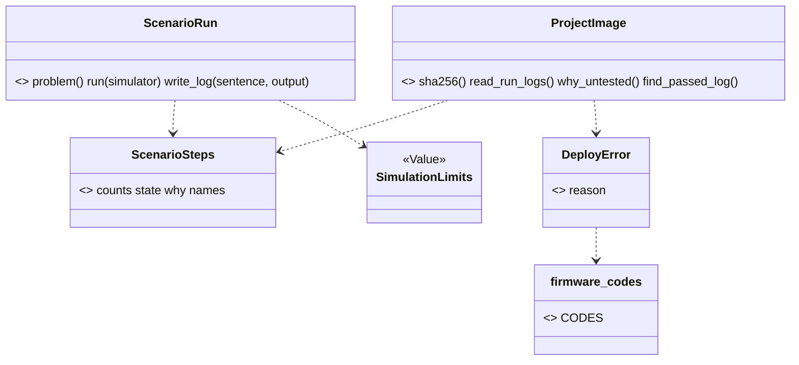

# Wave 6 plan: the other areas, firmware first (P681, #916)

> Pin down what the firmware tools print. Give their refusals codes. Then move the files. Wave 6 moves the eight
> areas that are still flat in `scripts/`, in the order of section 10: firmware, breadboard, checks, design with
> build, records with sourcing. Only firmware is refined here, into three PRs. W6-F1 gives the three firmware CLIs
> a golden net with `fake_wokwi_cli.py`, and no run spends a Wokwi minute. W6-F2 gives their refusals codes, text
> unchanged. W6-F3 is the move: six modules and the stand-ins go into `scripts/spark/firmware/` under the names of
> `areas/firmware.md`, and no module re-exports an old name. W6-F1 starts now. W6-F2 and W6-F3 wait for PR #906 and PR #915 (W5-3a).
> Each later group gets one paragraph. Batching the later moves into fewer PRs is open question 1.

Fable 5.1 wrote this plan on 2026-11-07, against `origin/main` 4e63057e. W5-1 (#914) and W5-2 (#913) are in main.
W5-3a (#915) and W5-3b are stacked on PR #906. Every count below is from that tree. A name marked "proposed" is not in
the code yet, and "est." marks a guess.

## Council

Round 1 (2026-11-07): the refuter on Opus (10 findings, 8 held, 2 rejected: the counts and "no import cycle" hold)
and an architecture lens on Sonnet. What changed:

- A golden child with the shim missing ran the real `wokwi-cli` with the real token: `~/.local/bin` is on PATH,
  `~/.zshrc` exports `WOKWI_CLI_TOKEN`, `golden_bench.child_env` passes every non-`SPARK_*` variable on, and
  `tools.merged` keeps the default `also` list. W6-F1 sets a fake token in the child env, sets `"also": []` on the
  project's entry, and a test asserts the shim is the command found. The mutation row that unset the shim is gone.
  It is risk 1.
- `import_child.py` moved as is adds `X2:scripts/spark/firmware/import_child.py:main:1` (reproduced). W6-F3 renames
  its `main` to `import_one`.
- Sites were missing from W6-F3. `tests/test_import_firmware.py:613` runs `scripts/import_child.py` by path. The
  three stand-ins name their own old path in a sentence (`machine.py:228`, `fallback/framebuf.py:39`,
  `fallback/micropython.py:39`). Tests at lines 138 and 371 assert those sentences.
- W6-F2 breaks 5 mutation rows whose `find` is `reason=board_codes.X` in `project_image.py` (`p239-pr5`,
  `p429-firmware-line`, `p433-bench-codes`). W6-F2 rewrites them and proves them with `--anchors`.
- "W6-F2 touches no file of #906 or #915" was untrue: `scripts/board_codes.py`, `docs/guide/agents/json.md`,
  `commands/deploy.md` and `tests/test_json_contracts.py` are #906's, and `test_json_contracts.py` and
  `golden_bench.py` are #915's. W6-F2 branches from the first main that holds both.
- `needs_person` means the person must use their hands first (`json.md`, line 399). A paid run is consent, not
  hands: the `run-scenario` step carries an `effects` entry that names the spent Wokwi CI minutes (round 2 dropped
  this). `needs_person` stays on the token and install steps (round 2 dropped this too).
- A table maps each name of `run_scenario.py` to its new file.
- Numbers: `emit_board.py` is 1,208 lines, `project_image.py` raises 4 codes at 5 sites, and the 47 import lines
  are those outside the six modules. 5 more sit among them.
- The lens: `--json` for `run_scenario.py` and `flash_image.py` does not serve the bar and is out of W6-F2. When an
  agent needs it, it becomes a card. W6-F2 is codes, text unchanged (round 2 drops the step fields too). Open
  question 2 is gone.
- Batching: a later area's net PR (tests only) can open while a move PR is open. One move PR at a time stays.
- The short version starts with three plain sentences, the diagram is "after W6-F3", and each later group is two
  sentences.

Round 2 (2026-11-07, the refuter on Opus, the changes only): 4 held, 2 rejected (no path to a paid run is left, and
the rest of the W6-F3 list holds). What changed:

- The W6-F1 row "the fake token not set" survived on the PO's machine: `tools/mutate.py:98` hands `os.environ` to
  the run, `child_env` passes it on, and `fake_wokwi_cli.py` never reads `WOKWI_CLI_TOKEN`. The shim now exits
  non-zero unless `WOKWI_CLI_TOKEN` equals the fake value, so the row dies on every machine.
- The W6-F2 row counts are 1 in `p239-pr5`, 1 in `p429-firmware-line` and 3 in `p433-bench-codes`. The 3 swap rows
  of `p433` name `board_codes.X` in `replace` too, so both `find` and `replace` are rewritten, then `--anchors`.
- The step fields had nowhere to show: `import_firmware.py:120` returns `answer(...)` with no `next`, and `--json`
  is dropped. W6-F2 is the codes only, text unchanged. The `effects` entry, the `needs_person` part, their rows and
  closing check 2 are gone. The step fields come with the later `--json` card.
- One more W6-F3 site: `tools/check_commit.py:94` leaves out only paths that start with `scripts/stand_in/`. After the
  move it tests for `stand_in` in the path's parts, as `measure.py:238` does.

PR council (2026-11-07, PR #919: one Sonnet reviewer, the refuter on Opus). What changed:

- W6-F1 opens with a guard line, and the token check lives in the temp-folder shim, not in `fake_wokwi_cli.py`,
  which four places run directly (`test_run_scenario.py:30`, `test_deploy.py:36`, `test_journey_basic.py:51`,
  `golden_bench.py:35` and `:154`).
- One word for one thing: W6-F1 is the golden net, W6-F2 the codes, W6-F3 the move. "Shim" is the wrapper script
  alone, and `fake_wokwi_cli.py` is the fake tool.
- W6-F2's size is one pair, in its section and in Review size.
- W6-F3: the `run_scenario.py` split is its own commit, and the goldens gate each commit.
- Four rows name `board_codes.X` in `replace`, not three: `p429`'s one and `p433`'s three.
- `check_commit.py:94` is in `scripts_size()`, the size line's code count (P99), not the lint.
- The round-1 `effects` bullet says that round 2 dropped it.

## Open questions

Only the PO answers these. Until he does, the plan takes the default.

1. Batching. Decision 4 (epic #94, 2026-10-26, his words in `refactor-plan.md`'s decisions table) asks for one pass
   if it does not take too long, else a continuous version. Once an area's golden net exists, its move is a mechanical PR
   with no new logic. When the files of two areas do not overlap, their moves can share one PR: breadboard with
   checks, and design with build (the page already pairs them). Records with sourcing stays its own PR, because it
   splits `parts.py`. Default: the golden net and the codes stay one PR per area. The moves go in three batches:
   firmware alone, breadboard with checks, design with build. Records with sourcing follows. One move PR is open at a
   time, so a broken main is one revert away. A later area's golden net PR holds tests only, so it can open while a
   move PR is open, in its own worktree.

## What the refactor plan said, and what the tree says

The refactor plan (section 10, "Wave 6") gives each area three PRs and about 900 lines. `areas/firmware.md` names the
target modules. Today:

- Six modules are the firmware's: `flash_image.py` (315 lines), `import_firmware.py` (126), `import_child.py` (87),
  `run_scenario.py` (590), `project_image.py` (128) and `sim_project.py` (410). Together 1,656 lines. Beside them sit
  `stand_in/machine.py` (231) and `stand_in/fallback/` (`framebuf.py`, `micropython.py`, 86 lines), which are not
  spark code. The page does not name `import_child.py`. It is the child program of `import_firmware.py`, run by path
  with `-I`, and moves beside it.
- 26 files outside the six import one of them, in 47 import lines: 11 under `scripts/` (15 lines) and 15 under
  `tests/` (32). 5 more import lines sit among the six (`run_scenario` imports `flash_image` and `sim_project`,
  `project_image` imports all three). No import is lazy. Nine importers are bench files: `deploy_service`, `board_look`, `firmware_platform`,
  `ready_check`, `board_connection`, `image_evidence`, `board_console`, `download_mode` (W5-3a moves all eight) and
  `spark/bench/deploy_image.py`. `check_spine.py` (build) and `onboard_parts.py` import `sim_project`.
- The six import `boards`, `store`, `tools`, `emit_board`, `parts`, `board_codes` and `spark.core`. Firmware reaches
  design, records and core along the arrows of the overview. `sim_project` reaches sourcing (`parts.chip_folder`,
  `CHIP_SOURCE_SUFFIXES`, `definition_path`) through design's arrow. `project_image` imports the bench leaf
  `board_codes` for four `DeployError` reasons at five raise sites: an upward edge. W6-F2 gives those four codes a
  firmware home.
- 228 mutation rows in 34 tables name one of the six by path (`flash_image` 64, `run_scenario` 69, `sim_project` 46,
  `import_firmware` 24, `project_image` 15, `import_child` 10).
- 15 keys of `tests/architecture_baseline.json` hold a firmware path: `R1` for the `main` of `flash_image.py` (36
  lines) and `run_scenario.py` (28), `R6:scripts/run_scenario.py:ScenarioRun`, eight `T1` keys and four `T2` keys.
- Every `print` and `sys.exit` of the three CLIs sits in its `main` or its module tail (checked with `ast`). No
  function of the six is over 40 lines. When each `main` stays in `scripts/`, the library parts move under
  `scripts/spark/` with no new R1 or X2 breach.
- The 25 goldens in `tests/golden/` are all the bench's. `tests/test_json_contracts.py` checks `import_firmware
  --json`. `golden_bench.build_project` already runs `ScenarioRun(...).run(FAKE_WOKWI_CLI)` with
  `tests/fake_wokwi_cli.py`, and `tests/test_run_scenario.py` runs `main` with `tools.find` patched.
- The five test files (`test_flash_image`, `test_import_firmware`, `test_run_scenario`, `test_project_image`,
  `test_sim_project`) hold 3,103 lines. 14 pages under `README.md`, `docs/guide/`, `skills/`, `agents/` and
  `commands/` name a firmware module path, and 182 files in all docs.

## The order, and wave 5's open PRs

W5-3a (#915) moves 18 bench modules. Eight of them import firmware, and W6-F3 rewrites those import lines. W5-3b
renames nothing in a firmware file. So:

1. W6-F1 starts now. It adds files under `tests/` and edits no file of #906 or #915. `tests/golden_bench.py` is
   imported, not edited.
2. W6-F2 edits `scripts/board_codes.py`, `docs/guide/agents/json.md`, `commands/deploy.md` and
   `tests/test_json_contracts.py`, which #906 edits, and `test_json_contracts.py` and `golden_bench.py`, which #915
   edits. So W6-F2 branches from the first main that holds #906 and #915. W6-F3 follows it. If W6-F1 is merged and
   #906 is still open, the reply to the PO names #906 as the one thing the firmware group waits on. Nobody rewrites
   his PR.

After this plan merges, three cards are filed as sub-issues of epic #94, in this Ready order: W6-F1, W6-F2, W6-F3.
When a later group is next, it gets its cards.

## The PRs

### W6-F1, the golden net

Guard, do not skip: every child gets a fake `WOKWI_CLI_TOKEN`, the shim's tools entry sets `"also": []`, and the
shim refuses any other token. The PO allows no paid Wokwi run (2026-10-31).

Goal: what `run_scenario.py`, `flash_image.py` and `import_firmware.py` print today stays what they print, so no
move breaks it. The fake tool is `tests/fake_wokwi_cli.py`, which exists. The shim is the new wrapper script in the
temp folder that the tools layers find and that runs the fake tool.

Files: `tests/golden_firmware.py` (proposed, a helper beside `golden_bench.py`) and `tests/test_golden_firmware.py`.
The helper reuses `golden_bench.build_project`, `child_env`, `scrub` and `replacements_of`. It adds what a child run
of `run_scenario.py` needs that the in-process run did not: a `wokwi-cli` the tools layers find. The project's
`.spark/tools.json` names the simulator with `"kind": "path"`. Its `"exe"` is a shim in the temp folder, and the
shim runs `python3 tests/fake_wokwi_cli.py "$@"`. `tools.find` uses `shutil.which(exe)`, which takes an absolute
path. The entry sets `"also": []`, so `tools.merged` adds no other command for the role. The child env sets
`WOKWI_CLI_TOKEN` to a fake value, because `child_env` passes the parent's variables on and the PO's shell exports the
real token. The shim exits non-zero unless `WOKWI_CLI_TOKEN` equals that fake value. So a child that reaches the shim
with the real token fails its golden, on every machine. The check sits in the shim, not in `fake_wokwi_cli.py`. Four
places run the fake tool directly with no token: `test_run_scenario.py:30`, `test_deploy.py:36`,
`test_journey_basic.py:51`, and `golden_bench.py` at lines 35 and 154. A test asserts that `tools.find("simulator", project)` in the
golden project is the shim. No golden run spends a Wokwi minute (the PO, 2026-10-31: no paid Wokwi runs). The Case is a `namedtuple` of its own:
`golden_bench.Case` without the two canned board files.

Goldens, est. 8 files: `run-scenario-ok.txt`, `run-scenario-problems-never-ready.txt`,
`run-scenario-could-not-run-no-token.txt`, `run-scenario-could-not-run-no-sim.txt`, `flash-image-ok.txt`,
`flash-image-could-not-run-no-interpreter.txt`, `import-firmware-ok.json`, `import-firmware-problems.json` (a
firmware module whose import raises). The scrub replaces the run's paths as the bench's does: `<project-dir>`,
`<spark-home>`, `<repo>` and `<python>`. It also replaces the run log's date and sha256 lines (`golden_bench.CLOCK`
and a sha256 pattern). None of the three CLIs runs through `run_cli`, so a firmware run has no `Privacy`. A path in
the text is a scrubbed path, not a masked one.

Tests: one test per Case, and `SPARK_ACCEPT=run-scenario` writes the goldens from today's output and fails, as the
bench's does. The class takes `needs_littlefs` (`flash_image` imports the `littlefs` package).

Mutation (`p<card>-firmware-net.json`, est. 4 rows). The scrub skipped. A Case's exit code ignored. The sha256
pattern dropped. The fake token not set, so the shim exits non-zero and the golden fails. No row unsets the shim,
because that row runs the real CLI. Proven with `--anchors`, run with `--copy`.

Review: no new product logic. One reviewer on the everyday model and the refuter on the strongest. Size est.: 120
test lines and 8 goldens.

### W6-F2, the codes (after #906 and #915)

Goal: each refusal of the three CLIs has a code. An agent decides on the code (P260). The text lines stay byte-equal
to the W6-F1 goldens, and the exit codes stay.

Files: `scripts/firmware_codes.py` (proposed, a leaf, the shape of `board_codes.py` and `idea_codes.py`: the
constants, then `CODES` with one sentence each). The name is unique under `scripts/` (C1), because
`spark/core/codes.py` exists. `run_scenario.py` and `flash_image.py` keep their text output. Each refusal site
raises or returns with its code, so the code is in the library for the Operation that comes later. The
`import_firmware.py --json` items gain a `code` key. `project_image.py` raises four `DeployError` reasons at five
sites: `NO_SIM_TOML`, `FIRMWARE_LINE_BAD` (twice), `NO_IMAGE` and `LOG_UNREADABLE`. It takes them from
`firmware_codes`. `board_codes` keeps the four names as aliases until W6-F3. In W6-F3 the bench reads them from
firmware. That ends the upward edge. A `--json` for the two text CLIs does not serve the bar today (the lens, round
1). When an agent needs it, it becomes a card.

The codes, est. 16, read from the refusal sites. `run_scenario.py`: `no_token`, `no_sim_project`, `never_ready`,
`step_timeout`, `simulator_lost`, `board_silent`, `simulator_not_started`, `simulator_failed`. `flash_image.py`:
`no_interpreter`, `files_not_folder`, `build_unknown`, `interpreter_damaged`, `tool_missing`. `import_firmware.py`:
`import_failed`, `nothing_to_import`, `import_timeout`. The PR reads each site and reports the real count.

No step fields in this PR. `import_firmware.py:120` returns `answer(...)` with no `next`, and the two text CLIs
print no envelope, so an `effects` entry or `needs_person` has nowhere to show. They come with the later `--json`
card. The refactor plan's "codes and `needs_person`" is read so for firmware.

Tests: in the three existing test files. Each code is asserted as a literal (`test_self_confirmation`, P677 row 26).
Each refusal site names its code. The `import_firmware --json` output is checked against the envelope contract in
`test_json_contracts.py`. The text output of each W6-F1 Case is unchanged. `CODES` names every constant once. Five
mutation rows name `board_codes.X` in `project_image.py`: one in `p239-pr5.json`, one in `p429-firmware-line.json`
and three in `p433-bench-codes.json`. Four of them name it in `replace` too: `p429`'s one and `p433`'s three. Both
`find` and `replace` get the new module name, proven with `--anchors`.

Mutation (`p<card>-firmware-codes.json`, est. 8 rows). A code dropped from an item. Two sites with one code swapped.
`CODES` missing a constant. The text line changed. The exit code changed. The alias in `board_codes` broken.

Docs: `docs/guide/agents/json.md` (the three ops and their codes), `agents.md`, `commands/build.md` and
`commands/deploy.md` where they show the output. Mark the new code `# --- MVP ---`.

Review: it holds logic. The lenses on the everyday model, the refuter on the strongest, one mutation run. Size est.:
80 product lines, 80 test lines, the 8 goldens unchanged.

The build's check of this section (P684, 2026-11-08, rows 8 to 17 of `docs/observations/rows/p684-firmware-codes.md`)
changed three things before any code:

- One code per refusal site, not per cause. A site whose one `except` catches several causes gets one code that names
  what they share: `ScenarioRun.problem()`'s `try` and `flash_image`'s `ToolProblem`. No `try` is split and no reason
  is added to `ToolProblem`. A split is a card when an agent needs to tell the causes apart. The one exception is
  `flash_image`'s bad `--config`, which today shares the damaged interpreter's `except`: it gets its own `except` and
  its own code, because the shared code would be wrong. The PR reports the real count.
- In `import_firmware.py --json`, only a `modules` entry that was not imported gains a `code` key. `problems` and
  `unchecked` stay plain strings, and "nothing to import" and "no `firmware/` folder" keep their codes in the library
  only. So `import-firmware-problems.json` is accepted again with the new key, and the other 7 goldens stay unchanged.
  The test asserts a `code` on each such entry. `import_firmware.py` prints no envelope.
- `firmware_codes` is a leaf, and `board_codes` stays one (U1). `board_codes` keeps its four names, and
  `TOOL_MISSING`, as equal literals, not imports. A test asserts that the five are equal in both modules, and the
  table test that keeps code tables apart lists these five as the one allowed overlap, until W6-F3.
  `firmware_codes` joins `measure.LEAVES` (`tools/measure.py:247`) and `planted_tree.LEAF_NAMES`
  (`tests/planted_tree.py:11`) in the same commit.

The refuter's plan check of this delta (rows 18 to 23) added four things:

- `flash_image.py`'s `except ValueError` (`:303`) catches six "use the build for the board's chip" errors and two
  "damaged" ones, so its code is `interpreter_unusable`, not `interpreter_damaged`. `ScenarioRun.problem()`'s last
  return (`why_outside_sim`, `run_scenario.py:466`) is the same cause as `project_image.py:55`, so it takes
  `FIRMWARE_LINE_BAD`. A `LittleFSError` that escapes `:303` as a traceback is a bug for a card, not this PR, because
  its fix changes the output.
- How a code travels: a refusal that raises gives its exception a `code` attribute. A refusal that returns a sentence
  returns a `Refusal`, a `str` subclass in `firmware_codes` with a `code` attribute. So no return shape changes, and
  the callers in `test_run_scenario.py`, `golden_bench.py:155` and `test_journey_basic.py:262` stay as they are.
- The mutation row "the alias in `board_codes` broken" becomes "a literal in `board_codes` differs from its
  `firmware_codes` twin". `sprint-10-p82-5.json:4` anchors on `flash_image.py`'s `except ToolProblem` print: the
  print stays byte-equal, and the row is proven again with `--anchors`. `json.md:191` names the new key.
- Size est.: 100 product lines, 100 test lines, one golden accepted again.

The second plan check (row 24) added one rule. A `%` format or a `.strip()` turns a `Refusal` back into a plain
`str`, so a site builds its `Refusal` from the final text. Four refusals never pass through a library function: the
missing simulator and the unset token in `run_scenario.main` (`:575`, `:578`), and `no_interpreter` and
`files_not_folder` in `flash_image.main` (`:291`-`:297`). Their codes are named in `main` only in this PR, and they
reach the library with the Operation in W6-F3 or later. The `Refusal` docstring starts with its role word ("Value:"),
as `Interpreter`'s does (R6).

### W6-F3, the firmware move (after #915)

Goal: `ls scripts/*.py` prints no firmware library module. `scripts/spark/firmware/` holds the area under the
names of its page. The three CLIs stay in `scripts/` as a `main` that parses and prints, with no module shim: no
`scripts/run_scenario.py` re-exports a name. Every import, mutation row, baseline key and guide page follows. The
goldens stay byte-equal.

Moves (`git mv`, then the page's names, one commit each, and the goldens run green after each commit). The
`run_scenario.py` split is its own commit. It splits in two.
`spark/firmware/scenario_run.py` holds `ScenarioRun` and the run log writer. `spark/firmware/scenario_steps.py`
holds `ScenarioSteps`, `StepNames`, the step constants, `file_hashes`, `printed_text` and `READY`. The library of
`flash_image.py` becomes `spark/firmware/image_builder.py`. The library of `import_firmware.py` becomes
`spark/firmware/import_probe.py`. `project_image.py`, `sim_project.py` and `stand_in/` move as they are.
`import_child.py` moves, and its `main` becomes `import_one`, because X2 counts a `main` under `scripts/spark/`
(reproduced in round 1). The child is a program run by path, so no caller names that function.

Where each name of `run_scenario.py` goes:

| Name | New file |
|---|---|
| `ScenarioRun`, `run_record`, `verdict`, `image_in`, `with_ready_wait`, `DEFAULT_IMAGE`, `ONE_RUN_MESSAGE`, `PASSED`, `PASSED_WITH_CAVEAT`, `NO_MAIN` | `scenario_run.py` |
| `ScenarioSteps`, `StepNames`, `file_hashes`, `printed_text`, `READY`, `READY_STEP`, `SET_CONTROL` and the other step constants | `scenario_steps.py` |

`scenario_steps.py` imports nothing of firmware, so the bench's imports of `READY`, `printed_text`, `ScenarioSteps`
and `file_hashes` pull no run logic in. `firmware_codes.py` moves in as the area's leaf. `spark/firmware/__init__.py` holds the index docstring
and nothing else: no `OPERATIONS` and no imports, because an `__init__` that imports its modules made the cycles of
wave 5 (P676 rows 4 and 10). The three `sys.path.insert` lines go. The industry words are Move Module and Extract
Module (Fowler, Refactoring, 2nd ed.).

The `__file__` paths that break, each fixed in this PR:

- `import_firmware.STAND_IN` and `CHILD` build `Path(__file__).parent / "stand_in"` and `/ "import_child.py"`.
  Both move into `import_probe.py`, beside the files they name, so the expressions stay. `import_child.STAND_IN_FOLDER`
  stays for the same reason.
- `flash_image.py:225` builds the rerun line with `store.format_rerun_line(Path(__file__), ...)`. In the library
  that names `image_builder.py`, not the CLI a person runs. The CLI passes its own `Path(__file__)` in.
- `tools/check_commit.py:94` leaves out only the paths that start with `scripts/stand_in/`. After the move it tests
  for `stand_in` in the path's parts, as `measure.py:238` does, so the stand-ins stay out of the size line's code
  count (`scripts_size()`, P99).
- `tests/test_import_firmware.py` names `scripts/stand_in/machine.py` (lines 36, 138) and
  `scripts/stand_in/fallback/<module>.py` (371, 382) by path, and line 613 runs `scripts/import_child.py` by path.
  The paths follow the move. `SCRIPT` (line 39) stays, because the CLI stays.
- The three stand-ins name their own path in the sentence they raise (`machine.py:228`, `fallback/framebuf.py:39`,
  `fallback/micropython.py:39`), and the tests at lines 138 and 371 assert it. The sentences say the new path.

What the rules do at the move, checked at 4e63057e:

- R1: no function of the six is over 40 lines, so none breaches the `scripts/spark/` limit. The two `R1` `main` keys
  stay, because the CLIs keep their path. Where the library takes a block, the PR trims that `main` toward 15 lines.
  When a `main` fits, its key goes.
- R6: `ScenarioRun`'s docstring starts with "Service", as the page says, and its key goes.
- X2: every `print` and `sys.exit` sits in the three `main`s, which stay in `scripts/`. So `scripts/spark/firmware/`
  prints nothing. The one X2 hit of the move is `import_child.main`, renamed above.
- T1: the eight keys are rewritten to the new paths. The baseline only shrinks (`test_architecture.py`).
- U1: `firmware_codes` joins `measure.LEAVES`. `project_image` no longer imports `board_codes`, and the bench's
  `image_evidence`, `ready_check`, `board_connection`, `board_console` and `download_mode` import
  `spark.firmware.scenario_steps` for `READY`, `printed_text`, `ScenarioSteps` and `file_hashes`.
- The 47 import lines become `from spark.firmware import <m>` or `from spark.firmware.<m> import ...`.
- The 228 rows move with `python3 tools/mutate.py --retarget scripts/<old>.py scripts/spark/firmware/<new>.py`,
  then `--anchors`. The rows of a function that moved from `run_scenario.py` to `scenario_steps.py` are retargeted
  by hand, and `--anchors` proves each `find` occurs once. No row is dropped. The retargeted tables run once, in
  parallel `--copy` shards, as the PR's one mutation run.

Tests: the five test files keep their names and import from `spark.firmware`. `test_architecture.py` gains the
closing `ls` check. The import-alone test of W5-3a extends to the firmware modules. It imports each one in a child
Python, with `python3 -c`. The page is regenerated with `python3 tools/map.py --write`. `firmware` appears
on it, because the map lists each folder under `scripts/spark/` with an `__init__.py` (P678 row 2).

Docs: the 14 agent-facing pages and `areas/firmware.md` (the file names, `import_child.py`, what waits). The pages
under `docs/discovery/` and `docs/archive/` are history and keep the old paths (`tools/check_docs.py`'s rule).

Not in this PR, with the reason. `SimulationEngine`, `WokwiCliEngine`, `ENGINES`, `RunLog`, `FlashImageBuilder` and
`SimulationEngineContract` are new shapes. Each has one implementation ("No base class with one implementation",
the not-do list). They wait for a second simulator or a second platform. The firmware Operations on `run_cli` wait
for a card of their own, as the bench's did in wave 4.

Review: no new logic. One reviewer on the everyday model and the refuter on the strongest, the retargeted tables as
the one mutation run. A whole-branch review runs before the PR, because it is the group's biggest diff. Size est.:
1,656 lines moved, 52 import lines, 228 rows, 15 baseline keys, 3 `__file__` fixes, 5 path sentences and tests.

P685 claims check (2026-11-08, against 46bca725). Each claim above was read in the code. These are wrong or stale:

1. The split table makes a cycle. `ScenarioSteps.passed_sentence` reads `PASSED`, `PASSED_WITH_CAVEAT` and the caveat
   sentences (`run_scenario.py:363`), and `from_log`, `run_record` and `file_hashes` share `_header` (`:534`).
   Decision: the second module holds the run log's words and their reader, so it is `run_log.py`, not
   `scenario_steps.py`. It holds `ScenarioSteps`, `StepNames`, the step kinds, `READY` and the header lines. It also
   holds the `WHY_*`, `PASSED`, the caveats, `NO_MAIN`, `_header`, `run_record`, `file_hashes` and `printed_text`.
   `scenario_run.py` holds the rest, with `find_simulator` (the table misses it). The docstring and `EPILOG` stay.
2. It is false that the steps module imports nothing of firmware. `from_log` reads `sim_project.WHY_LOG_UNREADABLE`
   (`:316`), and `sim_project` imports `emit_board` and `parts`. Decision: the sentence moves to `run_log.py`, and
   `sim_project.py:184` and `image_evidence.py:23` read it there. `run_log.py` then imports only `spark.core.outcomes`.
3. `project_image.py:52` reads `run_scenario.DEFAULT_IMAGE`. Decision: it moves to `sim_project` beside
   `UNNAMED_FIRMWARE`, so `project_image` never imports `scenario_run`, as the class diagram draws it.
4. No `ready_check` exists. The bench readers are `board_connection`, `board_console`, `download_mode`, `ready_probe`
   and `image_evidence` (also `NO_MAIN`, `ONE_RUN_MESSAGE`, `PASSED`). After 1 to 3, all read `run_log` only.
5. `build_command` (`flash_image.py:233`) is called by `project_image.py:57` and `image_evidence.py:415`, not by the
   CLI. Decision: `image_builder` names the CLI as `deploy_image.py:40` does (`parents[2]`), with a test.
6. `import_one` is taken (`import_firmware.py:70`). Decision: `import_child.main` becomes `import_named` (3 rows).
7. The CLIs keep `sys.path.insert` (`test_scripts_isolated.py:31` runs them with `-I`). Its `EXEMPT` (`:22`) goes.
8. Missed paths: `pyproject.toml:15`, `test_journey_basic.py:55`, `import_firmware.py:13` (help text),
   `tools/measure.py:8`, `tools/mutate.py:48,128` (docstrings) and `test_check_commit.py:98` (a planted path).
9. 15 test files import a firmware module, not five. Six `mock.patch.object` sites patch `run_record` or `subprocess`
   through `run_scenario` (`test_board_look.py:465`, `test_deploy.py:380`, `test_project_image.py:120,143`,
   `test_run_scenario.py:798,804`). Each must patch the module that holds the name now, or it patches nothing. The
   `interpreter_for` patches go to `image_builder`.
10. Counts: 2,087 lines in the files, about 1,900 move. 59 import lines. 267 rows: run_scenario 74, flash_image 68,
    sim_project 46, stand_in 27, import_firmware 25, project_image 15, import_child 10, firmware_codes 2. 11 baseline
    keys name an old path: 2 R1, 1 R6, 8 T1.
11. `--retarget` moves every row of a file, but the CLIs stay. Decision: `--retarget` the 7 files that move whole (100
    rows). 16 rows stay on a CLI path (the three `main`s, `project_here`, `DEFAULT_TIMEOUT_S`, the import_firmware
    docstring). Of run_scenario's other 69, 26 go to `run_log` and 43 to `scenario_run`. 4 rows name a renamed
    module. `--anchors` refuses one `sim_project` row today (`p97-council.json`, "re-check 1"), not this PR's miss.
12. 7 T1 keys move. `T1:scripts/flash_image.py:file-write` (`:329`, in `main`) and the two R1 `main` keys stay. So
    check 5 reads "no key of a moved library names an old path".
13. P684 did U1 (`LEAVES`, `LEAF_NAMES`). `MAY_READ` keys are stems and stay. Risk 5 is stale: no script reads the
    four firmware literals of `board_codes` (`test_json_contracts.py:257` pins them). Decision: they stay, a row asks.
14. 6 guide pages name a moved file, not 14 (`agents/firmware-codes.md`, `agents/scripts.md`, `developing.md`,
    `how-it-works.md`, `journey/firmware.md`, `patterns-and-names.md`). The area page is under `docs/discovery/`.

These claims hold: R1 (the longest is `from_text`, 38 lines) and X2. The goldens run the CLIs by path
(`golden_firmware.py:117`). The bench makes no cycle. `tools/map.py` and `mutate.import_spec` need no change.

### W6-B1, the breadboard golden net

Goal: what `breadboard.py` prints today, and the files it writes beside the sheet, stays what it prints, so the
breadboard codes and the move break nothing. This net is the first of the breadboard group's three PRs.

Nothing is faked, and no run spends anything. `breadboard.py` runs no tool and opens no URL. This was checked: with
`subprocess.run`, `subprocess.Popen`, `urlopen` and `socket.create_connection` set to raise, `main` on
`button-light-xiao` returns 0. `page.html` and its `tsci` export are written by `check_spine.keep_tabbed_page`
(`check_spine.py:894`, `:766`), not by `breadboard.py`. So the paragraph below and `areas/breadboard.md:17` are wrong
to say "tsci faked" and "runs `tsci` for the page". This PR fixes both, `areas/breadboard.md:128` (the same error),
`:17` (it leaves out `breadboard.svg` and `wiring-record.json`), and the stale `tests/fakes.py:137`/`:147` there. Each child gets an empty store, so the sheet's "have" column is blank (the docstring, and
the store was still empty after each probe run). The child env is `golden_bench.child_env` (`tests/golden_bench.py:162`). It drops only `SPARK_*`, so the helper
pops `WOKWI_CLI_TOKEN`, and a test checks that. It passes the bench's canned flash id and device list, which
`breadboard.py` never reads.

The CLI: `breadboard.py requirements.json [--out FILE]`. Exit 0 means the sheet is written. Exit 2 means the run stopped
(`breadboard.py:67`, `:583`). It has no handled exit 1. A renderer that raises still exits 1 with a traceback
(`:548`-`:553`, `:559`-`:563`). Cases, est. 7, each probed on a copy of its fixture in
`tests/data/breadboard/`. Each copy keeps the fixture's folder name, because the sheet's title is that name
(`breadboard.py:451`):

| Golden | Fixture and change | Exit |
|---|---|---|
| `breadboard-ok-xiao.txt` | `button-light-xiao`: the sheet, `breadboard.json` and `breadboard.svg` | 0 |
| `breadboard-ok-firebeetle.txt` | `button-light`: the SVG only, "breadboard.json not written: Wokwi has no part with this board's pins" | 0 |
| `breadboard-ok-not-drawn.txt` | `motor`: no drawing, "nothing says how to draw L9110sModule in Wokwi" | 0 |
| `breadboard-ok-rebuild.txt` | `button-light-xiao`, run, then `button-only-xiao`'s requirements and `dist/` as `test_breadboard_keep.change_requirements` (`:44`) does, run again: `change:` and `not kept:` lines | 0 |
| `breadboard-could-not-run-not-built.txt` | `button-light` without `dist/board/circuit.json` | 2 |
| `breadboard-could-not-run-stale.txt` | `button-light` with `motor`'s `requirements.json` | 2 |
| `breadboard-could-not-run-bad-out.txt` | `button-light`, `--out no/such/x.md` | 2 |

The folder is `tests/golden-breadboard/`. A golden holds stdout, then stderr after `golden_firmware.STDERR_MARK`, then
`breadboard.json`, `breadboard.svg` and `wiring-record.json`, each after `LOG_MARK` with its name. A rebuild's golden
holds only the second run. Reuse, with no copy: `golden_bench.child_env`, `replacements_of`, `scrub`, `op_of` (from
`breadboard.py`, the op is `breadboard`), `check_golden(case, text, golden_dir=GOLDEN_DIR)` and `RUN_TIMEOUT_S`. The
scrub needs nothing new: no output of the probes held a run date or a hash. No Case reaches the `drawing differs:`
line (`:592`-`:593`) or the sheet's matching paragraph: only a mocked `_plan_layout` does, and
`tests/test_breadboard_match.py:126`-`:137` covers both.

Files: `tests/golden_breadboard.py`, `tests/test_golden_breadboard.py`, the 7 goldens,
`tests/mutations/p686-breadboard-net.json`, `docs/observations/rows/p686-breadboard-net.md`, and
`docs/guide/developing.md` beside the firmware lines (`:76`, `:96`). The helper (proposed) holds `CASES`, `run_script`
and a `Case` namedtuple: `golden script fixture argv exit_code plant then`. `golden_bench.py` is imported, not edited, because #915 edits it.

Tests: one test per Case. `SPARK_ACCEPT=breadboard` writes the goldens and fails. A test checks that every golden
has its Case. Another checks that no golden holds a path of this machine. These two repeat `test_golden_firmware.py`,
and a row asks to lift both into `golden_bench` once #915 merges. No `needs_littlefs`.

Mutation (est. 6 rows, proven with `--anchors`, not run in this PR): the scrub is skipped. A Case's exit code is
wrong. The stderr is dropped. The written files are not appended. The rebuild's first run is skipped. One product
row: `breadboard.py` stops printing its `not kept:` lines.

Review: no new product logic. One reviewer on the everyday model, the refuter on the strongest, one mutation run.
Size est.: 110 test lines and 7 goldens.

### W6-C1, the checks golden net

Goal: what the six check CLIs print today stays what they print, so the checks move breaks nothing. Tests only. It
edits no file of #906, #915 or #917.

Guard, do not skip. Only `check_vendor_pins.py` starts a child, `gh` (`check_vendor_pins.py:68`), and only without
`--offline`. The vendor-truth check of `check_all.py` reads offline (`check_all.py:256`). So `gh` is faked. A shim
named `gh` is W6-F1's shape: `#!/bin/sh`, then `exec` of the absolute `sys.executable` on `tests/fake_gh.py`
(proposed, the shape of `fake_wokwi_cli.py`). A bare `python3` fails on a `PATH` this short. The fake prints spark's kept header
(`.spark/cache/dfrobot_firebeetle2_esp32s3.pins_arduino.h`) in base64. A Case can change one pin in it. A Case can
also give an exit code, and then the fake fails. The child's `PATH` is the shim's folder alone. A test asserts that
it equals that folder and that the `gh` found on it is the shim. Why alone: in a probe for this plan, the interpreter of a shim did not start.
The search went on, and the real `gh` ran (a free public read). No Case runs `wokwi-cli`, KiCad or `tsci`. The six
call no `urlopen`, but `store.fetch` (`store.py:400`) can be reached through `boards.py`. So every child sets
`http_proxy`, `https_proxy`, `HTTP_PROXY` and `HTTPS_PROXY` to `http://127.0.0.1:9` and has no `WOKWI_CLI_TOKEN`, and
a test checks the child env. The live Cases check a board file copied into the project. So the header is kept in the
project's cache, not in spark's (`project_header`, `check_vendor_pins.py:117`). A test asserts that spark's cache is
unchanged.

The project: `build_project` (proposed) copies `tests/data/breadboard/button-light`, which holds a built
`dist/board/circuit.json`. It runs `init_project.py --board firebeetle2-esp32s3 --circuit dist/board/circuit.json`
as a child with its own store. It also writes `floating-rules.json`: the same rules with `pulled_by_firmware` empty.

Cases, est. 17. Each golden is `<op>-<name>`, and each exit code was seen in a probe run, except the one marked "read":
- `check-all`: `ok.txt` (rules removed, 0), `problems-floating-input.json` (`--rules floating-rules.json`, 1),
  `could-not-run.txt` (physics cannot assess the LED's series resistor, 2).
- `check-physics`: `could-not-run.txt` (2), `could-not-run-no-rules.json` (2, read: `check_physics.py:637-641`). No
  ok Case: run alone, physics reads no part records, so the LED's resistor cannot clear (`check_physics.py:629-630`).
- `check-footprints`: `ok.json` (0), `could-not-run-no-circuit.txt` (2).
- `compare-design`: `ok.json` (0), `problems-floating-input.txt` (1), `could-not-run-no-rules.txt` (2).
- `check-bom`: `ok.txt` (0), `problems-no-supplier-part.txt` (1), `could-not-run-no-package.txt` (2). The two zips
  are planted as bytes.
- `check-vendor-pins`: `ok-offline.txt` (spark's kept header, 0), `ok-live.json` (0), `problems-mismatch.txt` (1),
  `could-not-run-fetch-failed.txt` (2).

Folder: `tests/golden-checks/`. Files: `tests/golden_checks.py` (proposed, the helper) and
`tests/test_golden_checks.py`. Reuse, no copy: `golden_bench.op_of`, `scrub`, `replacements_of`, `RUN_TIMEOUT_S` and
`check_golden(golden_dir=...)`, and `golden_firmware.Case`, `plant` and `run_script`. Two small changes go into
`golden_firmware.py`: `plant` writes bytes as bytes, and `run_script` takes the child's `env` (the checks' env: no
token, the proxies, the shim's `PATH`). `golden_bench.py` is not edited, because #915 edits it. None of the six runs through `run_cli`, so a path in
the text is scrubbed, not masked.

Tests: one test per Case. `SPARK_ACCEPT=<op>` writes that op's goldens and fails. No golden holds a path of this
machine, and every golden has its Case. The guard tests are above. No `needs_littlefs`.

Mutation (`p687-checks-net.json`, 9 rows as built). The scrub skipped. A Case's exit code wrong. The proxies not set (the
child env test). The fake `gh` ignores its exit code. `floating-rules.json` keeps `pulled_by_firmware`. The child's `PATH` keeps
another folder. The token or `no_proxy` reaches the child. Planted bytes are written as text. Proven
with `--anchors`, run with `--copy` in parallel shards.

Not pinned, rows for the PR's rows file and proposed cards. `check_vendor_pins.py` on a missing board file ends in a
traceback with exit 1, which reads as a mismatch (`:204`). `check_bom.py` on a zip with no `bom.csv` exits 1 by
`SystemExit` (`:58`). For a missing circuit, `check_footprints.py --json` prints text (`:561-563`).

Review: no new product logic. One reviewer on the everyday model and the refuter on the strongest. Size est.: 110
helper lines, 110 test lines, 20 lines of the fake, 17 goldens.

## The later groups

Each group follows the same three PRs. The order is the plan's. Open question 1 says which moves share a PR.

**Breadboard** (9 modules, 2,324 lines). The nine move into `spark/breadboard/` under the page's names, after a
golden of `breadboard.py` (W6-B1, it runs no tool) and a `breadboard_codes.py`. Done: `ls scripts/breadboard*.py` prints
only `breadboard.py`, and the goldens hold (est. three PRs of 150, 150 and 2,300 moved lines).

**Checks** (6 CLIs, 2,585 lines). After goldens of the six with `gh` faked and one `check_codes.py`, the five
`*Check` classes and `CheckService` move into `spark/checks/`. Done: `check_all.py` runs the five through `CHECKS`,
and the goldens hold (est. three PRs of 150, 200 and 2,600 moved lines). C1 refuses the page's `checks/codes.py`
beside `spark/core/codes.py`.

**Design with build** (15 modules, 6,075 lines, `emit_board.py` alone 1,208). The move brings the `board-list`
and `audit` Operations (N19), and `BuildService` with six `BuildStage`s replaces `check_spine.run`. Done: the spine
calls `BoardEmitter` in process, and `ImpossibleError` is in the code (est. three PRs of 200, 250 and 6,000 moved
lines, the biggest of the wave).

**Records with sourcing** (13 modules, 5,949 lines). The move brings P391's stage 2 classes, `Brief`, `ToolFinder`,
the two bench leaves and the `parts.py` split by job group. Done: `parts.py` imports its Operation modules at the
top, and the eight lazy edges of section 5 are gone (est. three PRs of 200, 250 and 6,000 moved lines).

## Firmware after W6-F3 (partial: the moved modules and their classes)

`ScenarioRun` (`scenario_run.py`), `ScenarioSteps` (`scenario_steps.py`), `ProjectImage` and `DeployError`
(`project_image.py`) and `SimulationLimits` (`sim_project.py`) exist today. `image_builder.py` and
`import_probe.py` hold functions, not classes, and stay so until a second platform asks for `FlashImageBuilder`. The
bench reaches `scenario_steps` and `project_image` along its arrow, and nothing in firmware imports the bench.

## The checks that close the firmware group

1. `tests/golden/` holds the firmware goldens, and the three CLIs print byte-equal text through W6-F2 and W6-F3.
2. Every refusal of the three CLIs has a code that `firmware_codes.CODES` names (W6-F2, tests).
3. `ls scripts/*.py` names no firmware library module, and `scripts/spark/firmware/__init__.py` imports nothing
   (W6-F3, a test).
4. Each moved module imports alone in a child Python (W6-F3, a test).
5. The baseline has no key with an old firmware path, and the `R6` key is gone. No row is dropped (W6-F3).
6. `tests/test_map.py` passes on the committed `docs/guide/map.md` with a `firmware` section (W6-F3).

## Risks

1. A golden child runs the real `wokwi-cli` with the real token and spends a paid minute. The real CLI is on the
   PO's PATH, his shell exports `WOKWI_CLI_TOKEN`, and `child_env` passes it on. W6-F1 sets a fake token in every
   child, sets `"also": []`, and a test asserts the shim is the command found. The shim refuses any other token. No
   mutation row unsets the shim.
2. #906 merges late. W6-F2 and W6-F3 wait, and W6-F1 does not. Breadboard's net can start.
3. The split of `run_scenario.py` moves functions to two files, so `--retarget` cannot move all 69 rows. The rest are
   retargeted by hand, and `--anchors` catches a miss before the run.
4. A `wokwi-cli` shim on the tools list is new ground for the goldens. If `tools.find` refuses an absolute `exe`, the
   shim goes on the child's `PATH` instead.
5. `board_codes` keeps four aliases for one PR. A test pins that each equals its `firmware_codes` twin until W6-F3
   removes them.

## Review size

- W6-F1: about 120 test lines and 8 goldens, no product logic. One reviewer on the everyday model, the refuter on the
  strongest, one mutation run of est. 4 rows.
- W6-F2: about 80 product lines and 80 test lines. It holds logic: the lenses on the everyday model, the refuter on
  the strongest, one mutation run of est. 8 rows.
- W6-F3: 1,656 lines moved, 52 import lines, 228 rows, 15 keys, no new logic. One reviewer on the everyday model, the
  refuter on the strongest, the retargeted tables as the one mutation run, and a whole-branch review before the PR.
