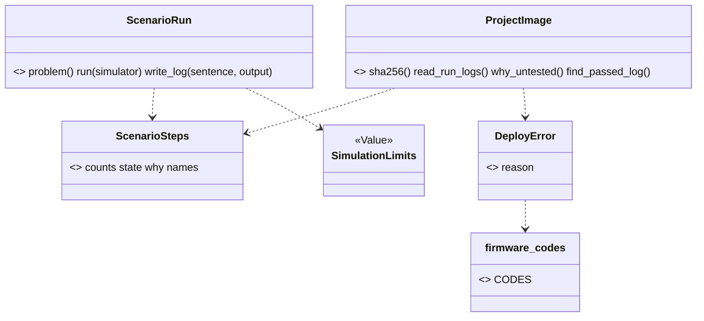

# Wave 6 plan: the other areas, firmware first (P681, #916)

> Wave 6 moves the eight areas that are still flat in `scripts/`, in the order of section 10: firmware, breadboard,
> checks, design with build, records with sourcing. Only firmware is refined here, into three PRs. W6-F1 gives the
> three firmware CLIs goldens with the fake `wokwi-cli`. W6-F2 gives their output codes and `needs_person`. W6-F3
> moves six modules and the stand-ins into `scripts/spark/firmware/` under the names of `areas/firmware.md`, with no
> module shim. W6-F1 and W6-F2 start now. W6-F3 waits for PR #915 (W5-3a), which moves nine files that import firmware.
> Each later group gets one paragraph. Batching the later moves into fewer PRs is open question 1.

Fable 5.1 wrote this plan on 2026-11-07, against `origin/main` 4e63057e. W5-1 (#914) and W5-2 (#913) are in main.
W5-3a (#915) and W5-3b are stacked on PR #906. Every count below is from that tree. A name marked "proposed" is not in
the code yet, and "est." marks a guess.

## Council

(filled after the council)

## Open questions

Only the PO answers these. Until he does, the plan takes the default.

1. Batching. Decision 4 (epic #94, 2026-10-26, his words in `refactor-plan.md`'s decisions table) asks for one pass
   if it does not take too long, else a continuous version. Once an area's net exists, its move is a mechanical PR
   with no new logic. When the files of two areas do not overlap, their moves can share one PR: breadboard with
   checks, and design with build (the page already pairs them). Records with sourcing stays its own PR, because it
   splits `parts.py`. Default: nets and output slices stay one PR per area. The moves go in three batches: firmware
   alone, breadboard with checks, design with build. Records with sourcing follows. One move PR is open at a time,
   so a broken main is one revert away.
2. `run_scenario.py` and `flash_image.py` print text only today, and `import_firmware.py` has `--json`. A code needs
   a JSON item to sit in. Default: W6-F2 gives both CLIs a `--json` envelope (`outcomes.envelope`), and their text
   output stays byte-equal to W6-F1's goldens. Both are additive. The agent pages then read a code, not a sentence
   (no magic strings, P260).

## What the refactor plan said, and what the tree says

The refactor plan (section 10, "Wave 6") gives each area three PRs and about 900 lines. `areas/firmware.md` names the
target modules. Today:

- Six modules are the firmware's: `flash_image.py` (315 lines), `import_firmware.py` (126), `import_child.py` (87),
  `run_scenario.py` (590), `project_image.py` (128) and `sim_project.py` (410). Together 1,656 lines. Beside them sit
  `stand_in/machine.py` (231) and `stand_in/fallback/` (`framebuf.py`, `micropython.py`, 86 lines), which are not
  spark code. The page does not name `import_child.py`. It is the child program of `import_firmware.py`, run by path
  with `-I`, and moves beside it.
- 26 files import one of the six, in 47 import lines: 11 under `scripts/` (15 lines) and 15 under `tests/` (32).
  No import is lazy. Nine importers are bench files: `deploy_service`, `board_look`, `firmware_platform`,
  `ready_check`, `board_connection`, `image_evidence`, `board_console`, `download_mode` (W5-3a moves all eight) and
  `spark/bench/deploy_image.py`. `check_spine.py` (build) and `onboard_parts.py` import `sim_project`.
- The six import `boards`, `store`, `tools`, `emit_board`, `parts`, `board_codes` and `spark.core`. Firmware reaches
  design, records and core along the arrows of the overview. `sim_project` reaches sourcing (`parts.chip_folder`,
  `CHIP_SOURCE_SUFFIXES`, `definition_path`) through design's arrow. `project_image` imports the bench leaf
  `board_codes` for five `DeployError` reasons: an upward edge. W6-F2 gives those five codes a firmware home.
- 228 mutation rows in 34 tables name one of the six by path (`flash_image` 64, `run_scenario` 69, `sim_project` 46,
  `import_firmware` 24, `project_image` 15, `import_child` 10).
- 15 keys of `tests/architecture_baseline.json` hold a firmware path: `R1` for the `main` of `flash_image.py` (36
  lines) and `run_scenario.py` (28), `R6:scripts/run_scenario.py:ScenarioRun`, eight `T1` keys and four `T2` keys.
- Every `print` and `sys.exit` of the three CLIs sits in its `main` or its module tail (checked with `ast`). No
  function of the six is over 40 lines. When each `main` stays in `scripts/`, the library parts move under
  `scripts/spark/` with no new R1 or X2 breach.
- The 25 goldens in `tests/golden/` are all the bench's. `tests/test_json_contracts.py` checks `import_firmware
  --json`. `golden_bench.build_project` already runs `ScenarioRun(...).run(FAKE_WOKWI_CLI)` with
  `tests/fake_wokwi_cli.py`, and `tests/test_run_scenario.py` runs `main` with `tools.find` patched.
- The five test files (`test_flash_image`, `test_import_firmware`, `test_run_scenario`, `test_project_image`,
  `test_sim_project`) hold 3,103 lines. 14 pages under `README.md`, `docs/guide/`, `skills/`, `agents/` and
  `commands/` name a firmware module path, and 182 files in all docs.

## The order, and wave 5's open PRs

W5-3a (#915) moves 18 bench modules. Eight of them import firmware, and W6-F3 rewrites those import lines. W5-3b
renames nothing in a firmware file. So:

1. W6-F1 and W6-F2 start now, in one worktree, one after the other. W6-F1 adds files under `tests/` and edits no
   module W5-3a moves. W6-F2 edits the three CLIs, `project_image.py` and a new leaf, none of which W5-3a touches.
   `tests/golden_bench.py` is imported, not edited.
2. W6-F3 branches from the first main that holds #915. If W6-F2 is merged and #906 is still open, the reply to the PO
   names #906 as the one thing the firmware move waits on. Nobody rewrites his PR.

After this plan merges, three cards are filed as sub-issues of epic #94, in this Ready order: W6-F1, W6-F2, W6-F3.
When a later group is next, it gets its cards.

## The PRs

### W6-F1, the firmware net (goldens)

Goal: what `run_scenario.py`, `flash_image.py` and `import_firmware.py` print today stays what they print, so no
move breaks it. The fake tool process is `tests/fake_wokwi_cli.py`, which exists.

Files: `tests/golden_firmware.py` (proposed, a helper beside `golden_bench.py`) and `tests/test_golden_firmware.py`.
The helper reuses `golden_bench.build_project`, `child_env`, `scrub` and `replacements_of`. It adds what a child run
of `run_scenario.py` needs that the in-process run did not: a `wokwi-cli` the tools layers find. The project's
`.spark/tools.json` names the simulator with `"kind": "path"`. Its `"exe"` is a shim in the temp folder, and the
shim runs `python3 tests/fake_wokwi_cli.py "$@"`. `tools.find` uses `shutil.which(exe)`, which takes an absolute
path. The Case is a `namedtuple` of its own: `golden_bench.Case` without the two canned board files.

Goldens, est. 8 files: `run-scenario-ok.txt`, `run-scenario-problems-never-ready.txt`,
`run-scenario-could-not-run-no-token.txt`, `run-scenario-could-not-run-no-sim.txt`, `flash-image-ok.txt`,
`flash-image-could-not-run-no-interpreter.txt`, `import-firmware-ok.json`, `import-firmware-problems.json` (a
firmware module whose import raises). The scrub replaces the run's paths as the bench's does: `<project-dir>`,
`<spark-home>`, `<repo>` and `<python>`. It also replaces the run log's date and sha256 lines (`golden_bench.CLOCK`
and a sha256 pattern). None of the three CLIs runs through `run_cli`, so a firmware run has no `Privacy`. A path in
the text is a scrubbed path, not a masked one.

Tests: one test per Case, and `SPARK_ACCEPT=run-scenario` writes the goldens from today's output and fails, as the
bench's does. The class takes `needs_littlefs` (`flash_image` imports the `littlefs` package).

Mutation (`p<card>-firmware-net.json`, est. 4 rows): the scrub skipped, a Case's exit code ignored, the sha256
pattern dropped, the shim not on the tools list. Proven with `--anchors`, run with `--copy`.

Review: no new product logic. One reviewer on the everyday model and the refuter on the strongest. Size est.: 120
test lines and 8 goldens.

### W6-F2, the firmware output slice (codes and `needs_person`)

Goal: each problem the three CLIs report carries a code, and each next step a person must take says so. An agent
decides on the code (P260). The text lines stay byte-equal to the W6-F1 goldens, and the exit codes stay.

Files: `scripts/firmware_codes.py` (proposed, a leaf, the shape of `board_codes.py` and `idea_codes.py`: the
constants, then `CODES` with one sentence each). The name is unique under `scripts/` (C1), because
`spark/core/codes.py` exists. `run_scenario.py` and `flash_image.py` gain `--json` (open question 2). Each prints
`outcomes.envelope(...)`. Its `problems` items carry a code, and its `next` step is built with `outcomes.step`.
`import_firmware.py` already prints `answer(...)`, and its items gain codes. `project_image.py` raises four
`DeployError` reasons: `NO_SIM_TOML`, `FIRMWARE_LINE_BAD`, `NO_IMAGE` and `LOG_UNREADABLE`. It takes them from
`firmware_codes`. `board_codes` keeps the four names as aliases until W6-F3. In W6-F3 the bench reads them from
firmware. That ends the upward edge.

The codes, est. 16, read from the refusal sites. `run_scenario.py`: `no_token`, `no_sim_project`, `never_ready`,
`step_timeout`, `simulator_lost`, `board_silent`, `simulator_not_started`, `simulator_failed`. `flash_image.py`:
`no_interpreter`, `files_not_folder`, `build_unknown`, `interpreter_damaged`, `tool_missing`. `import_firmware.py`:
`import_failed`, `nothing_to_import`, `import_timeout`. The PR reads each site and reports the real count.

`needs_person` (`outcomes.step`, `result.py`): the next step after a passed `flash-image` is `run-scenario`, which
spends Wokwi minutes, so it carries `needs_person: true` (`commands/build.md`: "Ask the person before each run"). The
step that asks for a token (`WOKWI_CLI_TOKEN`) or an install (`/spark:setup`) carries it too. A step an agent can
take alone carries none.

Tests: in the three existing test files. Each code is asserted as a literal (`test_self_confirmation`, P677 row 26).
Each refusal site names its code. The `--json` output is checked against the envelope contract in
`test_json_contracts.py`. The text output of each W6-F1 Case is unchanged. `CODES` names every constant once.

Mutation (`p<card>-firmware-codes.json`, est. 10 rows). A code dropped from an item. Two sites with one code
swapped. `needs_person` dropped from the paid step. `CODES` missing a constant. The text line changed. The exit code
changed. The alias in `board_codes` broken.

Docs: `docs/guide/agents/json.md` (the three ops and their codes), `agents.md`, `commands/build.md` and
`commands/deploy.md` where they show the output. Mark the new code `# --- MVP ---`.

Review: it holds logic. The lenses on the everyday model, the refuter on the strongest, one mutation run. Size est.:
150 product lines, 120 test lines, the 8 goldens unchanged.

### W6-F3, the firmware move (after #915)

Goal: `ls scripts/*.py` prints no firmware library module. `scripts/spark/firmware/` holds the area under the
names of its page. The three CLIs stay in `scripts/` as a `main` that parses and prints, with no module shim: no
`scripts/run_scenario.py` re-exports a name. Every import, mutation row, baseline key and guide page follows. The
goldens stay byte-equal.

Moves (`git mv`, then the page's names, one commit each). `run_scenario.py` splits in two.
`spark/firmware/scenario_run.py` holds `ScenarioRun` and the run log writer. `spark/firmware/scenario_steps.py`
holds `ScenarioSteps`, `StepNames`, the step constants, `file_hashes`, `printed_text` and `READY`. The library of
`flash_image.py` becomes `spark/firmware/image_builder.py`. The library of `import_firmware.py` becomes
`spark/firmware/import_probe.py`. `import_child.py`, `project_image.py`, `sim_project.py` and `stand_in/` move as
they are. `firmware_codes.py` moves in as the area's leaf. `spark/firmware/__init__.py` holds the index docstring
and nothing else: no `OPERATIONS` and no imports, because an `__init__` that imports its modules made the cycles of
wave 5 (P676 rows 4 and 10). The three `sys.path.insert` lines go. The industry words are Move Module and Extract
Module (Fowler, Refactoring, 2nd ed.).

The `__file__` paths that break, each fixed in this PR:

- `import_firmware.STAND_IN` and `CHILD` build `Path(__file__).parent / "stand_in"` and `/ "import_child.py"`.
  Both move into `import_probe.py`, beside the files they name, so the expressions stay. `import_child.STAND_IN_FOLDER`
  stays for the same reason.
- `flash_image.py:225` builds the rerun line with `store.format_rerun_line(Path(__file__), ...)`. In the library
  that names `image_builder.py`, not the CLI a person runs. The CLI passes its own `Path(__file__)` in.
- `tests/test_import_firmware.py` names `scripts/stand_in/machine.py` (lines 36, 138) and
  `scripts/stand_in/fallback/<module>.py` (371, 382) by path. The paths follow the move. `SCRIPT` (line 39) stays,
  because the CLI stays.

What the rules do at the move, checked at 4e63057e:

- R1: no function of the six is over 40 lines, so none breaches the `scripts/spark/` limit. The two `R1` `main` keys
  stay, because the CLIs keep their path. Where the library takes a block, the PR trims that `main` toward 15 lines.
  When a `main` fits, its key goes.
- R6: `ScenarioRun`'s docstring starts with "Service", as the page says, and its key goes.
- X2: every `print` and `sys.exit` sits in the three `main`s, which stay in `scripts/`. So `scripts/spark/firmware/`
  prints nothing.
- T1: the eight keys are rewritten to the new paths. The baseline only shrinks (`test_architecture.py`).
- U1: `firmware_codes` joins `measure.LEAVES`. `project_image` no longer imports `board_codes`, and the bench's
  `image_evidence`, `ready_check`, `board_connection`, `board_console` and `download_mode` import
  `spark.firmware.scenario_steps` for `READY`, `printed_text`, `ScenarioSteps` and `file_hashes`.
- The 47 import lines become `from spark.firmware import <m>` or `from spark.firmware.<m> import ...`.
- The 228 rows move with `python3 tools/mutate.py --retarget scripts/<old>.py scripts/spark/firmware/<new>.py`,
  then `--anchors`. The rows of a function that moved from `run_scenario.py` to `scenario_steps.py` are retargeted
  by hand, and `--anchors` proves each `find` occurs once. No row is dropped. The retargeted tables run once, in
  parallel `--copy` shards, as the PR's one mutation run.

Tests: the five test files keep their names and import from `spark.firmware`. `test_architecture.py` gains the
closing `ls` check. The import-alone test of W5-3a extends to the firmware modules. It imports each one in a child
Python, with `python3 -c`. The page is regenerated with `python3 tools/map.py --write`. `firmware` appears
on it, because the map lists each folder under `scripts/spark/` with an `__init__.py` (P678 row 2).

Docs: the 14 agent-facing pages and `areas/firmware.md` (the file names, `import_child.py`, what waits). The pages
under `docs/discovery/` and `docs/archive/` are history and keep the old paths (`tools/check_docs.py`'s rule).

Not in this PR, with the reason. `SimulationEngine`, `WokwiCliEngine`, `ENGINES`, `RunLog`, `FlashImageBuilder` and
`SimulationEngineContract` are new shapes. Each has one implementation ("No base class with one implementation",
the not-do list). They wait for a second simulator or a second platform. The firmware Operations on `run_cli` wait
for a card of their own, as the bench's did in wave 4.

Review: no new logic. One reviewer on the everyday model and the refuter on the strongest, the retargeted tables as
the one mutation run. A whole-branch review runs before the PR, because it is the group's biggest diff. Size est.:
1,656 lines moved, 47 import lines, 228 rows, 15 baseline keys, 3 `__file__` fixes.

## The later groups

Each group follows the same three PRs. The order is the plan's. Open question 1 says which moves share a PR.

**Breadboard** (9 modules, 2,324 lines). Net: goldens of `breadboard.py` on a built fixture, with `tsci` faked as a
process. Output slice: `breadboard_codes.py`. Move: into `spark/breadboard/` under the page's names. They are
`wiring_steps`, `drawing`, `kept_moves`, `bench_changes`, `drawing_match`, `sheet`, `part_pictures` and
`tabbed_page`, with `NotBuiltError` and `NotDrawnError`. Done: `ls scripts/breadboard*.py` prints only
`breadboard.py`, and the goldens hold. Est. three PRs of 150, 150 and 2,300 moved lines.

**Checks** (6 CLIs, 2,585 lines). Net: goldens of the six on one fixture, `gh` faked for `check_vendor_pins`.
Output slice: one `check_codes.py` (the page says `checks/codes.py`, which C1 refuses beside `spark/core/codes.py`).
Move: the five `*Check` classes and `CheckService` into `spark/checks/`. Done: `check_all.py` runs the five
through `CHECKS`, and the goldens hold. Est. three PRs of 150, 200 and 2,600 moved lines.

**Design with build** (15 modules, 6,043 lines, `emit_board.py` alone 1,176). Net: the build's `check_spine.py`
already has `tests/test_journey_basic.py`. Goldens of `assign_pins.py`, `emit_board.py` and `parts.py --audit`
are added. Output slice: `design_codes.py` and `build_codes.py`, `RefusedInput` codes among them. Move: `loader`,
`pin_assigner`, and `board_emitter` with `footprint_stop` and the `board-list` and `audit` Operations (N19). Then
`BuildService` and the six `BuildStage`s replace `check_spine.run`. Done: the spine calls `BoardEmitter` in
process, and `ImpossibleError` is in the code (section 3). Est. three PRs of 200, 250 and 6,000 moved lines, the
biggest of the wave.

**Records with sourcing** (13 modules, 5,949 lines, `parts.py` split by the pruning list's job groups). Net: goldens
of `boards.py`, `tools.py --status` and the `parts.py` ops a command page pins (decision 5 keeps their spellings).
Output slice: codes for the two. Move: P391's stage 2, which is `RecordKind`, `RecordFinder`, `Record` and
`ShelveRecord`. With it move `deploy_record_store.py`, `Brief`, `ToolFinder` and the two bench leaves `board_codes`
and `board_pads`. The section 3 renames in `board_records.py` land here. `Retriever` comes only with a second
source. Done: `parts.py` imports its Operation modules at the top, and the eight lazy edges of section 5 are gone.
Est. three PRs of 200, 250 and 6,000 moved lines. It goes last, because every other area imports records.

## Firmware after wave 6 (partial: the moved modules and their classes)

`ScenarioRun` (`scenario_run.py`), `ScenarioSteps` (`scenario_steps.py`), `ProjectImage` and `DeployError`
(`project_image.py`) and `SimulationLimits` (`sim_project.py`) exist today. `image_builder.py` and
`import_probe.py` hold functions, not classes, and stay so until a second platform asks for `FlashImageBuilder`. The
bench reaches `scenario_steps` and `project_image` along its arrow, and nothing in firmware imports the bench.

## The checks that close the firmware group

1. `tests/golden/` holds the firmware goldens, and the three CLIs print byte-equal text through W6-F2 and W6-F3.
2. Every `problems` item of the three CLIs carries a code that `firmware_codes.CODES` names, and the paid step carries
   `needs_person: true` (W6-F2, tests).
3. `ls scripts/*.py` names no firmware library module, and `scripts/spark/firmware/__init__.py` imports nothing
   (W6-F3, a test).
4. Each moved module imports alone in a child Python (W6-F3, a test).
5. The baseline has no key with an old firmware path, and the `R6` key is gone. No row is dropped (W6-F3).
6. `tests/test_map.py` passes on the committed `docs/guide/map.md` with a `firmware` section (W6-F3).

## Risks

1. #906 merges late. W6-F3 waits, and nothing else in the firmware group does. Breadboard's net can start.
2. The `--json` of two CLIs is a public addition (open question 2). It costs two command pages and the json guide.
3. The split of `run_scenario.py` moves functions to two files, so `--retarget` cannot move all 69 rows. The rest are
   retargeted by hand, and `--anchors` catches a miss before the run.
4. A `wokwi-cli` shim on the tools list is new ground for the goldens. If `tools.find` refuses an absolute `exe`, the
   shim goes on the child's `PATH` instead.
5. `board_codes` keeps four aliases for one PR. A test pins that each equals its `firmware_codes` twin until W6-F3
   removes them.

## Review size

- W6-F1: about 120 test lines and 8 goldens, no product logic. One reviewer on the everyday model, the refuter on the
  strongest, one mutation run of est. 4 rows.
- W6-F2: about 150 product lines and 120 test lines. It holds logic: the lenses on the everyday model, the refuter on
  the strongest, one mutation run of est. 10 rows.
- W6-F3: 1,656 lines moved, 47 import lines, 228 rows, 15 keys, no new logic. One reviewer on the everyday model, the
  refuter on the strongest, the retargeted tables as the one mutation run, and a whole-branch review before the PR.
