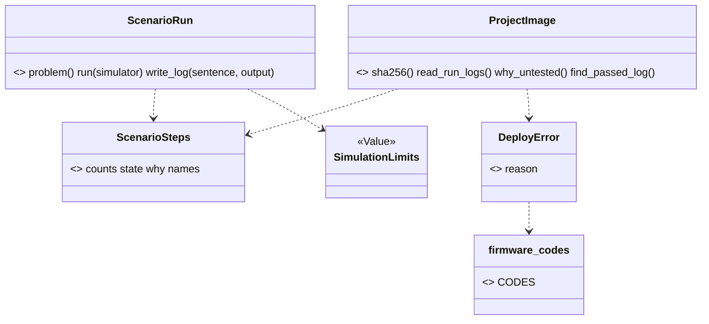

# Wave 6 plan: the other areas, firmware first (P681, #916)

> Pin down what the firmware tools print. Give their refusals codes. Then move the files. Wave 6 moves the eight
> areas that are still flat in `scripts/`, in the order of section 10: firmware, breadboard, checks, design with
> build, records with sourcing. Only firmware is refined here, into three PRs. W6-F1 gives the three firmware CLIs
> goldens with the fake `wokwi-cli`, and no run spends a Wokwi minute. W6-F2 gives their refusals codes, and the paid
> step names its cost. W6-F3 moves six modules and the stand-ins into `scripts/spark/firmware/` under the names of
> `areas/firmware.md`, with no module shim. W6-F1 starts now. W6-F2 and W6-F3 wait for PR #906 and PR #915 (W5-3a).
> Each later group gets one paragraph. Batching the later moves into fewer PRs is open question 1.

Fable 5.1 wrote this plan on 2026-11-07, against `origin/main` 4e63057e. W5-1 (#914) and W5-2 (#913) are in main.
W5-3a (#915) and W5-3b are stacked on PR #906. Every count below is from that tree. A name marked "proposed" is not in
the code yet, and "est." marks a guess.

## Council

Round 1 (2026-11-07): the refuter on Opus (10 findings, 8 held, 2 rejected: the counts and "no import cycle" hold)
and an architecture lens on Sonnet. What changed:

- A golden child with the shim missing ran the real `wokwi-cli` with the real token: `~/.local/bin` is on PATH,
  `~/.zshrc` exports `WOKWI_CLI_TOKEN`, `golden_bench.child_env` passes every non-`SPARK_*` variable on, and
  `tools.merged` keeps the default `also` list. W6-F1 sets a fake token in the child env, sets `"also": []` on the
  project's entry, and a test asserts the shim is the command found. The mutation row that unset the shim is gone.
  It is risk 1.
- `import_child.py` moved as is adds `X2:scripts/spark/firmware/import_child.py:main:1` (reproduced). W6-F3 renames
  its `main` to `import_one`.
- Sites were missing from W6-F3. `tests/test_import_firmware.py:613` runs `scripts/import_child.py` by path. The
  three stand-ins name their own old path in a sentence (`machine.py:228`, `fallback/framebuf.py:39`,
  `fallback/micropython.py:39`). Tests at lines 138 and 371 assert those sentences.
- W6-F2 breaks 5 mutation rows whose `find` is `reason=board_codes.X` in `project_image.py` (`p239-pr5`,
  `p429-firmware-line`, `p433-bench-codes`). W6-F2 rewrites them and proves them with `--anchors`.
- "W6-F2 touches no file of #906 or #915" was untrue: `scripts/board_codes.py`, `docs/guide/agents/json.md`,
  `commands/deploy.md` and `tests/test_json_contracts.py` are #906's, and `test_json_contracts.py` and
  `golden_bench.py` are #915's. W6-F2 branches from the first main that holds both.
- `needs_person` means the person must use their hands first (`json.md`, line 399). A paid run is consent, not
  hands: the `run-scenario` step carries an `effects` entry that names the spent Wokwi CI minutes. `needs_person`
  stays on the token and install steps.
- A table maps each name of `run_scenario.py` to its new file.
- Numbers: `emit_board.py` is 1,208 lines, `project_image.py` raises 4 codes at 5 sites, and the 47 import lines
  are those outside the six modules. 5 more sit among them.
- The lens: `--json` for `run_scenario.py` and `flash_image.py` does not serve the bar and is out of W6-F2. When an
  agent needs it, it becomes a card. W6-F2 is codes and the `effects` and `needs_person` fields, text unchanged. Open
  question 2 is gone.
- Batching: a later area's net PR (tests only) can open while a move PR is open. One move PR at a time stays.
- The short version starts with three plain sentences, the diagram is "after W6-F3", and each later group is two
  sentences.

## Open questions

Only the PO answers these. Until he does, the plan takes the default.

1. Batching. Decision 4 (epic #94, 2026-10-26, his words in `refactor-plan.md`'s decisions table) asks for one pass
   if it does not take too long, else a continuous version. Once an area's net exists, its move is a mechanical PR
   with no new logic. When the files of two areas do not overlap, their moves can share one PR: breadboard with
   checks, and design with build (the page already pairs them). Records with sourcing stays its own PR, because it
   splits `parts.py`. Default: nets and output slices stay one PR per area. The moves go in three batches: firmware
   alone, breadboard with checks, design with build. Records with sourcing follows. One move PR is open at a time,
   so a broken main is one revert away. A later area's net PR holds tests only, so it can open while a move PR is
   open, in its own worktree.

## What the refactor plan said, and what the tree says

The refactor plan (section 10, "Wave 6") gives each area three PRs and about 900 lines. `areas/firmware.md` names the
target modules. Today:

- Six modules are the firmware's: `flash_image.py` (315 lines), `import_firmware.py` (126), `import_child.py` (87),
  `run_scenario.py` (590), `project_image.py` (128) and `sim_project.py` (410). Together 1,656 lines. Beside them sit
  `stand_in/machine.py` (231) and `stand_in/fallback/` (`framebuf.py`, `micropython.py`, 86 lines), which are not
  spark code. The page does not name `import_child.py`. It is the child program of `import_firmware.py`, run by path
  with `-I`, and moves beside it.
- 26 files outside the six import one of them, in 47 import lines: 11 under `scripts/` (15 lines) and 15 under
  `tests/` (32). 5 more import lines sit among the six (`run_scenario` imports `flash_image` and `sim_project`,
  `project_image` imports all three). No import is lazy. Nine importers are bench files: `deploy_service`, `board_look`, `firmware_platform`,
  `ready_check`, `board_connection`, `image_evidence`, `board_console`, `download_mode` (W5-3a moves all eight) and
  `spark/bench/deploy_image.py`. `check_spine.py` (build) and `onboard_parts.py` import `sim_project`.
- The six import `boards`, `store`, `tools`, `emit_board`, `parts`, `board_codes` and `spark.core`. Firmware reaches
  design, records and core along the arrows of the overview. `sim_project` reaches sourcing (`parts.chip_folder`,
  `CHIP_SOURCE_SUFFIXES`, `definition_path`) through design's arrow. `project_image` imports the bench leaf
  `board_codes` for four `DeployError` reasons at five raise sites: an upward edge. W6-F2 gives those four codes a
  firmware home.
- 228 mutation rows in 34 tables name one of the six by path (`flash_image` 64, `run_scenario` 69, `sim_project` 46,
  `import_firmware` 24, `project_image` 15, `import_child` 10).
- 15 keys of `tests/architecture_baseline.json` hold a firmware path: `R1` for the `main` of `flash_image.py` (36
  lines) and `run_scenario.py` (28), `R6:scripts/run_scenario.py:ScenarioRun`, eight `T1` keys and four `T2` keys.
- Every `print` and `sys.exit` of the three CLIs sits in its `main` or its module tail (checked with `ast`). No
  function of the six is over 40 lines. When each `main` stays in `scripts/`, the library parts move under
  `scripts/spark/` with no new R1 or X2 breach.
- The 25 goldens in `tests/golden/` are all the bench's. `tests/test_json_contracts.py` checks `import_firmware
  --json`. `golden_bench.build_project` already runs `ScenarioRun(...).run(FAKE_WOKWI_CLI)` with
  `tests/fake_wokwi_cli.py`, and `tests/test_run_scenario.py` runs `main` with `tools.find` patched.
- The five test files (`test_flash_image`, `test_import_firmware`, `test_run_scenario`, `test_project_image`,
  `test_sim_project`) hold 3,103 lines. 14 pages under `README.md`, `docs/guide/`, `skills/`, `agents/` and
  `commands/` name a firmware module path, and 182 files in all docs.

## The order, and wave 5's open PRs

W5-3a (#915) moves 18 bench modules. Eight of them import firmware, and W6-F3 rewrites those import lines. W5-3b
renames nothing in a firmware file. So:

1. W6-F1 starts now. It adds files under `tests/` and edits no file of #906 or #915. `tests/golden_bench.py` is
   imported, not edited.
2. W6-F2 edits `scripts/board_codes.py`, `docs/guide/agents/json.md`, `commands/deploy.md` and
   `tests/test_json_contracts.py`, which #906 edits, and `test_json_contracts.py` and `golden_bench.py`, which #915
   edits. So W6-F2 branches from the first main that holds #906 and #915. W6-F3 follows it. If W6-F1 is merged and
   #906 is still open, the reply to the PO names #906 as the one thing the firmware group waits on. Nobody rewrites
   his PR.

After this plan merges, three cards are filed as sub-issues of epic #94, in this Ready order: W6-F1, W6-F2, W6-F3.
When a later group is next, it gets its cards.

## The PRs

### W6-F1, the firmware net (goldens)

Goal: what `run_scenario.py`, `flash_image.py` and `import_firmware.py` print today stays what they print, so no
move breaks it. The fake tool process is `tests/fake_wokwi_cli.py`, which exists.

Files: `tests/golden_firmware.py` (proposed, a helper beside `golden_bench.py`) and `tests/test_golden_firmware.py`.
The helper reuses `golden_bench.build_project`, `child_env`, `scrub` and `replacements_of`. It adds what a child run
of `run_scenario.py` needs that the in-process run did not: a `wokwi-cli` the tools layers find. The project's
`.spark/tools.json` names the simulator with `"kind": "path"`. Its `"exe"` is a shim in the temp folder, and the
shim runs `python3 tests/fake_wokwi_cli.py "$@"`. `tools.find` uses `shutil.which(exe)`, which takes an absolute
path. The entry sets `"also": []`, so `tools.merged` adds no other command for the role. The child env sets
`WOKWI_CLI_TOKEN` to a fake value, because `child_env` passes the parent's variables on and the PO's shell exports the
real token. A test asserts that `tools.find("simulator", project)` in the golden project is the shim. No golden run
spends a Wokwi minute (the PO, 2026-10-31: no paid Wokwi runs). The Case is a `namedtuple` of its own:
`golden_bench.Case` without the two canned board files.

Goldens, est. 8 files: `run-scenario-ok.txt`, `run-scenario-problems-never-ready.txt`,
`run-scenario-could-not-run-no-token.txt`, `run-scenario-could-not-run-no-sim.txt`, `flash-image-ok.txt`,
`flash-image-could-not-run-no-interpreter.txt`, `import-firmware-ok.json`, `import-firmware-problems.json` (a
firmware module whose import raises). The scrub replaces the run's paths as the bench's does: `<project-dir>`,
`<spark-home>`, `<repo>` and `<python>`. It also replaces the run log's date and sha256 lines (`golden_bench.CLOCK`
and a sha256 pattern). None of the three CLIs runs through `run_cli`, so a firmware run has no `Privacy`. A path in
the text is a scrubbed path, not a masked one.

Tests: one test per Case, and `SPARK_ACCEPT=run-scenario` writes the goldens from today's output and fails, as the
bench's does. The class takes `needs_littlefs` (`flash_image` imports the `littlefs` package).

Mutation (`p<card>-firmware-net.json`, est. 4 rows): the scrub skipped, a Case's exit code ignored, the sha256
pattern dropped, the fake token not set. No row unsets the shim, because that row runs the real CLI. Proven with
`--anchors`, run with `--copy`.

Review: no new product logic. One reviewer on the everyday model and the refuter on the strongest. Size est.: 120
test lines and 8 goldens.

### W6-F2, the firmware output slice (codes, `effects` and `needs_person`, after #906 and #915)

Goal: each refusal of the three CLIs has a code, and each next step says what it spends and who must act. An agent
decides on the code (P260). The text lines stay byte-equal to the W6-F1 goldens, and the exit codes stay.

Files: `scripts/firmware_codes.py` (proposed, a leaf, the shape of `board_codes.py` and `idea_codes.py`: the
constants, then `CODES` with one sentence each). The name is unique under `scripts/` (C1), because
`spark/core/codes.py` exists. `run_scenario.py` and `flash_image.py` keep their text output. Each refusal site
raises or returns with its code, so the code is in the library for the Operation that comes later. The
`import_firmware.py --json` items gain a `code` key. `project_image.py` raises four `DeployError` reasons at five
sites: `NO_SIM_TOML`, `FIRMWARE_LINE_BAD` (twice), `NO_IMAGE` and `LOG_UNREADABLE`. It takes them from
`firmware_codes`. `board_codes` keeps the four names as aliases until W6-F3. In W6-F3 the bench reads them from
firmware. That ends the upward edge. A `--json` for the two text CLIs does not serve the bar today (the lens, round
1). When an agent needs it, it becomes a card.

The codes, est. 16, read from the refusal sites. `run_scenario.py`: `no_token`, `no_sim_project`, `never_ready`,
`step_timeout`, `simulator_lost`, `board_silent`, `simulator_not_started`, `simulator_failed`. `flash_image.py`:
`no_interpreter`, `files_not_folder`, `build_unknown`, `interpreter_damaged`, `tool_missing`. `import_firmware.py`:
`import_failed`, `nothing_to_import`, `import_timeout`. The PR reads each site and reports the real count.

The step fields (`outcomes.step`, `result.py`): `needs_person: true` means the person must use their hands first
(`json.md`, line 399). A paid run is consent, not hands. So the `run-scenario` step that `import_firmware --json`
offers carries an `effects` entry that names the spent Wokwi CI minutes (`commands/build.md`: "Ask the person before
each run"). The step that asks for a token (`WOKWI_CLI_TOKEN`) or an install (`/spark:setup`) carries
`needs_person: true`. A step an agent can take alone carries neither.

Tests: in the three existing test files. Each code is asserted as a literal (`test_self_confirmation`, P677 row 26).
Each refusal site names its code. The `import_firmware --json` output is checked against the envelope contract in
`test_json_contracts.py`. The text output of each W6-F1 Case is unchanged. `CODES` names every constant once. Five
mutation rows find `reason=board_codes.X` in `project_image.py`: one in `p239-pr5.json`, two in
`p429-firmware-line.json` and two in `p433-bench-codes.json`. They get the new module name, proven with `--anchors`.

Mutation (`p<card>-firmware-codes.json`, est. 10 rows). A code dropped from an item. Two sites with one code
swapped. The `effects` entry dropped from the paid step. `needs_person` dropped from the token step. `CODES` missing
a constant. The text line changed. The exit code changed. The alias in `board_codes` broken.

Docs: `docs/guide/agents/json.md` (the three ops and their codes), `agents.md`, `commands/build.md` and
`commands/deploy.md` where they show the output. Mark the new code `# --- MVP ---`.

Review: it holds logic. The lenses on the everyday model, the refuter on the strongest, one mutation run. Size est.:
100 product lines, 100 test lines, the 8 goldens unchanged.

### W6-F3, the firmware move (after #915)

Goal: `ls scripts/*.py` prints no firmware library module. `scripts/spark/firmware/` holds the area under the
names of its page. The three CLIs stay in `scripts/` as a `main` that parses and prints, with no module shim: no
`scripts/run_scenario.py` re-exports a name. Every import, mutation row, baseline key and guide page follows. The
goldens stay byte-equal.

Moves (`git mv`, then the page's names, one commit each). `run_scenario.py` splits in two.
`spark/firmware/scenario_run.py` holds `ScenarioRun` and the run log writer. `spark/firmware/scenario_steps.py`
holds `ScenarioSteps`, `StepNames`, the step constants, `file_hashes`, `printed_text` and `READY`. The library of
`flash_image.py` becomes `spark/firmware/image_builder.py`. The library of `import_firmware.py` becomes
`spark/firmware/import_probe.py`. `project_image.py`, `sim_project.py` and `stand_in/` move as they are.
`import_child.py` moves, and its `main` becomes `import_one`, because X2 counts a `main` under `scripts/spark/`
(reproduced in round 1). The child is a program run by path, so no caller names that function.

Where each name of `run_scenario.py` goes:

| Name | New file |
|---|---|
| `ScenarioRun`, `run_record`, `verdict`, `image_in`, `with_ready_wait`, `DEFAULT_IMAGE`, `ONE_RUN_MESSAGE`, `PASSED`, `PASSED_WITH_CAVEAT`, `NO_MAIN` | `scenario_run.py` |
| `ScenarioSteps`, `StepNames`, `file_hashes`, `printed_text`, `READY`, `READY_STEP`, `SET_CONTROL` and the other step constants | `scenario_steps.py` |

`scenario_steps.py` imports nothing of firmware, so the bench's imports of `READY`, `printed_text`, `ScenarioSteps`
and `file_hashes` pull no run logic in. `firmware_codes.py` moves in as the area's leaf. `spark/firmware/__init__.py` holds the index docstring
and nothing else: no `OPERATIONS` and no imports, because an `__init__` that imports its modules made the cycles of
wave 5 (P676 rows 4 and 10). The three `sys.path.insert` lines go. The industry words are Move Module and Extract
Module (Fowler, Refactoring, 2nd ed.).

The `__file__` paths that break, each fixed in this PR:

- `import_firmware.STAND_IN` and `CHILD` build `Path(__file__).parent / "stand_in"` and `/ "import_child.py"`.
  Both move into `import_probe.py`, beside the files they name, so the expressions stay. `import_child.STAND_IN_FOLDER`
  stays for the same reason.
- `flash_image.py:225` builds the rerun line with `store.format_rerun_line(Path(__file__), ...)`. In the library
  that names `image_builder.py`, not the CLI a person runs. The CLI passes its own `Path(__file__)` in.
- `tests/test_import_firmware.py` names `scripts/stand_in/machine.py` (lines 36, 138) and
  `scripts/stand_in/fallback/<module>.py` (371, 382) by path, and line 613 runs `scripts/import_child.py` by path.
  The paths follow the move. `SCRIPT` (line 39) stays, because the CLI stays.
- The three stand-ins name their own path in the sentence they raise (`machine.py:228`, `fallback/framebuf.py:39`,
  `fallback/micropython.py:39`), and the tests at lines 138 and 371 assert it. The sentences say the new path.

What the rules do at the move, checked at 4e63057e:

- R1: no function of the six is over 40 lines, so none breaches the `scripts/spark/` limit. The two `R1` `main` keys
  stay, because the CLIs keep their path. Where the library takes a block, the PR trims that `main` toward 15 lines.
  When a `main` fits, its key goes.
- R6: `ScenarioRun`'s docstring starts with "Service", as the page says, and its key goes.
- X2: every `print` and `sys.exit` sits in the three `main`s, which stay in `scripts/`. So `scripts/spark/firmware/`
  prints nothing. The one X2 hit of the move is `import_child.main`, renamed above.
- T1: the eight keys are rewritten to the new paths. The baseline only shrinks (`test_architecture.py`).
- U1: `firmware_codes` joins `measure.LEAVES`. `project_image` no longer imports `board_codes`, and the bench's
  `image_evidence`, `ready_check`, `board_connection`, `board_console` and `download_mode` import
  `spark.firmware.scenario_steps` for `READY`, `printed_text`, `ScenarioSteps` and `file_hashes`.
- The 47 import lines become `from spark.firmware import <m>` or `from spark.firmware.<m> import ...`.
- The 228 rows move with `python3 tools/mutate.py --retarget scripts/<old>.py scripts/spark/firmware/<new>.py`,
  then `--anchors`. The rows of a function that moved from `run_scenario.py` to `scenario_steps.py` are retargeted
  by hand, and `--anchors` proves each `find` occurs once. No row is dropped. The retargeted tables run once, in
  parallel `--copy` shards, as the PR's one mutation run.

Tests: the five test files keep their names and import from `spark.firmware`. `test_architecture.py` gains the
closing `ls` check. The import-alone test of W5-3a extends to the firmware modules. It imports each one in a child
Python, with `python3 -c`. The page is regenerated with `python3 tools/map.py --write`. `firmware` appears
on it, because the map lists each folder under `scripts/spark/` with an `__init__.py` (P678 row 2).

Docs: the 14 agent-facing pages and `areas/firmware.md` (the file names, `import_child.py`, what waits). The pages
under `docs/discovery/` and `docs/archive/` are history and keep the old paths (`tools/check_docs.py`'s rule).

Not in this PR, with the reason. `SimulationEngine`, `WokwiCliEngine`, `ENGINES`, `RunLog`, `FlashImageBuilder` and
`SimulationEngineContract` are new shapes. Each has one implementation ("No base class with one implementation",
the not-do list). They wait for a second simulator or a second platform. The firmware Operations on `run_cli` wait
for a card of their own, as the bench's did in wave 4.

Review: no new logic. One reviewer on the everyday model and the refuter on the strongest, the retargeted tables as
the one mutation run. A whole-branch review runs before the PR, because it is the group's biggest diff. Size est.:
1,656 lines moved, 52 import lines, 228 rows, 15 baseline keys, 3 `__file__` fixes, 5 path sentences and tests.

## The later groups

Each group follows the same three PRs. The order is the plan's. Open question 1 says which moves share a PR.

**Breadboard** (9 modules, 2,324 lines). The nine move into `spark/breadboard/` under the page's names, after a
golden of `breadboard.py` with `tsci` faked and a `breadboard_codes.py`. Done: `ls scripts/breadboard*.py` prints
only `breadboard.py`, and the goldens hold (est. three PRs of 150, 150 and 2,300 moved lines).

**Checks** (6 CLIs, 2,585 lines). After goldens of the six with `gh` faked and one `check_codes.py`, the five
`*Check` classes and `CheckService` move into `spark/checks/`. Done: `check_all.py` runs the five through `CHECKS`,
and the goldens hold (est. three PRs of 150, 200 and 2,600 moved lines). C1 refuses the page's `checks/codes.py`
beside `spark/core/codes.py`.

**Design with build** (15 modules, 6,075 lines, `emit_board.py` alone 1,208). The move brings the `board-list`
and `audit` Operations (N19), and `BuildService` with six `BuildStage`s replaces `check_spine.run`. Done: the spine
calls `BoardEmitter` in process, and `ImpossibleError` is in the code (est. three PRs of 200, 250 and 6,000 moved
lines, the biggest of the wave).

**Records with sourcing** (13 modules, 5,949 lines). The move brings P391's stage 2 classes, `Brief`, `ToolFinder`,
the two bench leaves and the `parts.py` split by job group. Done: `parts.py` imports its Operation modules at the
top, and the eight lazy edges of section 5 are gone (est. three PRs of 200, 250 and 6,000 moved lines).

## Firmware after W6-F3 (partial: the moved modules and their classes)

`ScenarioRun` (`scenario_run.py`), `ScenarioSteps` (`scenario_steps.py`), `ProjectImage` and `DeployError`
(`project_image.py`) and `SimulationLimits` (`sim_project.py`) exist today. `image_builder.py` and
`import_probe.py` hold functions, not classes, and stay so until a second platform asks for `FlashImageBuilder`. The
bench reaches `scenario_steps` and `project_image` along its arrow, and nothing in firmware imports the bench.

## The checks that close the firmware group

1. `tests/golden/` holds the firmware goldens, and the three CLIs print byte-equal text through W6-F2 and W6-F3.
2. Every refusal of the three CLIs has a code that `firmware_codes.CODES` names. The paid step names its minutes in
   `effects`, and the token step carries `needs_person: true` (W6-F2, tests).
3. `ls scripts/*.py` names no firmware library module, and `scripts/spark/firmware/__init__.py` imports nothing
   (W6-F3, a test).
4. Each moved module imports alone in a child Python (W6-F3, a test).
5. The baseline has no key with an old firmware path, and the `R6` key is gone. No row is dropped (W6-F3).
6. `tests/test_map.py` passes on the committed `docs/guide/map.md` with a `firmware` section (W6-F3).

## Risks

1. A golden child runs the real `wokwi-cli` with the real token and spends a paid minute. The real CLI is on the
   PO's PATH, his shell exports `WOKWI_CLI_TOKEN`, and `child_env` passes it on. W6-F1 sets a fake token in every
   child, sets `"also": []`, and a test asserts the shim is the command found. No mutation row unsets the shim.
2. #906 merges late. W6-F2 and W6-F3 wait, and W6-F1 does not. Breadboard's net can start.
3. The split of `run_scenario.py` moves functions to two files, so `--retarget` cannot move all 69 rows. The rest are
   retargeted by hand, and `--anchors` catches a miss before the run.
4. A `wokwi-cli` shim on the tools list is new ground for the goldens. If `tools.find` refuses an absolute `exe`, the
   shim goes on the child's `PATH` instead.
5. `board_codes` keeps four aliases for one PR. A test pins that each equals its `firmware_codes` twin until W6-F3
   removes them.

## Review size

- W6-F1: about 120 test lines and 8 goldens, no product logic. One reviewer on the everyday model, the refuter on the
  strongest, one mutation run of est. 4 rows.
- W6-F2: about 100 product lines and 100 test lines. It holds logic: the lenses on the everyday model, the refuter on
  the strongest, one mutation run of est. 10 rows.
- W6-F3: 1,656 lines moved, 52 import lines, 228 rows, 15 keys, no new logic. One reviewer on the everyday model, the
  refuter on the strongest, the retargeted tables as the one mutation run, and a whole-branch review before the PR.
