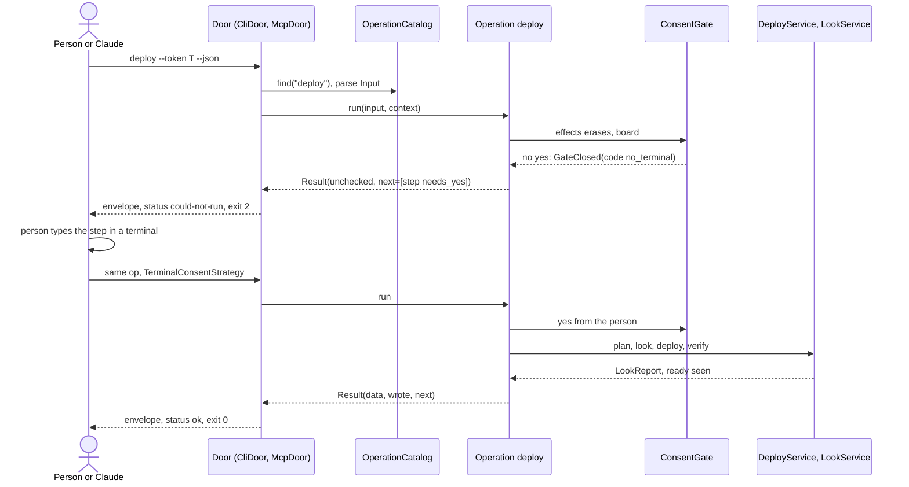
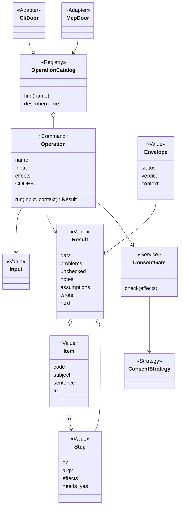

# P323 council: how people and AI reach the core

Lens: the AI and agent interface. Card [P323 #413](https://github.com/xmejkal/spark/issues/413), epic [P158 #94](https://github.com/xmejkal/spark/issues/94).
Date: 2026-10-19. Builds on P158 (§4.2 U7, §5.1, §9) and the P297 finding.

> **TL;DR.** Every core job becomes one **Operation** in one **OperationCatalog**: a name, a typed input, declared
> effects, a result Value and an outcome. The CLI, `--describe`, `--help`, the JSON schemas, the command pages'
> `allowed-tools` and a later MCP server are all generated from that catalog. Consent, effects and privacy live in the
> core, so a prompt only relays codes. Each operation gets a golden-JSON contract test, and the doors get one parity test.

Summary: spark already has the seeds. `parts.py`'s `OPERATIONS` table drives both its parser and `--describe`,
`outcomes.envelope` exists, and `deploy_gate.ConsentStrategy` keeps the yes inside the core. But only 2 of 16 `--json`
scripts print the envelope, `check_vendor_pins` prints a bare list, and the 8 command pages and 4 agent files hold
about 100 KB of prose, much of it restating what the scripts decide (`commands/build.md` alone is 4,059 words).

## 1. One operation model

An operation is the unit a person, Claude, a test or an MCP client calls. It is never a script.

| Part | Rule | Today's example |
|---|---|---|
| `name` | a verb or `noun_verb`, stable, snake_case | `look`, `deploy`, `part_show`, `build`, `checks_run` |
| `Input` | a frozen dataclass with types and one-line help per field | `look`'s `port: str or None`, `project: Path` |
| `effects` | a set from `reads`, `writes`, `network`, `board`, `erases`, `restarts_board` | `look`: `restarts_board`. `deploy`: `erases`, `writes`, `board` |
| `run(input, context) -> Result` | the body, which calls Services | `LookService.run()`, `DeployService.deploy()` |
| `Result` | a Value with `data`, `problems`, `unchecked`, `notes`, `assumptions`, `wrote`, `next` | `LookReport` plus the token step |
| outcome | decided by `outcomes.status_of`, never declared | three words, three exit codes |

`OperationCatalog` (role Registry) lists every operation once. Three doors read it and hold no logic:

- **`CliDoor`** builds argparse from each `Input`, runs the operation, prints the envelope or text, and returns
  `EXIT_FOR[status]`. This is P158's `cli.run`, keyed by operation instead of by script. Today's scripts become
  two-line shims (`look.py` calls `CliDoor.main("look")`), so no command page breaks.
- **`McpDoor`** (later, section 7) maps `tools/list` to the catalog and `tools/call` to `Operation.run`, in process.
- **`CommandPage`** is not code. It is a Markdown page that names operations. A test fails if its `allowed-tools`
  names an operation the catalog lacks.

## 2. The envelope and error contract

Keep envelope v1's keys and add P158's v2 keys (`verdict`, `context`, `wrote`). Three rules on top:

1. **Codes, not English.** Each problem and unchecked item carries `code` (from a per-operation `CODES` table, as
   `breadboard_keep.CODES` and the doctor's `plug_in`, `hold_boot` already do), `subject`, `sentence` and `fix`. Claude
   branches on `code`. It relays `sentence` word for word. A test fails on a code the table does not list
   (it extends `test_no_magic_strings.py`).
2. **Every `fix` and every `next` is a step** (`outcomes.step`): `op`, `argv` of ids only, `why`, `effects`,
   `needs_yes`. The core computes `needs_yes` from the effects and the consent in force. Claude never sets it, and a
   step with `needs_yes: true` is for the person's terminal. `deploy`'s `data.run_in_terminal` becomes such a step.
3. **A crash is `could-not-run`, kind `crash`,** with the innermost `scripts/` frame and a pointer to the traceback
   file. Today a crash exits 1 and reads as `problems`.

Every `--json` run prints exactly one envelope on stdout, and every human line goes to stderr. `deploy.py --json`
already works this way.

## 3. Discoverability

- **`describe`**: the catalog as JSON (name, one-line purpose, input schema, effects, data keys, codes). With an
  operation name it returns that one entry, so Claude pays for one operation, not forty. `parts.py --describe` becomes
  this for every script.
- **`where`**: "where am I". It answers which spark, store and project, the board, the stage table (built, stale,
  could-not-run, from P158's `state`), which board is on USB if asked, and the `next` steps. A fresh session starts here,
  instead of reading five files.
- **`--help`** is generated from the same `Input` help strings, so the help, the schema and the docs cannot drift.
- `schemas/envelope.schema.json` plus one generated `data` schema per operation.

## 4. Pages reference operations, not logic

A command page keeps three things: when to use it, which operations in which order, and how to talk to the person
(say the board restarts, wait for the press). It drops everything the core decides. `commands/deploy.md` now explains
how the passed image is chosen, the sha256 rule, the retry after 5 s, the facts file and the ready read. Those are
`deploy`'s codes and sentences. The page becomes about 25 lines:

```
1. Run `look`. Say first: the board restarts.
2. Relay each problem's sentence. A `stop` code means do not propose the flash.
3. Run `deploy --token <data.token>`. On a step with needs_yes, give the person its line and wait.
4. A `press_reset` or `hold_boot` code: tell the person at once, then run the same step again.
```

Agents get the same treatment. `part-finder`'s budgets are its own judgement and stay. A rule like "a number not on
the maker's page is not a fact" becomes a validation code in the record contract, so the core refuses it whatever the
agent wrote. The injection line stays in the pages, because it guards the
model, and `describe` marks fields that carry outside text as `untrusted`.

## 5. Consent and safety in the core

- **Effects decide the gate.** An operation with `writes` runs as a plan unless the input says `apply`. One with
  `erases`, `board` or `network` also needs a `ConsentStrategy` yes (`TerminalConsentStrategy`,
  `StandingConsentStrategy` from a grant). `deploy_gate` already does this for deploy. Generalise it as one `ConsentGate`
  that every door calls through `Operation.run`, so no door can skip it.
- **The yes is never an input.** No `Input` has a `yes` field Claude can fill. The MCP door's `yes` means "the client
  approved this call", which is the same rule as `allowed-tools`.
- **Privacy is a field property.** `store.PRIVATE` places are marked in each `Result` schema, and the door strips
  them from anything bound for a URL, a search or an agent prompt. Today that rule is prose in agents.md only.
- **Network operations stay off** unless the person's settings turn them on.

## 6. Testability of the AI paths

- **One contract test per operation, generated from the catalog.** A fixture project per operation and a golden
  envelope in `tests/golden/<op>.json`. The test compares key sets, the status, the codes and the step shapes, not
  values (the rule `test_json_contracts.py` already follows). A changed shape fails until the golden file changes in
  the same PR.
- **Every `next.argv` parses** through `CliDoor`.
- **Consent tests:** with a fake `ConsentStrategy` that says no, no operation with `erases` or `writes` touches a file.
- **Door parity:** `CliDoor` and `McpDoor` return the same envelope for every operation with no effect.
- **Page lint:** each command page names only catalog operations, and no page contains a code's sentence
  word for word (a sign it restates logic).

## 7. Token economy

- Default answer under 4 KB (`outcomes.page`), `truncated.next` for the rest. Assumptions are never cut.
- Pointers instead of content: `wrote` and `where` locators (`project:breadboard.md`), never the file inlined.
- Text is said once: in `sentence`, not again in `data`.
- `describe <op>` per operation, so the catalog never loads whole.
- Shorter pages save the most: each command run loads its page.

## 8. What an MCP server adds, and when

It adds typed schemas the host validates, structured output, and reach to hosts with no shell (Claude Desktop,
claude.ai through `host:`, MCP Apps for P297's page). It costs a running process and tool definitions in every
session. Build it when a named host cannot run a shell, or when P178's shared store needs it, and not before the
catalog covers every operation. Then it is about 150 lines of generated adapter, switched by the `spark-mcp` row in
`data/tools.json` (P158 §9). `isError` is true exactly for `could-not-run`.

## 9. What not to do

- No logic in a door, a page or an agent prompt. A page that explains a rule is a sign the code lacks a code.
- No second schema written by hand next to the `Input` dataclass.
- No English compared in code or in a prompt's branching. Branch on `code`.
- No `yes` parameter that Claude can fill, and no grant written by Claude.
- No MCP server before the catalog, which would publish nine output shapes.
- No planned operations. One enters when a stage needs it.
- No big-bang move. Each story converts one script to the catalog and keeps its shim.

## Diagrams





`Command` is a new role word for developing.md's table: one named operation with typed input, declared effects and a
result. The council should decide it or pick an existing word.
