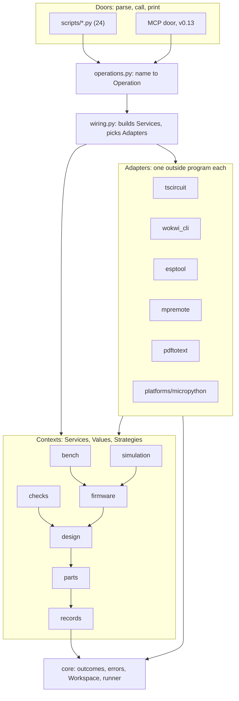
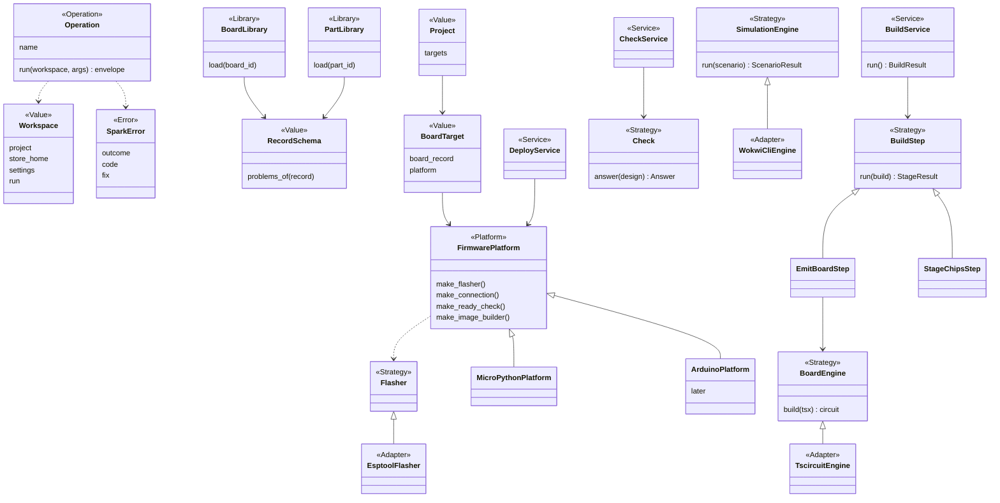

# P323 council: the software architect's target structure

Card [P323 #413](https://github.com/xmejkal/spark/issues/413), epic P158 [#94](https://github.com/xmejkal/spark/issues/94).
Input: P322's facts and score (`SCORE classes 16% | fat CLIs 3 | thin CLIs 4 | private imports 3 | outcome literals 10 | roles stated 56/103`), the P158 design (input, not plan) and P297's finding.

> **TL;DR.** One stdlib-only package `spark/` beside `scripts/`. Eight bounded contexts, each a small set of
> Services, Values and Strategies. Outside programs sit behind Adapters, picked by the role names that `tools.json`
> already has. `scripts/*.py` keep their paths and become thin doors over one command vocabulary (`operations.py`),
> which the MCP door later reuses. One test enforces the import rule. Move one context per PR, the deploy area first.

## 1. Three decisions

1. **A package with a written import rule.** Code moves from `scripts/` into `spark/<context>/`. A context may
   import only the contexts below it, and only their public names. A stdlib AST test (`tests/test_layers.py`) fails
   on a wrong edge. This ends private imports and the subprocess calls between our own scripts.
2. **One command vocabulary, many doors.** Each command is an Operation: a function `(workspace, args) -> envelope`.
   The CLI door and the MCP door both look it up by name. Every `--json` prints `outcomes.envelope`, and the text
   view renders the same envelope. A door never holds logic.
3. **Injection by constructor, choice by settings.** A `Workspace` Value holds the project, the store and the merged
   tool settings. `wiring.py` builds each Service with its Adapters and Platform, chosen by `tools.json` roles and
   the board record. No framework, no globals. Tests pass fakes to the same constructors.

## 2. The package layout

```
spark/                          the core: stdlib only, no main()
  core/        outcomes.py  errors.py  workspace.py  runner.py
  records/     store.py  board_library.py  part_library.py  record_schema.py  project.py
  parts/       matching.py  needs.py  cost.py  drawer.py  catalog.py  datasheets.py  shelf.py  requirements.py
  design/      design.py  restricted_pins.py  pin_assigner.py  netlist.py  footprint.py  build_service.py
    board_emitter/   power.py  placement.py  tsx_lines.py
    breadboard/      steps.py  planner.py  keep.py  match.py  changes.py  renderers.py  tabbed_page.py
  firmware/    platform.py  pin_module.py  flash_image.py  project_image.py  import_firmware.py
  simulation/  engine.py  sim_project.py  scenario.py
  checks/      check.py  copper.py  fab.py  bom.py  footprints.py  physics.py  vendor_pins.py  compare_design.py
  bench/       deploy_service.py  look.py  gate.py  grant.py  ready_check.py  facts.py  doctor.py  live.py  reach.py
  adapters/    tool_finder.py  tscircuit.py  circuit_to_wokwi.py  wokwi_cli.py  esptool.py  mpremote.py  pdftotext.py
    platforms/ micropython.py
  operations.py   the command vocabulary
  wiring.py       builds Services with their Adapters
scripts/        the doors, same paths as today: parse, call one Operation, print
```

Where today's modules go:

- `outcomes`, `tools` (finding and settings part) go to `core/` and `adapters/tool_finder.py`. `tools.py`'s install
  and status logic becomes `ToolInstallService` in `core`, and `scripts/tools.py` keeps only its door.
- `parts.py` (1,899 lines) splits by job. Loading and `validate` go to `records/part_library.py` and
  `records/record_schema.py`. Catalog and `need` go to `parts/catalog.py`. Fetch, keep and read go to
  `parts/datasheets.py`. Shelve and promote go to `parts/shelf.py`. Pick and `--requirements` go to
  `parts/requirements.py`. The 40 `_op_*` functions become Operations. `_problem` and `_parse` become public
  `core.outcomes.problem` and `records.part_library.read_record`.
- `parts.validate` and `boards.validate` become one `RecordSchema` with rule tables per kind (gap 6).
- `check_spine.run` becomes `design/build_service.BuildService`, one `BuildStep` per stage. `emit_board.py` becomes
  `design/board_emitter/`, called in process, not as a subprocess. `check_spine.py` stays as the door.
- `deploy_service`, `board_look`, `deploy_gate`, `board_grant`, `ready_check`, `board_facts`, `board_doctor`,
  `board_live`, `board_reach`, `download_mode` move to `bench/`. `flasher.EsptoolFlasher`, `board_look.EsptoolReader`
  go to `adapters/esptool.py`. `board_connection`, `board_console` go to `adapters/mpremote.py`.
- `check_all.Check` and its five checks become `checks/check.py` and one module per check.

## 3. Layers and the import rule



The rule, as the test checks it:

| Layer | May import |
|---|---|
| doors (`scripts/`, MCP) | `operations`, `core` |
| `operations`, `wiring` | everything below |
| `adapters` | the Strategy they implement, Values, `core` |
| a context | the contexts below it in the DAG above, `core` |
| `core` | the standard library |

A context never imports `adapters`. A Service gets its Adapter through the constructor. Only the public names of a
module (no leading `_`) cross a module border. Where two contexts must meet in one flow, such as the build that stages
chips for simulation, `wiring.py` passes the step in. `design` never imports `simulation`.

## 4. The core seams



Two new roles for developing.md's table, and no more:

- **Library**: reads one kind of record across its layers (spark's, the store, the project). Read only. Ends in
  `Library`. `BoardLibrary`, `PartLibrary`. A Store still writes one place in the person's store.
- **Operation**: one command of the vocabulary that every door calls. Its name is the command, such as
  `parts.need` or `bench.look`.

## 5. A script becomes a door

```python
#!/usr/bin/env python3
"""Door: look at the board on USB. The logic is spark.bench.look."""
import sys, pathlib
sys.path.insert(0, str(pathlib.Path(__file__).resolve().parents[1]))
from spark import doors
sys.exit(doors.run("bench.look", sys.argv[1:]))
```

`doors.run` parses with the Operation's own argument table, builds the `Workspace`, calls the Operation and prints.
With `--json` it prints the envelope. Without it, the Operation's Renderer prints text from the same envelope, so
text and JSON carry the same facts (P158 rank 1). The paths in `commands/*.md` and `allowed-tools` do not change.
The MCP door lists the same Operations and their argument tables as tools.

## 6. How errors and outcomes flow

- An Adapter raises `ToolMissingError` or `ToolFailedError`. Each is a `SparkError` with `outcome = COULD_NOT_RUN`
  and a `fix`, such as the install line.
- A Service returns a Result namedtuple. Its problems and unchecked items are `Problem` Values with a `code`
  constant. Code decides on the code, never on the sentence (P260).
- The Operation turns the Result into `outcomes.envelope`. `status_of` decides the status, so `ok` stays
  unreachable while anything went unchecked.
- `doors.run` catches `SparkError` and prints its envelope. Any other exception is a crash: exit 2, never `ok`.
- The exit code is `EXIT_FOR[status]`, in one place.

## 7. Configuration and injection

`Workspace.from_args(project, store_home)` reads `SPARK_HOME` and both `tools.json` layers once. Every Service takes
its collaborators in `__init__`, with `run=subprocess.run` and `clock` injectable as today in `DeployService`.
`wiring.py` holds small plain functions, such as `deploy_service_for(workspace)`, and three registries as dicts,
in the style of `DRAWING_RENDERERS`:

- `PLATFORMS = {"micropython": MicroPythonPlatform}`, keyed by the board record's firmware language.
- `ENGINES = {"wokwi-cli": WokwiCliEngine}`, keyed by the `simulator` role in `tools.json`.
- `CHECKS = [CopperCheck, FabCheck, ...]`.

A person switches a tool in `tools.json`, as now. The code reads the role, not the tool's name.

## 8. Extension points

- **A new board**: a JSON record in `boards/`. No code. Facts such as `physical.buttons` feed Values like
  `ButtonPlaces`.
- **A new MCU platform** (Arduino, PlatformIO, ESP-IDF): one subclass of `FirmwarePlatform` in
  `adapters/platforms/`, its Adapters (for example `arduino-cli`), and one line in `PLATFORMS`. `DeployService` does
  not change.
- **No MCU, or several**: `Project.targets` is a list of `BoardTarget`. A target with no platform answers `skipped`
  for firmware and deploy stages. Today the list has one item. Several MCUs is a loop over it, when P318 needs it.
- **A new check**: one `Check` subclass and one line in `CHECKS`.
- **A new simulator**: one `SimulationEngine` Adapter and one line in `ENGINES`.
- **KiCad**: an optional `BoardEngine` or export Adapter. Nothing needs it, so it stays off the person's path.

## 9. The order of moves

One context per PR. Each PR keeps the suite and the three projects green, and adds one row to `measure.py`: the share
of code in `spark/`.

1. `core/` and the layer test, with `outcomes` moved and a re-export left in `scripts/outcomes.py`.
2. `bench/` and its Adapters. It is already OO, so this proves the shape at low risk.
3. `records/` with one `RecordSchema`.
4. `parts/` split, and its Operations.
5. `design/` with `BuildService` and the in-process board emitter.
6. `checks/`, `simulation/`, `firmware/`. Then the MCP door.

A re-export shim lives only until its last caller moves, in the same epic.

## 10. Trade-offs

- The move churns imports, tests and `git blame`. One context per PR keeps each diff readable.
- A Strategy base adds one hop. It pays only where two implementations exist or a test needs a fake.
- `sys.path` in each door is a small hack. It is the price of no packaging, and the plugin copies the repo anyway.
- An in-process emitter loses the subprocess's isolation. A test of the build shows the same output either way.

## 11. What I would not do

- No DI container, no plugin entry points, no `pyproject` install. Plain constructors and dicts.
- No outside libraries such as pydantic or click. Namedtuples, dataclasses and argparse are enough.
- No base class for a single implementation. A pure calculation stays a function.
- No generic Repository over every JSON file. One Library per record kind that a check reads.
- No event bus, no async, no server. P297's `ProjectSession` and its server come as Operations later.
- No big-bang rewrite and no 49,000-word plan. Move code, do not redesign behaviour while moving it.
- No firmware behaviour in the core. Platforms flash and read. They never write thresholds or drivers.
