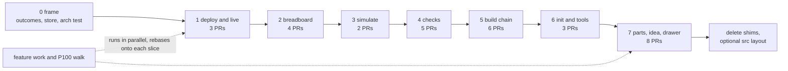

# P323 council: migration and tests (how to get there safely)

> TL;DR. Put the package at `scripts/spark/`, so every door, test and plugin path keeps working with no change. Move one area per slice, leave a one-line shim at the old module name, and move that area's tests in the same PR. Start with the already-clean deploy and board area (about 1,800 lines, mostly done by P239), then breadboard, then the checks, then the fat CLIs, and `parts.py` last.

## Facts this rests on

From `measure.py` today: 59 modules, 16% of code in classes, 3 fat CLIs (`emit_board` 926, `init_project` 407, `tools` 557), 4 thin CLIs. `parts.py` is 1,899 lines with 121 functions and 5 classes, so it is the biggest single risk. Scripts import each other flat (`import board_envelope`), which works because Python puts the script's own folder first on `sys.path`. Tests do the same with one `sys.path.insert` to `scripts/`. 76 test files hold about 30,000 lines. Commands call `${CLAUDE_PLUGIN_ROOT}/scripts/<name>.py` and list each in `allowed-tools`. Installing the plugin copies the whole repository. The push hook (`tools/check_commit.py`) runs the full suite and prints the script-size line. 45 mutation tables guard behaviour, and `tools/mutate.py` points rows at a file path with `find` text that must occur once.

## 1. The strangler path

**Where the package lives: `scripts/spark/`.** Reasons:

- `scripts/` is already on `sys.path` for every door (the script's own folder) and for every test. `import spark.deploy` works with zero setup. No `pip install`, no `PYTHONPATH`, no change to `${CLAUDE_PLUGIN_ROOT}` paths, no change to the plugin copy.
- A top-level `spark/` would need each door to add the repository root to `sys.path`, and every test header to change. That is a cross-cutting edit with no gain.
- The cost is that the package sits beside its own doors. Accept it. Move it to a `src/` layout in one last mechanical PR if the PO wants, after the doors are all thin.

**The door rule.** A script in `scripts/` stays the door: same file name, same flags, same JSON, same exit codes. During the move it shrinks to parse, call, print, exit. The commands, agents and `allowed-tools` lists never change in a slice, so the plugin cannot break.

**The shim rule.** When a library module such as `board_look.py` moves to `spark/deploy/look.py`, the old file becomes two lines: a docstring saying "moved, P323" and `from spark.deploy.look import *  # noqa`. Other callers keep working untouched. A shim is deleted when `grep` finds no importer. A shim is a loan, tracked by the measure (below), and none lives past the end of its area.

**Tests move with their module, in the same PR.** `mock.patch("deploy_service.x")` patches the name in one module. A shim would not carry the patch to the real module, so a test left on the old name can pass while testing nothing. So the PR that moves a module also rewrites that module's patch targets and imports to the new path. Other areas' tests keep using the shim, and they only call, never patch, across the area border (check with grep before the move).

**One area at a time, inside out.** In each area move the pure core first (values, planners, strategies), then the service that wires them, then the door last. Records and `outcomes` move before everything, because all areas import them.

**Rules for the package from day one** (cheap to hold now, costly later): the package never imports from `scripts/` doors, only the other way round. No `sys.path` edits inside the package. One test (`test_architecture.py`, a small AST walk) fails on an import cycle, on a package file importing a door, and on a package module with a `main()`.

## 2. The order of areas, with sizes

Sizes are measured lines today. PR counts use P239 as the unit: the deploy area (about 1,700 lines across 10 modules, done in 8 PRs, 6 of them one class each, over several days) shows that one PR holds about 150 to 400 moved lines plus review.

| Order | Area | Modules (lines) | PRs |
|---|---|---|---|
| 0 | Frame: package, `outcomes`, `store` records, the architecture test | outcomes 79, store 309 | 1 |
| 1 | Deploy and live (already classes) | deploy_service 169, board_look 234, board_grant 205, board_doctor 143, deploy_gate 78, flasher 41, firmware_platform 66, board_connection 105, board_console 103, board_live 75, board_reach 46, ready_check 59, board_facts 59, board_envelope 101, deploy/grant/look/live/reach doors | 3 |
| 2 | Breadboard | steps 145, drawing 384, keep 293, changes 191, match 77, tabbed_page 109, netlist 107, breadboard.py 495 | 4 |
| 3 | Simulate | sim_project 164, project_image 76, run_scenario 214, flash_image 135 | 2 |
| 4 | Checks | check_all 403, physics 518, footprints 452, vendor_pins 225, bom 139, compare_design 223, copper 68, fab 40 | 5 |
| 5 | Build chain | check_spine 754, emit_board 926, emit_footprint 190, assign_pins 356, import_firmware 84 | 6 |
| 6 | Init and tools | init_project 407, tools 557, ai_files 107, download_mode 25 | 3 |
| 7 | Parts, idea and drawer | parts 1,899, needs 541, matching 167, cost 244, drawer 349, design 302, boards 436, restricted_pins 62 | 8 |

About 32 PRs. Deploy goes first because 8 of its 10 modules already are classes, so the first slices only change addresses, prove the shim and the architecture test, and cost the least. Parts goes last because it is the biggest, everything imports it, and feature work touches it most. By the time we reach it the pattern is routine and the rest of the package already exists for it to call.

The order is a proposal. The PO's walk (P100) can pull an area forward when a bug sits in it, because a bug fix in an area is the best moment to move it (small, tested, already open).

## 3. The first three slices

**Slice 1 (PR 0): the frame.** Add `scripts/spark/__init__.py`, move `outcomes` to `spark/outcomes.py`, leave the shim, and add `tests/test_architecture.py`. Done when: the full suite has the same test count plus the architecture tests, no door output differs, `measure.py` prints the new "in package" column, and the mutation table for the architecture test (plant a cycle, plant a door import, plant a `main()` in the package) catches all three. This slice proves the path and the hook before any area risks anything.

**Slice 2: deploy's values and strategies.** Move `flasher`, `firmware_platform`, `ready_check`, `board_connection`, `board_console` and `board_envelope` to `spark/deploy/`, with their tests and patch targets. About 450 lines, no logic changes. Done when: the moved modules' mutation rows (p239-pr7, p251 and others) run against the new file paths and all are caught, `deploy.py --json` output is byte-identical on a recorded dry run, and a grep finds no importer of the shims except one for each module another area still uses.

**Slice 3: deploy's services and doors.** Move `board_look`, `board_grant`, `board_doctor`, `deploy_gate`, `deploy_service` and `board_live`, `board_reach` into the package, and cut `deploy.py`, `look.py`, `grant.py`, `live.py`, `reach.py` down to parse, call, print. Two PRs if the review says so. Done when: every shim of area 1 is deleted, the five doors have no logic beyond argument parsing and exit-code mapping (the measure counts them as thin), and the plugin walk `/spark:deploy` in its dry run gives the same answer as before.

## 4. Characterization tests before a move

A move changes addresses, not behaviour, so the net is the output, not the unit tests alone.

- **Golden door outputs.** Before an area moves, record each door's `--json` and text output on the demo inputs into `tests/data/golden/<area>/`. After the move the test compares byte for byte. Record it in the first commit of the slice's PR, so the diff shows nothing changed when the rest of the PR lands. Spark exports facts and these are facts, so goldens are stable. Timestamps and paths are masked by one helper.
- **Fat CLIs (emit_board, check_spine, parts) get this first.** They have the most logic in functions with no class seam. A golden on the generated board file, the Wokwi diagram and the pin map for the three demo projects pins the behaviour before any cut. This is the P100 baseline idea from the earlier plan (I0), kept small.
- **Where a seam is missing,** add the seam in its own PR first (an argument instead of a global, a function instead of an inline block), with a test. Then move.
- **A pass is not a skip.** A moved test that now reports "skipped" or "could not run" fails the slice.

## 5. How the guards watch each step

- **Test count.** The push hook already prints the count. A slice PR states "before N, after N plus the architecture tests" and moved tests must not shrink the count. A drop needs a named reason in the PR.
- **Mutation tables.** Each table row names a file path. Moving a file breaks its rows' anchors, and `mutate.py --anchors` finds that in a second. The slice rewrites the `file` fields in the same commit, then runs the area's tables with `--for` on the changed files. Rule: every row that existed before still exists after and is caught. The count of rows per area is written in the PR ("41 rows, 41 caught"). Planted defects for a move itself are two: the shim re-exports the wrong name, and a door still carries logic (a mutant that reintroduces a branch in the door must turn a test red).
- **The hook** is the gate, as the rules say. Nobody runs it by hand.
- **Journey tests** (`test_journey_basic`, `test_json_contracts`) stay untouched through a slice. If a slice needs to edit one, it is not a pure move and should be split.

## 6. How to measure progress

`measure.py` prints the P322 score. Add these to the line, one PR at a time, in the slice 1 PR:

- classes percent (16% today), the rate the PO already watches
- lines inside `scripts/spark/` over total code lines, and modules still flat
- shims alive (target 0 at the end of each area)
- fat CLIs and thin CLIs (3 and 4 today)
- doors with logic (a door that imports more than the package and `argparse`)

Each PR pastes the before and after line. Progress is the number of areas with zero shims and zero fat doors. No score may get worse in a slice.

## 6a. Risks and how to cut them

| Risk | Cut |
|---|---|
| Import cycles (`board_live` reuses `board_doctor`, `board_grant`, `board_connection`) | Architecture test from slice 1. Area order puts the shared base (outcomes, store, deploy values) first. A cycle is cut by moving the shared value down, never by a late import. |
| Plugin paths | Package under `scripts/`, so `${CLAUDE_PLUGIN_ROOT}` paths and `allowed-tools` do not change. A test imports each door from a copy of the tree in a temp folder, which is how a plugin install looks. |
| `subprocess` calls between scripts (`check_spine` runs `emit_board.py`) | Keep as is until area 5, then replace by a call into the package in a seam PR. Doors keep their path, so the subprocess keeps working meanwhile. |
| Test brittleness (`mock.patch` strings, `sys.path` headers) | Tests move with their module. A shared `tests/` import helper is not needed, since the header is already `scripts/`. |
| Merge conflicts with feature work | A slice is small and short-lived (under 3 days). `git mv` keeps history. Feature PRs that touch an area in flight rebase onto the shim. The board holds at most one area slice in progress at a time (WIP limit), and a feature on that area waits, or joins the slice. Announce the area in the card before it starts. |
| Hidden byte differences in generated output | Golden outputs, see 4. |
| Hook time grows | A shim costs nothing. Measure the suite's time in the hook line, flag a 20% rise. |

## 7. What stays procedural on purpose

- The doors themselves: `main()` parses, calls, prints, maps the exit code. About 20 lines each. Not a class.
- Pure data transforms with no state and no second implementation: `copper`, `fab`, `download_mode`, `board_facts`, `netlist` reading. A module of functions is fine. Classes need a reason (a swap point or state), not a quota. The 16% is a measure, not a target.
- The tools in `tools/` (`check_commit`, `mutate`, `journey`). They are the developer's, not the product's, and reach the package by path as they do today.
- Tests stay `unittest` functions and classes as they are. No framework change inside this card.
- Records (`boards/`, `parts/`) stay JSON. Only their readers become classes.

## Asks of the PO

- OK for `scripts/spark/` as the home, or a wish for a `src/` layout at the end.
- OK for deploy first, parts last, and for pulling an area forward when a P100 bug lands in it.
