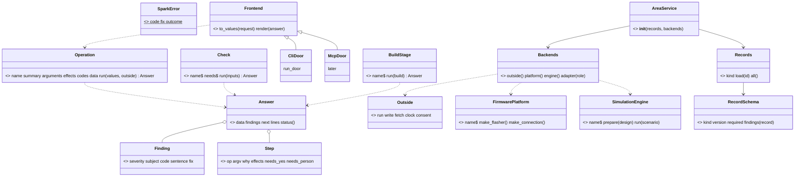
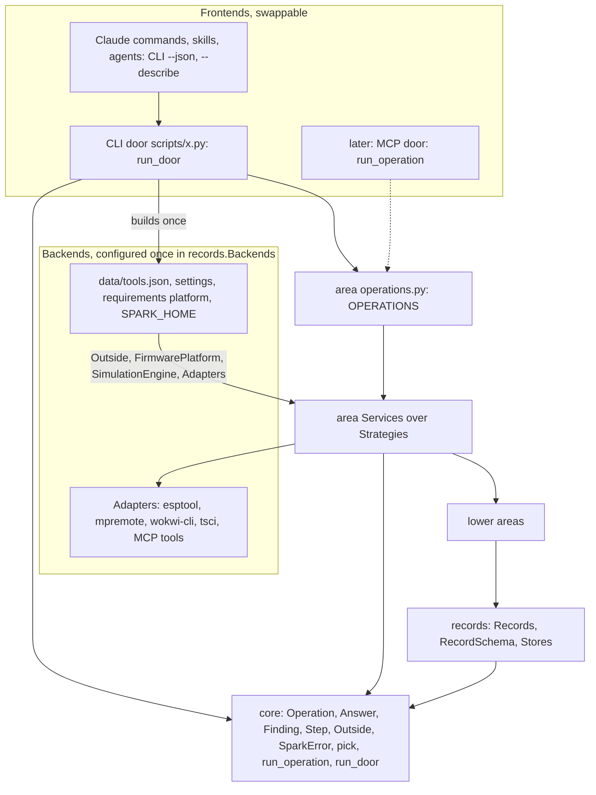

# P323 round 4: one unified architecture (architect lens)

> **TL;DR.** The layers are right, but each round added its own side concept. Unify into one system the scripts only
> call: frontends over `run_operation`, one `Answer` and one `Finding` at every boundary, one `Outside` for every
> effect, one `Records(kind)` reader, and one `Backends` that configures every tool, platform, store and simulator.

The shape from rounds 1 to 3 holds: doors, `core`, eight areas, records at the bottom (design.md 2.1, 2.2). The
pile is one level down: each round solved its problem with a new name, so one idea has three or four homes. The PO,
2026-10-21: "an actual well designed system that is just being called from the scripts", with frontends to switch
and backends "configured well". Names below that do not exist in the code yet are proposals.

## Proposals

**P1. One result Value, `Answer(data, findings, next, lines)`**, with `status` from `status_of`. Today there are six
shapes: `outcomes.answer` (outcomes.py:49), the envelope (outcomes.py:68), `Check.run` dicts (check_all.py:72),
`check_spine.Stage` (check_spine.py:100), `LookReport` (board_look.py:181) and `...Result` tuples; the design adds
`BuildResult`. `Operation.run`, `Check.run` and `BuildStage.run` all return an `Answer`. Inner Results stay inside
their area. Reason: one shape at every boundary, learnt once.

**P2. One problem Value, `Finding(severity, subject, code, sentence, fix)`.** Five shapes today: `parts._problem`
(parts.py:238), dicts (board_envelope.py:58), `check_physics.Finding` (check_physics.py:93), `NotKeptResult`
(breadboard_keep.py:63) and `DrawingDiffersResult` (breadboard_match.py:29); the last two already hold a `code`.
`severity` is problem, unchecked or unmeasured (check_physics.py:88). Reason: the design's `code` lands in one class.

**P3. One collaborator Value, `Outside(run, write, fetch, clock, consent)`.** The design passes `run`, `shorten`,
`secrets`, `writer`, `consent` and dry-run swaps as keywords (2.6), and `DeployService` takes `run`, `clock`, `probe`,
`echo_to` (deploy_service.py:78). `FakeClock` and `FakeConsent` exist in `tests/fakes.py`, so the rejected `Clock`
(row 95) exists in all but name. `run_door` passes only the fields the Operation's `effects` declare; any other
raises `SparkError` code `undeclared_effect`. One table maps `writes` to `write`, `network` to `fetch`, `board` and
`erases` to `run` and `consent`. Reason: S3, S15, S16, dry run and consent become one mechanism, planted once.

**P4. One record reader, `Records(kind, schema)`.** `store.layers` and `store.records` (store.py:73, :86) already
are "the one walk". Cut `Layers`, `BoardRecords` and `PartRecords` (2.3). `RecordSchema(kind, version, required)`
gets `findings(record)`, which replaces `boards.validate` (boards.py:340), `parts.validate` and `REQUIRED_KEYS`
(boards.py:62). Reason: a third kind (chips) adds a schema, not a class.

**P5. One extension form: a registry is a tuple of subclasses, each with a class attribute `name`.** Today
`MATCHERS` is a dict (matching.py:222), `CHECKS` a list of instances (check_all.py:285), `DRAWING_RENDERERS` a tuple
of instances (breadboard.py:94), and `FirmwarePlatform` five lambdas from a classmethod (firmware_platform.py:46-61).
One `core.pick(registry, name)` finds a member. `MicroPythonPlatform` subclasses `FirmwarePlatform`, so the Platform
role word folds into Strategy. Reason: "add a check" and "add a platform" read the same.

**P6. Frontends only call `run_operation`.** A frontend turns a request into `(operation, values)` and an `Answer`
into its form. CLI: `run_door` (argparse, envelope, exit code). Claude's commands, skills and agents: the CLI with
`--json` and `--describe`, both read from `OPERATIONS`. Later MCP: a tool call to `run_operation`. Text mode was
missing from the design: `Answer.lines` goes to stdout without `--json` and stderr with it, replacing `diagnostics`
(look.py:63 prints `report_lines` today). `description` and `epilog` describe a door, not an Operation (D2), so they
stay in the door, as look.py:15 does. Reason: no frontend holds logic; look.py:41-64 moves into `run_door` once.

**P7. Backends are configured in one place, `records.Backends`.** The choices sit in four places today: tool rows
and settings (`tools.find`, tools.py:277), the hard-coded MicroPython (deploy.py:171), `micropython_port`
(flash_image.py:89) and `SPARK_HOME` (store.py:46). `Backends` is built once per process from those and the
requirements' `platform` key. It gives the `Outside`, the `FirmwarePlatform`, the `SimulationEngine` and each tool
Adapter by role. Reason: one composition point per process, still no container (D3).

**P8. Small fixes.** `SparkError.outcome` becomes a class attribute, default could-not-run (look.py:59); only
`assign_pins.Impossible` sets problems (assign_pins.py:46, :475). Cut `pin_map_text` and `make_image` from
`FirmwarePlatform` until platform two: build (assign_pins.py:429) and firmware (flash_image.py:74) would import bench.

**P9. Three levels, named.** System: frontends, `core`, areas, `Backends`. Areas and main classes:

| Area | Main classes |
|---|---|
| `records` | `Records`, `RecordSchema`, `GrantStore`, `ToolFinder`, `Backends` |
| `parts` | `Matcher` (3 subclasses), `Offer`, `DrawerService`, `CostService` |
| `design` | `DesignService`, `PinAssigner`, `BoardEmitter`, `NeedsService` |
| `firmware` | `ProjectImage`, `FlashImageBuilder`, `SimulationEngine`, `WokwiCliEngine`, `ScenarioRun` |
| `breadboard` | `BreadboardPlanner`, `PartPlacement`, `JumperPlacement`, the Renderers |
| `checks` | `Check` (5 subclasses), `CheckService` |
| `bench` | `DeployService`, `LookService`, `GrantService`, `FirmwarePlatform`, `Flasher`, `BoardReader`, `BoardConnection`, `ConsentStrategy` |
| `build` | `BuildService`, `BuildStage` (one per stage), `ProjectSetupService` |

## The unified shape

`Frontend` is a concept, not a base class yet: `run_door` is a function until MCP is the second case (S13).

## What to cut

`Layers`, `BoardRecords`, `PartRecords`, `BuildResult`, the `shorten`, `secrets`, `writer` and `consent` keywords with
the per-area `COLLABORATORS`, `diagnostics`, `Operation.description` and `.epilog`, the `SparkError` outcome argument,
the Platform role word, `pin_map_text` and `make_image`. Five names in: `Answer`, `Finding`, `Outside`, `Backends`, `pick`.

## Rows

1. Six result shapes at boundaries (outcomes.py:49, check_all.py:72, check_spine.py:100): one `Answer` Value.
2. Five problem shapes, two with `code` (parts.py:238, breadboard_keep.py:63, check_physics.py:93): one `Finding`.
3. Collaborators as growing keyword lists (design 2.6, deploy_service.py:78): one `Outside`, limited to declared effects.
4. The rejected `Clock` exists as `DeployService(clock=)` and two Fakes: make it `Outside.clock`, row 95 superseded.
5. `Layers` duplicates `store.layers` (store.py:73): cut it, one `Records(kind, schema)` over `store.records`.
6. Two validators and `REQUIRED_KEYS` (boards.py:62, :340): `RecordSchema.findings(record)`.
7. Three registry forms and a lambda Platform (matching.py:222, check_all.py:285, firmware_platform.py:46): one form, `core.pick`.
8. `description` and `epilog` are door text, not Operation fields (D2): keep them in the door.
9. No text-mode output in the design (look.py:63): `Answer.lines`, replacing `diagnostics`.
10. `SparkError.outcome` as an argument invites a wrong outcome (assign_pins.py:46): a class attribute.
11. `pin_map_text` and `make_image` on a bench class add upward edges (assign_pins.py:429, flash_image.py:74): cut until platform two.
12. Frontends are implied, not designed: name CLI, Claude and MCP frontends, all over `run_operation` (P6).
13. Backend choices live in four places (tools.py:277, deploy.py:171, flash_image.py:89, store.py:46): one `records.Backends` (P7).
14. The final write-up needs three levels: use P9's area table, one class diagram per area.
15. The design's `Check.answer(design)` differs from the code's `run` and `call` (check_all.py:72): `Check.run(inputs) -> Answer`.
