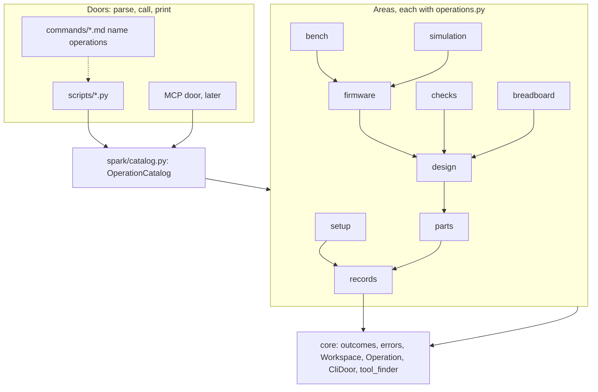
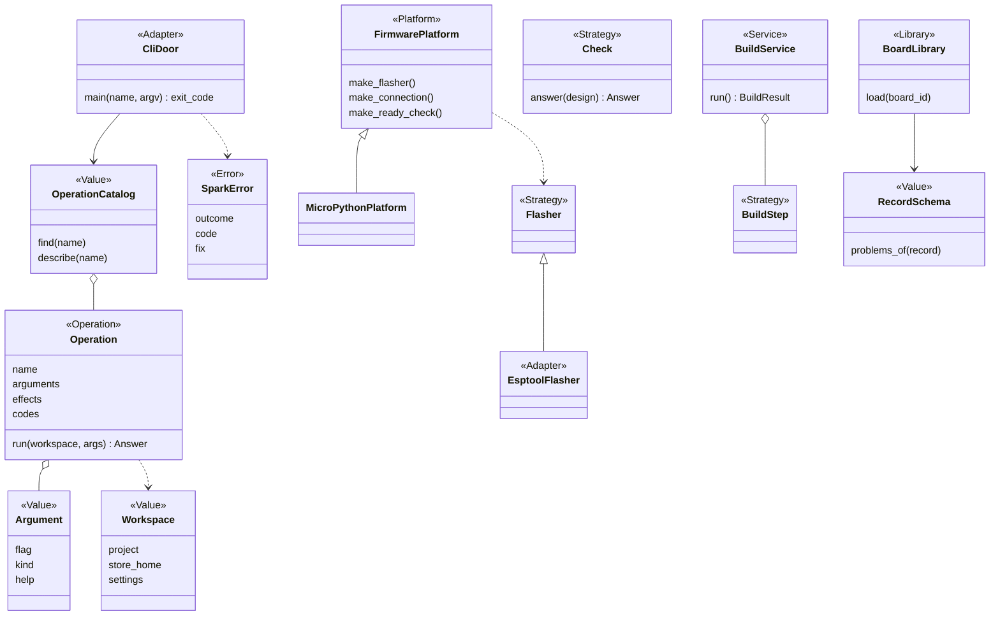
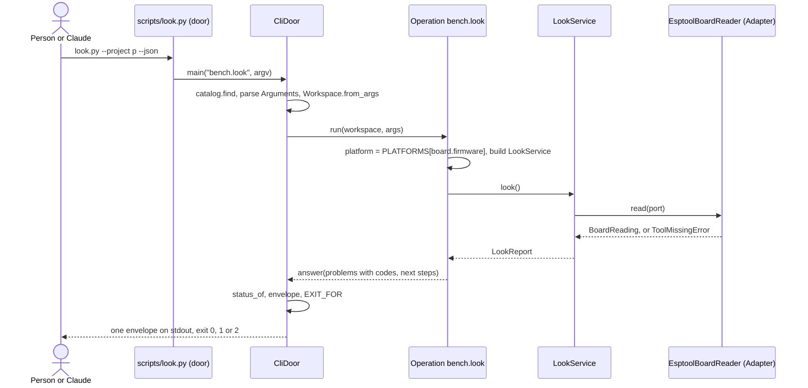

# P323: spark's target architecture and code standard

Card [P323 #413](https://github.com/xmejkal/spark/issues/413), epic P158 [#94](https://github.com/xmejkal/spark/issues/94).
Synthesis of the five papers in `council/`, on [P322's facts](../2026-10-19-p322-code-architecture/facts.md). 2026-10-19.

> **TL;DR.** One stdlib package, `scripts/spark/`, in nine areas plus `core`, with one import rule.
> Every command is an **Operation** in one **OperationCatalog**. Thin doors (the scripts, later MCP) call it and print one envelope.
> Swaps come from small registries keyed by the board record and `tools.json`. No framework, no type checker.
> One AST test with a shrinking baseline enforces the standard, so nothing gets worse and every story pays a little down.
> Phase 0 is three small PRs. Area moves wait for walk 1.

**Summary.** spark keeps its scripts as doors and moves their logic into a package inside `scripts/`, so no plugin
path, command page or test header changes. Each command becomes an Operation with declared arguments, effects and
codes, and the CLI, `--help`, `--describe` and a later MCP server all read that one table. The move runs area by
area, deploy first and `parts.py` last, beside feature work and never in front of walk 1.

## 1. Decisions

| # | Decision | Choice | Why | From | Where lenses disagreed |
|---|---|---|---|---|---|
| D1 | Package home | `scripts/spark/` | `scripts/` is already on `sys.path` for doors and tests. The 110 plugin paths stay. | migration | Architect: top-level `spark/`, editing every door and test. Smaller wins. |
| D2 | Operation | A frozen Value `Operation(name, summary, arguments, effects, codes, run)`. `run` is a plain function. | `parts.py`'s `OPERATIONS` table (line 1581) already drives its parser and `--describe`. This generalises it. | architect, AI interface | AI lens: a typed `Input` dataclass, a second schema. An `Argument` row does the job. |
| D3 | Wiring | No container, no central `wiring.py`. Each area's `operations.py` builds its Services. Registries are dicts beside their base class. A `Workspace` Value holds project, store home and settings. | A central module would import every area. | architect, tech lead | Architect's `wiring.py` dropped. |
| D4 | Adapters | An Adapter lives in the area of its Strategy. Only Adapters run outside programs, through an injected `run`. | `flasher.py` already does. | standards, migration | Architect's `adapters/` tree dropped. |
| D5 | MCP | Last, on a trigger: a host with no shell, or P178. | It costs a process and tool definitions in every session. | all | none |
| D6 | Type checker | None. Public functions in `spark/` carry hints. | Free, few, local. | standards | none |
| D7 | Size limits | Function 60 lines, module 600, door file 40, with a shrinking baseline. | A ratchet, not a big bang. | standards, tech lead | 25 or 40 for a door `main`. A whole door file at 40 is simpler to measure. |
| D8 | `mock.patch` | None new except `os.environ`. A file's count never rises. A move rewrites its tests' patch targets. | 336 today. A stale patch on a shim tests nothing. | standards, migration | No sweep. |
| D9 | Error root | One `SparkError` with `outcome` and `code`, area subclasses ending in `Error`. Any other exception is `could-not-run`, exit 2. | A dozen roots today, and a crash reads as `problems`. | standards, AI interface | none |
| D10 | Enforcement | One test, `tests/test_architecture.py`, with a baseline file. The hook already runs the suite. | One tool, no hook edit. | standards, migration | `tools/check_style.py` and the architecture test merged. |
| D11 | Roles | Add **Operation** and **Library** to developing.md's table. | `Command` collides with `commands/*.md`. A Policy is a `why_` function or a Check. | architect | Command and Policy dropped. |
| D12 | Several MCUs | One board per project stays. No `targets` list until P318. | No abstraction before its second case. | tech lead | Architect's `Project.targets` deferred. |
| D13 | Timing | Phase 0 now. Area moves after walk 1. | Walk 1 must not slip. | tech lead | Migration's deploy-first order kept, after walk 1. |

## 2. The target architecture

### 2.1 Layout and areas

```
scripts/                 the doors: same names, flags, JSON and exit codes as today
  look.py ...            parse, call one Operation, print. At most 40 lines.
  spark/
    core/                outcomes, errors, workspace, operation (Operation, Argument, OperationCatalog),
                         cli_door (CliDoor), tool_finder (tools.json roles)
    records/             store, BoardLibrary, PartLibrary, RecordSchema
    parts/               drawer, needs, matching, cost, catalog, datasheets, requirements
    design/              design, restricted_pins, pin_assigner, netlist, board_emitter/, build_service
    breadboard/          steps, drawing, keep, changes, match, tabbed_page
    checks/              Check, the five checks, physics, compare_design
    firmware/            FirmwarePlatform, MicroPythonPlatform, project_image, flash_image, import_firmware
    simulation/          sim_project, scenario, WokwiCliEngine
    bench/               look, deploy, grant, doctor, live, reach, Flasher, BoardConnection, console
    setup/               init_project, tool install, ai_files
    catalog.py           lists each area's operations module. The only file that imports all areas.
```

Each area's `operations.py` is the only module in it that reads settings and picks an Adapter.



### 2.2 The dependency rule

| Module | May import |
|---|---|
| a door in `scripts/` | `spark.catalog`, `spark.core` |
| `spark/catalog.py` | each area's `operations` |
| an area | itself, the areas below it in the graph, `core` |
| `core` | the standard library only |

Only public names cross a module border. Nothing in `spark/` has a `main()`, calls `print` or `sys.exit`, or imports
a door. Where a flow spans two areas, the higher area's `operations.py` passes the step in.

### 2.3 Core abstractions

Diagram 2.6 shows the seams. Two are new. `RecordSchema` is one rule table per record kind and joins the two
`validate` functions. `BuildService` runs one `BuildStep` per stage, with the emitter in process. The deploy area's
classes keep their names.

### 2.4 Operation and envelope

An Operation's name is `area.verb`, such as `bench.look`. Its `effects` come from `reads`, `writes`, `network`,
`board`, `erases`. Its `codes` list every code it may emit. `run` returns an `outcomes.answer`, and `status_of`
decides the status.

The envelope keeps v1's keys. Two rules are added:

- Each problem and unchecked item carries a `code` from the Operation's `codes`, plus its sentence and `fix`. Code and
  Claude branch on the code, never on the sentence.
- A `fix` or a `next` entry is a step: `op`, `argv`, `why`, `needs_yes`. The core sets `needs_yes` from the effects.

Every `--json` prints one envelope on stdout. `--help` and `--describe` come from the Arguments. An Operation with
`erases` or `board` passes `deploy_gate`'s `ConsentStrategy`, and no Argument is a yes that Claude can fill.

### 2.5 Extension seams

Each seam is a registry or a record, so its caller never changes.

| To add | You write |
|---|---|
| a board | a JSON record in `boards/` |
| an MCU platform (Arduino, ESP-IDF) | one `FirmwarePlatform` subclass, its Adapters, one line in `PLATFORMS` |
| no MCU | nothing: a board with no platform answers `skipped` for firmware and deploy |
| several MCUs | a second project folder (today's rule) |
| a tool | a row in `data/tools.json` and one Adapter, found by role through `tool_finder` |
| a check | one `Check` subclass, one line in `CHECKS` |
| a simulator | one `SimulationEngine` Adapter, one line in `ENGINES` |
| a renderer | one Renderer, one line in its registry |
| a door (MCP) | one Adapter over `OperationCatalog` |

### 2.6 Class diagram of the core seams



### 2.7 One call, door to envelope



### 2.8 Configuration and injection

`Workspace.from_args` reads `SPARK_HOME` and both `tools.json` layers once. A Service takes its collaborators in
`__init__` with real defaults (`run=subprocess.run`), as `DeployService` does. Tests pass Fakes to the same constructors.

## 3. The code standard

Each rule is one line, with what enforces it. "AST test" means `tests/test_architecture.py` with its baseline.

| # | Rule | Check |
|---|---|---|
| S1 | A class docstring starts with its role word from developing.md's table. | AST test |
| S2 | A Value is a frozen dataclass or a NamedTuple. | AST test |
| S3 | Collaborators that touch a process, clock, network or environment come in through the constructor. | review, and S8's count |
| S4 | Imports follow 2.2. No private name crosses a module. No cycles. | AST test |
| S5 | No `main`, `print` or `sys.exit` inside `spark/`. A door file is at most 40 lines. | AST test |
| S6 | Function at most 60 lines, module at most 600. | AST test, baseline only shrinks |
| S7 | Every exception class subclasses `SparkError` and ends in `Error`. No bare `except`. `except Exception` only in `CliDoor`. | AST test |
| S8 | No new `mock.patch` except `os.environ`. A file's count never rises. No `MagicMock` in new tests. | AST test |
| S9 | Code decides on a constant or a code, never on a sentence. | `test_no_magic_strings.py` |
| S10 | Every `--json` prints `outcomes.envelope`. Each Operation has a golden key-set test. | `test_json_contracts.py`, generated per Operation |
| S11 | Public functions in `spark/` have type hints. | AST test |
| S12 | One word per idea, from section 4. A new term enters the glossary first. | review, banned-synonym grep in the AST test |
| S13 | A pure calculation stays a function. A base class needs a second implementation or a Fake. | review |

The baseline lists today's breaches by name. The test fails on a new breach and on a stale entry, so it only
shrinks. Each Strategy gets one contract test run on the real class and on its Fake.

## 4. Vocabulary

| Term | One meaning |
|---|---|
| record | a JSON file of facts with an origin (part, board, chip) |
| part | a module or component record |
| board | the dev board record: chip, pins, power, physical |
| store | the person's local folder (`SPARK_HOME`), never the repo |
| drawer | what the person owns, kept in the store |
| project | the person's folder with requirements, firmware and simulation |
| requirements | the file that lists the board and parts for a build |
| design | the netlist and pin map derived from requirements |
| build | requirements to design, sheet, diagram and checks |
| check | one deterministic test of a design that returns an answer |
| outcome | ok, problems or could-not-run, decided by `status_of` |
| code | a constant that names one problem or unchecked item |
| envelope | the JSON form of an answer, the same for every `--json` |
| operation | one command of the catalog, called by every door |
| door | a thin entry that parses, calls one operation and prints |
| workspace | the project, store home and tool settings for one call |
| area | one package folder of related code with its own operations |
| service | runs the steps of one flow over objects it was given |
| strategy | a base class a caller can swap |
| adapter | wraps an outside program, or a door, behind spark's interface |
| platform | a bundle of factories for one firmware language |
| library | reads one record kind across spark, store and project |
| renderer | turns a value into text or a file and decides nothing |
| image | the flash image that passed the simulation |
| gate | a rule that opens or refuses the next step, with consent |

Banned synonyms: command (for operation), validator, verifier, interface (for door), module (for area), context.

## 5. The plan

### 5.1 Areas in order

| Order | Area | PRs |
|---|---|---|
| 0 | Frame (three slices below) | 3 |
| 1 | bench (deploy, look, grant, live, reach) | 3 |
| 2 | breadboard | 4 |
| 3 | simulation and firmware | 2 |
| 4 | checks | 5 |
| 5 | design and the build (`BuildService`, emitter in process) | 6 |
| 6 | setup (init, tools) | 3 |
| 7 | records, parts, drawer, idea (`parts.py` split) | 8 |
| 8 | MCP door, on its trigger | 1 |

About 35 PRs. bench is already classes, so it goes first. `parts.py` (2,402 lines) goes last. A story may pull its
area forward. A move leaves a one-line shim at the old name, and the shim dies with its area.

### 5.2 The first three slices

**Slice 1: the frame.** Add `scripts/spark/core/` with `outcomes` (shim left behind) and `errors.SparkError`. Add
`tests/test_architecture.py` with today's baseline. Move `measure.py` to `tools/` with the new columns. Done when:
the suite count only grows, no door output changes, and planted defects (a cycle, a door import, a `print` in
`spark/`, a new `mock.patch`) are caught 4 of 4.

**Slice 2: the first Operation.** Add `Operation`, `Argument`, `OperationCatalog`, `Workspace` and `CliDoor`, and turn
`look.py` into a door over `bench.look`. Done when: its JSON and text match a golden recorded in the PR's first
commit, `--describe` comes from the catalog, and `look.py` is under 40 lines.

**Slice 3: the AI paths.** Add `code` to each problem `look` emits, the `next` step shape, and the generated golden
contract test. Point `commands/deploy.md`'s look step at the codes. Done when: the contract test fails on a removed
key and on an unlisted code, and `parts.py --describe` answers unchanged.

### 5.3 Refactoring beside features

- **Before walk 1:** slices 1 and 2, in free slots. They are byte-identical. Slice 3 adds keys to `look`'s
  envelope, so it waits for walk 1.
- **Per story:** no new baseline entry, and at least one paid down in a file the story edits.
- **After walk 1:** one slot in four goes to an area move, inside the normal WIP limits, one move in flight.
- **Gate per move:** the demo projects' golden outputs do not change, and every old mutation row is still caught.

### 5.4 Measuring progress

`tools/measure.py` prints one line, and each PR pastes the before and after:

```
SCORE classes 16% | fat CLIs 3 | thin CLIs 4 | private imports 3 | outcome literals 10 | roles stated 56/103
      | in package 0% | shims 0 | operations 0/24 doors | envelope 2/16 | baseline 0 | mock.patch 336
```

No column may get worse in a PR. The Miro progress table has one row per area: status, PRs done of planned, shims,
baseline left, date.

## 6. Acceptance criteria

Each is checked by a test or by `measure.py`.

1. `tests/test_architecture.py` exists and its baseline is empty.
2. Every door in `scripts/` is at most 40 lines and calls `CliDoor` (fat CLIs 0).
3. Every `--json` prints `outcomes.envelope` (16 of 16), with a golden contract test per Operation.
4. Every problem in an envelope has a `code` listed in its Operation.
5. Private imports 0, outcome literals 0, roles stated on every class.
6. Seam tests: a second board record, a fake `FirmwarePlatform` and a new Renderer plug in with no caller edit.
7. An unexpected exception in any Operation gives `could-not-run` and exit 2.
8. Walk 1 passes at every merge, and no move PR changes a golden output.
9. A grep of docs, pages and code finds no banned synonym from section 4.

## 7. What we will not do

- No DI container, entry points, `pyproject`, `src/` layout, `wiring.py` or `adapters/` tree.
- No pydantic, click, ruff or mypy.
- No base class for one implementation, no record classes, no generic Repository.
- No `targets` list, `state` store, build graph or ledger until a story needs one.
- No MCP before the catalog covers every door. No class share as a target.
- No big-bang move, and no behaviour change inside a move.

## 8. Open questions for the PO

1. **Before walk 1, how much?** Example: slice 2 makes `look.py` a door, byte-identical by golden. (a) Slices 1 and 2
   now, in free slots. (b) Only slice 1 now. The council proposes (a).
2. **Capacity after walk 1.** Example: in a week of eight cards, two are area moves. (a) One slot in four. (b) No
   fixed share, only the per-story pay-down. The council proposes (a).
3. **Crash exit code.** Example: `check_all.py` hits a `KeyError` and today exits 1, read as "problems". (a) Make it
   `could-not-run`, exit 2, in slice 2. (b) Keep exit 1. The council proposes (a), since a crash is not a finding.
