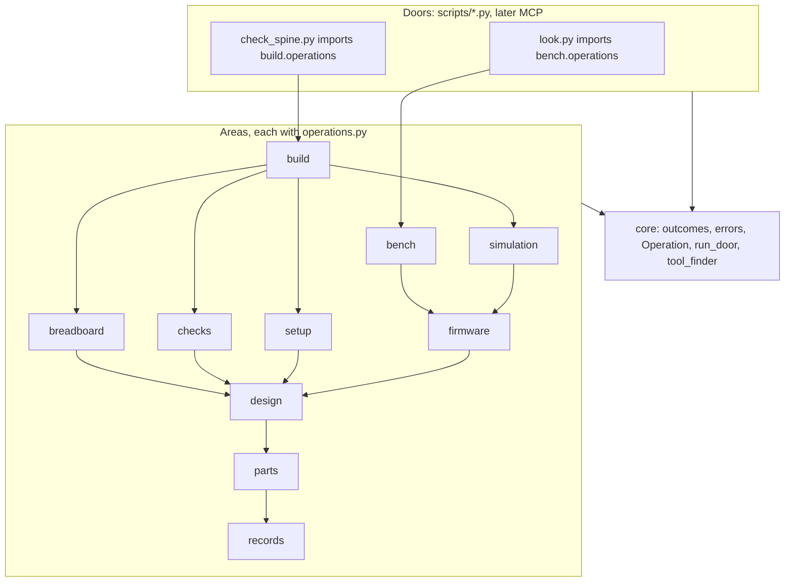
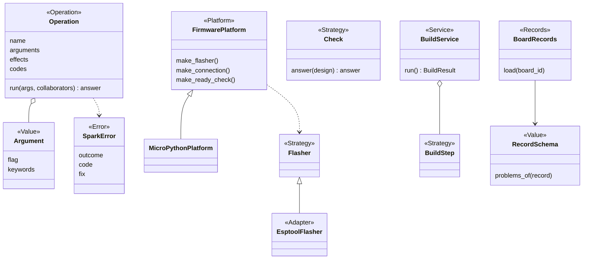
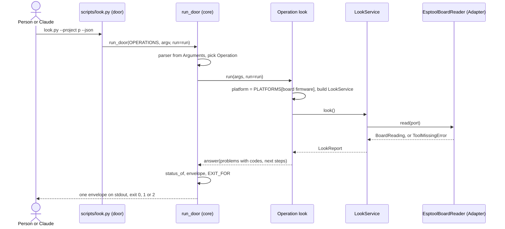

# P323: spark's target architecture and code standard

Card [P323 #413](https://github.com/xmejkal/spark/issues/413), epic P158 [#94](https://github.com/xmejkal/spark/issues/94).
Synthesis of the five papers in `council/`, on [P322's facts](../2026-10-19-p322-code-architecture/facts.md), after one refuter round. 2026-10-19.

> **TL;DR.** One stdlib package, `scripts/spark/`, in ten areas plus `core`, with one import rule.
> Each script stays a door. It lists its own **Operations**, and one small helper builds its parser, `--describe` and envelope.
> Swaps come from small registries keyed by the board record and `tools.json`. No framework, no type checker.
> One AST test with a shrinking baseline enforces the standard. Every story pays a little down.
> Only slice 1 (the frame) runs before walk 1. It changes no output.

**Summary.** spark keeps its scripts as doors and moves their logic into a package inside `scripts/`, so no plugin
path or command page changes. Each command becomes an Operation with declared arguments, effects and codes, and the
door, `--help` and `--describe` read that one list. The move runs area by area after walk 1, bench first and `parts.py`
last, and each move retargets its tests and mutation rows in the same PR instead of hiding behind shims.

## Refuter round

The refuter tried the design in scratch copies. Nine findings were confirmed and folded in. R1 (a `spark` name clash)
was rejected.

| # | Finding | What changed |
|---|---|---|
| R2 | A shim breaks `mock.patch`, drops private names (tests use 65) and the 7 mutation rows on `outcomes.py` | No library shims. A move retargets importers, patches and mutation rows (5.3). |
| R3 | Guard tests and `measure.py` read only `scripts/*.py` | Slice 1 switches them to `rglob` |
| R4 | The build had no legal place: `check_spine` imports breadboard, simulation and setup | A `build` area on top of the graph, setup above design (2.2) |
| R5 | `catalog.py` imported every area, so a broken area broke `look` | No catalog. A door imports only its own area's operations. |
| R6 | The Operation shape did not fit `parts.py`'s table | `Argument` holds argparse keywords. A door holds many Operations. The name is the envelope's `op`. |
| R7 | Slice 2 was not byte-identical | Only slice 1 before walk 1. The door passes `run` through (2.6). |
| R8 | Acceptance criteria contradicted D8 and failed on this file | No empty-baseline target for `mock.patch`. A ban list of exact identifiers. |
| R9 | "library", "Operation" and "code" each meant two things | Role `Records`, Operation is only a role, exit status is not a code |
| R10 | Slice 2 built a catalog, Workspace and door class for one door | One helper, `run_door`. Catalog and Workspace wait for need. |

## 1. Decisions

| # | Decision | Choice | Why | From | Where lenses disagreed |
|---|---|---|---|---|---|
| D1 | Package home | `scripts/spark/` | `scripts/` is already on `sys.path` for doors and tests. The 110 plugin paths stay. | migration | Architect: top-level `spark/`, editing every door and test. Smaller wins. |
| D2 | Operation | Role Operation: a frozen dataclass `Operation(name, summary, arguments, effects, codes, run)`. `run` is a plain function. `name` is what the envelope prints as `op`. | It generalises `parts.py`'s `OPERATIONS` table (line 1581). | architect, AI interface | AI lens: a typed `Input` dataclass, a second schema. An `Argument` row holds argparse keywords and does the job. |
| D3 | Wiring | No container, no `wiring.py`, no catalog. Each area's `operations.py` builds its Services. Registries are dicts beside their base class. | A central import lets one broken area break all doors. | architect, tech lead | Architect's `wiring.py` and the AI lens's catalog dropped until MCP. |
| D4 | Adapters | An Adapter lives in the area of its Strategy. Only Adapters run outside programs, through an injected `run`. | `flasher.py` already does. | standards, migration | Architect's `adapters/` tree dropped. |
| D5 | MCP | Last, on a trigger: a host with no shell, or P178. Then a catalog of all doors' Operations. | It costs a process and tool definitions in every session. | all | none |
| D6 | Type checker | None. Public functions in `spark/` carry hints. | Free, few, local. | standards | none |
| D7 | Size limits | Function 60 lines, module 600, door file 40, with a shrinking baseline. | A ratchet, not a big bang. | standards, tech lead | 25 or 40 for a door `main`. A door file at 40 is simpler to measure. |
| D8 | `mock.patch` | None new except `os.environ`. A file's count never rises. A move retargets its tests' patches. | 336 today. A patch on an old name tests nothing. | standards, migration | No sweep. |
| D9 | Error root | One `SparkError` with `outcome` and `code`, area subclasses ending in `Error`. | A dozen roots today. | standards, AI interface | Crash exit status left to the PO (question 2). |
| D10 | Enforcement | One test, `tests/test_architecture.py`, with a baseline file. The hook already runs the suite. | One tool, no hook edit. | standards, migration | `tools/check_style.py` and the architecture test merged. |
| D11 | Roles | Add **Operation** and **Records** to developing.md's table. | `Command` and `Library` already mean other things. A Policy is a `why_` function or a Check. | architect | Command, Library and Policy dropped. |
| D12 | Several MCUs | One board per project stays. No `targets` list until P318. | No abstraction before its second case. | tech lead | Architect's `Project.targets` deferred. |
| D13 | Timing | Slice 1 now. Everything else after walk 1. | Walk 1 must not slip. | tech lead, refuter | Migration's bench-first order kept, after walk 1. |
| D14 | Moves | No shim for a library module. A move updates every importer in the same PR. | See R2. | refuter | Migration's shim rule dropped. |

## 2. The target architecture

### 2.1 Layout and areas

```
scripts/                 the doors: same names, flags, JSON and exit status as today
  look.py ...            a list of Operations and one run_door call. At most 40 lines.
  spark/
    core/                outcomes, errors, operation (Operation, Argument), door (run_door), tool_finder
    records/             store, BoardRecords, PartRecords, RecordSchema
    parts/               drawer, needs, matching, cost, datasheets, requirements
    design/              design, restricted_pins, pin_assigner, netlist, board_emitter/
    setup/               init_project, tool install, ai_files
    firmware/            FirmwarePlatform, MicroPythonPlatform, project_image, flash_image, import_firmware
    breadboard/          steps, drawing, keep, changes, match, tabbed_page
    checks/              Check, the five checks, physics, compare_design
    simulation/          sim_project, scenario, WokwiCliEngine
    bench/               look, deploy, grant, doctor, live, reach, Flasher, BoardConnection, console
    build/               BuildService, one BuildStep per stage
```

Each area's `operations.py` is the only module in it that reads settings and picks an Adapter.



### 2.2 The dependency rule

| Module | May import |
|---|---|
| a door in `scripts/` | its own area's `operations`, `spark.core` |
| an area | itself, the areas below it in the graph, `core` |
| `core` | the standard library only |

`build` sits on top because `check_spine` reads breadboard, simulation, checks and setup. `setup` sits above `design`
because `init_project` reads `design`. Only public names cross a module border. Nothing in `spark/` has a `main()`,
calls `print` or `sys.exit`, or imports a door. Where a flow spans two areas, the higher area passes the step in.

### 2.3 Core abstractions

Diagram 2.6 shows the seams. New are `RecordSchema` (one rule table per record kind, joining the two `validate`
functions), `BuildService` (one `BuildStep` per stage, emitter in process) and `BoardRecords` and `PartRecords` (one
record kind read across the library, the store and the project). The deploy classes keep their names.

### 2.4 Operation and envelope

An Operation's `name` is the word the envelope prints as `op`, such as `look`. Names are unique across spark, and a
test checks that. An `Argument` holds a flag and its argparse keywords (`nargs`, `metavar`, `type`, `dest`,
`default`), so `parts.py`'s rows and its shared `OPTIONS` fit unchanged. A door holds a tuple of Operations. `look.py`
holds one. `parts.py` holds about 30 and picks one by flag, as today.

`effects` come from `reads`, `writes`, `network`, `board`, `erases`. `codes` list every code the Operation may emit.
`run` returns an `outcomes.answer`, and `status_of` decides the status. The envelope keeps v1's keys and adds two rules:

- Each problem and unchecked item carries a `code` from `codes`. Code and Claude branch on it, never on the sentence.
- A `fix` or a `next` entry is an `outcomes.step` (`op`, `argv`, `why`, `effects`, `needs_yes`). The core sets `needs_yes`.

An Operation with `erases` or `board` passes `deploy_gate`'s `ConsentStrategy`, and no Argument is a yes that Claude
can fill. `run_scenario.py` has no `--json` today and gets one when its area moves.

### 2.5 Extension seams

Each seam is a registry or a record, so its caller never changes.

| To add | You write |
|---|---|
| a board | a JSON record in `boards/` |
| an MCU platform (Arduino, ESP-IDF) | one `FirmwarePlatform` subclass, its Adapters, one line in `PLATFORMS` |
| no MCU | nothing: a board with no platform answers `skipped` for firmware and deploy |
| several MCUs | a second project folder (today's rule) |
| a tool | a row in `data/tools.json` and one Adapter, found by role through `tool_finder` |
| a check | one `Check` subclass, one line in `CHECKS` |
| a simulator | one `SimulationEngine` Adapter, one line in `ENGINES` |
| a renderer | one Renderer, one line in its registry |
| a door (MCP) | one Adapter over a catalog of the doors' Operations, built then |

### 2.6 Configuration and injection

`run_door(operations, argv, **collaborators)` parses, calls the picked Operation's `run(args, **collaborators)` and
prints. A door keeps its test seam: `look.main(argv=None, run=subprocess.run)` passes `run` to `run_door`, so
`test_look`'s `look.main(argv, run=run)` keeps working. A Service takes its collaborators in `__init__` with real
defaults, as `DeployService` does. Settings come from `tool_finder`, which reads `SPARK_HOME` and both `tools.json`
layers. A `Workspace` Value enters when two Operations need the same bundle.



### 2.7 One call, door to envelope



## 3. The code standard

Each rule is one line, with what enforces it. "AST test" means `tests/test_architecture.py` with its baseline.

| # | Rule | Check |
|---|---|---|
| S1 | A class docstring starts with its role word from developing.md's table. | AST test |
| S2 | A Value is a frozen dataclass or a NamedTuple. | AST test |
| S3 | Collaborators that touch a process, clock, network or environment come in through the constructor. | review, and S8's count |
| S4 | Imports follow 2.2. No private name crosses a module. No cycles. | AST test |
| S5 | No `main`, `print` or `sys.exit` inside `spark/`. A door file is at most 40 lines. | AST test |
| S6 | Function at most 60 lines, module at most 600. | AST test |
| S7 | Every exception class subclasses `SparkError` and ends in `Error`. No bare `except`. `except Exception` only in `run_door`. | AST test |
| S8 | No new `mock.patch` except `os.environ`. A file's count never rises. No `MagicMock` in new tests. | AST test |
| S9 | Code decides on a constant or a code, never on a sentence. | `test_no_magic_strings.py` |
| S10 | Every `--json` prints `outcomes.envelope`. Each Operation has a golden key-set test. | `test_json_contracts.py` |
| S11 | Public functions in `spark/` have type hints. | AST test |
| S12 | One word per idea, from section 4. No class or function name uses a banned word. | AST test |
| S13 | A pure calculation stays a function. A base class needs a second implementation or a Fake. | review |

The baseline lists today's breaches. A new breach or a stale entry fails, so it only shrinks. Each Strategy gets one
contract test, run on the real class and its Fake.

## 4. Vocabulary

| Term | One meaning |
|---|---|
| record | a JSON file of facts with an origin (part, board, chip) |
| library | the record folders shipped with spark (`parts/`, `boards/`) |
| part | a component or breakout record |
| board | the dev board record: chip, pins, power, physical |
| store | the person's local folder (`SPARK_HOME`), never the repo |
| drawer | what the person owns, kept in the store |
| project | the person's folder with requirements, firmware and simulation |
| requirements | the file that lists the board and parts for a build |
| design | the netlist and pin map derived from requirements |
| build | requirements to design, sheet, diagram and checks |
| check | one deterministic test of a design that returns an answer |
| outcome | ok, problems or could-not-run, decided by `status_of` |
| exit status | the number a script exits with, from `EXIT_FOR` |
| code | a constant that names one problem or unchecked item |
| envelope | the JSON form of an answer, the same for every `--json` |
| operation | one named job a door runs, printed as `op` |
| door | a script (later an MCP server) that parses, runs one operation and prints |
| area | one package folder of related code with its own operations |
| service | runs the steps of one flow over objects it was given |
| strategy | a base class a caller can swap |
| adapter | wraps an outside program behind spark's own methods |
| platform | a bundle of factories for one firmware language |
| renderer | turns a value into text or a file and decides nothing |
| image | the flash image that passed the simulation |
| gate | a rule that opens or refuses the next step, with consent |

Banned in class and function names: `Validator`, `Verifier`, `Checker`, `Command`, `Library`, `Context`, `Manager`.

## 5. The plan

### 5.1 Areas in order

| Order | Area | PRs |
|---|---|---|
| 0 | Frame (slice 1) | 1 |
| 1 | bench, with the first Operations (slices 2 and 3) | 4 |
| 2 | breadboard | 4 |
| 3 | firmware and simulation | 2 |
| 4 | checks | 5 |
| 5 | design, setup and build (`BuildService`, emitter in process) | 7 |
| 6 | records, parts, drawer, idea (`parts.py` split) | 8 |
| 7 | MCP door and its catalog, on its trigger | 1 |

About 32 PRs. bench is already classes. `parts.py` (2,402 lines) goes last. A story may pull its area forward.

### 5.2 The first three slices

**Slice 1: the frame (before walk 1).** Add `scripts/spark/core/` with `errors.SparkError` only. `outcomes` stays where
it is until its own move. Add `tests/test_architecture.py` with today's baseline. Switch the guard tests that list
`scripts/*.py` (`test_store`, `test_orphans`, `test_fab`, `test_self_confirmation`, `test_board_look`) and
`measure.py` to `rglob`, and move `measure.py` to `tools/` with the new columns. Done when: the suite count only
grows, every door's output is unchanged, and planted defects (a cycle, a door import, a `print` in `spark/`, a new
`mock.patch`, a module the guards skip) are caught 5 of 5.

**Slice 2: the first Operation (after walk 1).** Add `Operation`, `Argument` and `run_door`, and turn `look.py` into
a door over `look`. Done when: its JSON matches a golden recorded in the PR's first commit, `test_look` passes
unchanged, and `look.py` is under 40 lines. `--describe` is new output and is named in the PR.

**Slice 3: the AI paths.** Add `code` to each problem `look` emits, the `next` steps, and the golden contract test.
Point `commands/deploy.md`'s look step at the codes. Done when: the contract test fails on a removed key and on an
unlisted code, and `parts.py --describe` answers unchanged.

### 5.3 How a move runs, and refactoring beside features

- **A move PR** moves the modules, updates every importer, retargets every `mock.patch` string and every mutation
  row's `file` field, and keeps private names reachable where tests use them. No library shim. A door keeps its path.
- **Gate per move:** the demo projects' golden outputs do not change, the test count does not drop, and
  `mutate.py --anchors` finds every old row, each still caught.
- **Before walk 1:** slice 1 only.
- **Per story:** no new baseline entry, and at least one paid down in a file the story edits.
- **After walk 1:** one slot in four goes to an area move, inside the normal WIP limits, one move in flight.

### 5.4 Measuring progress

`tools/measure.py` prints one line, and each PR pastes the before and after:

```
SCORE classes 16% | fat CLIs 3 | thin CLIs 4 | private imports 3 | outcome literals 10 | roles stated 56/103
      | in package 0% | doors on run_door 0/24 | envelope 2/16 | baseline 0 | mock.patch 336
```

No column may get worse in a PR. The Miro progress table has one row per area: status, PRs done of planned, baseline
left, date.

## 6. Acceptance criteria

Each is checked by a test or by `measure.py`.

1. `tests/test_architecture.py` exists. Its baseline holds no entry outside S8, and S8's count only falls.
2. Every door in `scripts/` is at most 40 lines and calls `run_door` (fat CLIs 0).
3. Every door with `--json` prints `outcomes.envelope`, with a golden contract test per Operation.
4. Every problem in an envelope has a `code` listed in its Operation, and Operation names are unique.
5. Private imports 0, outcome literals 0, roles stated on every class.
6. Seam tests: a second board record, a fake `FirmwarePlatform` and a new Renderer plug in with no caller edit.
7. A `SparkError` maps to its outcome in one place, `run_door`.
8. Walk 1 passes at every merge, and no move PR changes a golden output.
9. No class or function name in `scripts/` uses a banned word from section 4.

## 7. What we will not do

- No DI container, entry points, `pyproject`, `src/` layout, `wiring.py`, `adapters/` tree or library shims.
- No pydantic, click, ruff or mypy.
- No catalog or `Workspace` before a second user needs one.
- No base class for one implementation, no record classes, no generic Repository.
- No `targets` list, `state` store, build graph or ledger until a story needs one.
- No MCP before every door runs on `run_door`. No class share as a target.
- No big-bang move, and no behaviour change inside a move.

## 8. Open questions for the PO

1. **Capacity after walk 1.** Example: in a week of eight cards, two are area moves. (a) One slot in four. (b) No
   fixed share, only the per-story pay-down. The council proposes (a).
2. **Crash exit status.** Example: `check_all.py` hits a `KeyError` and today exits 1, read as "problems". (a) Make it
   `could-not-run`, exit 2, in slice 2. (b) Keep exit 1. The council proposes (a), since a crash is not a finding.
