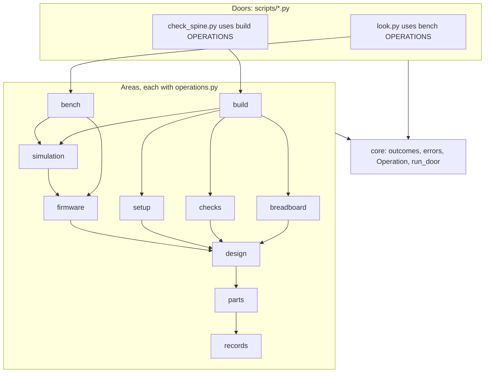
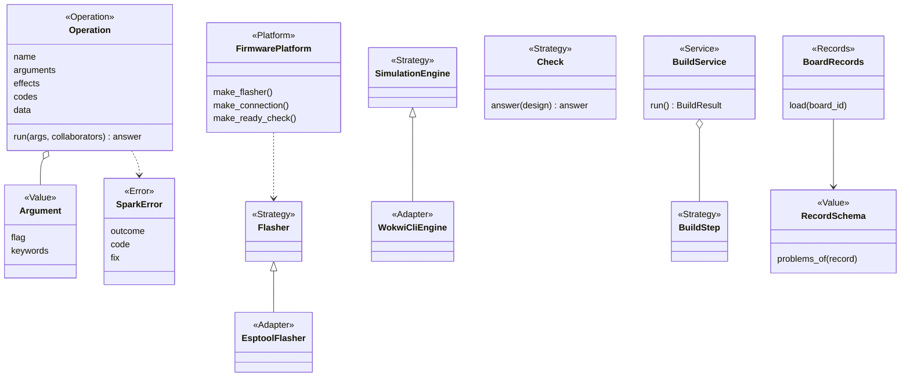
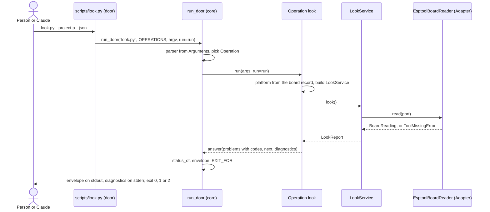

# P323: spark's target architecture and code standard

Card [P323 #413](https://github.com/xmejkal/spark/issues/413), epic P158 [#94](https://github.com/xmejkal/spark/issues/94).
Built on [P322's facts](../2026-10-19-p322-code-architecture/facts.md). 2026-10-19.

## Council

- **Round 1** (papers in `council/`): architect, AI interface, standards, migration and tech lead, on the everyday
  model. The synthesis on Opus picked the smaller option at each split.
- **Refuter** (Opus): nine findings confirmed, one rejected. It removed library shims and the global catalog, added a
  `build` area, and fit `Argument` to `parts.py`.
- **Round 2**: tech lead (Opus) fixed the area graph cycle, the many-operation door, the platform key, the MCP switch
  and the seam tests. Senior (Sonnet) made `run_door`, the baseline and slice 1 buildable and split slice 1. PO
  assistant (Sonnet) rewrote the top in plain words and cut the questions to one.

> **TL;DR.** We move spark's logic out of the big scripts into one package, area by area. Each script stays and keeps
> its name, flags and output. Each job gets one declared list of arguments and results, so the script, `--help` and
> Claude read the same thing. One automatic test enforces the code rules and only lets the list of known breaches
> shrink. Only step 1a, a small change to tests and the measure script, could run before walk 1, and it changes no output.

**Your call:** say yes to this design, and answer the one question in section 8.

**Summary.** spark keeps its scripts as doors and moves their logic into a package inside `scripts/`, so no plugin
path changes. Each job becomes an Operation in its area's `operations.py`, and the door, `--help` and `--describe` read
that list. Until v0.13 only the per-story pay-down runs, and the area moves are v0.13's work.

Sections 1 to 7 are reference. The TL;DR and section 8 are enough to decide.

## Refuter round

| # | Finding | What changed |
|---|---|---|
| R2 | Shims break patches, private names and mutation rows | No library shims (D14, 5.3) |
| R3 | Guards read only `scripts/*.py` | `rglob` in slice 1a |
| R4 | The build had no place in the graph | A `build` area on top |
| R5 | A catalog imported every area | Each door imports its own area |
| R6 | Operation did not fit `parts.py` | Argparse keywords, many Operations per door, one name |
| R7 | Slice 2 was not byte-identical | Only slice 1a before walk 1 |
| R8 | Criteria contradicted D8 | No empty target for `mock.patch`, exact S12 |
| R9 | Three words had two meanings | `Records`, exit status, Operation as a role |
| R10 | Slice 2 was too big | One `run_door` helper |

R1 (a `spark` name clash) was rejected. Round 2's rows are in `docs/observations/rows/p323-target-architecture.md`.

## 1. Decisions

| # | Decision | Choice | Why | From | Where lenses disagreed |
|---|---|---|---|---|---|
| D1 | Package home | `scripts/spark/` | `scripts/` is already on `sys.path` for doors and tests. The 110 plugin paths stay. | migration | Architect: top-level `spark/`, editing every door and test. Smaller wins. |
| D2 | Operation | Role Operation: a frozen dataclass `Operation(name, summary, arguments, effects, codes, data, description, epilog, run)`. `name` is the envelope's `op`. | It generalises `parts.py`'s `OPERATIONS` table (line 1581). | architect, AI interface | AI lens: a typed `Input` dataclass, a second schema. An `Argument` row does the job. |
| D3 | Wiring | No container, no `wiring.py`, no catalog. Each area's `operations.py` holds its `OPERATIONS` tuple and builds its Services. Registries are dicts beside their base class. | A central import lets one broken area break all doors. | architect, tech lead, refuter | `wiring.py` and the catalog dropped until MCP. |
| D4 | Adapters | An Adapter lives in the area of its Strategy. Only Adapters run outside programs, through an injected `run`. | `flasher.py` already does. | standards, migration | `adapters/` tree dropped. |
| D5 | MCP | A tool's MCP version is a setting today (`kind: mcp` rows). An MCP door for spark itself comes last, on a trigger: a host with no shell, or P178. | It costs a process and tool definitions in every session. | all | none |
| D6 | Type checker | None. Public functions in `spark/` carry hints. | Free, few, local. | standards | none |
| D7 | Size limits | Function 60 lines, module 600, door file 40. | A ratchet, not a big bang. | standards, tech lead | A whole door file at 40 is simpler to measure than a `main`. |
| D8 | `mock.patch` | None new except `os.environ`. A file's count never rises. A move retargets its tests' patches. | 336 today. A patch on an old name tests nothing. | standards, migration | No sweep. |
| D9 | Errors | One `SparkError(outcome, code, fix)`, area subclasses ending in `Error`. An unexpected exception is `could-not-run` with code `crash`, exit 2. agents.md's exit table gets that line in the same PR. | `agents.md:501`: exit 2 is "it could not look". | standards, AI interface, council round 2 | Decided by the council, door by door as each moves onto `run_door`. |
| D10 | Enforcement | One test, `tests/test_architecture.py`, with `tests/architecture_baseline.json`. The hook already runs the suite. | One tool, no hook edit. | standards, migration | `tools/check_style.py` merged in. |
| D11 | Roles | Add **Operation** and **Records** to developing.md's table. | `Command` and `Library` already mean other things. A Policy is a `why_` function or a Check. | architect | Command, Library and Policy dropped. |
| D12 | Several MCUs | One board per project stays. The v0.13 promise in `developing.md:301` and `journey.md:875` moves to P318. This design's PR edits both lines. | No abstraction before its second case. | tech lead | Architect's `Project.targets` deferred. |
| D13 | Timing | Until v0.13, refactoring is the per-story pay-down only, and a story may pull its area forward. The area moves are v0.13's work. | AGENTS.md: the whole-repository change waits for v0.13. | tech lead, council round 2 | Migration's bench-first order kept, inside v0.13. |
| D14 | Moves | No shim for a library module. A move updates every importer in the same PR. | A shim breaks patches, private names and mutation anchors. | refuter | Migration's shim rule dropped. |
| D15 | Settings | `tool_finder` lives in `records`, since it reads `boards` and the store. | `core` imports only Python's built-ins. | tech lead | none |

## 2. The target architecture (reference)

### 2.1 Layout and areas

```
scripts/                 the doors: same names, flags, JSON and exit status as today
  look.py ...            imports its area's OPERATIONS and calls run_door. At most 40 lines.
  spark/
    core/                outcomes, errors (SparkError), operation (Operation, Argument), door (run_door)
    records/             store, tool_finder, BoardRecords, PartRecords, RecordSchema
    parts/               drawer, needs, matching, cost, datasheets, requirements
    design/              design, restricted_pins, pin_assigner, netlist, board_emitter/
    setup/               init_project, tool install, ai_files
    firmware/            FirmwarePlatform, flash_image, import_firmware, errors (DeployError)
    simulation/          sim_project, run_scenario, project_image, SimulationEngine
    breadboard/          steps, drawing, keep, changes, match, tabbed_page
    checks/              Check, the five checks, physics, compare_design
    bench/               look, deploy, grant, doctor, live, reach, Flasher, BoardConnection, console
    build/               BuildService, one BuildStep per stage
```

`project_image` lives in `simulation`, since the image is the one that passed the simulation. `DeployError` moves to
`firmware/errors.py`, which breaks today's loop between `firmware_platform` and `project_image`.



### 2.2 The dependency rule

| Module | May import |
|---|---|
| a door in `scripts/` | its own area's `operations`, `spark.core` |
| an area | itself, the areas below it (reachable by the arrows), `core` |
| `core` | Python's built-ins only |

Only public names cross a module border. Nothing in `spark/` has a `main()`, calls `print` or `sys.exit`, or imports
a door. Where a flow spans two areas, the higher area passes the step in.

### 2.3 Core abstractions

New are `RecordSchema` (one rule table per record kind, joining the two `validate` functions), `BuildService` (one
`BuildStep` per stage, emitter in process) and `BoardRecords` and `PartRecords` (one record kind read across the
library, the store and the project). The deploy classes keep their names.

### 2.4 Operation and envelope

An Operation's `name` is the word the envelope prints as `op`, such as `look`. Names are unique across spark. An
`Argument` holds a flag and its argparse keywords (`nargs`, `metavar`, `type`, `dest`, `default`). `data` lists the
keys of the envelope's `data`, so `--describe` keeps them.

An area's `operations.py` holds its `OPERATIONS` tuple. A door imports that tuple and calls `run_door`, so `parts.py`'s
30 Operations fit a 40-line door. With more than one Operation, each one's selector is its own flag, and `run_door`
builds a required group of mutually exclusive flags, as `parts.py` does today. Its 11 shared `OPTIONS` rows go in as
`options=`. `store.locked()` stays in parts' `operations.py`.

`effects` come from `reads`, `writes`, `network`, `board`, `erases`. `codes` list every code the Operation may emit.
`run` returns an `outcomes.answer`, and `status_of` decides the status. The envelope keeps v1's keys and adds:

- a `code` from `codes` on each problem and unchecked item. Code and Claude branch on it, never on the sentence.
- `outcomes.step` for each `fix` and `next` entry (`op`, `argv`, `why`, `effects`, `needs_yes`). The core sets `needs_yes`.
- `diagnostics`: lines for a person, which `run_door` writes to stderr. `look`'s doctor lines go here, so nothing in
  `spark/` prints.

An Operation with `erases` or `board` passes `deploy_gate`'s `ConsentStrategy`. No Argument is a yes Claude can fill.

### 2.5 Extension seams

A seam is a swap point. Each is a registry (a dict from a name to a class) or a record, so its caller never changes.

| To add | You write |
|---|---|
| a board | a JSON record in `boards/` |
| an MCU platform | one `FirmwarePlatform` subclass, its Adapters, one line in `PLATFORMS`. `PLATFORMS` is keyed by the board record's `firmware` field, which enters with the second platform. Until then a record with `micropython_port` maps to `micropython`. |
| no MCU | nothing: a record with neither field maps to no platform, which answers `skipped` for firmware and deploy |
| several MCUs | a second project folder (today's rule, D12) |
| a tool | a row in `data/tools.json` and one Adapter, found by role through `tool_finder` |
| a tool's MCP version | a `kind: mcp` row for the same role and one MCP Adapter. `tool_finder` picks it from the person's setting. |
| a check | one `Check` subclass, one line in `CHECKS` |
| a simulator | one subclass (an Adapter) of the `SimulationEngine` Strategy, one line in `ENGINES` |
| a renderer | one Renderer, one line in its registry |

### 2.6 Configuration and injection

```python
def run_door(prog, operations, argv=None, *, options=(), **collaborators) -> int
# look.py:  def main(argv=None, run=subprocess.run): return run_door("look.py", OPERATIONS, argv, run=run)
```

`run_door` builds the parser with `prog`, each Operation's `description` and `epilog`, and `options`. It turns a bad
argument into an answer, as `parts.py`'s `_Parser.error` does. It calls `run(args, **collaborators)`, prints the
envelope or the text, writes `diagnostics` to stderr and returns `EXIT_FOR[status]`. A Service takes its collaborators in `__init__` with real defaults, as `DeployService`
does. A `Workspace` Value enters when two Operations need the same bundle.



### 2.7 One call, door to envelope



## 3. The code standard (reference)

"AST test" means `tests/test_architecture.py`, a test that reads the code's structure with Python's `ast`.

| # | Rule | Check | Scope |
|---|---|---|---|
| S1 | A class docstring starts with its role word from developing.md's table. | AST test | all |
| S2 | A Value is a frozen dataclass or a NamedTuple. | AST test | `spark/` |
| S3 | Collaborators that touch a process, clock, network or environment come in through the constructor. | review | all |
| S4 | Imports follow 2.2. No private name crosses a module. No cycles. | AST test | `spark/` |
| S5 | No `main`, `print` or `sys.exit` inside `spark/`. A door file is at most 40 lines. | AST test | both |
| S6 | Function at most 60 lines, module at most 600. | AST test | all |
| S7 | Every exception subclasses `SparkError` and ends in `Error`. No bare `except`. `except Exception` only in `run_door`. | AST test | `spark/` |
| S8 | No new `mock.patch` except `os.environ`. A file's count never rises. No `MagicMock` in new tests. | AST test | `tests/` |
| S9 | Code decides on a constant or a code, never on a sentence. | `test_no_magic_strings.py` | all |
| S10 | Every `--json` prints `outcomes.envelope`. Each Operation has a golden contract test. | `test_json_contracts.py` | doors |
| S11 | Public functions have type hints. | AST test | `spark/` |
| S12 | No class name has Validator, Verifier, Checker, Command, Library, Context or Manager as a whole CamelCase word. No function name has validator, verifier, checker or manager as a whole word. | AST test | all |
| S13 | A pure calculation stays a function. A base class needs a second implementation or a Fake. | review | all |

"All" means `scripts/` and `tests/`. The baseline holds one sorted key per line with no line numbers, such as
`"S6|scripts/parts.py|_op_list": 71`. The test fails when a measure is above its value (a new breach) or below it (a
stale entry). `python3 tests/test_architecture.py --lower` rewrites it and can only lower it. Each Strategy gets one
contract test, run on the real class and its Fake.

## 4. Vocabulary (reference)

The role words (Service, Strategy, Adapter, Value, Result, Store, Decorator, Renderer, Platform, Fake, Error, plus
Operation and Records) are developing.md's table. This table holds the domain and process words.

| Term | One meaning |
|---|---|
| record | a JSON file of facts with an origin (part, board, chip) |
| library | the record folders shipped with spark (`parts/`, `boards/`) |
| part | a component or breakout record |
| board | the dev board record: chip, pins, power, physical |
| store | the person's local folder (`SPARK_HOME`), never the repo |
| drawer | what the person owns, kept in the store |
| project | the person's folder with requirements, firmware and simulation |
| design | the netlist and pin map derived from requirements |
| build | requirements to design, sheet, diagram and checks |
| check | one deterministic test that returns an answer |
| outcome | ok, problems or could-not-run, decided by `status_of` |
| exit status | the number a script exits with, from `EXIT_FOR` |
| code | a constant that names one problem or unchecked item |
| envelope | the JSON form of an answer, the same for every `--json` |
| operation | one named job a door runs, printed as `op` |
| door | a script (later an MCP server) that parses, runs one operation and prints |
| area | one package folder of related code with its own operations |
| image | the flash image that passed the simulation |
| gate | a rule that opens or refuses the next step, with consent |
| Value | a small fixed record of facts, a frozen dataclass or a NamedTuple |
| registry | a dict from a name to a class, such as `PLATFORMS` |
| seam | a swap point a test or a setting can fill |
| baseline | the list of today's rule breaches, which may only shrink |
| golden | a saved correct output a test compares with |
| mutation row | a planted defect that the suite must catch |
| stdlib | Python's built-in modules, the only ones spark uses |

## 5. The plan (reference)

### 5.1 Order

Slice 1a can run before walk 1 (section 8). Until v0.13, slices 1b to 3 land with the first story that needs them,
such as the AI-first `--json` items. In v0.13 the areas move in this order: bench, breadboard, firmware and
simulation, checks, design with setup and build, then records and parts. About 32 PRs, each area refined
only when it is next.

### 5.2 The first slices

**Slice 1a: guards and measure (about 110 lines).** Switch the guard tests that list `scripts/*.py` (`test_store`,
`test_orphans`, `test_fab`, `test_self_confirmation`, `test_board_look`) and `measure.py` to `rglob`. Move `measure.py`
to `tools/` with the new columns. No code under `spark/`. Done when: every door's output is unchanged, the suite count
does not drop, and a test plants a module one folder down and each guard sees it.

**Slice 1b: the architecture test (about 290 lines plus the baseline).** `ArchitectureCheck(root)` takes a folder.
Five unittest cases build a temp tree and plant a cycle, a door import, a `print` in `spark/`, a new `mock.patch` and a
module the guards skip. Each is caught. `tests/mutations/p323-architecture.json` plants the same five in the checker.
Done when: all five are caught and the generated baseline passes.

**Slice 2: the first Operation (about 450 lines).** First commit: move `outcomes.py` to `core/outcomes.py` (39
importers, 7 mutation rows, no patches). Then add `SparkError`, `Operation`, `Argument`, `run_door` and
`bench/operations.py`, and turn `look.py` into a door. Done when: its JSON matches a golden, `test_look` passes unchanged, every `test_look` case's exit equals `EXIT_FOR[status_of(...)]`, and `look.py`
is at most 40 lines. `--describe` is new output and is named in the PR.

**Slice 3: the AI paths (about 150 lines).** Add `code` at the 6 sites in `board_envelope`, the `next` steps and the
golden contract test. Point `commands/deploy.md`'s look step at the codes. Done when: the contract test fails on a
removed key and on an unlisted code, and `parts.py --describe` answers unchanged.

### 5.3 How a move runs

- A move PR moves the modules, updates every importer, retargets every patch and every mutation row's `file` field,
  and keeps private names reachable where tests use them. No library shim. A door keeps its path.
- Guard regexes (`test_store:78`, `test_orphans:52,82`) learn the package form in the same PR.
- The bench move, for scale: 17 modules, 34 importing files, 188 mutation rows in 18 tables, about 15
  `mock.patch.object` lines, and 16 patches of `tools.find` that retarget when `tool_finder` moves.
- Gate: the demo projects' golden outputs do not change, the test count does not drop, and `mutate.py --anchors`
  finds every old row, each still caught.
- Per story, always: no new baseline entry, and at least one paid down in a file the story edits.

### 5.4 Measuring progress

**Areas moved: 0 of 10. Known breaches left: N.** The other columns are detail. `tools/measure.py` prints them, and
each PR pastes the before and after:

```
SCORE classes 16% | fat CLIs 3 | thin CLIs 4 | private imports 3 | outcome literals 10 | roles stated 56/103
      | in package 0% | doors on run_door 0/24 | envelope 2/16 | baseline N | mock.patch 336
```

No column may get worse in a PR. The Miro progress table has one row per area: status, PRs done of planned, baseline
left, date.

## 6. Acceptance criteria

Each is checked by a test or by `measure.py`.

1. `tests/test_architecture.py` exists. Its baseline holds no entry outside S8, and S8's count only falls.
2. Every door in `scripts/` is at most 40 lines and calls `run_door` (fat CLIs 0).
3. Every door with `--json` prints `outcomes.envelope`, with a golden contract test per Operation.
4. Every problem in an envelope has a `code` listed in its Operation, and Operation names are unique.
5. Private imports 0, outcome literals 0, roles stated on every class.
6. Seam tests: a second board record, a fake `FirmwarePlatform`, a board with no platform answering `skipped`, a new
   `Check`, a fake `SimulationEngine`, a tool switched to its MCP Adapter and a new Renderer each plug in with no
   caller edit.
7. A crash in any Operation gives `could-not-run`, code `crash`, exit 2.
8. Walk 1 passes at every merge, and no move PR changes a golden output.
9. S12 finds no banned name part in `scripts/` or `tests/`.

## 7. What we will not do

- No DI container, entry points, `pyproject`, `src/` layout, `wiring.py`, `adapters/` tree or library shims.
- No pydantic, click, ruff or mypy.
- No catalog or `Workspace` before a second user needs one.
- No base class for one implementation, no record classes, no `targets` list, state store or ledger.
- No MCP door before every door runs on `run_door`. No class share as a target.
- No area move before v0.13 unless a story pulls it. No behaviour change inside a move.

## 8. The one question for the PO

**Slice 1a before walk 1, or everything after walk 1?** Example: you start the walk on the bench tomorrow.

- (a) Slice 1a lands first. It is one PR of about 110 lines in tests and the measure script, and no script output changes.
- (b) Walk 1 first, and slice 1a lands with the first story after it.

Trade-off: (a) costs one review slot now and makes the score honest before code moves. (b) keeps every slot on walk 1.
The council proposes (a).
