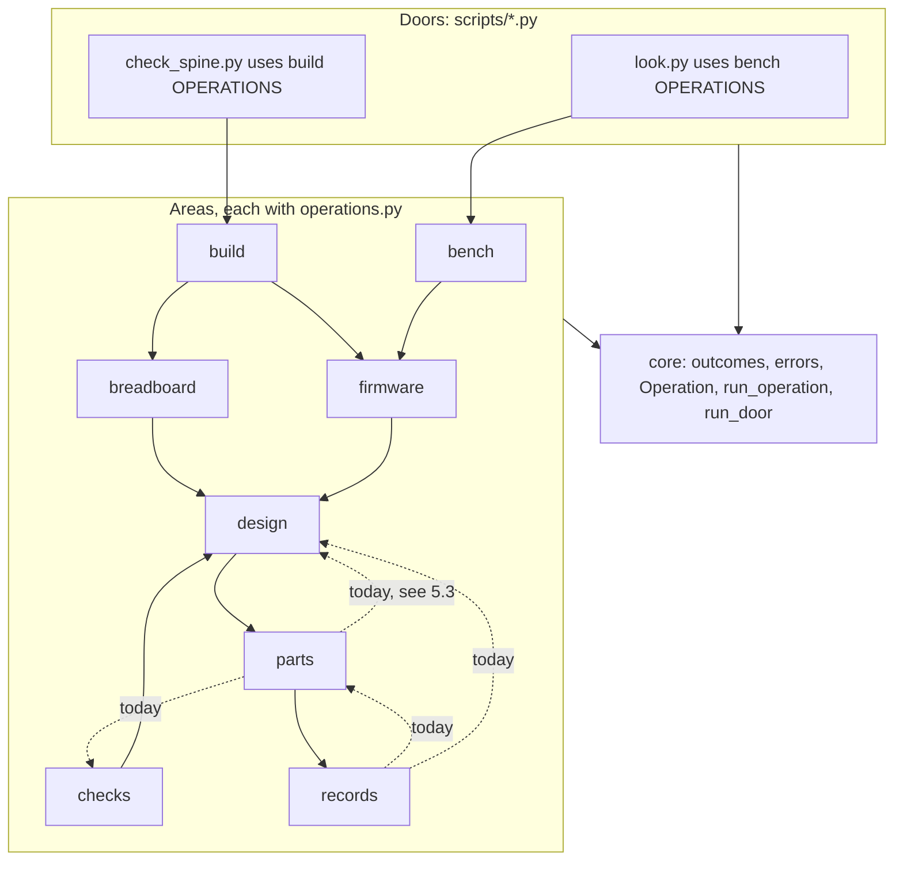
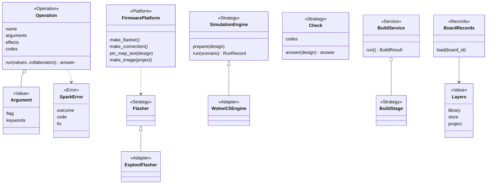
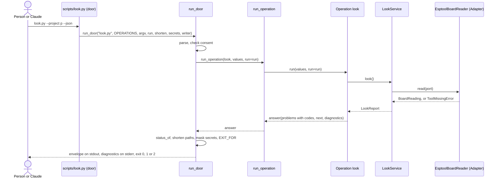

# P323: spark's target architecture and code standard

Card [P323 #413](https://github.com/xmejkal/spark/issues/413), epic P158 [#94](https://github.com/xmejkal/spark/issues/94).
Built on [P322's facts](../2026-10-19-p322-code-architecture/facts.md). 2026-10-19.

## Council

- **Round 1** (papers in `council/`): architect, AI interface, standards, migration and tech lead, on the everyday
  model. The synthesis on Opus picked the smaller option at each split.
- **Refuter** (Opus): nine findings confirmed, one rejected (a `spark` name clash). It removed module shims and the
  global catalog, added a `build` area, fit `Argument` to `parts.py`, and left only slice 1a before walk 1.
- **Round 2**: tech lead (Opus), senior and PO assistant (Sonnet) fixed the many-operation door, the platform key,
  the seam tests and the top.
- **Round 3**: extensions and simplicity (Opus), testing, Claude operator and safety (Sonnet). See its table.
- **Refuter round 2** (Opus): nine findings confirmed and acted on. The area graph now matches today's imports.

Every row is in `docs/observations/rows/p323-target-architecture.md`.

> **TL;DR.** We move spark's logic out of the big scripts into one package, area by area. Each script keeps its name
> and flags. Its output only gains keys, and a crash exits 2. Each job gets one declared list of arguments and results,
> so the script, `--help` and Claude read the same thing. One automatic test enforces the code rules and only lets the
> list of known breaches shrink. Only step 1a, which records today's outputs and fixes the measure, could run before walk 1.

**Your call:** say yes to this design, and answer the one question in section 8.

**Summary.** spark keeps its scripts as doors and moves their logic into a package inside `scripts/`. Each job becomes
an Operation in its area's `operations.py`, which the door, `--help` and `--describe` read. Until v0.13 only the
per-story pay-down runs.

Sections 1 to 7 are reference. The TL;DR and section 8 are enough to decide.

## Round 3

| Finding | What changed |
|---|---|
| The platform key and its scope | Key in requirements. The platform owns the pin map and image too. |
| A missing board silently loads the active ESP32 (`boards.py:253`) | `no_board`. A no-MCU platform is deferred. |
| `run_door` mixes parse, run and print | `run_operation` split out |
| 10 areas | 8 (D15) |
| Safety by convention | S14 to S18, and consent, masking, short paths and dry run in `run_door` |
| Records read the environment in many places | `Layers`, versioned `RecordSchema` |
| Test and walk gaps | Test shapes, contract mixins, goldens in 1a, `--retarget`, starter codes, `needs_person` |
| Terms | outcome printed as `status`, `BuildStage`, `ArchitectureRules`, "Done when" |
| Built too early | No Renderer or MCP-client seam test, measure columns enter when they move |

Rejected or deferred: a `project` area, an `EXPORTERS` registry, an online store layer, a `Clock`, `check_all --all`
and a `firmware_pins` check.

## Refuter round 2

| Finding | What changed |
|---|---|
| The area graph had cycles against today's imports | `FirmwarePlatform` in bench, `needs` in design, `part_pictures` in breadboard. 5.3 lists the upward edges left. |
| The platform was chosen in two places | The requirements' `platform` key is the only choice. `micropython_port` is a fact the platform reads. |
| "firmware" named four things | The requirements key is `platform` |
| `no_board` broke `boards/active.json` | `no_board` only when neither names a board. The four callers are listed (D16). |
| `run_door` broke S3, the core rule and the Fakes' home | The door passes `shorten`, `secrets` and `writer` from `records` |
| S14, S15, S17 not AST-checkable | S14 checks `<Name>Contract` classes, S15 direct imports, S17's last sentence dropped |
| Goldens held home paths and versions | A fixture under `tests/data/`, `<project>` for the root, tool versions normalised |
| Terms | "exit code" for the process, "module shim", `developing.md:222` |
| Rows 89, 71, 42 had no text | Added to 2.4, S14 and 5.3 |

## 1. Decisions

| # | Decision | Choice | Why |
|---|---|---|---|
| D1 | Package home | `scripts/spark/` | `scripts/` is already on `sys.path` for doors and tests. The 110 plugin paths stay. |
| D2 | Operation | A frozen dataclass `Operation(name, summary, arguments, effects, codes, data, description, epilog, run)`. `name` is the envelope's `op`. | It generalises `parts.py`'s `OPERATIONS` table (line 1581). |
| D3 | Wiring | No container, no `wiring.py`, no catalog. Each area's `operations.py` holds its `OPERATIONS` and builds its Services. Registries are dicts beside their base class. A catalog returns only with an MCP door. | A central import lets one broken area break all doors. |
| D4 | Adapters | An Adapter lives in the area of its Strategy. Only Adapters run outside programs. | `flasher.py` already does. |
| D5 | MCP | A tool's MCP version is a setting (`kind: mcp` rows). An MCP door for spark comes last, on a trigger: a host with no shell, or P178. | It costs a process and tool definitions in every session. |
| D6 | Type checker | None. Public functions carry hints. | Free, few, local. |
| D7 | Size limits | Function 60 lines, module 600, door file 40. | A ratchet, not a big bang. |
| D8 | `mock.patch` | None new except `os.environ`. A file's count never rises. | 336 today. |
| D9 | Errors | One `SparkError(outcome, code, fix)`, area subclasses ending in `Error`. A crash is `could-not-run`, code `crash`, exit 2. | `agents.md:501`: exit 2 is "it could not look". |
| D10 | Enforcement | One test, `tests/test_architecture.py` (class `ArchitectureRules`), with `tests/architecture_baseline.json`. | One tool, no hook edit. |
| D11 | Roles | Add **Operation** and **Records** to developing.md's table. | `Command` and `Library` mean other things. |
| D12 | Several MCUs | One board per project stays. The v0.13 promise moves to P318 (section 7). | No abstraction before its second case. |
| D13 | Timing | Until v0.13, the per-story pay-down only. A story may pull its area forward. Area moves are v0.13's work. | AGENTS.md: the whole-repository change waits for v0.13. |
| D14 | Moves | No module shim. A move updates every importer in the same PR. | See R2. |
| D15 | Areas | 8 areas. Firmware holds simulation, build holds setup, records holds tools. | Removes two edges and a loop. |
| D16 | No MCU | Small fix now: `no_board` only when neither requirements nor `boards/active.json` names a board (5.1). A no-MCU platform waits for a 555-style project. | The board contract requires `chip` and `wokwi_part_type` (`boards.py:62`). `init_project --board` writes `active.json`. |

## 2. The target architecture (reference)

### 2.1 Layout and areas

```
scripts/                 the doors: same names and flags as today
  look.py ...            imports its area's OPERATIONS and calls run_door. At most 40 lines.
  spark/
    core/                outcomes, errors (SparkError), operation (Operation, Argument), door (run_operation, run_door)
    records/             store, Layers, tools (tool_finder, install), BoardRecords, PartRecords, RecordSchema
    parts/               drawer, matching, cost, datasheets, requirements
    design/              design, needs, restricted_pins, pin_assigner, netlist, board_emitter/, emit_footprint, fab, copper
    firmware/            flash_image, import_firmware, project_image, sim_project, run_scenario, SimulationEngine
    breadboard/          steps, drawing, part_pictures, keep, changes, match, tabbed_page
    checks/              Check, the five checks, physics, compare_design
    bench/               look, deploy, grant, doctor, live, reach, FirmwarePlatform, Flasher, BoardConnection, console
    build/               BuildService, one BuildStage per stage, init_project, ai_files, loop_status
```



The solid arrows are today's imports between areas (an `ast` scan of `scripts/*.py`), less those already reached. The dotted ones point upward and are breaches (5.3).

### 2.2 The dependency rule

| Module | May import |
|---|---|
| a door in `scripts/` | its own area's `operations`, `spark.core` |
| an area | itself, the areas below it (reachable by the arrows), `core` |
| `core` | Python's built-ins only |

Only public names cross a module border. Nothing in `spark/` has a `main()`, calls `print` or `sys.exit`, or imports
a door. Where a flow spans two areas, the higher area passes the step in.

### 2.3 Core abstractions

New are `RecordSchema(kind, version, rules)`, `Layers` (the library, store and project folders, built once), `BuildService` (one `BuildStage` per stage, emitter in process) and
`BoardRecords` and `PartRecords` (one record kind read across the `Layers`). Only `records` reads `SPARK_HOME`. The
deploy classes keep their names.

### 2.4 Operation and envelope

An Operation's `name` is printed as `op`, such as `look`, and is unique. An `Argument` holds a flag and its argparse keywords (`nargs`, `metavar`, `type`, `dest`, `default`). `data` lists the
keys of the envelope's `data`. `Argument.kind` waits for the MCP door.

A door imports its area's `OPERATIONS` tuple and calls `run_door`, so `parts.py`'s 30 Operations fit a 40-line door.
Each selector is its own flag in a required group of mutually exclusive flags, as `parts.py` does today. Its 11 shared `OPTIONS` rows go in as `options=`.

`effects` come from `reads`, `writes`, `network`, `board`, `erases`. `codes` list every code the Operation may emit.
For `check_all`, `codes` is the union of each `Check`'s own `codes`. `run` returns an `outcomes.answer`, and
`status_of` decides the outcome, printed as `status`. The envelope keeps v1's keys and adds:

- a `code` on each problem and unchecked item, for code and Claude to branch on. Starter codes:
  `tool_missing`, `no_project`, `no_requirements`, `no_board`, `no_port`, `port_busy`, `image_stale`, `sim_failed`, `crash`.
- `outcomes.step` for each `fix` and `next` entry (`op`, `argv`, `why`, `effects`, `needs_yes`, `needs_person`).
  `needs_yes` is consent. `needs_person` is a hand on the bench, such as plugging the USB cable.
- `diagnostics`: lines for a person, which `run_door` writes to stderr.

### 2.5 Extension seams

A seam is a swap point: a registry (a dict from a name to a class) or a record, so its caller never changes.

| To add | You write |
|---|---|
| a board | a JSON record in `boards/`, for an ESP32 that Wokwi and MicroPython run |
| an MCU platform | one `FirmwarePlatform` subclass and its Adapters, one line in `PLATFORMS`. The requirements' `platform` key, default `micropython`, is the only choice. `deploy.py:171` hard-codes it today. The board's `micropython_port` (`flash_image.py:89`) becomes a fact the platform reads. |
| no MCU | deferred (D16). Today `no_board` answers when neither requirements nor `boards/active.json` names a board. |
| several MCUs | a second project folder (D12) |
| a tool | a row in `data/tools.json` and one Adapter, found by role through `records/tools` |
| a tool's MCP version | a `kind: mcp` row for the same role and one Adapter, picked by the person's setting |
| a check | one `Check` subclass with its `codes`, one line in `CHECKS` |
| a simulator | one `SimulationEngine` Adapter, one line in `ENGINES`. Engine facts then move under `simulation.<engine>`. |
| a renderer | one Renderer, one line in its registry |

### 2.6 Running an Operation

```python
def run_operation(operation, values, **collaborators) -> answer
def run_door(prog, operations, argv=None, *, options=(), **collaborators) -> int
# look.py:  def main(argv=None, run=subprocess.run):
#               return run_door("look.py", OPERATIONS, argv, run=run, **COLLABORATORS)
```

`run_operation` has no argparse and no stdout, so a later MCP door calls it too. `run_door` builds the parser (`prog`, `description`, `epilog`, `options`), turns a bad argument into an answer, calls
`run_operation`, prints, and returns `EXIT_FOR[status]`. Before it prints, it calls its `shorten` and `secrets`
collaborators: paths under the project become relative and under the store `$SPARK_HOME/...`, and every `account_env`
value is masked. The door passes `shorten`, `secrets` and `writer` from its area's `operations.py`. Their production
versions live in `records`, never in `core` or `tests/`. A `crash` holds the class and a short message, and
the traceback goes to stderr only with `--debug`.

Consent: `run_door` refuses an Operation with `erases` or `board` unless the door's process gave a `consent`
collaborator. A yes is never an Argument or a tool input. An MCP door gets only the terminal strategy, which fails closed.

Dry run: `--dry-run` makes `run_door` pass the door's recording `run` and `writer` from `records`, and the envelope
lists `data.would_write`. It lands with the first writing Operation.

A Service takes its collaborators in `__init__` with real defaults, as `DeployService` does.





## 3. The code standard (reference)

"AST test" means `ArchitectureRules`, a test that reads the code's structure with Python's `ast`, parsing each file once.

| # | Rule | Check | Scope |
|---|---|---|---|
| S1 | A class docstring starts with its role word from developing.md's table. | AST test | `scripts/` |
| S2 | A Value is a frozen dataclass or a NamedTuple. | AST test | `spark/` |
| S3 | Only a module that holds an Adapter calls `subprocess`, `time.time`, `urllib` or `os.environ`. Only `records` reads `SPARK_HOME`. | AST test | `spark/` |
| S4 | Imports follow 2.2. No private name crosses a module. No cycles. | AST test | `spark/` |
| S5 | No `main`, `print` or `sys.exit` inside `spark/`. A door file is at most 40 lines. | AST test | `scripts/` |
| S6 | Function at most 60 lines, module at most 600. | AST test | `scripts/` |
| S7 | Every exception subclasses `SparkError` and ends in `Error`. `except Exception` only in `run_door`. | AST test | `spark/` |
| S8 | No new `mock.patch` except `os.environ`. A file's count never rises. Every patch target resolves to the module that defines the name. | AST test | `tests/` |
| S9 | Code decides on a constant or a code, never on a sentence. | `test_no_magic_strings.py` | all |
| S10 | Every Operation a command page calls has `--json`, prints `outcomes.envelope`, and has an entry in `tests/test_json_contracts.py`. | contract test | doors |
| S11 | Public functions have type hints. | AST test | `spark/` |
| S12 | No class or function name holds Validator, Verifier, Checker, Command, Library, Context or Manager as a whole word. | AST test | all |
| S13 | A base class has two subclasses or a Fake in `tests/fakes.py`. | AST test | `spark/` |
| S14 | A `<Name>Contract` test class exists for each Strategy (`FlasherContract`), and the test of each subclass inherits it. The `FirmwarePlatform` contract loops over every board record. | AST test | `tests/` |
| S15 | An Operation with `erases` names its gate. Only `bench/deploy` imports the erase Adapter directly, and calls it through `require_open_gate`. | AST test, seam test | `spark/` |
| S16 | Only `records` writes files, through `store.write_file` or the `FileWriter` collaborator. | AST test | `spark/` |
| S17 | A record reader refuses a newer schema with `schema_too_new`. A bump ships one tested `migrate(record)`. | `RecordSchema` test | `records/` |
| S18 | No secret value or home path reaches stdout, stderr or a project file. | marker test | doors |

"All" means `scripts/` and `tests/`. The baseline holds one sorted key per line, such as
`"S6|scripts/parts.py|_op_list": 71`. A breach prints its rule, file, line and reason, at most 20, then a count.
`--lower` can only lower the baseline.

## 4. Vocabulary (reference)

The role words are developing.md's table plus Operation and Records. This table holds the other words.

| Term | One meaning |
|---|---|
| record | a JSON file of facts with an origin (part, board, chip) |
| library | the record folders shipped with spark (`parts/`, `boards/`). A Python file is a module. |
| store | the person's local folder (`SPARK_HOME`), never the repo |
| design | the netlist and pin map derived from requirements |
| build | requirements to design, sheet, diagram and checks |
| outcome | ok, problems or could-not-run, printed as `status` |
| exit code | the number a script exits with, from `EXIT_FOR` |
| code | a constant that names one problem or unchecked item, never the exit code |
| operation | one named job a door runs, printed as `op` |
| door | a script (later an MCP server) that parses, runs one operation and prints |
| area | one package folder of related code with its own operations |
| image | the flash image that passed the simulation |
| gate | a rule that opens or refuses an erase or a board write, with consent |
| baseline | the list of today's rule breaches, which may only shrink |

## 5. The plan (reference)

### 5.1 Order

Slice 1a can run before walk 1 (section 8). Until v0.13, each slice lands with the first story that needs it:
1b, 2 (`look`), `loop_status` as the second Operation, 3 (codes for `look`), then the `build` and `check_all` envelopes
with codes and `fix` steps, then a generated `docs/guide/operations.md`, then `idea`, `init` and `drawer`. In v0.13 the
areas move: bench, breadboard, firmware, checks, design with build, then records and parts. About 30 PRs.

The `no_board` fix (D16) is one small PR. It covers the callers that pass no board id: `live.py:91`,
`check_all.py:406`, `emit_footprint.py:208` and `design.py:377`.

### 5.2 The first slices

**Slice 1a: guards, measure and goldens (about 220 lines).** Switch the guard tests that list `scripts/*.py`
(`test_store`, `test_orphans`, `test_fab`, `test_self_confirmation`, `test_board_look`) and `measure.py` to `rglob`.
Move `measure.py` to `tools/`. Record goldens of `--json` for
`check_spine`, `check_all` and `deploy --dry-run` on a fixture project under `tests/data/`, one file per Operation and
outcome in `tests/golden/`. Each golden replaces the project root with `<project>` and normalises tool versions. 1a
records only goldens that meet these rules. Only `tests/golden.py --accept <op>` updates one, printing the diff. Done when: no door output changes, the suite count
does not drop, each guard sees a module planted one folder down, and a changed golden fails.

**Slice 1b: the architecture test (about 330 lines plus the baseline).** `ArchitectureRules(root)` takes a folder.
Unittest cases build a temp tree and plant one breach per rule. `tests/mutations/p323-architecture.json` plants the
same in the checker. developing.md gains one test shape per role, what only the bench proves and an "add a flag"
example. Done when: every planted breach is caught with its rule, file, line and reason, and the generated baseline passes.

**Slice 2: the first Operation (about 500 lines).** First commit: move `outcomes.py` to `core/outcomes.py` (39
importers) with `mutate.py --retarget OLD NEW`. Then
add `SparkError`, `Operation`, `Argument`, `run_operation`, `run_door` with path shortening, secret masking and the
consent refusal, and `bench/operations.py`. Turn `look.py` into a door. Done when: its JSON matches the golden,
`test_look` passes unchanged, each case's exit equals `EXIT_FOR[status_of(...)]`, the secret marker test and an
erasing Operation with no gate both fail as planted, and `look.py` is at most 40 lines.

**Slice 3: codes for `look` (about 150 lines).** Add `code` at the 6 sites in `board_envelope`, the `next` steps and
the contract entry. Point `commands/deploy.md`'s look step at the codes. Done when: the contract test fails on a
removed key and on an unlisted code.

### 5.3 How a move runs

- A move PR moves the modules, updates every importer, retargets every patch and mutation row with `--retarget`, and
  keeps private names reachable where tests use them. No module shim. A door keeps its path.
- Guard regexes (`test_store:78`, `test_orphans:52,82`) learn the package form in the same PR.
- The bench move, for scale: 17 modules with `FirmwarePlatform`, 34 importers, 188 mutation rows. Contract mixins land
  with their area. Its tests add a corrupt or zoneless grant that fails closed.
- Four upward edges remain today. The checks move removes parts to checks (`parts.py:495` takes `compare_design`'s
  pull-up limits, which move down). The records and parts move removes parts to design (`parts.py` imports
  `emit_footprint` and `needs`) and records to parts and design (`boards.py:243,464` import `parts` and
  `emit_footprint`).
- Done when: no golden changes, the test count does not drop, and the PR prints "rows N, caught N".
- Per story, always: no new baseline entry, and at least one paid down in a file the story edits.

### 5.4 Measuring progress

**Known breaches left: N.** `tools/measure.py` prints the detail, and each PR pastes the before and after:

```
SCORE classes 16% | fat CLIs 3 | thin CLIs 4 | private imports 3 | outcome literals 10 | roles stated 56/103
      | baseline N | mock.patch 336 | suite 110 s
```

A new column enters in the slice that first moves it. No column may get worse.

## 6. Acceptance criteria

Each is checked by a test or by `measure.py`.

1. `ArchitectureRules` runs in the suite. Its baseline holds no entry outside S8, and S8's count only falls.
2. Every door in `scripts/` is at most 40 lines and calls `run_door` (fat CLIs 0).
3. Every Operation a page calls has `--json`, prints `outcomes.envelope` and has a contract entry.
4. Every problem has a listed `code`, and Operation names are unique.
5. Private imports 0, outcome literals 0, roles stated on every class.
6. Seam tests, each with no caller edit: a second board record, a fake `FirmwarePlatform`, `no_board` (D16), a new
   `Check`, a fake `SimulationEngine`, and a tool row switched to another Adapter.
7. A crash gives `could-not-run`, code `crash`, exit 2, with no traceback on stdout.
8. Walk 1 passes at every merge, and no move PR changes a golden.
9. A dry run of every writing Operation leaves the project's file tree unchanged.

## 7. What we will not do

- No DI container, entry points, `pyproject`, `src/` layout, `wiring.py`, `adapters/` tree or module shims.
- No catalog, `Workspace`, `project` area, `EXPORTERS` registry or online store layer before a second user needs one.
- No base class for one implementation, no record classes, no `targets` list.
- No area move before v0.13 unless a story pulls it. No behaviour change inside a move.

The same PR as this design edits `developing.md:237` and `:278` (the Error suffix now spreads beyond the deploy area),
`:222` and `measure.py`'s module kind `library` (now `module`), `developing.md:301`, `journey.md:875`, and the crash
line in agents.md's exit table. "Exit code" in 33 files changes only where this design touches it, the others in
later slices.

## 8. The one question for the PO

Slice 1a now records its goldens on a small fixture project, so it grows to about 220 lines.

**Slice 1a before walk 1, or after it?** Example: you start the walk on the bench tomorrow.

- (a) Slice 1a lands first: one PR of about 220 lines in tests, a fixture project and the measure script. No script
  output changes.
- (b) Walk 1 first, and slice 1a lands with the first story after it.

Trade-off: (a) costs one review slot now, and its goldens catch a change in what walk 1 runs. (b) keeps every slot on
walk 1. The council proposes (a).
